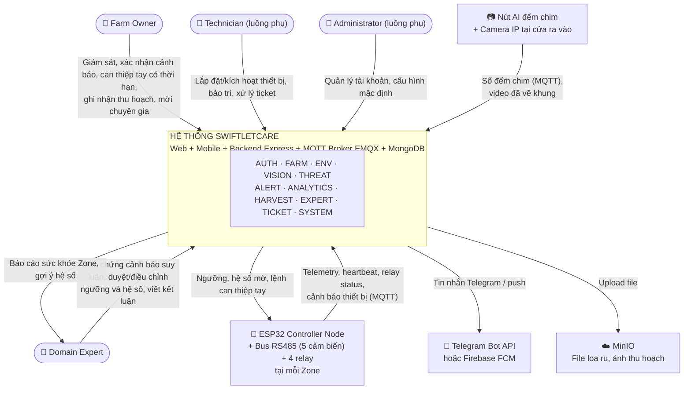
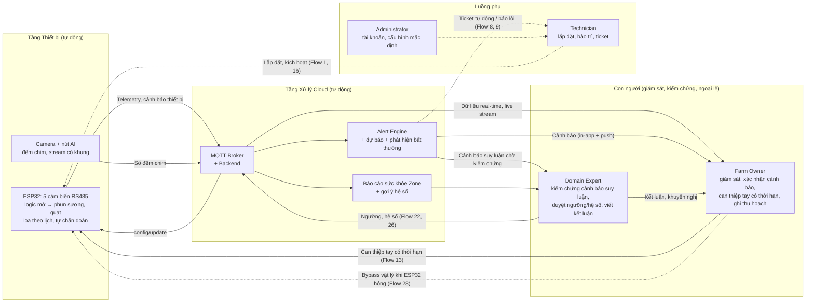

# Software Requirements Specification (SRS)

## SwiftletCare: An Automated Environmental Control and Multi-Modal Health Monitoring System for Swiftlet Farming

---

| Trường thông tin        | Nội dung                            |
| ----------------------- | ----------------------------------- |
| **Tên dự án**           | SwiftletCare                        |
| **Phiên bản SRS**       | 2.1.3                               |
| **Ngày tạo**            | 07/09/2026                          |
| **Thời gian thực hiện** | Tháng 7/2026 – Tháng 12/2026 (FA26) |
| **Chuyên ngành**        | Software Engineering (SE)           |
| **Loại đồ án**          | Capstone Project – KLTN             |

---

## MỤC LỤC

0. [Phạm vi v2.0.0 sau Review 1 — đọc trước](#0-phạm-vi-v200-sau-review-1--đọc-trước)
1. [Giới thiệu](#1-giới-thiệu)
2. [Mô tả Tổng quan Hệ thống](#2-mô-tả-tổng-quan-hệ-thống)
3. [Kiến trúc Hệ thống](#3-kiến-trúc-hệ-thống)
4. [Các Tác nhân (Actors)](#4-các-tác-nhân-actors)
5. [Yêu cầu Chức năng](#5-yêu-cầu-chức-năng)
6. [Yêu cầu Phi chức năng](#6-yêu-cầu-phi-chức-năng)
7. [Đặc tả Phần cứng & BOM](#7-đặc-tả-phần-cứng--bom)
8. [Mô hình Dữ liệu](#8-mô-hình-dữ-liệu)
9. [Đặc tả Giao diện & API](#9-đặc-tả-giao-diện--api)
10. [Luồng Xử lý Nghiệp vụ (Flows)](#10-luồng-xử-lý-nghiệp-vụ-flows)
11. [Yêu cầu AI / Computer Vision](#11-yêu-cầu-ai--computer-vision)
12. [Yêu cầu Bảo mật](#12-yêu-cầu-bảo-mật)
13. [Kế hoạch Kiểm thử](#13-kế-hoạch-kiểm-thử)
14. [Phân công & Lịch trình](#14-phân-công--lịch-trình)
15. [Quản lý Rủi ro (Risk Register)](#15-quản-lý-rủi-ro-risk-register)
16. [Giả định, Ràng buộc & Phạm vi Loại trừ](#16-giả-định-ràng-buộc--phạm-vi-loại-trừ)
17. [Vận hành, Triển khai & Tuân thủ Dữ liệu](#17-vận-hành-triển-khai--tuân-thủ-dữ-liệu)
18. [Tiêu chí Nghiệm thu (Definition of Done)](#18-tiêu-chí-nghiệm-thu-definition-of-done)
19. [Bảng Thuật ngữ](#19-bảng-thuật-ngữ)

---

## 0. Phạm vi v2.0.0 sau Review 1 — đọc trước

> **Nguồn:** phiếu đăng ký đề tài bản sửa `FA26_SE_Capstone_Project_Register_SwiftletCare_v2.docx`, lập sau nhận xét của hội đồng Review 1. Hội đồng các vòng sau đánh giá hệ thống theo phiếu này. **Khi phần còn lại của SRS mâu thuẫn với mục 0, mục 0 và phiếu v2 thắng.** Các ghi chú `[v1.x]` cũ được giữ làm lịch sử.
>
> **Ký hiệu trạng thái mới:** `🔄 Cần sửa code (v2.0.0)` = code đang chạy theo phạm vi cũ, phải sửa cho khớp. `❌ Ngoài phạm vi v2.0.0` = không làm nữa, giữ ID để các tham chiếu không lệch.

### 0.1. Định hướng

SwiftletCare là một **hệ thống** điều khiển và giám sát tự động, không phải nền tảng nghiệp vụ: nhà yến tự điều tiết và tự bảo vệ; con người giám sát, kiểm chứng và chỉ can thiệp như ngoại lệ. Ba thành phần chính:

1. **Điều khiển vi khí hậu tự động** — ESP32 đọc 5 cảm biến RS485, lọc tín hiệu, điều khiển phun sương và quạt bằng logic mờ, phát loa dẫn dụ theo lịch; chạy được khi mất mạng.
2. **Đếm chim ra/vào bằng thị giác máy tính** — YOLOv8 + ByteTrack, tính tỷ lệ quay về, phát video trực tiếp có vẽ khung trên từng con chim.
3. **Giám sát sức khỏe đa phương thức có chuyên gia trong vòng lặp** — kết hợp cảm biến môi trường, mức ồn và số đếm chim; hệ thống là chuyên gia tự động chính, một Chuyên gia (Domain Expert) là người thật kiểm chứng kết luận và tinh chỉnh thông số.

### 0.2. Quyết định phạm vi

| #   | Quyết định | Nơi bị ảnh hưởng trong SRS |
| --- | --- | --- |
| 1   | Bỏ Buyer và Marketplace; chỉ giữ **ghi nhận thu hoạch** | Mục 5.8 (MARKET-FR-006..013 bỏ), Flow 7, `nest_listings`, `contact_inquiries`, `/marketplace/*` |
| 2   | **Farm Operator bị thay bằng Domain Expert** (role `DOMAIN_EXPERT`, phạm vi cả farm, không còn `zone_ids`) | AUTH-FR-004/005, mục 4.1, 4.4, 5.12, Flow 12, Flow 26 |
| 3   | Bỏ phát hiện thiên địch qua camera | THREAT-FR-001..004, VISION-FR-003, Flow 4, mục 11 |
| 4   | Đếm chim: 1 class `swiftlet`, stream có vẽ khung; nút AI là PC tại nhà yến hoặc máy chủ cloud, không dùng Raspberry Pi | Mục 5.4, 7.3, Flow 3, mục 11; chi tiết ở `docs/bird-counting-plan.md` |
| 5   | Âm thanh chỉ dùng **mức ồn**: hỏng loa (`SPEAKER_FAILURE`) và ồn bất thường (`NOISE_ANOMALY`, đổi tên từ `BIRD_PANIC`); không phân loại tiếng kêu | THREAT-FR-005/007/008, Flow 25 |
| 6   | Bỏ sưởi | ENV-FR-012, relay `heating` |
| 7   | NH3 và CO2 chỉ **theo dõi và cảnh báo**, không điều khiển quạt (chưa có ngưỡng nào được xác lập cho nhà yến trong tài liệu; NH3 chủ yếu từ phân chim, thứ người nuôi còn dùng để dẫn dụ) | ENV-FR-006/007/011/022, ALERT-FR-012, Flow 24 |
| 8   | Thông báo: trong ứng dụng + trên điện thoại qua **Telegram bot hoặc push**; bỏ Zalo và SMS | ALERT-FR-002..005, ALERT-FR-013 |
| 9   | Can thiệp tay là **đường ngoại lệ**: có thời hạn, có lịch sử; thêm công tắc bypass vật lý | ENV-FR-016..019, ENV-FR-023, Flow 13, Flow 28 |
| 10  | Bơm chạy khô thì tự ngừng phun; cảm biến lỗi thì vòng điều khiển về trạng thái an toàn | THREAT-FR-011/013, Flow 27 |
| 11  | Technician, Administrator và ticket là **luồng phụ**, không phát triển thêm | Mục 5.9, 5.11 |
| 12  | Phải có bằng chứng đo được: tỷ lệ thời gian tự động, % trong ngưỡng, độ chính xác đếm, xác nhận ngưỡng của người nuôi yến | Mục 6.8, 13.6, VISION-FR-016, ANALYTICS-FR-011 |
| 13  | **[v2.1.0]** Các **tham số phát hiện** (ồn bất thường, bơm chạy khô, hỏng loa, tỷ lệ chim về giảm) không còn là hằng số trong code: Domain Expert chỉnh được theo từng Zone, có lịch sử và giới hạn hợp lệ | EXPERT-FR-008, THREAT-FR-006/007/011, VISION-FR-011, Flow 25, Flow 26 |

### 0.3. Vai trò

| Vai trò | Vị trí | Làm gì |
| --- | --- | --- |
| **Farm Owner** | Luồng chính | Quản lý farm/House/Zone, giám sát, xem đếm chim và live stream, nhận và xác nhận cảnh báo, can thiệp tay có thời hạn, ghi nhận thu hoạch, mời Domain Expert, đọc kết luận của chuyên gia |
| **Domain Expert** | Luồng chính | Người có chuyên môn nuôi yến, do Primary Owner mời. Chỉ đọc dữ liệu vận hành; kiểm chứng cảnh báo suy luận; duyệt/điều chỉnh ngưỡng và hệ số logic mờ; viết kết luận cho Farm Owner. Không điều khiển relay, không tạo ticket, không ghi nhận thu hoạch |
| **Technician** | Luồng phụ | Lắp đặt, kích hoạt thiết bị, cấp WiFi, bảo trì, OTA |
| **Administrator** | Luồng phụ | Quản lý tài khoản và cấu hình mặc định toàn hệ thống |

Buyer không còn là actor.

### 0.4. Luồng chính của phiếu v2 và Flow tương ứng trong SRS

| Luồng trong phiếu v2 | Flow trong SRS (mục 10) |
| --- | --- |
| 1. Điều tiết vi khí hậu tự động | Flow 2 |
| 2. Giám sát chất lượng không khí (NH3/CO2 chỉ cảnh báo) | Flow 24 |
| 3. Vận hành khi mất mạng và phục hồi | Flow 14, REL-NFR-001..003 |
| 4. Xử lý lỗi thiết bị (bơm khô, cảm biến, loa) | Flow 27, Flow 8, Flow 5 |
| 5. Cảnh báo sớm theo dự báo | ALERT-FR-011, ANALYTICS-FR-009 |
| 6. Phiên đếm chim | Flow 3 |
| 7. Ồn bất thường | Flow 25 |
| 8. Chuyên gia kiểm chứng và tinh chỉnh | Flow 26 |
| 9. Can thiệp tay và bypass | Flow 13, Flow 28 |
| Luồng phụ: lắp đặt và kích hoạt | Flow 1, 1b, 9, 9b, 15, 20, 21, 23 |

### 0.5. Việc cần sửa code theo module

Mỗi dòng là một việc; mã FR trỏ tới yêu cầu chi tiết ở mục 5. `docs/api/api-spec.yaml` là hợp đồng API và phải được sửa **trong cùng PR** với thay đổi route tương ứng.

**Firmware (`firmware/`)** — đã làm ở firmware 1.3.0 (build + unit test trên máy; chưa nạp và thử trên thiết bị thật)

- [x] ENV-FR-011 — bỏ NH3/CO2 khỏi bộ mờ của quạt và bỏ chốt "khí vượt ngưỡng thì ép quạt 100%" (`pid/FuzzyControl.cpp`, `rawGasOverMax` trong `pid/PIDController.cpp`); sửa `test/test_fuzzy`.
- [x] ENV-FR-012 — gỡ `runHeatingControl` và relay/override `heating`; kênh IN4 để dự phòng.
- [x] THREAT-FR-011 — khi phát hiện `PUMP_DRY`, ngừng phun sương tới hết đợt (hiện chỉ báo, chưa ngắt).
- [x] THREAT-FR-013 — xác nhận và viết test cho trạng thái an toàn khi cảm biến nhiệt-ẩm mất hoặc trả giá trị sai.
- [x] THREAT-FR-007 — đổi loại cảnh báo `BIRD_PANIC` thành `NOISE_ANOMALY`.
- [ ] ENV-FR-023 — (phần cứng) công tắc 3 vị trí Auto/Off/Hand cho bơm và quạt; đọc trạng thái công tắc là tùy chọn.
- [x] EXPERT-FR-008 — nhận 5 tham số phát hiện qua `config/update` (`noise_margin_db`, `noise_min_sec`, `pump_dry_on_sec`, `pump_dry_min_rise_pct`, `speaker_drop_pct`), lưu NVS, tự kẹp vào khoảng hợp lệ; thay cho các hằng số hiện tại trong `Config.h`/`PIDController.cpp`/`PanicDetector`; thêm unit test.

**Backend (`backend/`)** — đã làm; DB cũ chạy `npm run migrate:scope-v2`

- [x] AUTH-FR-004/005 — đổi role `FARM_OPERATOR` thành `DOMAIN_EXPERT`; bỏ `zone_ids` và toàn bộ phạm vi theo Zone (`operatorZoneScope`, `applyZoneScope`, `hasZoneAccess` trong `utils/farmAccess.util.ts`); bỏ `PUT /farms/:id/members/:userId`; viết migration cho user/farm/invitation cũ.
- [x] Mục 4.4 — phân quyền Domain Expert: chỉ đọc dashboard/analytics/cảnh báo/thu hoạch; được sửa ngưỡng và hệ số mờ; không relay, không ticket, không ghi thu hoạch.
- [x] Mục 5.8 — gỡ `/marketplace/*`, model `nestListing`, `contactInquiry` và service liên quan; giữ `harvestBatch` (bỏ trạng thái `LISTED`).
- [x] ENV-FR-011 — đồng bộ `utils/fuzzyModel.util.ts` với firmware (bỏ luật khí); chạy lại test dùng chung case.
- [x] ENV-FR-012 — bỏ `heating` khỏi `relay_states`, validator và lệnh relay.
- [x] THREAT-FR-007, EXPERT-FR-003 — enum `NOISE_ANOMALY` (migration từ `BIRD_PANIC`), trường `alerts.expert_verdict`, `PUT /alerts/:id/verdict`.
- [x] ALERT-FR-012 — `THRESHOLD_BREACH` của NH3/CO2 ở mức MEDIUM, không tự sinh ticket.
- [x] ENV-FR-019, ANALYTICS-FR-011 — collection `relay_override_logs`, API lịch sử, chỉ số tỷ lệ thời gian tự động.
- [x] EXPERT-FR-005/006/007 — `zone_health_reports`, job tổng hợp hàng tuần, API báo cáo và kết luận, thông báo cho Farm Owner/Domain Expert. Còn thiếu của EXPERT-FR-007: thông báo riêng khi có cảnh báo suy luận chờ kiểm chứng (hiện xem qua `GET /alerts?verdict=pending`).
- [x] EXPERT-FR-008 — `zones.detection_tuning` + `detection_tuning_history`, `PUT /farms/zones/:zoneId/detection-tuning` (kiểm tra khoảng, audit `DETECTION_TUNING_UPDATED`), đưa 5 tham số của firmware vào `buildDeviceConfig`; xu hướng tỷ lệ chim về đọc `return_rate_drop_pct` của Zone thay cho hằng số 20% (job sinh cảnh báo `LOW_RETURN_RATE` thuộc đợt đếm chim, chưa làm).
- [x] ALERT-FR-013 / ALERT-FR-002 — nối **ít nhất một** kênh ngoài ứng dụng chạy thật: Telegram bot (nhanh nhất — thêm `sendTelegram` cạnh `sendPush` trong `services/notification.service.ts`, lưu `telegram_chat_id` của user) hoặc Firebase FCM (hiện chỉ ghi log). Adapter Zalo/SMS để nguyên, không nối. Đã chọn Telegram; cần đặt `TELEGRAM_BOT_TOKEN`/`TELEGRAM_BOT_USERNAME` để gửi thật.

**Giả định kỹ thuật chưa có nguồn — cần nhóm xác nhận hoặc đo thực tế**

Các mốc dưới đây do người viết code chọn để hệ thống chạy được, **không** lấy từ tài liệu nuôi yến và chưa đo ở nhà yến thật. Chúng là hằng số trong code (chưa chỉnh được từ giao diện); khi có số đo thì sửa, hoặc đưa vào tham số của Domain Expert (EXPERT-FR-008) nếu nhóm thấy cần.

| Mốc | Giá trị | Ở đâu | Dùng để |
| --- | --- | --- | --- |
| Tự thử phun lại sau khi chốt bơm khô | 30 phút | firmware `PUMP_DRY_RETRY_MIN` | Một lần báo nhầm không làm mất phun sương vô thời hạn (THREAT-FR-011) |
| Độ ẩm còn tính là hợp lệ | tới 101 % | firmware `HUMIDITY_SATURATION_MAX`, backend `fuzzyModel.util.ts` | Dung sai cảm biến khi bão hoà lúc đang phun (THREAT-FR-013) |
| Gửi lại cảnh báo theo đợt khi còn tiếp diễn | 15 phút | firmware `EPISODE_ALERT_RESEND_MS` | Backend biết đợt `NOISE_ANOMALY`/`PUMP_DRY` chưa hết |
| Tự đóng cảnh báo theo đợt không còn ghi nhận lại | 60 phút | backend `EPISODE_CLEAR_MS` | Lần tái phát sau đó là cảnh báo mới (ALERT-FR-008). Phải lớn hơn mốc 15 phút ở trên — hai hằng số ở hai module, giữ khớp bằng tay |
| Số đo nhiệt-ẩm hợp lệ gần nhất còn dùng được | 2 chu kỳ điều khiển (20 giây) | firmware `CONTROL_INPUT_MAX_AGE_CYCLES` | Một lần đọc RS485 lỗi không tắt relay; quá mốc này mới vào trạng thái an toàn (THREAT-FR-013) |
| Bỏ qua bản tin AUTO sau khi vừa bật tay | 30 giây | backend `DEVICE_CONFIRM_GRACE_MS` | Bản tin phát trước lệnh mà tới sau không huỷ override vừa đặt |
| Thời hạn tối đa của 1 lần can thiệp tay | 24 giờ | backend `MAX_OVERRIDE_MS` | Chặn override vô hạn làm sai tỷ lệ thời gian tự động (ENV-FR-018/019) |
| Thời hạn tối thiểu của 1 lần can thiệp tay | 1 phút (2 × cửa sổ 30 giây ở trên) | backend `MIN_OVERRIDE_MS` | Override ngắn hơn cửa sổ bỏ qua bản tin AUTO thì lúc thiết bị tự hết hạn, bản tin AUTO bị coi là cũ |

Việc nên làm về sau (đổi giao thức MQTT giữa firmware và backend, không thuộc đợt này): gắn mã lệnh vào `relay/command` và `relay/status` thay cho cửa sổ 30 giây; firmware gửi tín hiệu "hết đợt" thay cho cặp mốc 15/60 phút (thiết bị chạy firmware < 1.3.0 chỉ báo một lần nên đợt dài hơn 60 phút bị đóng sớm).

**Web (`frontend/`)**

- [ ] Gỡ `MarketplacePage`, `ListingDetailPage`, route công khai của marketplace, `useMarketplace` và API tương ứng; gỡ nốt code `sales-staff/` cũ.
- [ ] Role `DOMAIN_EXPERT`: nhóm role và `MENU_ACCESS` trong `constants/roles.ts`, layout chuyên gia (thay cho `FarmOperatorLayout`), các trang: báo cáo sức khỏe Zone, kiểm chứng cảnh báo, duyệt gợi ý hệ số, chỉnh tham số phát hiện (EXPERT-FR-008 — đặt cạnh tỷ lệ cảnh báo được xác nhận của từng loại).
- [ ] Farm Owner: lịch sử can thiệp tay, thẻ "tỷ lệ thời gian tự động", đọc kết luận của chuyên gia, live stream có khung và số đếm trực tiếp.
- [ ] Bỏ relay sưởi khỏi giao diện; NH3/CO2 ghi rõ là ngưỡng cảnh báo do chuyên gia đặt.
- [ ] Nhãn `NOISE_ANOMALY` (thay `BIRD_PANIC`), hiển thị kèm số đếm chim cùng khoảng thời gian.

**Mobile (`mobile/`)**

- [ ] Đồng bộ enum role và loại cảnh báo; bỏ tùy chọn kênh Zalo/SMS.
- [ ] Đăng ký FCM token và nhận push; màn hình live stream có khung; Farm Owner đọc kết luận của chuyên gia.
- [ ] Domain Expert trên mobile: tối thiểu xem dashboard và báo cáo; thao tác kiểm chứng/tinh chỉnh ưu tiên làm trên web.

**AI pipeline (`ai-pipeline/`)**

- [ ] VISION-FR-001..007, 013, 014, 016 — làm theo `docs/bird-counting-plan.md`: 1 class `swiftlet`, đếm qua vạch ảo, publish số đếm qua MQTT, phát stream đã vẽ khung, đo độ chính xác trên video quay sẵn.

---

## 1. Giới thiệu

### 1.1. Mục đích Tài liệu

Tài liệu này là Đặc tả Yêu cầu Phần mềm (Software Requirements Specification – SRS) cho hệ thống **SwiftletCare**. Tài liệu mô tả đầy đủ và chính xác tất cả các yêu cầu chức năng, phi chức năng, ràng buộc kỹ thuật, kiến trúc hệ thống và tiêu chí chấp nhận của đồ án tốt nghiệp. SRS này được sử dụng làm căn cứ để:

- Đội phát triển thiết kế, xây dựng và kiểm thử hệ thống.
- Giảng viên hướng dẫn và hội đồng đánh giá xem xét phạm vi đồ án.
- Các bên liên quan hiểu rõ giá trị và giới hạn của sản phẩm.

### 1.2. Phạm vi Hệ thống

**SwiftletCare** là một **hệ thống điều khiển và giám sát tự động** cho nhà yến, gồm bộ điều khiển nhúng tại từng Zone, camera AI đếm chim tại cửa ra vào, và backend đám mây cùng ứng dụng web/mobile. Hệ thống giải quyết 4 bài toán:

| #   | Bài toán                                                 | Giải pháp                                                         |
| --- | -------------------------------------------------------- | ----------------------------------------------------------------- |
| 1   | Điều khiển vi khí hậu thủ công, phụ thuộc người vận hành | Điều khiển vòng kín bằng logic mờ, tự động 24/7 trên ESP32 (chạy được khi mất mạng) |
| 2   | Không thể theo dõi số lượng đàn chim chính xác           | AI Camera đếm chim ra/vào theo thời gian thực                     |
| 3   | Sự cố thiết bị và bất thường phát hiện trễ               | Giám sát sức khỏe đa phương thức (cảm biến môi trường + mức ồn + camera đếm chim) và tự chẩn đoán thiết bị — **[v2.0.0]** không còn phát hiện thiên địch |
| 4   | Không ai đảm bảo các quyết định tự động là đúng          | **[v2.0.0]** Chuyên gia nuôi yến (Domain Expert) kiểm chứng kết luận và tinh chỉnh thông số; hệ thống là chuyên gia tự động chính (mục 5.12). Marketplace/truy xuất nguồn gốc cho người mua đã bị loại bỏ |

> **[Cập nhật v2.0.0]** Hệ thống có **4 vai trò người dùng**: **Farm Owner** và **Domain Expert** (luồng chính), **Technician** và **Administrator** (luồng phụ). So với v1.23.0–v1.24.0: bỏ **Buyer** cùng Marketplace, thay **Farm Operator** bằng **Domain Expert**. Toàn bộ quyết định phạm vi sau Review 1 xem **mục 0**. Mô hình 3 giai đoạn ở mục 2.4 chỉ còn giá trị lịch sử — phạm vi nghiệm thu là phạm vi của phiếu v2.

### 1.3. Tài liệu Tham chiếu

- `FA26_SE_Capstone_Project_Register_SwiftletCare.docx` – Phiếu đăng ký đề tài KLTN
- `FA26_SE_Capstone_Project_Register_SwiftletCare_v2.docx` – **[v2.0.0]** Phiếu đăng ký bản sửa sau Review 1 — căn cứ đánh giá hiện hành (mục 0)
- `docs/bird-counting-plan.md` – **[v2.0.0]** Kế hoạch triển khai đếm chim thời gian thực (Module VISION)
- `KLTN_2026_SwiftletCare_FA26.docx` – Đặc tả kỹ thuật phần cứng và Edge AI Vision (tài liệu ban đầu, không lưu trong repo)
- YOLOv8 Documentation – Ultralytics
- ByteTrack: Multi-Object Tracking by Associating Every Detection Box
- EMQX MQTT Broker Documentation
- Express.js Framework Documentation
- `BA_Review_ActivityFlow_SwiftletCare.md` (không lưu trong repo) – Đánh giá BA & thiết kế luồng nghiệp vụ **5 actor (Farmer, Buyer, Technician, Sales Staff, Admin)** — nội dung đã được hợp nhất vào SRS này. **[v1.23.0]** Mô hình actor hiện tại khác tài liệu gốc: không còn Sales Staff, có thêm Farm Operator (xem mục 2.2, 4.1). **[v2.0.0]** Farm Operator và Buyer cũng đã bị thay/bỏ — xem mục 0

### 1.4. Tổng quan Tài liệu

SRS được tổ chức theo chuẩn IEEE 830-1998 với các phần mở rộng cho hệ thống IoT/Edge AI. Mỗi yêu cầu chức năng được định danh duy nhất theo format `[MODULE]-FR-XXX` để dễ truy vết.

---

## 2. Mô tả Tổng quan Hệ thống

### 2.1. Bối cảnh Vấn đề

Nghề nuôi yến thương mại tại Việt Nam là ngành có giá trị kinh tế cao (tổ yến đạt 20–60 triệu đồng/kg), nhưng cực kỳ nhạy cảm với môi trường. Các vấn đề hiện tại:

- **Về môi trường:** Độ ẩm < 75% hoặc nhiệt độ > 31°C gây thoái hóa tổ, chim bỏ tổ, hoặc tỉ lệ tử vong non cao. Hầu hết nông dân dùng cảm biến rời lẻ, phải kiểm tra thủ công nhiều lần/ngày.
- **Về quản lý đàn:** Không có cơ chế đánh giá tự động số lượng chim ra/vào hàng ngày — chỉ số then chốt nhất để đánh giá sức khỏe đàn và dự báo năng suất thu hoạch.
- **Về sự cố:** Sự cố thiết bị (hỏng loa dẫn dụ, bơm cạn nước, cảm biến sai, mất điện) hiện chỉ được phát hiện khi chủ nhà kiểm tra trực tiếp, thường quá muộn. **[v2.0.0]** Phát hiện thiên địch (chuột, rắn, cú) nằm ngoài phạm vi.
- **Về độ tin cậy của tự động hóa:** một nhà yến tự động cần người có chuyên môn kiểm chứng ngưỡng và kết luận của hệ thống.

### 2.2. Đối tượng Người dùng Mục tiêu

> **[Cập nhật v2.0.0 — Domain Expert thay Farm Operator]** Phía Farm có 2 vai trò: **Farm Owner** (chủ farm — 1 Primary Owner tự đăng ký + các đồng sở hữu được mời) và **Domain Expert** (người có chuyên môn nuôi yến, do Primary Owner mời, phạm vi cả farm). Hội đồng Review 1 đặt câu hỏi "ai đảm bảo hệ thống tự động quyết định đúng" — Domain Expert trả lời câu hỏi đó: xem dữ liệu, kiểm chứng cảnh báo suy luận, duyệt/điều chỉnh ngưỡng và hệ số, viết kết luận cho Farm Owner. Vai trò Farm Operator (nhân viên vận hành theo Zone, v1.23.0) bị bỏ; việc vận hành tại chỗ thuộc về Farm Owner. 1 email = 1 role.

| Vai trò           | Thuộc về                                    | Mô tả                                                                                                                                                                                                                                                                                                                   |
| ----------------- | ------------------------------------------- | ----------------------------------------------------------------------------------------------------------------------------------------------------------------------------------------------------------------------------------------------------------------------------------------------------------------------- |
| **Farm Owner**    | Phía khách hàng (Farm)                      | Chủ nhà yến; 1 Farm có 1 tài khoản Primary Owner tự đăng ký, có thể mời thêm đồng sở hữu (quyền quản lý như chủ) hoặc **[v2.0.0]** Domain Expert; quản lý farm/House/Zone, thành viên, ghi nhận thu hoạch |
| **Technician**    | Phía công ty SwiftletCare                   | Nhân viên hỗ trợ kỹ thuật: lắp đặt phần cứng, xử lý ticket sự cố theo SLA, bảo trì định kỳ; **[mới v1.16.0]** quản lý cấu trúc Farm (danh sách, House/Zone) trong `assigned_regions` phụ trách (FARM-FR-009); chat trực tiếp với Farm Owner theo từng ticket (TICKET-FR-014)                                            |
| **Domain Expert** | **[mới v2.0.0]** Phía khách hàng (Farm) | Người có chuyên môn nuôi yến, do Primary Owner mời (phạm vi cả farm): xem dashboard/camera/analytics và báo cáo sức khỏe Zone, kiểm chứng cảnh báo suy luận, duyệt/điều chỉnh ngưỡng và hệ số logic mờ, viết kết luận và khuyến nghị cho Farm Owner. **Không** điều khiển relay, không tạo ticket, không ghi nhận thu hoạch, không quản lý farm/thành viên (mục 5.12) |
| ~~Buyer~~         | —                                           | **[Đã loại bỏ v2.0.0]** cùng Marketplace (mục 5.8) |
| **Administrator** | Phía công ty SwiftletCare                   | Quản trị nền tảng: tài khoản, cấu hình hệ thống toàn cục; **[mới v1.16.0]** quản lý cấu trúc Farm toàn hệ thống không giới hạn vùng (FARM-FR-009), audit log/cấu hình ngưỡng mặc định/tổng quan sức khỏe hệ thống (Module SYSTEM, mục 5.11) |

### 2.4. Phạm vi KLTN (v2.0.0)

> **[v2.0.0]** Mô hình "3 giai đoạn" của các bản trước được thay bằng 3 nhóm dưới đây, theo phiếu đăng ký bản sửa.

| Giai đoạn　　　　　　　　　　　　　　　　　　　　　　  | Mục tiêu                                                      | Phạm vi chính                                                                                                                                                                                                                                                                                                                                                            |                                                      Thuộc phạm vi KLTN?                                                      |
| ------------------------------------------------------ | ------------------------------------------------------------- | ------------------------------------------------------------------------------------------------------------------------------------------------------------------------------------------------------------------------------------------------------------------------------------------------------------------------------------------------------------------------ | :---------------------------------------------------------------------------------------------------------------------------: |
| 🟢 **Phạm vi nghiệm thu (v2.0.0)** | Hệ thống nhà yến tự điều tiết, tự chẩn đoán, có chuyên gia kiểm chứng | Điều khiển vi khí hậu tự động, đếm chim + live stream có khung, giám sát sức khỏe đa phương thức, Domain Expert, cảnh báo, can thiệp tay có thời hạn, ghi nhận thu hoạch, bằng chứng thực nghiệm (mục 0) | ✅ **Có — theo phiếu v2** |
| 🟡 **Luồng phụ (đã có, không phát triển thêm)** | Phục vụ triển khai và hỗ trợ | Technician lắp đặt/kích hoạt/bảo trì/OTA, ticket + SLA + chat, Administrator quản lý tài khoản và cấu hình | ⚠️ **Giữ nguyên hiện trạng — không thuộc luồng chính** |
| 🔵 **Ngoài phạm vi** | — | Marketplace/Buyer, phát hiện thiên địch, phân loại tiếng kêu, sưởi, Zalo/SMS, điều khiển theo NH3/CO2, automation rule builder, multi-tenant SaaS | ❌ **Không làm** |

**Ý nghĩa với nhóm phát triển:** mọi công sức mới dồn vào nhóm "Phạm vi nghiệm thu" — thứ tự ưu tiên: (1) đếm chim chạy thật có số đo, (2) khép các vòng tự động đã cam kết, (3) vai trò Domain Expert, (4) số liệu thực nghiệm. Luồng phụ chỉ sửa khi bị ảnh hưởng bởi thay đổi role hoặc loại cảnh báo.

Sản phẩm đầu ra theo phiếu v2 (phiếu gộp P1 và P2 thành một sản phẩm, tổng cộng **5**):

| #   | Sản phẩm                          | Mô tả                                                                |
| --- | --------------------------------- | -------------------------------------------------------------------- |
| P1  | **Hardware Controller Prototype** | Bo mạch IoT ESP32 tích hợp cảm biến + relay, đóng gói trong hộp IP65 |
| P2  | **AI Camera Node**                | Camera IP tại cửa chim ra vào + nút AI (PC tại nhà yến hoặc máy chủ cloud) chạy YOLOv8/ByteTrack |
| P3  | **Trained AI Model**              | Mô hình đếm chim ra/vào (1 class `swiftlet`, ONNX) kèm kết quả đánh giá |
| P4  | **Web & Mobile Application**      | Web Dashboard (React) + Mobile App (React Native/Expo) cho Farm Owner và Domain Expert |
| P5  | **Cloud Backend**                 | Node.js + Express API + MQTT Broker + Time-series DB + Alert Service |
| P6  | **Báo cáo đánh giá**              | Hiệu quả điều khiển, độ chính xác đếm, độ trễ, kết quả các kịch bản mất mạng/lỗi thiết bị (mục 13.6) |

---

## 3. Kiến trúc Hệ thống

### 3.1. Mô hình Phân tầng (Tiered Edge AI & IoT Architecture)

```
┌─────────────────────────────────────────────────────────────┐
│                    TIER 3: CLOUD LAYER                      │
│  Express API ──── MongoDB ──── Redis ──── S3/MinIO          │
│  EMQX MQTT Broker ─── Alert Service (in-app/Telegram/FCM)  │
└────────────────────────┬───────────────────────────────────┘
                         │ Internet cáp quang (MQTT, RTSP)
┌────────────────────────▼───────────────────────────────────┐
│              TIER 2: EDGE GATEWAY (Modem)                  │
│  Modem cáp quang, IP tĩnh ─── Local LAN/Wi-Fi              │
└────────┬───────────────────────────────────────┬───────────┘
         │ Wi-Fi (MQTT)                          │ LAN (RTSP)
┌────────▼───────────────────┐    ┌─────────────▼───────────┐
│  TIER 1A: ESP32 NODE       │    │  TIER 1B: EDGE AI NODE  │
│  Modbus RTU Master (RS485) │    │  PC x86 / máy chủ cloud │
│  RS485 Bus → 5 Sensors     │    │  YOLOv8 + ByteTrack     │
│  GPIO → 4-ch Relay         │    │  IP Camera (RTSP)       │
│  Fuzzy closed-loop         │    │  IR, stream có vẽ khung │
│  IP65–IP67 Industrial Grade│    │  FullHD Resolution      │
└────────────────────────────┘    └─────────────────────────┘
```

### 3.2. Stack Công nghệ

| Tầng                  | Công nghệ                                                                                                 | Lý do Chọn                                                                              |
| --------------------- | --------------------------------------------------------------------------------------------------------- | --------------------------------------------------------------------------------------- |
| **Firmware/Embedded** | ESP32-WROOM-32D, FreeRTOS, Arduino Framework, RS485 Modbus RTU (ModbusMaster/eModbus), MAX485 Transceiver | Dual-core 240MHz, Wi-Fi tích hợp, MQTT native, RS485 bus cho cảm biến công nghiệp IP65+ |
| **Nút AI đếm chim**   | PC x86 tại nhà yến hoặc máy chủ cloud; Python, ONNX Runtime, `supervision` (ByteTrack), OpenCV, ffmpeg, MediaMTX | **[v2.0.0]** Không dùng Raspberry Pi — chi tiết ở `docs/bird-counting-plan.md` |
| **AI Model**          | YOLOv8n (1 class `swiftlet`), ByteTrack                                                                    | Phát hiện + theo vết gọn nhẹ cho đếm qua vạch ảo                                        |
| **AI Training**       | Roboflow/CVAT, Google Colab GPU, ONNX                                                                     | Pipeline annotation → quantize → deploy                                                 |
| **MQTT Broker**       | EMQX                                                                                                      | Pub/Sub IoT protocol, low latency                                                       |
| **Backend**           | Node.js + Express, JavaScript/TypeScript                                                                  | Nhẹ, linh hoạt, hệ sinh thái npm lớn, WebSocket (socket.io)                             |
| **Database**          | MongoDB (telemetry), Redis (cache/session)                                                                | Phù hợp time-series IoT, schema linh hoạt                                               |
| **File Storage**      | MinIO                                                                                                     | File loa ru, ảnh thu hoạch                                                              |
| **Web Dashboard**     | React.js, TailwindCSS, Chart.js                                                                           | SPA dashboard, real-time chart components                                               |
| **Web dạng PWA**      | ReactJS, TailwindCSS, Vite (`vite-plugin-pwa`)                                                            | Web dashboard cài được như ứng dụng trên điện thoại                                     |
| **Mobile App**        | React Native (Expo Router), React Query, Zustand, socket.io-client                                        | **[v2.0.0]** Ứng dụng di động theo phiếu v2; dùng chung backend với web                 |
| **Notification**      | Thông báo trong ứng dụng (Socket.io) + Telegram Bot API hoặc Firebase FCM (push)                          | **[v2.0.0]** Bỏ Zalo ZNS và SMS; thêm Telegram                                                         |

---

## 4. Các Tác nhân (Actors)

> **[Cập nhật v2.0.0]** Hệ thống có **4 actor người dùng**: **Farm Owner**, **Domain Expert**, **Technician**, **Administrator** (bỏ Buyer cùng Marketplace; Domain Expert thay Farm Operator). Phía Farm phân biệt 3 mức: **Primary Owner** (người tạo Farm — thêm quyền xóa Farm, mời/gỡ thành viên, đổi khu vực `region`), **đồng sở hữu** (Farm Owner được mời — quyền vận hành và quản lý farm như chủ) và **Domain Expert** (chuyên gia nuôi yến được mời — chỉ đọc dữ liệu vận hành, kiểm chứng và tinh chỉnh thông số, phạm vi cả farm). Role lưu ở `users.role`, thành viên ở `farms.members[]` (mục 8.2).

### 4.1. Actor Bên Ngoài

| Actor             | Mô tả                                                                                                                                                                                                              | Quyền hạn                                                                                                                                                                                                                                                                                                                                                                                                                                                                                                                                                                                                                                                                                                                                          | Tài khoản được tạo bởi                                                                                                                  |
| ----------------- | ------------------------------------------------------------------------------------------------------------------------------------------------------------------------------------------------------------------ | -------------------------------------------------------------------------------------------------------------------------------------------------------------------------------------------------------------------------------------------------------------------------------------------------------------------------------------------------------------------------------------------------------------------------------------------------------------------------------------------------------------------------------------------------------------------------------------------------------------------------------------------------------------------------------------------------------------------------------------------------- | --------------------------------------------------------------------------------------------------------------------------------------- |
| **Farm Owner**    | Chủ nhà yến; mỗi Farm có 1 Primary Owner + có thể có thêm đồng sở hữu (Farm Owner được mời)                                                                              | Quản lý thông tin farm/house/zone (tạo, đổi tên, xóa mềm), **xem** dashboard thời gian thực của thiết bị đã được Technician lắp đặt & kích hoạt, **chỉnh thông số vận hành** (ngưỡng cảnh báo môi trường — ENV-FR-006, có thể **reset về mặc định hệ thống** — ENV-FR-020 mới v1.16.0, điều khiển relay thủ công — ENV-FR-016..018), tạo/xử lý ticket báo lỗi kèm **chat trực tiếp với Technician phụ trách** (TICKET-FR-014, mới v1.16.0), **ghi nhận thu hoạch**. Primary Owner có thêm quyền: xóa farm, đổi khu vực `region`, mời/gỡ đồng sở hữu và **Domain Expert (v2.0.0)**. **Không tự đăng ký/gỡ bỏ/thay thế thiết bị vật lý** — việc này thuộc về Technician (mô hình giống thợ lắp mạng/camera: khách hàng chỉ dùng, không tự đấu nối) | **Primary Owner: tự đăng ký** (AUTH-FR-001); **thành viên khác: được Primary Owner mời** (AUTH-FR-005)                                  |
| **Technician**    | Nhân viên hỗ trợ kỹ thuật **phía công ty SwiftletCare** (không thuộc farm)                                                                                                                                         | Lắp đặt phần cứng tại farm; **đăng ký/kích hoạt/gỡ bỏ/thay thế thiết bị vào đúng Farm→House→Zone qua Web Console Onboarding chuyên dụng** (bao gồm cấu hình WiFi thật cho thiết bị qua AP-mode ngay tại chỗ, không cần cắm USB nạp lại firmware mỗi lần lắp — FARM-FR-003/003b); tiếp nhận & xử lý ticket theo SLA, bảo trì định kỳ, đẩy OTA firmware; **[mới v1.16.0]** quản lý cấu trúc Farm (danh sách, House/Zone) trong `assigned_regions` phụ trách (FARM-FR-009, KHÔNG xem được Dashboard/Analytics môi trường như Farm Owner); chat trực tiếp với Farm Owner theo từng ticket (TICKET-FR-014..017)                                                                                                                                         | Administrator tạo, gán khu vực phụ trách                                                                                                |
| **Domain Expert** | **[mới v2.0.0]** Người có chuyên môn nuôi yến **phía khách hàng**, do Primary Owner mời; phạm vi **cả farm** | Xem (chỉ đọc) dashboard/camera/analytics, lịch sử cảnh báo, báo cáo sức khỏe Zone; **kiểm chứng cảnh báo suy luận** (xác nhận/bác bỏ kèm ghi chú); **duyệt/điều chỉnh ngưỡng Zone và hệ số logic mờ**, kể cả gợi ý của hệ thống; **viết kết luận và khuyến nghị** cho Farm Owner. **Không được:** điều khiển relay, chọn bài/lịch loa, tạo hay xử lý ticket, ghi nhận thu hoạch, xóa/sửa farm, mời/gỡ thành viên, tạo House/Zone | **Primary Owner mời** (AUTH-FR-005/010); đăng ký bằng email được mời thì tài khoản mang role `DOMAIN_EXPERT` |
| ~~Buyer~~         | **[Đã loại bỏ v2.0.0]** cùng Marketplace | — | — |
| **Administrator** | Quản trị nền tảng SwiftletCare                                                                                                                                                                                     | Quản lý tài khoản toàn hệ thống, cấu hình SLA/ngưỡng mặc định, audit log; **[mới v1.16.0]** quản lý cấu trúc Farm toàn hệ thống không giới hạn vùng (FARM-FR-009, KHÔNG xem chi tiết/thông số như Farm Owner), xem/duyệt Audit Log + cấu hình ngưỡng mặc định hệ thống thật + xem tổng quan sức khỏe hệ thống (Module SYSTEM, mục 5.11)                                                                                                                                                                                                                                                                                                | Tài khoản gốc hệ thống (seed/super-admin tạo)                                                                                           |

> **Ghi chú quan trọng (giải quyết mâu thuẫn của các bản trước):** Chốt lại: **Farm Owner (Primary) luôn tự đăng ký phần mềm** (AUTH-FR-001/002); đồng sở hữu và Domain Expert đều do Primary Owner mời (**[v2.0.0]** Domain Expert thay Farm Operator, phạm vi cả farm, không còn giới hạn theo Zone). **[Cập nhật — mô hình "công ty vận hành, khách hàng chỉ dùng", giống lắp mạng/camera an ninh]** Việc **đăng ký/kích hoạt thiết bị là một luồng nghiệp vụ chính thức trên Web, chỉ do Technician thực hiện** (không còn đường tự phục vụ song song cho Farm Owner như bản trước) — Farm Owner không tự quét QR/tự cấu hình thiết bị, chỉ nhận bàn giao thiết bị đã hoạt động và thao tác trên dữ liệu/thông số sau đó. Lý do: (1) khớp đúng mô hình kinh doanh — công ty SwiftletCare bán sản phẩm + vận hành nền tảng, không bàn giao đứt quyền kiểm soát kỹ thuật cho khách hàng; (2) việc lắp đặt vật lý (đấu dây RS485) vốn dĩ đã cần Technician có mặt tại farm, nên để họ hoàn tất luôn bước kích hoạt phần mềm trong cùng 1 lượt ghé thăm là hợp lý và giảm rủi ro cấu hình sai. Xem Flow 1/1b (mục 10) đã viết lại theo luồng Technician Web Console.

### 4.2. Actor Hệ thống (Background Services)

| Actor                         | Mô tả                                                                                                              |
| ----------------------------- | ------------------------------------------------------------------------------------------------------------------ |
| **ESP32 Controller Node**     | Thu thập cảm biến, lọc tín hiệu, điều khiển bằng logic mờ, tự chẩn đoán thiết bị, publish MQTT                     |
| **Nút AI đếm chim**           | **[v2.0.0]** PC tại nhà yến hoặc máy chủ cloud: chạy YOLOv8 + ByteTrack, publish số đếm, phát stream có vẽ khung   |
| **MQTT Broker (EMQX)**        | Trung gian message routing giữa edge và cloud                                                                      |
| **Alert Engine**              | Dịch vụ background phân tích sự kiện và gửi thông báo                                                              |
| **Telemetry Aggregator**      | Thu thập, validate, lưu time-series IoT data                                                                       |
| **Health Reporter**           | **[mới v2.0.0]** Job nền tổng hợp báo cáo sức khỏe Zone định kỳ cho Domain Expert và Farm Owner (EXPERT-FR-005)    |
| **Ticket Router**             | Dịch vụ nền tự động gán ticket cho Technician theo khu vực, theo dõi SLA và tự động escalate khi quá hạn (mục 5.9) |

### 4.3. Sơ đồ Ngữ cảnh Hệ thống (System Context Diagram)

> SwiftletCare là 1 hộp trung tâm, giao tiếp với **4 actor người dùng** (Farm Owner, Domain Expert, Technician, Administrator) và các hệ thống bên thứ 3. **[v2.0.0]** Bỏ Buyer, Zalo, SMS và Raspberry Pi.




### 4.4. Ma trận Phân quyền Tổng hợp (RACI rút gọn)

> Bổ sung theo BA Review để mọi thành viên team tra cứu nhanh "ai làm gì" khi thiết kế phân quyền API (middleware RBAC, mục 12.1). _R = Thực hiện, A = Phê duyệt/chịu trách nhiệm cuối, I = Được thông báo, "-" = không liên quan._

| Chức năng | Farm Owner | Domain Expert | Technician | Admin |
| --- | :---: | :---: | :---: | :---: |
| Đăng ký/đăng nhập | R (Primary tự đăng ký; đồng sở hữu được mời) | - (Primary Owner mời) | - (Admin tạo) | - (tài khoản gốc) |
| Xem Dashboard môi trường thời gian thực (ENV-FR-005) ⁵ | R | R (chỉ đọc) | - | - |
| Xem Analytics (xu hướng/so sánh/đếm chim), live stream ⁵ | R | R (chỉ đọc) | - | - |
| Xem báo cáo sức khỏe Zone (EXPERT-FR-005) | R | R | - | - |
| Xác nhận (acknowledge) cảnh báo, nhận push (ALERT-FR-009) | R | - | - | - |
| Kiểm chứng cảnh báo suy luận (EXPERT-FR-003) | I | R | - | - |
| Viết kết luận/khuyến nghị (EXPERT-FR-006) | I (đọc) | R | - | - |
| Can thiệp tay relay có thời hạn (ENV-FR-016) | R | - | R (khắc phục sự cố) | - |
| Chỉnh ngưỡng cảm biến theo Zone (ENV-FR-006) | R | R (duyệt/điều chỉnh) | - | - |
| Reset ngưỡng Zone về mặc định hệ thống (ENV-FR-020) | R | R | - | I (audit) |
| Chỉnh hệ số logic mờ theo Zone (ENV-FR-021) | R | R (duyệt gợi ý của hệ thống) | R (hiệu chỉnh tại hiện trường) | I (audit) |
| Chỉnh tham số phát hiện theo Zone (EXPERT-FR-008) | I (xem) | R | - | I (audit) |
| Tạo/xử lý ticket lỗi ³ | R (tạo) | - | R (xử lý) | A (escalate/can thiệp) |
| Trò chuyện trực tiếp trong Ticket (TICKET-FR-014..017) ⁶ | R | - | R | I |
| Gán/kích hoạt/dời thiết bị (Farm→Zone khác) ¹ | - | - | R | I (audit) |
| Xem/quản lý cấu trúc Farm (danh sách, House/Zone) ⁵ | R (farm mình) | I (chỉ xem) | R (trong assigned_regions) | A (toàn bộ) |
| Xóa Farm / đổi khu vực `region` (FARM-FR-001) | R (Primary Owner) | - | - | A |
| Mời/gỡ đồng sở hữu và Domain Expert ⁷ | R (Primary Owner) | - | - | I (audit) |
| Tự đổi WiFi cho thiết bị đã lắp ⁴ (Flow 20) | R | - | R (nếu hỗ trợ) | - |
| Yêu cầu lắp đặt nhà yến mới ² | R (tạo) | - | R (nhận tự động & thực hiện) | I (audit/can thiệp) |
| Ghi nhận thu hoạch (MARKET-FR-001..005) | R | I (chỉ xem) | - | - |
| Duyệt tài khoản/khóa-mở khóa tài khoản (Flow 19) | I | I | I | R/A |
| Yêu cầu xoá tài khoản (right to erasure, Flow 19) | R (yêu cầu) | R (yêu cầu) | R (yêu cầu) | A (xử lý ≤30 ngày) |
| Quên mật khẩu / quản lý phiên đăng nhập (Flow 11) | R | R | R | - |
| Đẩy OTA firmware (Flow 15) | I | - | R | I |
| Cấu hình ngưỡng cảnh báo mặc định, SLA ⁸ | I | I | I | R/A |
| Xem/duyệt Audit Log toàn hệ thống (SYSTEM-FR-001) | - | - | - | R/A |
| Xem tổng quan sức khỏe hệ thống (SYSTEM-FR-003) | - | - | - | R/A |
| Upload/quản lý file loa ru, đánh dấu đã chép thẻ SD ⁹ (ENV-FR-013c) | - | - | R | I (audit) |
| Chọn bài loa ru mặc định / nghe thử ngay ⁹ (ENV-FR-013c) | R | - | - | - |

> **[v2.0.0]** Cột Buyer bị bỏ; cột Farm Operator đổi thành Domain Expert với quyền khác hẳn: chuyên gia **đọc + kiểm chứng + tinh chỉnh thông số**, không vận hành thiết bị. Dòng "Đăng bán Nest Listing" bị bỏ cùng Marketplace.

> ¹ **Gán/kích hoạt/dời thiết bị** (kể cả FARM-FR-007b — chuyển thiết bị đã lắp sang Zone/Farm khác, Flow 21) là việc của **Technician** (nhân viên công ty), không phải Farm Owner tự làm — giống mô hình lắp mạng/camera an ninh: kỹ thuật viên của nhà cung cấp dịch vụ tới lắp đặt phần cứng **và** kích hoạt kết nối luôn trong cùng 1 lượt, khách hàng (Farm Owner) chỉ xem và chỉnh thông số vận hành sau khi thiết bị đã hoạt động. Technician chỉ kích hoạt được thiết bị cho Farm nằm trong `assigned_regions` của mình (xem `users.assigned_regions`, AUTH-FR-005c, mục 8.2) — không phải toàn quyền trên mọi Farm. Admin không cần duyệt từng lần kích hoạt (tránh làm chậm lắp đặt hiện trường) nhưng được thông báo để audit. **[Sửa BA Review — lần 2]** Bản trước (do phiên trước hiểu nhầm là mô hình "bàn giao phần mềm cho Farm Owner tự vận hành") ghi Farm Owner = R tự đăng ký qua QR — không đúng với mô hình SaaS mà công ty SwiftletCare vẫn vận hành nền tảng và kiểm soát qua Technician/Admin (xem mô tả actor Technician/Admin, mục 4.1: cả hai đều "phía công ty SwiftletCare").

> ⁴ **Tự đổi WiFi** khác hẳn ghi chú ¹ (gán/dời thiết bị) — đây là **khu công khai** của AP-mode (FARM-FR-003c), không đụng farmId/houseId/zoneId/mqttCredentials nên không cần `secretKey`, không cần Technician xác nhận gì. Farm Owner (hoặc bất kỳ ai đứng gần thiết bị) tự làm được. Technician chỉ "R (nếu hỗ trợ)" trong trường hợp họ đang có mặt tại farm vì lý do khác (VD đang xử lý ticket) và tiện tay làm luôn, không phải trách nhiệm bắt buộc của họ.

> ² **Yêu cầu lắp đặt nhà yến mới** đi qua ticket loại `INSTALLATION` (TICKET-FR-001/004/004b, Flow 9b) — dùng chung cơ chế Ticket Router tự động như ticket báo lỗi: Technician phụ trách khu vực (`assigned_regions`) nhận ticket ngay, không cần Admin chọn tay cho từng ticket. Admin chỉ **I (audit)** trong vận hành bình thường vì việc "điều phối" thật sự đã xảy ra từ trước — lúc Admin gán khu vực phụ trách cho Technician (AUTH-FR-005c) — chứ không phải điều phối lặp lại mỗi khi có ticket mới. Xem thêm ghi chú ³ về quyền can thiệp khi cần.

> ³ **Cả 2 dòng ticket ở trên (báo lỗi và lắp đặt)**: dù vận hành bình thường là tự động (Ticket Router) và Farm Owner/Technician tự xử lý, **Administrator luôn có toàn quyền can thiệp bất kỳ ticket nào, bất kỳ lúc nào** — xem, sửa, đổi Technician phụ trách, đổi ngày giờ hẹn, đổi priority, đóng/huỷ (TICKET-FR-005b). Đây không phải quyền có điều kiện (chỉ khi vượt SLA hay thiếu Technician) mà là quyền quản trị nền tảng luôn sẵn có, dùng khi có khiếu nại hoặc sai sót phát sinh.

> ⁵ **[mới v1.14.0, làm rõ v1.15.0, FARM-FR-009]** **"Quản lý cấu trúc Farm" — không phải "xem chỉ số vận hành giống Farm Owner".** Ghi chú này (thao tác trên **chính Farm/House/Zone**: tạo House/Zone, xem danh sách Farm) khác ghi chú ¹ (thao tác trên **thiết bị**: gán/kích hoạt/dời). Technician chỉ thấy/thao tác được Farm có `region` khớp `assigned_regions` của mình — không phải toàn quyền mọi Farm, và **không có quyền quản lý tài khoản người dùng** (khoá/mở khoá, tạo tài khoản — việc đó chỉ Administrator làm, xem dòng "Duyệt tài khoản/khóa-mở khóa tài khoản"). Administrator không bị giới hạn theo vùng — quản lý cấu trúc **mọi Farm** _và_ quản lý **mọi tài khoản** (kể cả tài khoản Farm Owner). **Cả Technician lẫn Admin đều KHÔNG được xem Dashboard/Analytics** — xem 2 dòng **"Xem Dashboard môi trường thời gian thực"** và **"Xem Analytics..."** ở trên, cả hai đều chỉ Farm Owner=R **[sửa v1.16.0 — trước đó 2 dòng này gộp chung thành 1 dòng "Xem dữ liệu cảm biến nhà yến mình" và sai giá trị Technician=R/Admin=A, đã tách + sửa cho khớp đúng nội dung ghi chú này]** — dù đã "quản lý" được Farm đó, Technician/Admin biết tình trạng farm qua thiết bị (online/offline) và ticket, không qua dashboard môi trường chi tiết như chủ farm. Farm Owner chỉ thấy Farm mình sở hữu (`owner_id`) hoặc là thành viên (`members`), không liên quan `assigned_regions`; **[v2.0.0]** Domain Expert cũng theo `members` (cả farm, không còn `zone_ids`) và chỉ đọc Dashboard/Analytics. Đã triển khai qua `hasFarmAccess()`/`listAccessibleFarmIds()` (`backend/src/utils/farmAccess.util.ts`) — áp dụng cho `GET /farms`, `GET /farms/:id`, `POST /farms/:id/houses`, `POST /farms/houses/:houseId/zones`, `PUT /farms/zones/:zoneId/thresholds`; route `/dashboard`, `/analytics` mở cho `FARM_OWNER` và `DOMAIN_EXPERT` ở tầng frontend.

> ⁶ **[mới v1.16.0, TICKET-FR-014..017]** Chat gắn theo từng Ticket, không phải kênh chat tự do — chỉ Farm Owner (của farm sở hữu ticket) và Technician đang `assigned_to` ticket đó mới mặc định ở trong kênh. Administrator được đánh dấu `I` (thông báo/quan sát được) chứ không phải `-`, vì theo TICKET-FR-005b, Admin có toàn quyền can thiệp bất kỳ ticket nào bất kỳ lúc nào — có thể tự nâng lên `R` (tham gia trả lời) ngay khi cần, không cần xin phép. Chat chỉ hoạt động khi ticket chưa `ĐÃ ĐÓNG` (TICKET-FR-016).

> ⁷ **[v2.0.0, AUTH-FR-005]** Chỉ **Primary Owner** mời/gỡ thành viên (đồng sở hữu hoặc Domain Expert); đồng sở hữu và Domain Expert không làm được. Mọi thay đổi ghi audit (`FARM_MEMBER_INVITED`, `FARM_MEMBER_REMOVED`) để Admin tra cứu. Không còn thao tác "đổi phạm vi Zone" (v1.23.0) vì Domain Expert luôn có phạm vi cả farm.

> ⁸ **[cập nhật v1.16.0]** "Ngưỡng mặc định" ở dòng này giờ có nguồn dữ liệu thật là `system_settings.default_thresholds` (SYSTEM-FR-002, mục 5.11) thay vì chỉ là giá trị khuyến nghị trong văn bản (ENV-FR-007 trước v1.16.0) — Admin chỉnh giá trị này sẽ ảnh hưởng trực tiếp tới hành vi "Reset về mặc định" (ENV-FR-020) mà Farm Owner dùng.

> ⁹ **[mới v1.20.0, ENV-FR-013c]** Tách bạch 2 việc khác hẳn nhau quanh loa ru, giống tinh thần ghi chú ¹ (thiết bị vật lý là việc của Technician, vận hành là việc của Farm Owner): **upload file + chép tay vào thẻ SD** là thao tác phần cứng (Technician, vì họ là người duy nhất cầm thẻ SD/laptop tại hiện trường — hệ thống không có cách ghi file xuống thẻ từ xa, xem ENV-FR-013c(d)); **chọn bài đã có sẵn để phát / nghe thử** là thao tác vận hành thuần phần mềm (Farm Owner, giống cách họ đã tự chỉnh ngưỡng ENV-FR-006 hay bật/tắt relay ENV-FR-016). Admin chỉ `I (audit)` phần upload, không tham gia chọn bài phát (không phải người vận hành farm).

---

## 5. Yêu cầu Chức năng

### 5.1. Module AUTH – Xác thực & Phân quyền

| ID                             | Yêu cầu                                                                                                                                                                                                                                                                                                                                                                                                                                                                                                                                                                                                                              | Mức độ   | Trạng thái Backend                                                                                                                                                                                       |
| ------------------------------ | ------------------------------------------------------------------------------------------------------------------------------------------------------------------------------------------------------------------------------------------------------------------------------------------------------------------------------------------------------------------------------------------------------------------------------------------------------------------------------------------------------------------------------------------------------------------------------------------------------------------------------------ | -------- | -------------------------------------------------------------------------------------------------------------------------------------------------------------------------------------------------------- |
| AUTH-FR-001                    | Hệ thống cho phép đăng ký tài khoản bằng email/số điện thoại, xác thực OTP — luồng đầy đủ kể cả bad case xem Flow 11                                                                                                                                                                                                                                                                                                                                                                                                                                                                                                                 | Bắt buộc | ✅ Xong                                                                                                                                                                                                  |
| AUTH-FR-002                    | Hỗ trợ đăng nhập bằng email/mật khẩu và OAuth2 (Google) — xem Flow 11. **[v2.0.0]** OAuth2 là tùy chọn, không thuộc cam kết của phiếu                                                                                                                                                                                                                                                                                                                                                                                                                                                                                                                                                                | Bắt buộc | 🟡 Email/password xong; OAuth2 Google chưa cài                                                                                                                                                           |
| AUTH-FR-003                    | Quản lý phiên đăng nhập bằng JWT Access Token (15 phút) + Refresh Token (30 ngày) — xem Flow 11                                                                                                                                                                                                                                                                                                                                                                                                                                                                                                                                      | Bắt buộc | ✅ Xong                                                                                                                                                                                                  |
| AUTH-FR-004                    | **[Cập nhật v2.0.0]** Phân quyền theo Role: `ADMIN`, `FARM_OWNER`, `DOMAIN_EXPERT`, `TECHNICIAN` (enum thống nhất với schema `users.role`, mục 8.2). `DOMAIN_EXPERT` là chuyên gia nuôi yến do Primary Owner mời (AUTH-FR-005), phạm vi luôn là cả farm được mời — không còn phạm vi theo Zone. Route chặn theo role (`requireRole`), service chặn theo thành viên farm (`assertFarmAccess`). 1 email = 1 role. Lịch sử: v1.7.0 bỏ `OPERATOR`, v1.23.0 bỏ `SALES_STAFF` và thêm `FARM_OPERATOR`, v2.0.0 thay `FARM_OPERATOR` bằng `DOMAIN_EXPERT` | Bắt buộc | 🟡 Backend ✅ (role `DOMAIN_EXPERT`, bỏ phạm vi Zone, `npm run migrate:scope-v2`); web/mobile chưa làm |
| AUTH-FR-005                    | **[Cập nhật v2.0.0]** Primary Owner (người tạo Farm) mời thêm thành viên với 1 trong 2 vai trò: **đồng sở hữu** (`FARM_OWNER` — quyền vận hành và quản lý farm như chủ) hoặc **Domain Expert** (`DOMAIN_EXPERT` — chuyên gia nuôi yến, phạm vi cả farm). Domain Expert **không** xoá/sửa farm, đổi `region`, mời/gỡ thành viên, tạo House/Zone, điều khiển relay, tạo ticket, ghi nhận thu hoạch; không thấy email thành viên khác. Tài khoản đã mang role khác không nhận lời mời — dùng email khác. Luồng mời/chấp nhận/gỡ xem Flow 12; quyền của chuyên gia xem mục 5.12 | Bắt buộc | 🟡 Backend ✅ (`POST /farms/:id/members` nhận `role: DOMAIN_EXPERT`, bỏ `zone_ids` và `PUT /farms/:id/members/:userId`; `domainExpert.test.ts`); web/mobile chưa làm |
| AUTH-FR-005c **[Đổi v1.16.0, thu hẹp v1.23.0]** | Administrator có thể tạo tài khoản Technician và gán khu vực địa lý phụ trách (`assigned_regions`). Farm Owner/Domain Expert không do Admin tạo (tự đăng ký / được mời). **[v1.23.0]** Bỏ việc Admin tạo tài khoản Sales Staff cùng role này | Bắt buộc | ✅ Xong (`POST /admin/technicians` kèm `assigned_regions`; **gỡ một khu vực khỏi Technician thì ticket đang mở ở khu vực đó tự điều phối lại** — quyền trên ticket đi theo `assigned_regions` nên nếu để nguyên, chính người được gán bị chặn 403 trên việc của mình: ticket chuyển cho Technician khác trong vùng (về `NEW` để người mới xác nhận tiếp nhận, huỷ lịch hẹn cũ trừ `INSTALLATION`/`MAINTENANCE`) hoặc về hàng đợi chung + báo Admin, audit `TICKET_REROUTED`, response kèm `meta.rerouted`/`meta.unassigned`) |
| AUTH-FR-006                    | Hỗ trợ xác thực 2 yếu tố (2FA) bằng TOTP (Google Authenticator)                                                                                                                                                                                                                                                                                                                                                                                                                                                                                                                                                                      | Tùy chọn | ⬜ Chưa cài                                                                                                                                                                                              |
| AUTH-FR-007                    | Ghi audit log mọi hành động đăng nhập, thay đổi cấu hình                                                                                                                                                                                                                                                                                                                                                                                                                                                                                                                                                                             | Bắt buộc | ✅ Xong (`audit_logs` + `logAction()`: LOGIN/LOGIN_FAILED, `PASSWORD_RESET`, khoá/mở khoá, yêu cầu xoá/xoá tài khoản (kèm chuyển chủ/xoá mềm từng Farm), tạo tài khoản, đổi vùng Technician, đổi ngưỡng (Zone + mặc định hệ thống), relay override, đăng ký/dời thiết bị, can thiệp ticket, mời/gỡ thành viên farm (`FARM_MEMBER_INVITED`, `FARM_MEMBER_REMOVED`; **[v2.0.0]** bỏ `FARM_OPERATOR_SCOPE_UPDATED`); `ip_address` tự lấy từ request qua middleware `requestContext`, đặt `TRUST_PROXY=<số hop proxy>` khi chạy sau proxy — không nhận `true` vì tin `X-Forwarded-For` do client tự đặt). Chưa ghi log: tạo/sửa/xoá Farm-House-Zone |
| AUTH-FR-009 **[mới v1.12.0]**  | Quên mật khẩu: user nhập email/SĐT → hệ thống gửi OTP hoặc link đặt lại (TTL 15 phút, dùng 1 lần) → xác thực → đặt mật khẩu mới. Sau khi đổi thành công, mọi Refresh Token cũ của user bị thu hồi (buộc đăng nhập lại trên các thiết bị khác) — xem Flow 11                                                                                                                                                                                                                                                                                                                                                                          | Bắt buộc | ✅ Xong                                                                                                                                                                                                  |
| AUTH-FR-010 **[mới v1.12.0, cập nhật v1.23.0]** | Lời mời thành viên farm (đồng sở hữu hoặc Domain Expert — AUTH-FR-005) có TTL 7 ngày và trạng thái `PENDING → ACCEPTED / DECLINED / EXPIRED`; người được mời nhận thông báo (email/push) kèm link chấp nhận; nếu email chưa có tài khoản, đăng ký xong tự chấp nhận và tài khoản mang đúng role được mời (Flow 11) — xem Flow 12. Chấp nhận bằng tài khoản role khác role được mời → 409 | Bắt buộc | ✅ Xong |
| AUTH-FR-011 **[mới v1.12.0]**  | Administrator có thể khoá (`is_active=false`) hoặc mở khoá tài khoản bất kỳ, kèm lý do bắt buộc (ghi vào audit log — AUTH-FR-007); tài khoản bị khoá vẫn còn dữ liệu nhưng mọi request JWT của user đó bị từ chối (401) kể cả token còn hạn — không chỉ chặn lúc login — xem Flow 19                                                                                                                                                                                                                                                                                                                                                 | Bắt buộc | ✅ Xong (`PUT /admin/users/:id/status`, lý do bắt buộc khi khoá; middleware `authenticate` đọc lại `is_active` mỗi request nên chặn ngay cả khi token còn hạn; Socket.io cũng từ chối kết nối của tài khoản bị khoá và ngắt kết nối đang mở; chặn tự khoá; **[v2.1.3]** khoá Technician còn ticket đang giao thì **tự điều phối lại** cho Technician khác cùng vùng như khi xoá tài khoản (ticket về `NEW`, audit `TICKET_REROUTED` lý do `ACCOUNT_LOCKED`) — trước đó để nguyên ticket cho người bị khoá, trong khi họ không đăng nhập được và thông báo SLA bỏ qua họ nên ticket nằm im; response kèm `meta.rerouted`/`meta.unassigned`, ticket không ai nhận về hàng đợi chung và vẫn trả `meta.openTickets` + `meta.openTicketIds` (tối đa 100 id) để Admin gán tay; đăng nhập báo lý do khoá chỉ sau khi đúng mật khẩu) |
| AUTH-FR-012 **[mới v1.12.0]**  | User có thể yêu cầu xoá tài khoản và dữ liệu cá nhân (PRIV-NFR-003 — quyền được xoá theo Nghị định 13/2023/NĐ-CP); Administrator xử lý yêu cầu trong ≤ 30 ngày. Quy tắc cascade: nếu là Primary Owner của Farm còn **đồng sở hữu** → chuyển `owner_id` cho đồng sở hữu `joined_at` sớm nhất trước khi xoá (không chuyển cho Domain Expert); nếu Farm không còn đồng sở hữu nào → xóa mềm luôn Farm đó (không xoá dữ liệu telemetry lịch sử, chỉ ẩn khỏi giao diện, phục vụ nghĩa vụ lưu trữ hồ sơ) — xem Flow 19                                                                                                                                                   | Bắt buộc | ✅ Xong (`GET /admin/delete-requests`, `PUT /admin/delete-requests/:id/complete` — cascade chuyển `owner_id`/xoá mềm Farm + ẩn danh hoá PII; còn ticket đang mở thì trả 409 `HAS_OPEN_TICKETS` kèm số ticket, chỉ xoá tiếp khi Admin gửi `force:true`; thông báo chủ mới và người bị xoá; thiết kế chạy lại được sau khi lỗi giữa chừng vì Mongo chạy standalone không có transaction; dọn liên kết trỏ tới user — cho hết hạn lời mời đang chờ user đã gửi; đặt `users.deleted_at` để phân biệt "đã xoá theo yêu cầu" với "đang bị khoá" — tài khoản đã xoá không khoá/mở khoá lại được; Farm bị xoá mềm trong lúc cascade cũng đóng luôn ticket đang mở của farm đó như FARM-FR-001, kể cả khi dùng `force:true`; xoá Technician thì gỡ vùng phụ trách và điều phối lại ticket đang giao cho họ — không để ticket nằm lại với tài khoản đã ẩn danh; **[v2.1.3]** user tự huỷ yêu cầu trước khi Admin xử lý (`DELETE /auth/delete-request`, audit `DELETION_CANCELLED`, báo Admin); Admin từ chối kèm lý do bắt buộc (`PUT /admin/delete-requests/:id/reject`, audit `DELETION_REJECTED`, báo lý do cho người yêu cầu); job hằng ngày nhắc Admin **một lần** khi yêu cầu đã chờ ≥ 23 ngày (còn ≤ 7 ngày tới hạn 30 ngày) — `users.deletion_reminder_sent_at`) |

### 5.2. Module FARM – Quản lý Trang trại & Thiết bị

| ID                                            | Yêu cầu                                                                                                                                                                                                                                                                                                                                                                                                                                                                                                                                                                                                                                                                                                                                                                                                                                                                                                                                                                                                                                                                                                                                                                                                                                                                                                                                                                                                                                                                                                                                                                                                                                                                                                                                               | Mức độ   | Trạng thái Backend                                                                                                                                                                                  |
| --------------------------------------------- | ----------------------------------------------------------------------------------------------------------------------------------------------------------------------------------------------------------------------------------------------------------------------------------------------------------------------------------------------------------------------------------------------------------------------------------------------------------------------------------------------------------------------------------------------------------------------------------------------------------------------------------------------------------------------------------------------------------------------------------------------------------------------------------------------------------------------------------------------------------------------------------------------------------------------------------------------------------------------------------------------------------------------------------------------------------------------------------------------------------------------------------------------------------------------------------------------------------------------------------------------------------------------------------------------------------------------------------------------------------------------------------------------------------------------------------------------------------------------------------------------------------------------------------------------------------------------------------------------------------------------------------------------------------------------------------------------------------------------------------------------------- | -------- | --------------------------------------------------------------------------------------------------------------------------------------------------------------------------------------------------- |
| FARM-FR-001                                   | Tạo, cập nhật, xóa mềm thông tin trang trại (Farm): tên, địa chỉ, tọa độ GPS, mô tả. Khu vực (`region` — quyết định Technician phụ trách và nơi ticket được giao) chỉ Primary Owner/Admin được đổi; xóa farm đóng mọi cảnh báo đang mở của farm và farm đã xóa không sinh cảnh báo mới                                                                                                                                                                                                                                                                                                                                                                                                                                                                                                                                                                                                                                                                                                                                                                                                                                                                                                                                                                                                                                                                                                                                                                                                                                                                                                                                                                                                                                                                                                                                                                                                                                                                   | Bắt buộc | ✅ Xong (xoá mềm farm đóng luôn mọi cảnh báo **và ticket đang mở** của farm — kèm `cancelled_at` + ghi chú, báo Technician đang giữ ticket: farm đã xoá thì không ai mở được ticket của nó nữa, kể cả Admin, nhưng để mở thì chúng vẫn chiếm suất quá tải của Router và vẫn cộng vào health-overview/tỉ lệ SLA. Đổi `region` thì ticket đang mở của farm tự điều phối lại sang Technician khu vực mới — xem AUTH-FR-005c)                                                                                                                                                                                             |
| FARM-FR-002                                   | Mỗi Farm có thể chứa nhiều House (tòa nhà yến), mỗi House nhiều Zone (tầng/khu vực)                                                                                                                                                                                                                                                                                                                                                                                                                                                                                                                                                                                                                                                                                                                                                                                                                                                                                                                                                                                                                                                                                                                                                                                                                                                                                                                                                                                                                                                                                                                                                                                                                                                                   | Bắt buộc | ✅ Xong                                                                                                                                                                                             |
| FARM-FR-003                                   | **Technician** đăng ký thiết bị IoT Node (ESP32 Controller) bằng Device ID + khoá thiết bị (nhập tay; quét mã QR chỉ là tiện ích tùy chọn), qua **Web Console Onboarding chuyên dụng** (không phải Farm Owner tự làm — xem actor Technician, mục 4.1)                                                                                                                                                                                                                                                                                                                                                                                                                                                                                                                                                                                                                                                                                                                                                                                                                                                                                                                                                                                                                                                                                                                                                                                                                                                                                                                                                                                                                                                                                                                                                       | Bắt buộc | ✅ Xong (bắt buộc cặp `{device_id, secret_key}` từ kho `provisioned_devices` do Admin cấp — `POST /admin/provisioned-devices`; báo riêng "Thiết bị đã thuộc về Farm khác"; job `activationOverdue` đánh dấu PENDING >15 phút; thiết bị vừa (re)connect tự nhận lại bộ cấu hình của Zone qua `config/update` — cơ chế `justConnected` thống nhất với firmware, v1.21.0. Chưa có mqttCredentials riêng từng thiết bị) |
| FARM-FR-003b                                  | Web Console Onboarding cho phép Technician cấu hình WiFi thật của farm cho thiết bị **tại chỗ qua AP-mode** (ESP32 tự phát mạng WiFi tạm khi chưa có cấu hình, Technician kết nối vào và điền form) — không cần cắm cáp USB nạp lại firmware mỗi lần lắp đặt một thiết bị mới. **[Làm rõ v1.13.0]** Payload AP-mode lúc onboarding lần đầu gồm `{wifiSsid, wifiPassword, farmId, houseId, zoneId, mqttUsername, mqttPassword, secretKey}` — thiết bị lưu riêng `secretKey` vào NVS (không hiển thị lại cho ai) để dùng làm mật khẩu cục bộ xác thực Technician trong các lần cấu hình lại sau này khi thiết bị không có mạng (xem FARM-FR-007b, Flow 20) **[Cập nhật v1.18.0]** Cách đẩy identity đổi hẳn cơ chế: KHÔNG qua form AP-mode nữa (đã thử, vướng OS tự mở captive-portal riêng làm mất identity — xem ghi chú kỹ thuật trong Flow 1) mà qua tự phát hiện heartbeat lệch topic + `config/reassign` tự động (`device.service.ts` recordHeartbeat(), đã code + verify thật)                                                                                                                                                                                                                                                                                                                                                                                                                                                                                                                                                                                                                                                                                                                                                                                                                                                                                                                                                                                                                                                                                              | Bắt buộc | 🟡 AP-mode (WiFi-only) đã code + chạy thật (Flow 20); tự đẩy identity qua heartbeat đã code + verify thật (v1.18.0, xem Flow 1 bước 7-8). mqttCredentials/secretKey theo payload gốc vẫn CHƯA cài (ngoài phạm vi hiện tại)                                                                                                                                            |
| FARM-FR-003c **[mới v1.13.0]**                | AP-mode có 2 khu tách biệt trên cùng 1 trang: **khu công khai** (chỉ đổi WiFi, ai đứng gần thiết bị cũng sửa được — không cần biết `secretKey`, phục vụ Farm Owner tự đổi WiFi khi farm đổi router mà thiết bị đã lắp xong, xem Flow 20) và **khu nâng cao** (đổi farmId/houseId/zoneId/mqttCredentials — bị khoá, chỉ mở khi nhập đúng `secretKey` đã lưu lúc onboarding lần đầu, xem FARM-FR-007b, Flow 21). Farm Owner không biết `secretKey` nên không tự dời được Zone của thiết bị, đúng RACI mục 4.4                                                                                                                                                                                                                                                                                                                                                                                                                                                                                                                                                                                                                                                                                                                                                                                                                                                                                                                                                                                                                                                                                                                                                                                                                                           | Bắt buộc | ⬜ Thuộc Firmware/ESP32 (AP-mode), ngoài phạm vi backend                                                                                                                                            |
| FARM-FR-004                                   | **Technician** đăng ký AI Camera Node (camera IP + nút AI — **[v2.0.0]** không dùng Raspberry Pi) bằng Node ID + khoá thiết bị qua cùng Web Console Onboarding                                                                                                                                                                                                                                                                                                                                                                                                                                                                                                                                                                                                                                                                                                                                                                                                                                                                                                                                                                                                                                                                                                                                                                                                                                                                                                                                                                                                                                                                                                                                                                                                                                           | Bắt buộc | ✅ Xong                                                                                                                                                                                             |
| FARM-FR-005                                   | Xem trạng thái online/offline của từng thiết bị theo thời gian thực (Last Heartbeat ≤ 30s) — chi tiết cơ chế tự động phát hiện mất kết nối/mất nguồn xem Flow 14                                                                                                                                                                                                                                                                                                                                                                                                                                                                                                                                                                                                                                                                                                                                                                                                                                                                                                                                                                                                                                                                                                                                                                                                                                                                                                                                                                                                                                                                                                                                                                                      | Bắt buộc | ✅ Xong                                                                                                                                                                                             |
| FARM-FR-006                                   | Xem thông tin chi tiết thiết bị: firmware version, uptime, cường độ tín hiệu Wi-Fi (RSSI)                                                                                                                                                                                                                                                                                                                                                                                                                                                                                                                                                                                                                                                                                                                                                                                                                                                                                                                                                                                                                                                                                                                                                                                                                                                                                                                                                                                                                                                                                                                                                                                                                                                             | Bắt buộc | ✅ Xong                                                                                                                                                                                             |
| FARM-FR-007                                   | **Technician** gán thiết bị vào Zone cụ thể khi onboarding; một Zone có thể có nhiều node cảm biến và nhiều camera. Farm Owner/Domain Expert chỉ xem, không tự gán/đổi Zone của thiết bị                                                                                                                                                                                                                                                                                                                                                                                                                                                                                                                                                                                                                                                                                                                                                                                                                                                                                                                                                                                                                                                                                                                                                                                                                                                                                                                                                                                                                                                                                                                                                                            | Bắt buộc | ✅ Xong (gán lúc onboarding)                                                                                                                                                                        |
| FARM-FR-008                                   | **Technician** gỡ bỏ và thay thế thiết bị mà không mất lịch sử dữ liệu cũ (qua Web Console, không phải Farm Owner)                                                                                                                                                                                                                                                                                                                                                                                                                                                                                                                                                                                                                                                                                                                                                                                                                                                                                                                                                                                                                                                                                                                                                                                                                                                                                                                                                                                                                                                                                                                                                                                                                                    | Bắt buộc | ✅ Xong (`POST /devices/{sensor\|camera}-nodes/:id/decommission` gắn `decommissioned_at`, không xoá document nên telemetry theo `node_id` còn nguyên; thiết bị đang ONLINE/DEGRADED phải gửi `force: true` và Farm Owner được báo sau khi gỡ; cảnh báo còn mở của thiết bị được đóng theo và không sinh ticket tự động nữa; gỡ nhầm khôi phục được trong 24 giờ qua `/restore`; `POST /devices/sensor-nodes/:id/replace` onboarding thiết bị mới cùng Zone + `replaced_by`) |
| FARM-FR-007b **[mới v1.13.0, Nhánh A code v1.18.0]** | **Technician** dời thiết bị đã lắp sang Zone khác (cùng Farm) hoặc Farm khác — khác FARM-FR-007 (gán lần đầu lúc onboarding) ở chỗ thiết bị đã có dữ liệu lịch sử, không mất khi đổi Zone. Hệ thống xử lý theo 2 nhánh tuỳ tình trạng kết nối (Flow 21): **(a) còn mạng** — Technician chọn Zone đích trên Web Console, backend gửi lệnh qua MQTT topic cũ, thiết bị tự cập nhật rồi kết nối lại theo topic mới, không cần ai tới hiện trường; **(b) mất mạng** (dời tới nơi khác WiFi) — Technician tới hiện trường, mở khu nâng cao trong AP-mode (FARM-FR-003c), nhập đúng `secretKey` của thiết bị để xác thực cục bộ (không có mạng nên không xác thực qua JWT được). Mọi lần đổi đều ghi `audit_logs` (mục 8.2)                                                                                                                                                                                                                                                                                                                                                                                                                                                                                                                                                                                                                                                                                                                                                                                                                                                                                                                                                                                                                                 | Bắt buộc | 🟡 Nhánh A đã code + verify trên phần cứng thật (`PUT /devices/sensor-nodes/:id/reassign-zone`, firmware `onConfigReassign()` + NVS `saveIdentity()`), có ghi `audit_logs` (`DEVICE_REASSIGNED`); nhận thiết bị ONLINE hoặc DEGRADED (vẫn kết nối), chặn dời về chính Zone đang ở. Nhánh B (offline/AP-mode + secretKey) chưa cài |
| FARM-FR-009 **[mới v1.14.0, làm rõ v1.15.0]** | **Phạm vi "quản lý Farm" của Technician/Admin — quản lý CẤU TRÚC + (chỉ Admin) quản lý NGƯỜI DÙNG, KHÔNG PHẢI xem chỉ số vận hành chi tiết như Farm Owner.** Cụ thể gồm 2 vế tách biệt, không được hiểu nhầm là "vào xem farm giống hệt Farm Owner": <br>**(a) Quản lý cấu trúc Farm** (danh sách Farm, tạo/xem House/Zone, thiết bị gắn trong zone, ticket liên quan, chỉnh ngưỡng vận hành khi xử lý sự cố) — **Administrator**: toàn bộ Farm trong hệ thống, không giới hạn vùng. **Technician**: chỉ Farm có `region` nằm trong `assigned_regions` của mình (AUTH-FR-005c) — Farm chưa gán `region` thì không Technician nào truy cập được. <br>**(b) Quản lý người dùng sở hữu Farm** — chỉ **Administrator** có quyền này (khoá/mở khoá bất kỳ tài khoản nào kể cả Farm Owner — AUTH-FR-011, tạo tài khoản Technician — AUTH-FR-005c); **Technician KHÔNG có quyền quản lý tài khoản người dùng**, kể cả tài khoản Farm Owner trong vùng mình phụ trách. <br>**Loại trừ rõ ràng:** cả Technician lẫn Admin **đều KHÔNG** được xem Dashboard (6 chỉ số môi trường realtime theo zone, ENV-FR-005) hay Analytics (xu hướng/so sánh/đếm chim) — 2 trang đó là công cụ vận hành hằng ngày **của phía farm** (Farm Owner, và **[v2.0.0]** Domain Expert ở chế độ chỉ đọc); route `/dashboard` và `/analytics` chỉ cho phép `FARM_OWNER` và `DOMAIN_EXPERT` (chặn ở tầng route, không chỉ ẩn nav). Technician/Admin "biết farm đó thế nào" qua trạng thái thiết bị (online/offline/RSSI, trang Thiết bị) và ticket, không qua dashboard môi trường chi tiết. Khác với TICKET-FR-004/RACI ghi chú ¹ (phạm vi **gán/kích hoạt thiết bị**) — cùng cơ chế `assigned_regions` nhưng khác đối tượng thao tác. Farm Owner là role DUY NHẤT quản lý đầy đủ (kể cả Dashboard/Analytics và quản lý thành viên) Farm mình sở hữu/là thành viên; Domain Expert chỉ xem, kiểm chứng và tinh chỉnh thông số | Bắt buộc | ✅ Xong (`hasFarmAccess`/`listAccessibleFarmIds` — `backend/src/utils/farmAccess.util.ts`; route `/dashboard`, `/analytics` giới hạn `RequireRole` phía farm — `frontend/src/routes/`; 🔄 **v2.0.0:** gỡ `operatorZoneScope`, đổi role sang `DOMAIN_EXPERT`) |

### 5.3. Module ENV – Giám sát & Điều khiển Môi trường

#### 5.3.1. Thu thập Dữ liệu Cảm biến

| ID         | Yêu cầu                                                                                                                                                                                                                                                                                                                                                                                                                                                                                                                  | Mức độ   | Trạng thái Backend                               |
| ---------- | ------------------------------------------------------------------------------------------------------------------------------------------------------------------------------------------------------------------------------------------------------------------------------------------------------------------------------------------------------------------------------------------------------------------------------------------------------------------------------------------------------------------------ | -------- | ------------------------------------------------ |
| ENV-FR-001 | **[Cập nhật v1.8.0 — theo linh kiện thực tế]** ESP32 thu thập dữ liệu từ **5 cảm biến RS485 vật lý** trên bus (mỗi cảm biến 1 Slave ID): ES35-SW nhiệt-ẩm (ID5), ES-ALS-02 ánh sáng (ID4), ES-NH3-01 khí NH3 (ID3), ES-CO2-01 khí CO2 (ID2), ES-NOISE-01 tiếng ồn (ID1) — xem BOM v3.1 mục 7.1. ESP32 đọc lần lượt bằng Modbus Function 0x03, quy đổi giá trị theo công thức từng cảm biến, rồi publish qua MQTT topic: `swiftletcare/{farmId}/{houseId}/{zoneId}/telemetry` (xem cấu trúc topic thống nhất tại mục 9.2) | Bắt buộc | ✅ Xong (backend nhận & lưu qua MQTT)            |
| ENV-FR-002 | **[Sửa v2.0.0 cho khớp firmware và phiếu]** ESP32 **đọc cảm biến mỗi giây** (`SENSOR_INTERVAL_MS` = 1000) và gửi telemetry cùng nhịp; **bộ điều khiển ra quyết định mỗi 10 giây** (`PID_INTERVAL_MS` = 10000). Backend đẩy mọi mẫu lên dashboard nhưng chỉ lưu DB 1 mẫu/10 giây; khi mất mạng ESP32 đệm 1 mẫu/10 giây vào flash | Bắt buộc | ✅ Xong (firmware + `telemetry.service.ts`) |
| ENV-FR-003 | **[Cập nhật v1.8.0]** Dữ liệu cảm biến bao gồm: Nhiệt độ (°C), Độ ẩm (%), Cường độ ánh sáng (lux), Nồng độ khí NH3 (ppm), CO2 (ppm), Biên độ âm thanh (dB). **Đã loại bỏ H2S (ppm) và TVOC (ppb)** vì không mua cảm biến rời cho 2 khí này; nếu sau này bổ sung cảm biến H2S/TVOC thì mở rộng lại schema `telemetry` (mục 8.2) và ngưỡng tương ứng                                                                                                                                                                       | Bắt buộc | ✅ Xong (schema `Telemetry` đủ 6 chỉ số)         |
| ENV-FR-004 | Backend validate và lưu telemetry vào time-series collection MongoDB; dữ liệu ngoài ngưỡng hợp lệ bị đánh dấu anomaly                                                                                                                                                                                                                                                                                                                                                                                                    | Bắt buộc | ✅ Xong                                          |
| ENV-FR-005 | Dashboard hiển thị giá trị cảm biến thời gian thực qua WebSocket; độ trễ cập nhật ≤ 2 giây                                                                                                                                                                                                                                                                                                                                                                                                                               | Bắt buộc | ✅ Xong (WebSocket `TELEMETRY_UPDATE`)           |

#### 5.3.2. Cấu hình Ngưỡng Điều khiển

| ID                           | Yêu cầu                                                                                                                                                                                                                                                                                                                                                                                                                                         | Mức độ   | Trạng thái Backend                                                                                                             |
| ---------------------------- | ----------------------------------------------------------------------------------------------------------------------------------------------------------------------------------------------------------------------------------------------------------------------------------------------------------------------------------------------------------------------------------------------------------------------------------------------- | -------- | ------------------------------------------------------------------------------------------------------------------------------ |
| ENV-FR-006                   | **[Cập nhật v2.0.0]** Farm Owner / Domain Expert cấu hình ngưỡng cho từng Zone: `temp_min` (°C), `temp_max` (°C), `humidity_min` (%), `humidity_max` (%), `light_max` (lux), `nh3_max` (ppm), `co2_max` (ppm). (Đã bỏ `h2s_max`, `tvoc_max` theo bộ cảm biến thực tế). **[v2.0.0]** `nh3_max` và `co2_max` chỉ là **ngưỡng cảnh báo** do Domain Expert đặt — không còn điều khiển quạt (ENV-FR-011). Mỗi lần đổi lưu kèm role của người sửa                                                                                                                                                                                   | Bắt buộc | ✅ Xong; 🔄 v2.0.0: mở quyền cho `DOMAIN_EXPERT`, lưu role vào `threshold_history`                                                                                                                        |
| ENV-FR-007 **[Đổi v1.16.0]** | Giá trị mặc định hệ thống cho đủ 7 trường ngưỡng của ENV-FR-006: Nhiệt độ 26–31°C, Độ ẩm 75–95%, Ánh sáng < 0.2 lux, **NH3 < 25 ppm, CO2 < 1500 ppm** (2 trường mới bổ sung v1.16.0 — trước đó thiếu, dù ENV-FR-006 đã cho phép chỉnh cả 2). Giá trị này lưu trong `system_settings.default_thresholds`, Admin chỉnh được qua SYSTEM-FR-002 (mục 5.11), và là nguồn Farm Owner dùng khi "Reset về mặc định" (ENV-FR-020). **[v2.0.0]** Nhiệt độ, độ ẩm, ánh sáng có nguồn tham chiếu từ tài liệu nuôi yến (ghi trong báo cáo) và được người nuôi yến xem xét; **NH3 25 ppm và CO2 1500 ppm là giá trị tạm, không có nguồn riêng cho nhà yến** — chỉ dùng làm ngưỡng cảnh báo cho tới khi Domain Expert đặt lại                        | Bắt buộc | ✅ Xong (`system_settings.default_thresholds`, chưa cấu hình thì dùng giá trị gốc khớp firmware `Config.h`) |
| ENV-FR-008                   | Hệ thống hỗ trợ đặt ngưỡng cảnh báo (Warning) riêng với ngưỡng kích hoạt actuator (Action)                                                                                                                                                                                                                                                                                                                                                      | Tùy chọn (không thuộc cam kết phiếu v2) | ⬜ Chưa cài (chưa tách ngưỡng Warning riêng khỏi Action)                                                                       |
| ENV-FR-009                   | Lịch sử thay đổi cấu hình được ghi lại với timestamp và user thực hiện                                                                                                                                                                                                                                                                                                                                                                          | Bắt buộc | ✅ Xong (`threshold_history`)                                                                                                  |
| ENV-FR-020 **[mới v1.16.0]** | Farm Owner / Domain Expert bấm "Reset về mặc định" trên trang cấu hình ngưỡng của 1 Zone → hệ thống ghi đè `zones.thresholds` bằng giá trị `system_settings.default_thresholds` hiện hành (ENV-FR-007/SYSTEM-FR-002), ghi 1 bản ghi mới vào `threshold_history` (với `source: RESET_TO_DEFAULT`, phân biệt với chỉnh tay `MANUAL`), và publish `config/update` xuống thiết bị qua MQTT giống 1 lần chỉnh ngưỡng thủ công bình thường (ENV-FR-006) — xem Flow 22 | Bắt buộc | ✅ Xong (`PUT /farms/zones/:zoneId/thresholds/reset` lấy nguồn từ `system_settings`, ghi `threshold_history.source=RESET_TO_DEFAULT`) |
| ENV-FR-021 **[mới v1.24.0]** | Farm Owner / Domain Expert / Technician / Admin chỉnh **4 hệ số bộ điều khiển mờ** của 1 Zone mà không cần nạp lại firmware: `fuzzy_humidity_band` (độ rộng vùng chuyển tiếp độ ẩm, 2–20 %RH, mặc định 8), `fuzzy_temp_band` (độ rộng vùng nóng, 1–10 °C, mặc định 4), `fuzzy_fan_dry_level` (mức quạt khi nóng mà khô, 0–100 %, mặc định 40), `fuzzy_window_sec` (cửa sổ time-proportioning, 60–600 giây nguyên, mặc định 120). Hệ thống kiểm tra khoảng, lưu `zones.fuzzy_tuning` + lịch sử `zones.fuzzy_tuning_history` (100 bản gần nhất) + audit `FUZZY_TUNING_UPDATED`, publish MQTT `config/update` để mọi ESP32 trong Zone áp dụng ngay (ESP32 lưu NVS và tự kẹp lại vào khoảng hợp lệ). Hệ số cũng được gửi kèm mỗi lần đẩy lại cấu hình đầy đủ (thiết bị mới lên mạng / kết nối lại). Mặc định cho ra đúng hàm thuộc gốc của ENV-FR-010/011. | Bắt buộc | ✅ Xong (`PUT /farms/zones/:zoneId/fuzzy-tuning`, firmware `Config::update()` + NVS; UI "Chỉnh hệ số" trong trang Analytics) |
| ENV-FR-022 **[mới v1.24.0]** | ESP32 lọc nhiễu giá trị cảm biến **trước khi đưa vào bộ điều khiển mờ**: median 5 mẫu (loại spike đơn lẻ do nhiễu RS485) + bộ lọc Kalman vô hướng (làm mượt), chạy ở nhịp đọc cảm biến 1 Hz cho nhiệt độ, độ ẩm, NH3, CO2. Giá trị **thô** vẫn gửi lên telemetry/dashboard và dùng cho phát hiện cảm biến bất thường (ALERT-FR-010); **[v2.0.0]** NH3/CO2 không còn tham gia điều khiển (ENV-FR-011) nên bộ lọc chỉ cần cho nhiệt độ và độ ẩm. Bật/tắt từ web qua hệ số `fuzzy_input_filter` (mặc định bật) để so sánh A/B số lần relay đóng cắt trên biểu đồ ANALYTICS-FR-008 | Bắt buộc | 🟡 Firmware 1.2.0 đã code + build + unit test (`sensors/SignalFilter`, `test/test_filter`), chưa đo trên nhà yến thật; backend/web lưu & gửi cờ `fuzzy_input_filter` |

#### 5.3.3. Điều khiển Tự động (Closed-loop — logic mờ)

| ID          | Yêu cầu                                                                                                                                                                                                                                                                                                                                                                                                                                                                                                                                                                                                                                                                                                                                                                               | Mức độ   | Trạng thái Backend                                                  |
| ----------- | ------------------------------------------------------------------------------------------------------------------------------------------------------------------------------------------------------------------------------------------------------------------------------------------------------------------------------------------------------------------------------------------------------------------------------------------------------------------------------------------------------------------------------------------------------------------------------------------------------------------------------------------------------------------------------------------------------------------------------------------------------------------------------------- | -------- | ------------------------------------------------------------------- |
| ENV-FR-010  | **[Cập nhật v1.24.0]** ESP32 điều khiển Relay phun sương (kênh IN1, GPIO25) bằng **logic mờ Sugeno bậc 0** cục bộ: đầu vào độ ẩm + nhiệt độ (tập mờ Ẩm THẤP/VỪA/CAO, NÓNG — điểm gãy suy ra từ `humidity_min/max`, `temp_max` nên chỉnh ngưỡng qua `config/update` vẫn có hiệu lực); luật: Ẩm THẤP → 100% · Ẩm VỪA ∧ NÓNG → 50% · Ẩm VỪA ∧ ¬NÓNG → 0% · Ẩm CAO → 0%. Đầu ra % công suất được áp bằng **time-proportioning** (relay BẬT duty × cửa sổ đầu mỗi cửa sổ — mặc định 2 phút, chỉnh được theo ENV-FR-021) và gửi lên qua telemetry `control_output.misting`. Dùng **module Relay thường 4 kênh kích GPIO** (không phải relay Modbus — xem phụ lục Relay Addon)                                                                                                                                                                                                                                                                                                                                                                                                                                                                                                                                             | Bắt buộc | 🟡 Firmware đã code + build (logic mờ `pid/FuzzyControl.cpp`, unit test `test/test_fuzzy`), chưa hiệu chỉnh trên nhà yến thật; backend chuyển tiếp `control_output` qua `TELEMETRY_UPDATE` |
| ENV-FR-011  | **[Cập nhật v2.0.0]** ESP32 điều khiển Relay quạt thông gió (kênh IN3, GPIO27) bằng **logic mờ** theo **nhiệt độ + độ ẩm**; luật: NÓNG ∧ ¬KHÔ → 100% · NÓNG ∧ KHÔ → `fuzzy_fan_dry_level` (mặc định 40%, để phun sương làm mát mà không hút hết hơi ẩm) · ¬NÓNG → 0%. Time-proportioning như ENV-FR-010 nhưng lệch nửa cửa sổ để quạt không chạy cùng lúc với phun sương; % gửi qua `control_output.ventilation`. **NH3 và CO2 không còn là đầu vào của bộ điều khiển và không còn chốt "khí vượt ngưỡng thì ép quạt 100%"** (v1.24.0) — chưa có giới hạn NH3/CO2 nào được xác lập cho nhà yến trong tài liệu, và NH3 chủ yếu từ phân chim, thứ người nuôi còn dùng để dẫn dụ; hai chỉ số này chỉ theo dõi và cảnh báo (ALERT-FR-012, Flow 24) | Bắt buộc | 🟡 Firmware 1.3.0 + backend ✅ (quạt chỉ theo nhiệt độ + độ ẩm; `fuzzyModel.util.ts` khớp; unit test hai phía) — chưa nạp và đo trên thiết bị thật; chữ trên web chưa sửa |
| ENV-FR-012  | **[Đã loại bỏ v2.0.0]** Không dùng sưởi. Kênh relay IN4 (GPIO14) để dự phòng, không gắn tải. Nhiệt độ < `temp_min` chỉ sinh cảnh báo `THRESHOLD_BREACH`; hệ thống không có cơ cấu chống lạnh (ghi ở phần giới hạn của đề tài) | ❌ Ngoài phạm vi v2.0.0 | 🟡 Firmware 1.3.0 + backend ✅ (đã gỡ sưởi, IN4 dự phòng); nút sưởi ở web/mobile chưa gỡ |
| ENV-FR-013  | **[Sửa v2.0.0]** Hệ thống **không có cơ cấu che/tắt sáng**: ánh sáng chỉ được đo; vượt `light_max` sinh cảnh báo `THRESHOLD_BREACH` để Farm Owner xử lý tại chỗ (ghi ở phần giới hạn của đề tài). Bản cũ ghi "ESP32 tắt ánh sáng" — bỏ vì không có thiết bị tương ứng | ❌ Điều khiển ánh sáng: ngoài phạm vi | ✅ Cảnh báo vượt ngưỡng đã có ở backend |
| ENV-FR-013b | **[Cập nhật v1.10.0]** ESP32 điều khiển hệ thống loa ru dẫn dụ: (a) Relay kênh IN2 (GPIO26) đóng/ngắt NGUỒN cấp cho amply/loa; (b) Module phát nhạc **DFPlayer Mini** (giao tiếp UART qua GPIO32/33) đọc file âm thanh (MP3/WAV) từ thẻ microSD, ESP32 gửi lệnh `play/stop/volume/loop` qua UART; (c) tín hiệu audio qua amply **PAM8403** (nếu loa >3W) rồi ra loa. Điều khiển theo **lịch cố định** (mặc định 5:00-7:00 và 17:00-19:00) hoặc thủ công. File âm thanh nạp sẵn vào thẻ SD (Mức 1); upload file từ xa qua cloud → ESP32 ghi SD là **Mức 2 (stretch, không bắt buộc MVP)**. Liên kết THREAT-FR-006: khi relay loa ON + DFPlayer đang play mà cảm biến dB (ES-NOISE-01) không tăng → cảnh báo SPEAKER_FAILURE. Chi tiết: xem phụ lục `docs/hardware/components-guide.md` mục 10–12 | Bắt buộc | ✅ Xong — `PUT /devices/sensor-nodes/:id/speaker-schedule` + MQTT `config/update` (tối đa 2 khung giờ tròn), web: modal "Lịch loa ru" ở trang Thiết bị; phát nhạc thuộc Firmware         |
| ENV-FR-013c **[mới v1.20.0]** | Quản lý & phát file âm thanh loa ru từ xa qua Web (mở rộng ENV-FR-013b Mức 2): **(a) Upload** — Technician/Admin upload file `.mp3` mới qua Web Console cho 1 SensorNode cụ thể (validate MIME/dung lượng theo mục 12.4, ≤10MB), đặt tên thân thiện + nhập `track_number` (số thứ tự file sẽ tương ứng trên thẻ SD, VD `2` = `0002.mp3`), đánh dấu `synced_to_sd` sau khi **tự tay chép file đó vào thẻ SD bằng laptop** (quy trình thủ công không đổi — xem `docs/hardware/components-guide.md` mục 10); **(b) Chọn bài mặc định** — Farm Owner xem danh mục các bài đã `synced_to_sd=true` của thiết bị mình, chọn 1 bài làm `speaker_track` cho lịch phát cố định (5-7h/17-19h) — publish MQTT `config/update` tái dùng đúng field `speaker_track` **đã có sẵn ở firmware** (`Config::update()`, không cần sửa ESP32); **(c) Nghe thử ngay** — Farm Owner phát thử 1 bài bất kể giờ/lịch để kiểm tra — **cần bổ sung firmware**: topic mới `audio/command` (`{action:"play" hoặc "stop", track}`) + `AudioManager::forcePlay()/forceStop()` bỏ qua điều kiện `speakerScheduleEnabled`/khung giờ (khác Manual Override relay hiện tại ở ENV-FR-016, vốn chỉ đóng nguồn amply chứ KHÔNG tự gọi `dfPlayer.play()`); **(d) Ràng buộc phần cứng cứng (không thể tự động hoá thêm)** — DFPlayer Mini **không có lệnh ghi file qua UART** (thư viện `DFRobotDFPlayerMini` chỉ có `play/stop/volume/loop/next/previous/EQ/outputDevice/sleep/reset`, xác nhận từ chính thư viện đang dùng trong `firmware/`), nên catalog trên web **không tự đẩy được file xuống thẻ SD vật lý** — mọi bài mới bắt buộc qua bước (a) chép tay 1 lần; hệ thống chỉ tự động hoá phần chọn/phát giữa các bài **đã có sẵn** trên thẻ, không thay thế được bước chép file. Nếu `synced_to_sd=false`, hệ thống chặn (b)/(c) và báo rõ lý do thay vì phát nhầm/im lặng. Xem thêm mục 8.2 (`audio_tracks`), mục 9.1 (API), mục 9.2 (topic `audio/command`) | Tùy chọn | ✅ Xong — model `audio_tracks` + 7 route `/devices/sensor-nodes/:id/audio-tracks*` & `audio/stop` (MinIO qua `aws-sdk`), firmware `audio/command` (nghe thử tự dừng sau 5 phút), web: modal "File loa ru" ở trang Thiết bị; thiết bị đã gỡ không upload/đánh dấu chép SD được nữa, không xoá được bài đã chép SD đang được phát theo lịch |
| ENV-FR-014  | Hệ thống tiếp tục thực thi Closed-loop Control cục bộ khi mất kết nối Internet (Offline Resilience)                                                                                                                                                                                                                                                                                                                                                                                                                                                                                                                                                                                                                                                                                   | Bắt buộc | ⬜ Thuộc Firmware (ESP32 offline resilience), ngoài phạm vi backend |
| ENV-FR-015  | Trạng thái relay (ON/OFF) được publish lên MQTT và đồng bộ lên Cloud mỗi khi thay đổi                                                                                                                                                                                                                                                                                                                                                                                                                                                                                                                                                                                                                                                                                                 | Bắt buộc | ✅ Xong (đồng bộ `relay_states` qua MQTT `relay/status`)            |

#### 5.3.4. Can thiệp Tay (Manual Override) — đường ngoại lệ

> **[v2.0.0]** Tự động là chế độ vận hành; can thiệp tay chỉ là cơ chế an toàn cho các tình huống tự động không xử lý được (có người trong nhà yến khi thu hoạch/vệ sinh, bảo trì và nghiệm thu, cảm biến hỏng, tình huống ngoài thiết kế). Mọi can thiệp đều có thời hạn và được ghi lại; tỷ lệ thời gian chạy tự động được đo (ANALYTICS-FR-011).

| ID         | Yêu cầu                                                                                                                                    | Mức độ   | Trạng thái Backend                                                        |
| ---------- | ------------------------------------------------------------------------------------------------------------------------------------------ | -------- | ------------------------------------------------------------------------- |
| ENV-FR-016 | Farm Owner có thể bật/tắt thủ công từng relay (phun sương, quạt, loa) qua Web/Mobile UI trong thời gian giới hạn; Technician dùng khi khắc phục sự cố                                                                            | Bắt buộc | ✅ Xong                                                                   |
| ENV-FR-017 | Khi ở chế độ Manual Override, điều khiển tự động bị tạm dừng cho relay đó; hiển thị cảnh báo rõ ràng                                              | Bắt buộc | ✅ Xong (`control_mode=MANUAL` + cảnh báo trạng thái)                     |
| ENV-FR-018 | Manual Override tự động hết hạn sau thời gian cấu hình (mặc định 30 phút), trả về chế độ tự động — luồng đầy đủ kể cả bad case xem Flow 13 | Bắt buộc | ✅ Xong (job `overrideExpiry`, mặc định 30 phút; tắt sớm qua `DELETE /devices/sensor-nodes/:id/relay-override`)                          |
| ENV-FR-019 | Lịch sử mọi lần override được ghi lại (user, role, thời điểm bắt đầu/kết thúc, relay, trạng thái, lý do kết thúc: hết hạn / tắt sớm) và xem được trên web. **[v2.0.0]** Là cam kết của phiếu v2 và là nguồn tính tỷ lệ thời gian tự động (ANALYTICS-FR-011) | Bắt buộc | 🟡 Backend ✅ (`relay_override_logs`, `GET /devices/sensor-nodes/:id/relay-overrides`); màn hình web chưa làm |
| ENV-FR-023 **[mới v2.0.0]** | **Công tắc bypass vật lý** tại tủ điện cho bơm phun sương và quạt (REL-NFR-005): công tắc xoay 3 vị trí **Auto** (tải đi qua relay của ESP32) / **Hand** (cấp nguồn thẳng cho tải, bỏ qua relay — dùng khi ESP32 hỏng) / **Off** (ngắt tải khi sửa chữa). Tùy chọn: tiếp điểm phụ của công tắc nối về 1 GPIO để firmware báo "đang bypass tại tủ" lên dashboard | Bắt buộc (phần báo trạng thái: Tùy chọn) | ⬜ Chưa làm — phần cứng (Task 1) |

### 5.4. Module VISION – AI Camera & Đếm Chim

> **[v2.0.0]** Kế hoạch triển khai chi tiết ở `docs/bird-counting-plan.md`. Nút AI là **PC tại nhà yến hoặc máy chủ cloud**, không dùng Raspberry Pi; chỉ còn **1 class `swiftlet`**; live stream có vẽ khung là **bắt buộc**. Cột trạng thái bên dưới tính cho cả `ai-pipeline/`, backend và frontend.

#### 5.4.1. Luồng Video & Xử lý AI

| ID            | Yêu cầu                                                                                                       | Mức độ   | Trạng thái Backend                                                    |
| ------------- | ------------------------------------------------------------------------------------------------------------- | -------- | --------------------------------------------------------------------- |
| VISION-FR-001 | Nút AI nhận luồng RTSP từ camera IP tại cửa chim ra vào (H.264, 1080p, 25 fps), hoặc đọc từ file video để phát triển và đo độ chính xác | Bắt buộc | ⬜ Chưa cài (`ai-pipeline/` mới là khung) |
| VISION-FR-002 | Mô hình YOLOv8n (ONNX Runtime) chạy trên nút AI đủ nhanh để xử lý luồng thời gian thực; tốc độ đo được ghi trong báo cáo đánh giá (VISION-FR-016) | Bắt buộc | ⬜ Chưa cài |
| VISION-FR-003 | **[v2.0.0]** Hệ thống phát hiện **1 class: `swiftlet`**. Các class `rat`, `snake`, `owl` bị bỏ cùng phát hiện thiên địch (mục 5.5.1) | Bắt buộc | ⬜ Chưa cài (chưa có dataset/model) |
| VISION-FR-004 | Thuật toán ByteTrack theo dõi ID object qua các frame để tránh đếm trùng                                      | Bắt buộc | ⬜ Chưa cài |
| VISION-FR-005 | Logic đếm dựa trên vector di chuyển: chim vượt qua line ảo theo hướng ra → counted as EXIT; ngược lại → ENTRY | Bắt buộc | ⬜ Chưa cài |
| VISION-FR-006 | Nút AI publish số đếm cộng dồn qua MQTT mỗi 30 giây: `{entry_count, exit_count, timestamp, confidence}`       | Bắt buộc | ⬜ Chưa cài — handler `birdCount.handler.ts` mới chỉ ghi log, chưa lưu DB (thiết kế ở `docs/bird-counting-plan.md` mục 8) |
| VISION-FR-007 | Camera có hồng ngoại nhìn đêm (IR) để đếm chim lúc bình minh/hoàng hôn; độ chính xác báo cáo riêng cho phiên ban ngày và phiên thiếu sáng | Bắt buộc | ⬜ Phần cứng camera + đánh giá |

#### 5.4.2. Theo dõi & Thống kê Đàn Chim

| ID            | Yêu cầu                                                                                               | Mức độ   | Trạng thái Backend                                                         |
| ------------- | ----------------------------------------------------------------------------------------------------- | -------- | -------------------------------------------------------------------------- |
| VISION-FR-008 | Backend tổng hợp entry/exit count theo phiên (session): Phiên Sáng (ra), Phiên Tối (về)               | Bắt buộc | 🟡 Chỉ có phần đọc (`GET /analytics/bird-count/*`); chưa có code nào ghi `BirdCountRecord` |
| VISION-FR-009 | **[Sửa v2.1.1]** Tính tỷ lệ chim về hàng ngày trên **số ròng**: `return_rate = (vào − ra của phiên chiều) / (ra − vào của phiên sáng) × 100%`. Chim lượn qua lại vạch đếm làm cả hai chiều phồng lên; phép trừ triệt tiêu phần đó. Số thô của cả hai chiều vẫn được lưu, và báo cáo đánh giá so sai số của hai cách (VISION-FR-016). Bản cũ dùng `evening_entry / morning_exit`                | Bắt buộc | ⬜ Chưa cài — chưa có chỗ nào tính và lưu `return_rate` |
| VISION-FR-010 | Lưu lịch sử đếm chim theo ngày, tuần, tháng; hiển thị biểu đồ xu hướng                                | Bắt buộc | ✅ Xong (endpoint `bird-count/trends`; chờ dữ liệu thật)                   |
| VISION-FR-011 | Cảnh báo khi return_rate giảm > 20% so với trung bình 7 ngày trước (**[v2.1.0]** mức 20% chỉnh được theo Zone — EXPERT-FR-008)                                    | Bắt buộc | ⬜ Chưa cài — không có code nào tạo cảnh báo `LOW_RETURN_RATE`. Thiết kế: job chạy sau khi phiên chiều kết thúc, không phụ thuộc tin kết thúc phiên của pipeline (`docs/bird-counting-plan.md` mục 8.3) |
| VISION-FR-012 | Dashboard hiển thị live count thời gian thực trong giờ cao điểm (5:30–7:00 sáng và 17:30–19:00 chiều) | Bắt buộc | ⬜ Chưa cài (frontend; socket `BIRD_COUNT_UPDATE` đã có) |

#### 5.4.3. Live Stream Camera

| ID            | Yêu cầu                                                                             | Mức độ   | Trạng thái Backend                                          |
| ------------- | ----------------------------------------------------------------------------------- | -------- | ----------------------------------------------------------- |
| VISION-FR-013 | Farm Owner / Domain Expert xem live stream camera trên Web/Mobile (WebRTC qua máy chủ video, xem `docs/bird-counting-plan.md`) | Bắt buộc | ⬜ Chưa cài |
| VISION-FR-014 | **[v2.0.0 — đổi từ Tùy chọn sang Bắt buộc]** Live stream có **khung bao vẽ trên từng con chim đang được theo vết** và vạch đếm, để kiểm chứng số đếm bằng mắt. Khung được vẽ thẳng lên frame tại nút AI trước khi phát (không gửi toạ độ cho frontend tự vẽ) | Bắt buộc | ⬜ Chưa cài |
| VISION-FR-015 | Xem video recording của các sự kiện đã qua (lưu trữ 7 ngày mặc định, cấu hình được) | Tùy chọn (không thuộc cam kết phiếu v2) | ⬜ Chưa cài (chưa có endpoint video recording)              |
| VISION-FR-016 **[mới v2.0.0]** | **Đánh giá độ chính xác đếm:** so số đếm của hệ thống với số đếm tay trên các đoạn video quay sẵn, báo cáo Precision, Recall của phát hiện và **sai số đếm** theo từng chiều (ra/vào), tách riêng điều kiện ban ngày và thiếu sáng. Kết quả lưu ở `docs/test-reports/` và là một phần sản phẩm "mô hình AI kèm kết quả đánh giá" của phiếu v2 | Bắt buộc | ⬜ Chưa làm |
| VISION-FR-017 **[mới v2.1.1]** | **Số đếm theo khoảng 5 phút, cả ngày:** ngoài bản ghi cộng dồn của mỗi phiên, nút AI gửi số chim ra/vào của từng khoảng 5 phút, kể cả ngoài hai phiên sáng và chiều; backend lưu `bird_count_buckets` (giữ 90 ngày) và cung cấp `GET /analytics/bird-count/buckets`. Đây là dữ liệu để đối chiếu cảnh báo ồn bất thường với chuyển động của đàn tại đúng thời điểm (Flow 25, EXPERT-FR-003), và để xem giờ chim bay thực tế có lệch khung giờ phiên không | Bắt buộc | ⬜ Chưa cài |

### 5.5. Module THREAT – Phát hiện Mối đe dọa

#### 5.5.1. Phát hiện Thiên địch qua Camera — ❌ Ngoài phạm vi v2.0.0

> **[v2.0.0]** Phiếu v2 không còn cam kết phát hiện thiên địch (không có dữ liệu chuột/rắn/cú trong điều kiện nhà yến để huấn luyện và kiểm chứng). 4 yêu cầu dưới đây giữ ID làm lịch sử; chỉ cân nhắc lại như hướng mở rộng nếu còn thời gian. Backend còn `PREDATOR_DETECTED` trong enum — không cần gỡ gấp, nhưng không phát triển thêm.

| ID            | Yêu cầu                                                                                                                             | Mức độ   | Trạng thái Backend                                                                           |
| ------------- | ----------------------------------------------------------------------------------------------------------------------------------- | -------- | -------------------------------------------------------------------------------------------- |
| THREAT-FR-001 | Khi phát hiện đối tượng class `rat`, `snake`, hoặc `owl` với confidence ≥ 0.7, hệ thống lập tức capture frame và kích hoạt cảnh báo | ❌ Ngoài phạm vi v2.0.0 | 🟡 Backend nhận & tạo cảnh báo qua `alert.handler.ts` chung; thuật toán detect thuộc Edge AI |
| THREAT-FR-002 | Snapshot frame (với bounding box) được upload lên S3/MinIO và gửi kèm URL trong notification                                        | ❌ Ngoài phạm vi v2.0.0 | ⬜ Thuộc Edge AI (upload S3) + Frontend hiển thị, ngoài phạm vi backend hiện tại             |
| THREAT-FR-003 | Áp dụng Non-Maximum Suppression và Temporal Filtering (≥ 2 frame liên tiếp) trước khi kích hoạt alert, tránh false positive         | ❌ Ngoài phạm vi v2.0.0 | ⬜ Thuộc Edge AI (NMS/Temporal Filtering), ngoài phạm vi backend                             |
| THREAT-FR-004 | Mức độ cảnh báo thiên địch: CRITICAL (snake, owl) và HIGH (rat)                                                                     | ❌ Ngoài phạm vi v2.0.0 | ✅ Xong (mức độ mặc định theo `AlertType` trong `alert.service.ts`)                          |

#### 5.5.2. Phát hiện Sự cố Âm thanh

| ID            | Yêu cầu                                                                                                            | Mức độ   | Trạng thái Backend                                                                            |
| ------------- | ------------------------------------------------------------------------------------------------------------------ | -------- | --------------------------------------------------------------------------------------------- |
| THREAT-FR-005 | **[v2.0.0]** Cảm biến ES-NOISE-01 (RS485) đo **mức ồn dB** liên tục; ESP32 dùng mức này để phát hiện hỏng loa và ồn bất thường. Cảm biến không trả dạng sóng nên hệ thống **không phân tích tần số và không phân loại tiếng kêu** (bản cũ ghi MAX9814 + phân tích tần số — đã bỏ) | Bắt buộc | ✅ Xong (firmware `sensors/SensorManager`) |
| THREAT-FR-006 | Phát hiện sự cố loa dẫn dụ: Khi amplitude âm thanh giảm đột ngột > 70% so với baseline (**[v2.1.0]** mức 70% chỉnh được theo Zone — EXPERT-FR-008) → cảnh báo SPEAKER_FAILURE  | Bắt buộc | ✅ Xong — ESP32 publish `{base}/alert` (phát 1 lần khi sự cố bắt đầu), backend `alert.handler.ts` → `alert.service#ingestDeviceAlert` |
| THREAT-FR-007 | **[Viết lại v2.0.0 — `NOISE_ANOMALY`, đổi tên từ `BIRD_PANIC`]** Phát hiện **mức ồn bất thường**: ESP32 học một mức nền cho từng giờ trong ngày (24 mức, mỗi mức là phân vị 90 tự học qua các ngày khi loa tắt — nên giờ chim ra/vào tổ vốn ồn được coi là bình thường, kể cả khi nhiều chim kêu cùng lúc); ồn > mức của giờ đó + 15 dB trong ≥ 10/15 giây (**[v2.1.0]** hai số 15 dB và 10 giây chỉnh được theo Zone — EXPERT-FR-008) → cảnh báo `NOISE_ANOMALY` mức **MEDIUM** (không tự sinh ticket); bỏ qua lúc loa đang phát; giờ chưa học đủ ~1 giờ dữ liệu hoặc chưa đồng bộ NTP thì chưa đánh giá. **Chỉ báo này không bao giờ là kết luận nếu đứng một mình:** giao diện hiển thị kèm số đếm chim ra/vào của cùng khoảng thời gian và cảnh báo chờ Domain Expert xác nhận/bác bỏ (EXPERT-FR-003, Flow 25). Hệ thống không tuyên bố "chim hoảng loạn" | Bắt buộc | 🟡 Firmware 1.3.0 + backend ✅ (`sensors/NoiseAnomalyDetector`, loại `NOISE_ANOMALY`, firmware cũ gửi `BIRD_PANIC` vẫn nhận, verdict của chuyên gia). Còn: web/mobile, hiển thị kèm số đếm chim. Ngưỡng chưa hiệu chỉnh bằng dữ liệu thật |
| THREAT-FR-008 | Lưu audio snippet 10 giây trước và sau sự kiện âm thanh bất thường                                                 | ❌ Ngoài phạm vi v2.0.0 (không có dạng sóng) | ⬜ Thuộc Firmware (lưu audio snippet), ngoài phạm vi backend                                  |

#### 5.5.3. Phát hiện Sự cố Thiết bị & Hạ tầng

| ID            | Yêu cầu                                                                                                                                                                                                                                                                                                                                                                                                                                   | Mức độ   | Trạng thái Backend                                                                         |
| ------------- | ----------------------------------------------------------------------------------------------------------------------------------------------------------------------------------------------------------------------------------------------------------------------------------------------------------------------------------------------------------------------------------------------------------------------------------------- | -------- | ------------------------------------------------------------------------------------------ |
| THREAT-FR-009 | Phát hiện mất kết nối ESP32 (timeout heartbeat > 60 giây) → cảnh báo NODE_OFFLINE                                                                                                                                                                                                                                                                                                                                                         | Bắt buộc | ✅ Xong (job `deviceOffline` → `raiseNodeOfflineAlert`)                                    |
| THREAT-FR-010 | Phát hiện nút AI đếm chim offline hoặc tốc độ xử lý giảm < 10 FPS → cảnh báo EDGE_AI_DEGRADED                                                                                                                                                                                                                                                                                                                                      | Bắt buộc | 🟡 Backend nhận & tạo cảnh báo qua `alert.handler.ts` chung; đo FPS thuộc Edge AI          |
| THREAT-FR-011 | Phát hiện bơm nước cạn (pump running dry): relay ON nhưng humidity không tăng sau 5 phút → cảnh báo PUMP_DRY. **[v1.24.0]** Vì logic mờ bật/tắt bơm theo chu kỳ, "5 phút" tính là **5 phút relay BẬT cộng dồn trong 1 đợt phun** (đợt = liên tục có nhu cầu phun > 0% hoặc đang override BẬT); ẩm không tăng > 2% so với đầu mỗi khối 5 phút → cảnh báo, 1 lần/đợt. **[v2.1.2]** Chỉ xét khi độ ẩm còn **dưới ngưỡng dưới của Zone** (`humidity_min`): quanh mục tiêu bộ mờ giữ độ ẩm đứng yên là đúng thiết kế, xét ở đó thì bơm còn nước cũng bị báo khô. **[v2.1.0]** Hai số 5 phút và 2% chỉnh được theo Zone (EXPERT-FR-008). **[v2.0.0] Tự bảo vệ:** khi phát hiện, ESP32 **ngừng phun sương cho tới hết đợt đó** (relay phun TẮT, `control_output.misting` = 0) để bảo vệ bơm; đợt phun kế tiếp được thử lại bình thường; nếu nhu cầu phun không về 0 (bơm khô thì độ ẩm không tự lên, hoặc báo nhầm khi độ ẩm đang cân bằng) thì **tự thử phun lại sau 30 phút**, vẫn khô thì chốt và báo lại — 30 phút là hằng số kỹ thuật của firmware (`PUMP_DRY_RETRY_MS`), chưa có nguồn nuôi yến; lần đọc cảm biến lỗi không làm mất phần thời gian đã cộng dồn; can thiệp tay vẫn bật được bơm — chốt không ngắt bơm đang bật tay, khi đó cảnh báo ghi rõ bơm vẫn chạy (Flow 27)                                                                                                                                                                                                                                                                                                                              | Bắt buộc | 🟡 Firmware 1.3.0 ✅ phát hiện (chỉ khi độ ẩm dưới ngưỡng dưới) + tự ngừng phun, tự thử lại sau 30 phút (`pid/PumpDryMonitor`, `test/test_pump_dry`) — chưa thử với bơm thật |
| THREAT-FR-012 | Phát hiện mất điện: Watchdog cứng phát hiện reset không mong muốn → ESP32 publish POWER_OUTAGE alert khi khởi động lại                                                                                                                                                                                                                                                                                                                    | Bắt buộc | ✅ Xong — ESP32 publish `{base}/alert` (phát 1 lần khi sự cố bắt đầu), backend `alert.handler.ts` → `alert.service#ingestDeviceAlert` |
| THREAT-FR-013 | **[Cập nhật v1.8.0]** Trong mỗi chu kỳ đọc Modbus (ENV-FR-002), nếu 1 Slave ID cảm biến timeout/lỗi CRC → giữ giá trị cũ, gắn cờ `stale`, cảnh báo `SENSOR_FAULT` (MEDIUM); nếu ≥ 3/5 Slave ID timeout liên tiếp trong 3 chu kỳ → nghi ngờ lỗi vật lý toàn bus (đứt dây/mất nguồn/nhiễu) → cảnh báo `RS485_BUS_FAILURE` (CRITICAL) thay vì báo từng cảm biến riêng lẻ. **[v2.0.0] Trạng thái an toàn:** số đo `stale` hoặc không hợp lệ bị loại khỏi quyết định điều khiển; nếu mất nhiệt độ/độ ẩm thì relay phun sương và quạt TẮT cho tới khi có số đo hợp lệ trở lại. Một lần đọc lỗi lẻ không tính là mất: vòng điều khiển dùng số đo hợp lệ gần nhất trong 2 chu kỳ (mốc kỹ thuật, mục 0.5), quá đó mới tắt relay. (Ngưỡng tính trên 5 thiết bị thực tế: Noise/CO2/NH3/Light/ES35-SW) | Bắt buộc | 🟡 Cảnh báo ✅; trạng thái an toàn ✅ ở firmware 1.3.0 (số đo không hợp lệ → nhu cầu 0, có unit test) — chưa thử rút cảm biến trên thiết bị thật |

### 5.6. Module ALERT – Hệ thống Cảnh báo & Thông báo

| ID           | Yêu cầu                                                                                        | Mức độ   | Trạng thái Backend                                                        |
| ------------ | ---------------------------------------------------------------------------------------------- | -------- | ------------------------------------------------------------------------- |
| ALERT-FR-001 | Alert Engine phân loại cảnh báo theo 4 mức: CRITICAL, HIGH, MEDIUM, LOW                        | Bắt buộc | ✅ Xong                                                                   |
| ALERT-FR-002 | Gửi Push Notification qua Firebase FCM đến Mobile App (< 3 giây)                               | Bắt buộc | 🟡 Định tuyến xong; Firebase FCM vẫn chỉ ghi log. Cam kết "Telegram bot hoặc push" đã có một vế chạy thật — xem ALERT-FR-013 |
| ALERT-FR-003 | Gửi Zalo ZNS (Zalo Notification Service) cho cảnh báo CRITICAL và HIGH                         | ❌ Ngoài phạm vi v2.0.0 | 🟡 Định tuyến xong; chưa nối credential Zalo ZNS thật (chỉ log ở dev)     |
| ALERT-FR-004 | Gửi SMS (Twilio/ESMS.vn) làm kênh dự phòng khi mạng kém                                        | ❌ Ngoài phạm vi v2.0.0 | 🟡 Định tuyến xong; chưa nối credential SMS gateway thật (chỉ log ở dev)  |
| ALERT-FR-005 | **[Cập nhật v2.0.0]** Farm Owner cấu hình nhận thông báo (trong ứng dụng / Telegram / push) theo từng loại sự kiện. Người nhận cảnh báo của 1 farm: chủ farm và đồng sở hữu. Domain Expert chỉ nhận thông báo trong ứng dụng cho cảnh báo suy luận chờ kiểm chứng và báo cáo sức khỏe mới (EXPERT-FR-007) | Bắt buộc | ✅ Xong (`PUT /auth/notification-preferences`); 🔄 v2.0.0: bỏ lựa chọn Zalo/SMS, thêm lựa chọn Telegram, đổi người nhận theo role mới |
| ALERT-FR-006 | Hỗ trợ "giờ im lặng" (Do Not Disturb): không gửi thông báo ngoại trừ CRITICAL                  | Bắt buộc | ✅ Xong (giờ im lặng, trừ CRITICAL)                                       |
| ALERT-FR-007 | Dashboard hiển thị Notification Center với lịch sử tất cả cảnh báo, trạng thái đã đọc/chưa đọc | Bắt buộc | ✅ Xong                                                                   |
| ALERT-FR-008 | Cơ chế chống spam: mỗi sự cố (cùng loại, cùng zone, cùng thiết bị) chỉ có 1 cảnh báo đang mở — lặp lại thì cập nhật `last_seen_at`/`occurrence_count`, không tạo mới; vượt ngưỡng tự đóng sau 5 phút bình thường, mất kết nối tự đóng khi thiết bị online lại **[v2]** Cảnh báo theo đợt do thiết bị phát 1 lần khi sự cố bắt đầu (`NOISE_ANOMALY`, `PUMP_DRY`) tự đóng sau 60 phút không được ghi nhận lại (mốc kỹ thuật, chưa có nguồn); firmware gửi lại cảnh báo mỗi 15 phút chừng nào sự cố còn tiếp diễn nên một đợt dài không bị đóng giữa chừng; ghi chú xác nhận của Farm Owner được giữ nguyên khi tự đóng — nếu không, dedup sẽ nuốt mọi lần tái phát và thống kê tỷ lệ xác nhận (EXPERT-FR-003) mất ý nghĩa | Bắt buộc | ✅ Xong (dedup theo sự cố + tự đóng)                                       |
| ALERT-FR-009 | Farm Owner xác nhận (acknowledge) cảnh báo và ghi chú hành động đã xử lý                       | Bắt buộc | ✅ Xong                                                                   |
| ALERT-FR-010 **[mới v1.24.0]** | Phát hiện **cảm biến trả lời được nhưng sai** (bổ sung SENSOR_FAULT vốn chỉ bắt timeout), quét telemetry thô 2 giờ gần nhất mỗi 10 phút: (a) **kẹt** — nhiệt độ/độ ẩm đứng yên tuyệt đối ≥ 2 giờ (NH3/CO2/ánh sáng đứng yên là bình thường nên không xét); (b) **nhảy phi vật lý** — ≥ 3 lần thay đổi giữa 2 mẫu liền nhau vượt nhiệt 2°C / ẩm 10% / NH3 20 ppm / CO2 500 ppm; (c) **lệch giữa thiết bị** — Zone có ≥ 2 thiết bị mà trung bình 1 giờ lệch > 2°C / 8% RH. Sinh cảnh báo `SENSOR_ANOMALY` mức **MEDIUM** (không tự sinh ticket), tự đóng khi dữ liệu bình thường trở lại | Bắt buộc | ✅ Xong (`sensorAnomaly.job.ts` → `sensorAnomaly.service.ts`) |
| ALERT-FR-011 **[mới v1.24.0]** | **Cảnh báo sớm theo dự báo**: mỗi 10 phút, Zone còn gửi dữ liệu mà độ ẩm/nhiệt độ hiện còn trong ngưỡng nhưng được dự báo (ANALYTICS-FR-009) vượt ngưỡng trong 60 phút tới → cảnh báo `FORECAST_BREACH` mức **LOW** (không tự sinh ticket) kèm số phút dự kiến và sai số dự báo; tự đóng khi dự báo hết vượt hoặc chỉ số đã vượt thật (THRESHOLD_BREACH tiếp quản) | Bắt buộc | ✅ Xong (`forecast.job.ts` → `forecast.service.ts`) |
| ALERT-FR-012 **[mới v2.0.0]** | **Cảnh báo chất lượng không khí:** NH3 hoặc CO2 vượt ngưỡng cảnh báo của Zone (ENV-FR-006) → `THRESHOLD_BREACH` mức **MEDIUM** (không tự sinh ticket), nội dung ghi rõ đây là ngưỡng cảnh báo của Zone và chưa có giới hạn chuẩn cho nhà yến (không ghi "do chuyên gia đặt" khi ngưỡng còn là mặc định hệ thống); hệ thống **không** tự chạy quạt theo 2 chỉ số này. Farm Owner và Domain Expert cùng thấy cảnh báo để đánh giá (Flow 24) | Bắt buộc | ✅ Backend xong (breach NH3/CO2 mức MEDIUM, nội dung ghi rõ ngưỡng do chuyên gia đặt, thiết bị gửi mức cao hơn cũng bị giữ ở MEDIUM, không sinh ticket) |
| ALERT-FR-013 **[mới v2.0.0]** | **Thông báo qua Telegram bot:** cảnh báo được gửi thành tin nhắn Telegram tới người dùng đã liên kết, theo cùng luật chọn người nhận, mức độ và giờ im lặng như push (ALERT-FR-002/006). Liên kết bằng mã một lần: người dùng bấm "Kết nối Telegram" trong Cài đặt → mở bot bằng deep link chứa mã → bot nhận `/start <mã>` → backend lưu `users.telegram_chat_id`; hủy liên kết được bất cứ lúc nào. Token của bot nằm trong biến môi trường (`TELEGRAM_BOT_TOKEN`), không commit. Phiếu v2 cam kết kênh ngoài ứng dụng là **Telegram bot hoặc push** — chỉ cần một trong hai chạy thật | Bắt buộc (một trong hai: ALERT-FR-002 hoặc ALERT-FR-013) | 🟡 Backend ✅ (`telegram.service.ts`, `POST/DELETE /auth/telegram/link`, long polling) — cần đặt `TELEGRAM_BOT_TOKEN` và thử gửi thật; nút "Kết nối Telegram" trên web chưa làm |

### 5.7. Module ANALYTICS – Phân tích & Báo cáo

| ID               | Yêu cầu                                                                                                  | Mức độ   | Trạng thái Backend                                                       |
| ---------------- | -------------------------------------------------------------------------------------------------------- | -------- | ------------------------------------------------------------------------ |
| ANALYTICS-FR-001 | Dashboard hiển thị biểu đồ lịch sử telemetry môi trường theo khoảng thời gian: 1h, 6h, 24h, 7d, 30d      | Bắt buộc | ✅ Xong                                                                  |
| ANALYTICS-FR-002 | Biểu đồ xu hướng đàn chim: entry/exit count theo ngày, return rate theo tuần                             | Bắt buộc | ✅ Xong (code xong; chờ dữ liệu thật từ module VISION)                   |
| ANALYTICS-FR-003 | Báo cáo tương quan (Correlation Report) giữa điều kiện môi trường và return rate                         | Bắt buộc | ✅ Xong (code xong; chờ dữ liệu thật từ module VISION)                   |
| ANALYTICS-FR-004 | Thống kê nest growth logging: chủ trang trại nhập liệu số lượng tổ thu hoạch, hệ thống hiển thị xu hướng | Bắt buộc | 🟡 Đã có `nest_count` theo Harvest Batch; chưa có biểu đồ xu hướng riêng |
| ANALYTICS-FR-005 | So sánh đa Zone trên cùng một màn hình (Multi-Zone Comparison)                                           | Bắt buộc | ✅ Xong (Multi-Zone Comparison)                                          |
| ANALYTICS-FR-006 | Export báo cáo dưới định dạng PDF và CSV                                                                 | Tùy chọn | ⬜ Chưa cài (export PDF/CSV)                                             |
| ANALYTICS-FR-007 | Heatmap nhiệt độ/độ ẩm theo thời gian trong ngày (để phát hiện pattern)                                  | Tùy chọn | ⬜ Chưa cài (heatmap)                                                    |
| ANALYTICS-FR-008 **[mới v1.24.0]** | Biểu đồ "Hiệu quả điều khiển" (logic mờ) của 1 Zone theo khoảng 1h/6h/24h/7d/30d: độ ẩm thực tế so với % phun sương / % quạt do ESP32 quyết định, % thời gian độ ẩm và nhiệt độ nằm trong ngưỡng hiện tại của Zone, số lần relay phun sương / quạt đóng cắt mỗi giờ, vạch mốc tại các lần chỉnh hệ số (ENV-FR-021) để so trước/sau. Dữ liệu lấy từ telemetry đã lưu (`misting_pct`, `ventilation_pct`, `misting_on`, `ventilation_on` — chỉ có từ firmware 1.1.0). Hướng **bán tự động**: hệ thống thu thập + đo, con người quyết định chỉnh hệ số | Bắt buộc | ✅ Xong (`GET /analytics/control/performance`, card "Hiệu quả điều khiển" trang Analytics) |
| ANALYTICS-FR-009 **[mới v1.24.0]** | Dự báo độ ẩm và nhiệt độ **60 phút tới** của 1 Zone bằng làm trơn hàm mũ kép Holt có trend tắt dần, trên dữ liệu 6 giờ gần nhất gom 5 phút (cần ≥ 2 giờ, dữ liệu mới trong 15 phút); α, β tự chọn bằng tìm lưới; kèm **sai số tuyệt đối trung bình (MAE) khi dự báo 30 và 60 phút**, đánh giá lùi trên chính dữ liệu đã qua. Hiển thị card "Dự báo 60 phút tới" trang Analytics | Bắt buộc | ✅ Xong (`GET /analytics/forecast`, `ForecastCard`) |
| ANALYTICS-FR-010 **[mới v1.24.0]** | **Gợi ý hệ số logic mờ** (bước tự động của ENV-FR-021): học mô hình phản ứng độ ẩm của nhà yến bằng hồi quy tuyến tính `Δh(10 phút) = a·%phun + b·%quạt + c·(T − T̄) + d` trên ≤ 14 ngày dữ liệu, mô phỏng lại 24 giờ gần nhất với 120 bộ hệ số, chọn bộ ít thời gian ngoài ngưỡng nhất (phạt nhẹ lượng nước phun). **Chỉ đề xuất** — người vận hành xem dự đoán rồi tự bấm lưu; từ chối kèm lý do khi < 3 ngày dữ liệu, R² < 0.3, hoặc dữ liệu cho thấy phun sương không làm tăng ẩm | Bắt buộc | ✅ Xong (`GET /analytics/control/suggestion`, nút "Gợi ý hệ số" trong modal) |
| ANALYTICS-FR-011 **[mới v2.0.0]** | **Tỷ lệ thời gian tự động** của 1 Zone theo khoảng thời gian: % thời gian mọi relay ở chế độ AUTO, tính từ lịch sử can thiệp tay (ENV-FR-019); hiển thị cùng % thời gian trong ngưỡng (ANALYTICS-FR-008). Đây là số liệu trả lời câu hỏi "hệ thống tự động đến mức nào" và được đưa vào báo cáo sức khỏe Zone (EXPERT-FR-005) | Bắt buộc | 🟡 Backend ✅ (`GET /analytics/autonomy`, tính từ lịch sử can thiệp tay); thẻ trên web chưa làm |

### 5.8. Module HARVEST – Ghi nhận Thu hoạch (trước v2.0.0 là Module MARKET)

> **[v2.0.0]** Hội đồng Review 1 yêu cầu bỏ Buyer và Marketplace: hệ thống **chỉ ghi nhận thu hoạch tổ**, dùng làm dữ liệu đầu ra để đối chiếu với môi trường và biến động đàn. Mã yêu cầu `MARKET-FR-001..005` được giữ nguyên để không lệch tham chiếu trong code và test; `MARKET-FR-006..013` (đăng bán, Marketplace công khai, Traceability Card cho người mua, liên hệ) đã bị loại bỏ.

#### 5.8.1. Quản lý Thu hoạch (Harvest Batch)

| ID            | Yêu cầu                                                                                                                                                            | Mức độ   | Trạng thái Backend          |
| ------------- | ------------------------------------------------------------------------------------------------------------------------------------------------------------------ | -------- | --------------------------- |
| MARKET-FR-001 | Farm Owner tạo **Harvest Batch** (đợt thu hoạch) ghi nhận: ngày thu hoạch, zone thu hoạch, số lượng tổ, trọng lượng (gram), loại yến (thô/tinh), ảnh chụp sản phẩm | Bắt buộc | ✅ Xong                     |
| MARKET-FR-002 | Hệ thống **tự động gắn kèm dữ liệu môi trường** (snapshot) tại thời điểm thu hoạch: nhiệt độ, độ ẩm, ánh sáng, NH3 trung bình 7 ngày trước thu hoạch               | Bắt buộc | ✅ Xong                     |
| MARKET-FR-003 | Hệ thống tự động gắn kèm **thông tin đàn chim**: return rate trung bình 30 ngày, tổng số chim ước tính tại zone thu hoạch                                          | Bắt buộc | ✅ Xong                     |
| MARKET-FR-004 | Mỗi Harvest Batch có mã truy xuất duy nhất (**Trace Code**) dạng UUID. **[v2.0.0]** Giữ trong schema làm mã định danh mẻ; không còn trang tra cứu công khai hay mã QR cho người mua                                                              | Bắt buộc | ✅ Xong (`trace_code` UUID) |
| MARKET-FR-005 | Farm Owner có thể chỉnh sửa hoặc xóa mềm Harvest Batch. Domain Expert chỉ xem | Bắt buộc | ✅ Xong (v2.0.0: đã bỏ ràng buộc "sau khi đăng bán" và trạng thái `LISTED`) |

#### 5.8.2. Đăng bán & Marketplace — ❌ Đã loại bỏ (v2.0.0)

> `MARKET-FR-006..013` (Nest Listing, danh sách/chi tiết Listing công khai, Traceability Card, form liên hệ của Buyer, tra cứu Trace Code, thống kê lượt xem, Farm Profile công khai) không còn thuộc sản phẩm. **Cần gỡ khỏi code:** route `/marketplace/*`, model `nestListing` và `contactInquiry` cùng service/controller, các trang `MarketplacePage`/`ListingDetailPage` và route công khai ở frontend. Dữ liệu `harvest_batches` giữ nguyên.

---

### 5.9. Module TICKET – Hỗ trợ Kỹ thuật & SLA

> **[v2.0.0] Luồng phụ.** Technician và ticket phục vụ triển khai, bảo trì; không thuộc luồng chính của hệ thống và **không phát triển thêm**. Code hiện có giữ nguyên; chỉ sửa những chỗ dính tới role bị đổi (Farm Operator) và loại cảnh báo bị bỏ.

> Module này còn thiếu hoàn toàn ở bản gốc: SRS v1.4.0 chỉ nhắc "Alert" (hệ thống tự phát hiện sự cố) nhưng chưa mô tả quy trình con người xử lý sự cố đó.

#### 5.9.1. Tạo & Định tuyến Ticket

| ID             | Yêu cầu                                                                                                                                                                                                                                                                                                                                                                                                                                                                                                                                                                                                                                                      | Mức độ   | Trạng thái Backend                                                                                         |
| -------------- | ------------------------------------------------------------------------------------------------------------------------------------------------------------------------------------------------------------------------------------------------------------------------------------------------------------------------------------------------------------------------------------------------------------------------------------------------------------------------------------------------------------------------------------------------------------------------------------------------------------------------------------------------------------ | -------- | ---------------------------------------------------------------------------------------------------------- |
| TICKET-FR-001  | Farm Owner tạo ticket thủ công, chọn loại: nhóm **báo lỗi** (`SENSOR_FAULT`, `RS485_BUS_FAILURE`, `ACTUATOR_FAILURE`, `NODE_OFFLINE`, `EDGE_AI_DEGRADED`, `POWER_OUTAGE`, `SPEAKER_FAILURE`, `PREDATOR_DETECTED`, `OTHER`) hoặc nhóm **yêu cầu dịch vụ** (`INSTALLATION` — yêu cầu lắp đặt House/Zone/thiết bị mới, xem Flow 9b). Với ticket `INSTALLATION`, Farm Owner chọn luôn **ngày giờ hẹn mong muốn** (`scheduled_visit_at`) ngay lúc tạo — không cần thêm bước liên hệ qua lại để chốt lịch. **[v1.22.0]** Giờ hẹn phải ở tương lai và trong khung **7:00–18:00 giờ Việt Nam** (áp chung cho mọi đường đặt giờ hẹn: tạo yêu cầu lắp đặt, Technician hẹn/dời, Admin can thiệp, lịch bảo trì). Ticket báo lỗi **không** chọn giờ hẹn lúc tạo (Technician hẹn sau khi chẩn đoán — TICKET-FR-004b); `MAINTENANCE` không tạo tay (chỉ sinh từ lịch bảo trì, TICKET-FR-013); `zone_id` nếu chọn phải thuộc farm. Technician được Ticket Router gán nhận thông báo ngay (kèm giờ hẹn nếu có)                                                                                                                                                          **[v2.0.0]** Domain Expert không tạo ticket; `PREDATOR_DETECTED` không còn được sinh ra. | Bắt buộc | ✅ Xong                                                                                                    |
| TICKET-FR-002  | Hệ thống tự động tạo ticket và liên kết với Alert tương ứng khi Alert Engine phát sinh cảnh báo CRITICAL/HIGH chưa được acknowledge trong 15 phút. Riêng NODE_OFFLINE: chỉ tạo khi thiết bị mất kết nối liên tục quá 1 giờ (kể cả đã acknowledge); mỗi lần mất kết nối tối đa 1 ticket, mất kết nối lại khi ticket cũ còn mở thì ghi chú vào ticket cũ                                                                                                                                                                                                                                                                                                                                                                                                                                                                                                            | Bắt buộc | ✅ Xong (job `alertEscalation`)                                                                            |
| TICKET-FR-003  | Mỗi ticket có mức ưu tiên P1/P2/P3, gán tự động theo loại (VD: `RS485_BUS_FAILURE` → P1 mặc định; `INSTALLATION`/`MAINTENANCE` → P3 mặc định vì không khẩn cấp) nhưng Technician/Admin có thể điều chỉnh thủ công kèm lý do                                                                                                                                                                                                                                                                                                                                                                                                             | Bắt buộc | ✅ Xong                                                                                                    |
| TICKET-FR-004  | Ticket Router (actor hệ thống, mục 4.2) tự động gán **mọi loại ticket** (kể cả `INSTALLATION`) cho Technician phụ trách khu vực địa lý của Farm, dựa theo `assigned_regions` mà **Administrator đã điều phối từ trước** (AUTH-FR-005c) — không cần Admin can thiệp thủ công theo từng ticket phát sinh                                                                                                                                                                                                                                                                                                                                                       | Bắt buộc | ✅ Xong                                                                                                    |
| TICKET-FR-004b | Với ticket loại `INSTALLATION`: `scheduled_visit_at` do **Farm Owner chọn sẵn lúc tạo ticket** (TICKET-FR-001), không phải Technician/Admin đặt sau. Sau khi Ticket Router tự động gán, Technician chỉ cần xác nhận tiếp nhận đúng ngày giờ đó (không có bước liên hệ qua lại để chốt lịch). Nếu Technician không sắp xếp được đúng giờ đã chọn, Technician tự sửa `scheduled_visit_at` kèm ghi chú lý do, hoặc báo Administrator can thiệp gán lại (xem TICKET-FR-005b). SLA phản hồi của `INSTALLATION` tính theo thời điểm Technician xác nhận tiếp nhận (VD ≤ 24h kể từ lúc tạo ticket), khác với SLA khắc phục sự cố của ticket báo lỗi (TICKET-FR-006). **[v1.22.0] Ticket báo lỗi (Flow 9 bước 6b):** Technician đã tiếp nhận (`ĐANG XỬ LÝ`) và chẩn đoán/xử lý từ xa không được (TICKET-FR-008) thì tự đặt `scheduled_visit_at` kèm lý do để xuống hiện trường; ticket còn `MỚI` không hẹn được. Hẹn/dời đều theo khung 7:00–18:00 giờ VN, Farm Owner + người tạo ticket được báo | Bắt buộc | ✅ Xong (`PUT /tickets/:id/scheduled-date` Technician được gán hẹn/dời lịch cho mọi loại ticket — ticket báo lỗi phải đang IN_PROGRESS —, lý do bắt buộc, audit `TICKET_VISIT_SCHEDULED`/`TICKET_RESCHEDULED`, báo Farm Owner; `responded_at` ghi lúc xác nhận tiếp nhận, job SLA đánh dấu `is_sla_response_breached`; ticket chuyển sang người khác (xin gán lại, đổi vùng, Admin gán) về `NEW` thì hạn phản hồi tính lại từ lúc giao cho người mới — hạn xử lý giữ nguyên) |
| TICKET-FR-005  | Nếu không có Technician nào phù hợp khu vực hoặc Technician phụ trách đang quá tải (> N ticket mở), Ticket Router gán cho Technician dự phòng hoặc đưa vào hàng đợi chung                                                                                                                                                                                                                                                                                                                                                                                                                                                                                    | Bắt buộc | ✅ Xong (ngưỡng quá tải N do Admin cấu hình `GET/PUT /system/settings/ticket-routing`, mặc định 10; không còn ai → hàng đợi chung `GET /tickets?unassigned=true` + báo Admin; `POST /tickets/:id/reassign-request` cho Flow 9 case 4a. Chưa chuyển dự phòng sang vùng khác — Admin gán tay bằng TICKET-FR-005b) |
| TICKET-FR-005b | **Administrator có toàn quyền quản lý mọi ticket** (mọi loại, mọi trạng thái, bất kể do Ticket Router tự động gán hay ai tạo): xem chi tiết, sửa thông tin, đổi priority/`scheduled_visit_at`, gán lại (reassign) sang Technician khác, hoặc đóng/huỷ ticket. Đây là quyền can thiệp **luôn sẵn có** để xử lý ngoại lệ, khiếu nại, hoặc sai sót phát sinh — không giới hạn ở trường hợp vượt SLA (TICKET-FR-009) hay không tìm được Technician phù hợp (TICKET-FR-005)                                                                                                                                                                                       | Bắt buộc | ✅ Xong (`PUT /tickets/:id/admin-override` — đổi Technician/priority/`scheduled_visit_at`/status, bỏ qua ràng buộc luồng thường, `reason` bắt buộc; đổi người thì bỏ lịch hẹn của người cũ trên ticket sự cố — trừ khi gửi kèm giờ mới, Farm Owner được báo — và không mượn mốc tiếp nhận của người cũ) |

#### 5.9.2. Xử lý & SLA

| ID            | Yêu cầu                                                                                                                                                                                                                                                                                                                                         | Mức độ   | Trạng thái Backend                                                         |
| ------------- | ----------------------------------------------------------------------------------------------------------------------------------------------------------------------------------------------------------------------------------------------------------------------------------------------------------------------------------------------- | -------- | -------------------------------------------------------------------------- |
| TICKET-FR-006 | SLA cấu hình được bởi Administrator theo mức ưu tiên; mặc định đề xuất: **P1** phản hồi ≤ 30 phút / xử lý ≤ 4 giờ, **P2** phản hồi ≤ 4 giờ / xử lý ≤ 24 giờ, **P3** phản hồi ≤ 24 giờ / xử lý ≤ 72 giờ                                                                                                                                          | Bắt buộc | ✅ Xong (`system_settings.sla_hours` + `GET/PUT /system/settings/sla`; trước đó hard-code trong `ticket.service.ts` nên chưa đạt SLA-NFR-001; bắt thứ tự P1 ≤ P2 ≤ P3 cho cả hạn phản hồi lẫn hạn xử lý) |
| TICKET-FR-007 | Technician cập nhật trạng thái ticket theo đúng luồng đầy đủ cho **mọi loại ticket** (kể cả `INSTALLATION` — xem Flow 9b): `MỚI` (chờ tiếp nhận) → `ĐANG XỬ LÝ` (đã tiếp nhận, đang xử lý/chuẩn bị lắp đặt) → `CHỜ XÁC NHẬN HIỆN TRƯỜNG` (đã làm xong tại farm, chờ checklist/xác nhận) → `ĐÃ ĐÓNG`; mỗi lần đổi trạng thái ghi log kèm ghi chú | Bắt buộc | ✅ Xong                                                                    |
| TICKET-FR-008 | Technician có thể xử lý từ xa (restart thiết bị, đẩy OTA, cập nhật cấu hình qua MQTT command) trước khi quyết định cần đến hiện trường — luồng OTA đầy đủ kể cả rollback khi lỗi xem Flow 15                                                                                                                                                    | Bắt buộc | 🟡 Backend xong (`POST /devices/sensor-nodes/:id/commands`: RESTART / PUSH_CONFIG / OTA qua `config/update`, cho cả thiết bị `DEGRADED`; firmware chỉ tải từ HTTPS + host trong `OTA_ALLOWED_HOSTS`; broker chưa kết nối thì trả 503 thay vì báo đã gửi; quá 30 phút chưa xác nhận qua heartbeat thì đánh dấu `ota_failed`; PUSH_CONFIG gửi đủ gói cấu hình như lúc thiết bị kết nối lại — ngưỡng, hệ số mờ, tham số phát hiện, lịch loa); firmware ESP32 chưa xử lý trường `command` |
| TICKET-FR-009 | Nếu ticket vượt SLA xử lý mà chưa đóng, hệ thống tự động **escalate**: gửi thông báo cho Administrator và Technician dự phòng                                                                                                                                                                                                                   | Bắt buộc | ✅ Xong (`jobs/slaBreach.job.ts` quét mỗi 2 phút, bật `is_sla_breached` + audit `TICKET_SLA_BREACHED` + báo Admin. Escalate tay ghi `escalated_at`, KHÔNG tính là vượt SLA. Lưu ý `alertEscalation.job` KHÔNG phải job này — nó thuộc TICKET-FR-002. Danh sách ticket quá hạn lọc trên DB qua `GET /tickets?slaBreached=true` — gồm ticket đã đánh dấu và ticket còn mở đã qua hạn mà job chưa kịp quét) |
| TICKET-FR-010 | Với ticket "Lắp đặt mới", Technician bắt buộc hoàn thành **checklist nghiệm thu (Site Acceptance Test)** trước khi đóng ticket: kiểm tra 5 địa chỉ Modbus phản hồi đúng, camera RTSP ổn định, kết nối Internet, relay đóng/ngắt đúng. **[v1.22.0]** Áp cho mọi ticket có buổi đến hiện trường: `INSTALLATION`, `MAINTENANCE`, và ticket báo lỗi đã có `scheduled_visit_at` (Flow 9 bước 6b "chạy lại checklist SAT"); ticket báo lỗi xử lý xong từ xa (không có lịch hẹn) đóng thẳng, không dùng SAT                                                                                                                  | Bắt buộc | ✅ Xong (mục camera RTSP chỉ bắt buộc khi Zone của ticket — hoặc cả farm nếu ticket cấp farm — có Camera Node đang hoạt động; nhà yến chỉ lắp cảm biến không phải tick một mục không có thật) |
| TICKET-FR-011 | Farm Owner đánh giá mức độ hài lòng (1–5 sao) sau khi ticket đóng                                                                                                                                                                                                                                                                               | Tùy chọn | ✅ Xong                                                                    |
| TICKET-FR-012 | Administrator xem dashboard KPI: số ticket mở/đóng theo Technician, thời gian xử lý trung bình, tỉ lệ đúng SLA                                                                                                                                                                                                                                  | Bắt buộc | ✅ Xong (`GET /tickets/kpi`: loại ticket bị huỷ khỏi thời gian xử lý; tỉ lệ SLA tính trên mọi ticket đã tới hạn gồm cả ticket còn treo; theo từng Technician có tên, thời gian xử lý và tỉ lệ SLA riêng. Technician xem số liệu của riêng mình qua `GET /tickets/stats/me` — đếm trên toàn DB thay vì trên vài chục ticket frontend đã tải) |
| TICKET-FR-013 | Hệ thống hỗ trợ bảo trì định kỳ: Administrator/Technician lên lịch bảo trì theo Farm, tự tạo ticket loại `MAINTENANCE` khi đến hạn                                                                                                                                                                                                              | Tùy chọn | ✅ Xong (`/maintenance-schedules` CRUD + job mỗi giờ tạo ticket MAINTENANCE trước hạn `MAINTENANCE_LEAD_DAYS` ngày qua Ticket Router, chống tạo trùng, tự tắt lịch của farm đã xoá; tạo ticket lỗi thì trả hạn về để lượt sau thử lại, còn lỗi ở bước ghi dấu vết sau khi ticket đã tạo thì chỉ ghi log để không sinh ticket trùng cho cùng kỳ; "kỳ trước chưa hoàn thành" chỉ tính khi giờ hẹn của kỳ đó đã qua — lịch chu kỳ ngắn hơn số ngày tạo trước không bị báo nhầm; sửa lịch thành trùng một lịch đang chạy cũng bị chặn như khi tạo; ticket bảo trì tính hạn **xử lý** SLA từ giờ hẹn thay vì lúc tạo — ticket sinh trước hạn `MAINTENANCE_LEAD_DAYS` ngày (≈ đúng 72h của P3) nên tính từ lúc tạo thì hạn rơi chưa tới 1 tiếng sau giờ hẹn và Technician đến đúng hẹn vẫn bị tính vượt SLA; hạn phản hồi vẫn tính từ lúc tạo, Technician tự dời lịch không kéo dài được hạn) |

#### 5.9.3. Chat Trực tiếp theo Ticket **[mới v1.16.0]**

> Kênh hội thoại 2 chiều thời gian thực giữa phía farm (Farm Owner) và Technician, khác hẳn cơ chế `notes` sẵn có (TICKET-FR-007) — `notes` là nhật ký ghi chú 1 chiều gắn theo mỗi lần đổi trạng thái ticket (ai làm gì, khi nào), còn chat ở đây là hội thoại qua lại thật sự để 2 bên trao đổi trong lúc xử lý sự cố. Trả lời trực tiếp yêu cầu "Technician hỗ trợ Farm Owner, bao gồm nhận chat hỗ trợ" của actor Technician (mục 4.1).

| ID            | Yêu cầu                                                                                                                                                                                                                                                                                                                                                                                               | Mức độ   | Trạng thái Backend |
| ------------- | ----------------------------------------------------------------------------------------------------------------------------------------------------------------------------------------------------------------------------------------------------------------------------------------------------------------------------------------------------------------------------------------------------- | -------- | ------------------ |
| TICKET-FR-014 | Mỗi ticket có 1 kênh chat 2 chiều thời gian thực giữa phía farm (Farm Owner của farm sở hữu ticket) và Technician đang `assigned_to`; Administrator tham gia được bất kỳ lúc nào theo quyền can thiệp toàn diện (TICKET-FR-005b) — xem Flow 23                                                                                                                                    | Bắt buộc | ✅ Xong (`ticket_messages`; quyền: Farm Owner/member, Technician đang phụ trách, Admin — Technician khác cùng vùng bị chặn) |
| TICKET-FR-015 | Tin nhắn truyền thời gian thực qua WebSocket (phòng `ticket:{ticketId}`); lịch sử tin nhắn lấy được qua REST có phân trang để tải lại khi mở lại tab hoặc khi client không giữ kết nối WebSocket liên tục                                                                                                                                                                                             | Bắt buộc | ✅ Xong (Socket `JOIN_TICKET_CHAT`/`SEND_TICKET_MESSAGE` có ack, room `ticket:{id}`, `TICKET_MESSAGE_NEW`; REST `GET/POST /tickets/:id/messages` có phân trang, dedupe `clientMessageId`) |
| TICKET-FR-016 | Chat chỉ hoạt động khi ticket ở trạng thái khác `ĐÃ ĐÓNG`; khi ticket đóng, kênh chuyển **read-only** (vẫn xem lại lịch sử, không gửi thêm được) — muốn trao đổi tiếp phải tạo ticket mới                                                                                                                                                                                                             | Bắt buộc | ✅ Xong (ticket CLOSED → gửi tin trả 409, lịch sử vẫn đọc được) |
| TICKET-FR-017 | Khi ticket được reassign sang Technician khác (do quá tải — TICKET-FR-005, hoặc Admin reassign — TICKET-FR-005b), hệ thống tự thêm 1 tin nhắn hệ thống vào thread ("Đã chuyển xử lý sang &lt;tên Technician mới&gt;"); Technician mới xem lại được toàn bộ lịch sử chat để nắm bối cảnh; Technician cũ mất quyền gửi tin nhắn mới kể từ thời điểm reassign (vẫn xem lại lịch sử cũ nếu cần đối chiếu) | Bắt buộc | ✅ Xong (tin hệ thống + `TICKET_CHAT_ASSIGNEE_CHANGED` khi Admin override / Technician xin gán lại; người cũ bị đá khỏi room, chỉ đọc lịch sử tới tin bàn giao) |
| TICKET-FR-018 **[mới v1.24.0]** | **Bảo trì theo thời gian chạy thật** (bổ sung lịch cố định TICKET-FR-013): mỗi giờ cộng dồn số giờ bơm phun sương / quạt thực sự BẬT và số lần relay đóng cắt từ telemetry (bỏ qua khoảng mất kết nối > 30 giây) vào `sensor_nodes.relay_usage`; vượt mốc (bơm 500 giờ, quạt 2.000 giờ, hoặc 100.000 lần đóng cắt) → tự tạo 1 ticket MAINTENANCE rồi đếm lại từ đầu. Tiến độ hiển thị trên card "Hiệu quả điều khiển" | Bắt buộc | ✅ Xong (`relayUsage.service.ts`, chạy trong `maintenanceSchedule.job.ts`) — mốc là số tham khảo, cần thay bằng datasheet thiết bị thật |

---

### 5.10. Module SALES — Đã loại bỏ (v1.23.0)

> Module SALES (sản phẩm, tồn kho, đơn hàng, thanh toán, vận chuyển, đổi trả — SALES-FR-001..016, SALES-NFR-001/002) và actor **Sales Staff** đã bị loại khỏi hệ thống ở v1.23.0. Module này chỉ từng là thiết kế Giai đoạn 2 với backend stub 501, chưa có logic thật. Bán tổ yến đi hoàn toàn qua **Module MARKET (mục 5.8)**: ghi nhận thu hoạch → đăng tin kèm truy xuất nguồn gốc → Buyer liên hệ trực tiếp Farm Owner. **[v2.0.0]** Module MARKET cũng đã thu lại thành ghi nhận thu hoạch (mục 5.8). Số mục 5.10 được giữ lại để các tham chiếu tới mục 5.11 không bị lệch.

---

### 5.11. Module SYSTEM – Quản trị & Giám sát Hệ thống **[mới v1.16.0]**

> Trả lời trực tiếp yêu cầu "Admin kiểm soát toàn bộ hệ thống" (actor mục 4.1) — trước v1.16.0, các quyền admin nằm rải rác (khoá tài khoản — AUTH-FR-011, can thiệp ticket — TICKET-FR-005b, xem trạng thái node — OPS-NFR-004) mà không có module riêng nào gom lại thành "trung tâm điều hành" cho Admin. Phạm vi ở đây giữ vừa đủ (công cụ giám sát/cấu hình, không phải 1 hệ BI đầy đủ).

| ID            | Yêu cầu                                                                                                                                                                                                                                                                                                                       | Mức độ   | Trạng thái Backend       |
| ------------- | ----------------------------------------------------------------------------------------------------------------------------------------------------------------------------------------------------------------------------------------------------------------------------------------------------------------------------- | -------- | ------------------------ |
| SYSTEM-FR-001 | Administrator xem/lọc **Audit Log** toàn hệ thống theo `actor_id`, loại hành động, đối tượng bị tác động, khoảng thời gian — dùng lại collection `audit_logs` đã có từ v1.12.0 (AUTH-FR-007) nhưng trước đó chưa có UI/endpoint để duyệt lại                                                                                  | Bắt buộc | ✅ Xong (`GET /system/audit-logs`) |
| SYSTEM-FR-002 | Administrator xem/chỉnh **giá trị ngưỡng mặc định hệ thống** (`system_settings.default_thresholds`, đủ 7 trường như ENV-FR-006/007) — nguồn dữ liệu thật thay cho ENV-FR-007 (trước v1.16.0 chỉ là khuyến nghị văn bản); mọi thay đổi ghi vào `audit_logs`. Đây là nguồn Farm Owner dùng khi "Reset về mặc định" (ENV-FR-020) | Bắt buộc | ✅ Xong (`GET/PUT /system/settings/default-thresholds`; kiểm tra min<max **và** khoảng đo của từng cảm biến — nhiệt −40..125°C, ẩm 0..100%, ánh sáng ≤ 200.000 lux, NH3 ≤ 500 ppm, CO2 ≤ 5000 ppm — dùng chung với chỉnh ngưỡng Zone; `system_settings` ép singleton bằng unique index `_singleton`) |
| SYSTEM-FR-003 | **Tổng quan sức khỏe hệ thống** — mở rộng OPS-NFR-004 (vốn chỉ đếm node online/offline) thành 1 màn hình duy nhất: tổng số Farm/Zone/thiết bị theo trạng thái, số ticket mở theo priority, số tài khoản theo role/trạng thái hoạt động — không cần drill-down sâu, không phải BI đầy đủ                                       | Bắt buộc | ✅ Xong (`GET /system/health-overview`; Farm, Zone, thiết bị **và ticket mở** cùng chỉ tính Farm chưa xoá mềm) |
| SYSTEM-FR-004 | Xuất báo cáo định kỳ (CSV/PDF) từ dữ liệu SYSTEM-FR-003 — chỉ nêu định hướng, không bắt buộc nghiệm thu KLTN                                                                                                                                                                                                                  | Tùy chọn | ⬜ Chưa cài (định hướng) |

---

### 5.12. Module EXPERT – Chuyên gia Kiểm chứng & Tinh chỉnh **[mới v2.0.0]**

> Trả lời câu hỏi của hội đồng Review 1: "hệ thống tự động này ai đảm bảo là đúng?". Hệ thống là chuyên gia chính, tự động: nó tự điều khiển, tự phát hiện bất thường, tự tổng hợp báo cáo và tự đề xuất hệ số. **Domain Expert** là người thật có chuyên môn nuôi yến, xác nhận hoặc bác bỏ các kết luận đó và điều chỉnh thông số. Vai trò này cố ý **mỏng**: không vận hành thiết bị, không thêm quy trình nghiệp vụ; phần lớn tái dùng chức năng đã có (gợi ý hệ số, lịch sử ngưỡng, biểu đồ hiệu quả điều khiển).

| ID            | Yêu cầu | Mức độ   | Trạng thái |
| ------------- | --- | -------- | --- |
| EXPERT-FR-001 | Primary Owner mời **Domain Expert** vào farm bằng cơ chế lời mời sẵn có (AUTH-FR-005/010) với `invited_role: DOMAIN_EXPERT`; phạm vi luôn là cả farm. Một chuyên gia có thể được nhiều farm mời | Bắt buộc | 🟡 Backend ✅ (`invited_role: DOMAIN_EXPERT`, phạm vi cả farm); web chưa làm |
| EXPERT-FR-002 | Domain Expert xem (chỉ đọc) Dashboard, Analytics, số đếm chim, live stream, lịch sử cảnh báo, lịch sử ngưỡng/hệ số/can thiệp tay và các mẻ thu hoạch của farm được mời | Bắt buộc | 🟡 Backend ✅ phân quyền theo mục 4.4 (`domainExpert.test.ts`); web/mobile chưa làm |
| EXPERT-FR-003 | **Kiểm chứng cảnh báo suy luận:** với `NOISE_ANOMALY`, `SENSOR_ANOMALY`, `FORECAST_BREACH`, `LOW_RETURN_RATE`, Domain Expert ghi kết quả `CONFIRMED` hoặc `REJECTED` kèm ghi chú (lưu `alerts.expert_verdict`). Trang kiểm chứng hiển thị bối cảnh quanh thời điểm cảnh báo: số đo cảm biến và số đếm chim ±30 phút (lấy từ số đếm theo khoảng 5 phút — VISION-FR-017). Hệ thống thống kê tỷ lệ được xác nhận theo từng loại cảnh báo để làm căn cứ hiệu chỉnh ngưỡng phát hiện | Bắt buộc | 🟡 Backend ✅ (`PUT /alerts/:id/verdict`, lọc `verdict`, `GET /alerts/verdict-stats`). Còn: trang kiểm chứng trên web; bối cảnh số đếm chim ±30 phút chờ VISION-FR-017 |
| EXPERT-FR-004 | **Duyệt và tinh chỉnh thông số:** Domain Expert sửa ngưỡng Zone (ENV-FR-006, gồm ngưỡng cảnh báo NH3/CO2) và hệ số logic mờ (ENV-FR-021), áp dụng hoặc bỏ qua gợi ý của hệ thống (ANALYTICS-FR-010). Mọi thay đổi lưu lịch sử kèm người sửa, role và thời điểm; biểu đồ hiệu quả điều khiển (ANALYTICS-FR-008) có vạch mốc tại lần sửa để so trước/sau | Bắt buộc | 🟡 Backend ✅ (mở quyền cho `DOMAIN_EXPERT`, lịch sử lưu `changed_by_role`); web chưa làm |
| EXPERT-FR-005 | **Báo cáo sức khỏe Zone** do hệ thống tự tổng hợp hàng tuần (chu kỳ cấu hình được) và xem được theo khoảng bất kỳ: % thời gian nhiệt độ/độ ẩm trong ngưỡng, % thời gian chạy tự động (ANALYTICS-FR-011), số lần đóng cắt relay, số cảnh báo theo loại, lỗi thiết bị, xu hướng tỷ lệ chim về, NH3/CO2 trung bình và cực đại | Bắt buộc | 🟡 Backend ✅ (`zone_health_reports`, job `healthReport.job.ts`, `GET /health-reports`, `/health-reports/preview`); web chưa làm. `avg_return_rate` rỗng cho tới khi có dữ liệu đếm chim |
| EXPERT-FR-006 | Domain Expert viết **kết luận và khuyến nghị** gắn vào một báo cáo sức khỏe; Farm Owner nhận thông báo và đọc được trên web/mobile. Người viết sửa được kết luận của mình; có lưu thời điểm | Bắt buộc | 🟡 Backend ✅ (`PUT /health-reports/:id/conclusion`). Farm Owner chỉ thực sự được báo qua **Telegram** nếu đã liên kết bot — push/email mới ghi log, chưa có hộp thông báo trong ứng dụng; web/mobile chưa làm |
| EXPERT-FR-007 | Domain Expert nhận thông báo trong ứng dụng khi có cảnh báo suy luận chờ kiểm chứng hoặc báo cáo sức khỏe mới; không nhận push cảnh báo vận hành (đó là việc của Farm Owner) | Bắt buộc | 🟡 Backend: Domain Expert không nhận cảnh báo vận hành ngoài ứng dụng ✅. Báo cáo sức khỏe mới chỉ tới được qua **Telegram** nếu đã liên kết bot (push mới ghi log; **chưa có thông báo trong ứng dụng** như yêu cầu ghi). Thông báo riêng "có cảnh báo suy luận chờ kiểm chứng" chưa làm (hiện xem qua `GET /alerts?verdict=pending`) |
| EXPERT-FR-008 **[mới v2.1.0]** | **Chỉnh tham số phát hiện theo Zone.** Các ngưỡng mà hệ thống dùng để *phát hiện* sự cố không còn cố định trong code; Domain Expert chỉnh được, dựa trên tỷ lệ cảnh báo được xác nhận (EXPERT-FR-003). Sáu tham số, giá trị mặc định là hằng số đang dùng: `noise_margin_db` — ồn cao hơn nền bao nhiêu dB thì tính (mặc định 15, khoảng 5–30); `noise_min_sec` — số giây vượt trong cửa sổ 15 giây (mặc định 10, khoảng 5–15); `pump_dry_on_sec` — thời gian bơm bật cộng dồn trước khi xét (mặc định 300, khoảng 120–900); `pump_dry_min_rise_pct` — độ ẩm phải tăng tối thiểu (mặc định 2, khoảng 0.5–10); `speaker_drop_pct` — mức âm giảm so với nền thì coi là hỏng loa (mặc định 70, khoảng 30–90); `return_rate_drop_pct` — tỷ lệ chim về giảm so với trung bình 7 ngày (mặc định 20, khoảng 5–50). Năm tham số đầu chạy trên ESP32: backend gửi qua `config/update`, thiết bị lưu NVS và tự kẹp vào khoảng hợp lệ; tham số cuối do backend dùng. Mỗi lần đổi lưu `zones.detection_tuning_history` (người sửa, role, thời điểm, giá trị cũ/mới) + audit `DETECTION_TUNING_UPDATED`; có nút "về mặc định". Farm Owner xem được nhưng không sửa. Khoảng hợp lệ là giới hạn kỹ thuật để tránh nhập nhầm, không phải khuyến nghị chuyên môn. Các ngưỡng của `SENSOR_ANOMALY` (đứng yên 2 giờ, nhảy 2°C/10%, lệch 2°C/8%) và của dự báo **chưa** mở ra ở bản này — Tùy chọn | Bắt buộc | 🟡 Firmware 1.3.0 + backend ✅ (`zones.detection_tuning`, `PUT /farms/zones/:zoneId/detection-tuning`, 5 tham số qua `config/update`); web chưa làm; job tỷ lệ chim về chờ đợt đếm chim |

> **Kiểm chứng ngoài phần mềm:** một vai trò trong phần mềm chưa đủ để nói hệ thống đúng. Nhóm cần một người nuôi yến có kinh nghiệm thật xem xét bộ ngưỡng mặc định và dùng thử vai trò này; biên bản ý kiến được đưa vào báo cáo (mục 13.6).

---

## 6. Yêu cầu Phi chức năng

### 6.1. Hiệu năng (Performance)

| ID           | Yêu cầu                                                            | Mục tiêu                               |
| ------------ | ------------------------------------------------------------------ | -------------------------------------- |
| PERF-NFR-001 | Thời gian cập nhật telemetry lên dashboard                         | ≤ 2 giây (qua WebSocket)               |
| PERF-NFR-002 | Thời gian cảnh báo tới ứng dụng (và tới Telegram/push) sau khi sự kiện xảy ra | ≤ 3–5 giây                             |
| PERF-NFR-003 | Thời gian phản hồi API REST (P95)                                  | ≤ 500ms                                |
| PERF-NFR-004 | Tốc độ xử lý của nút AI đếm chim                                   | Đủ thời gian thực với luồng 25 fps; giá trị đo ghi ở VISION-FR-016 |
| PERF-NFR-005 | ESP32 đọc cảm biến 1 Hz, ra quyết định điều khiển mỗi 10 giây     | Chu kỳ quyết định 10 giây              |
| PERF-NFR-006 | Backend chịu tải đồng thời                                         | ≥ 100 concurrent WebSocket connections |
| PERF-NFR-007 | Thời gian khởi động lại ESP32 sau mất điện và reconnect MQTT       | ≤ 30 giây                              |

### 6.2. Độ tin cậy & Khả năng phục hồi (Reliability & Resilience)

| ID          | Yêu cầu                                                                                           |
| ----------- | ------------------------------------------------------------------------------------------------- |
| REL-NFR-001 | ESP32 tiếp tục thực thi Closed-loop Control ngay cả khi mất Internet hoàn toàn                    |
| REL-NFR-002 | ESP32 có hardware watchdog timer; tự reset và reconnect khi firmware bị treo                      |
| REL-NFR-003 | ESP32 lưu buffer dữ liệu cảm biến cục bộ (SPIFFS/Flash) khi mất MQTT; upload khi kết nối phục hồi |
| REL-NFR-004 | Tiến trình AI đếm chim tự khởi động lại nếu crash                                                 |
| REL-NFR-005 | Công tắc bypass cơ học cho phép vận hành bơm/quạt bằng tay khi bộ điều khiển hỏng hoàn toàn (ENV-FR-023) |
| REL-NFR-006 | Backend deploy với ít nhất 2 instance (Load Balancer) để đảm bảo HA                               |
| REL-NFR-007 | Dữ liệu telemetry được backup tự động hàng ngày                                                   |

### 6.3. Khả năng mở rộng (Scalability)

| ID            | Yêu cầu                                                                           |
| ------------- | --------------------------------------------------------------------------------- |
| SCALE-NFR-001 | Kiến trúc backend hỗ trợ horizontal scaling (stateless services + Redis cache)    |
| SCALE-NFR-002 | MQTT Broker (EMQX) hỗ trợ ≥ 10,000 concurrent connections (production deployment) |
| SCALE-NFR-003 | Một Farm có thể quản lý tối đa 10 Houses và 50 Zones                              |
| SCALE-NFR-004 | Hệ thống hỗ trợ thêm loại cảm biến mới mà không cần thay đổi kiến trúc core       |

### 6.4. Bảo mật (Security)

| ID          | Yêu cầu                                                                                      |
| ----------- | -------------------------------------------------------------------------------------------- |
| SEC-NFR-001 | Giao tiếp MQTT giữa Edge và Cloud sử dụng TLS 1.2+ và MQTT Authentication                    |
| SEC-NFR-002 | API REST sử dụng HTTPS (TLS 1.3); mọi endpoint được bảo vệ bởi JWT                           |
| SEC-NFR-003 | Mật khẩu lưu trữ bằng bcrypt (cost factor ≥ 12)                                              |
| SEC-NFR-004 | Rate limiting **[cập nhật v2.1.3]**: API đã đăng nhập ≤ **300** request/phút **mỗi tài khoản** (đếm theo user trong access token; request chưa đăng nhập đếm theo IP) — trước là 100/phút theo IP, không đủ vì trang Tổng quan gọi API theo từng zone (~85 request/lần mở với farm 20 zone), sẽ hạ lại khi có endpoint gộp nhiều zone. Đăng nhập, xác thực OTP, đặt lại mật khẩu: ≤ 10 lần **sai**/15 phút theo IP; đăng ký, gửi OTP, quên mật khẩu: ≤ 10 lần/15 phút theo IP (đếm cả lần thành công vì mỗi lần là một email gửi đi); `/auth/refresh` có suất riêng 30/phút theo IP để không bị chặn lây. Vượt giới hạn trả 429 mã `RATE_LIMITED` kèm `Retry-After`. Các mức cấu hình qua `RATE_LIMIT_*`, `AUTH_RATE_LIMIT_*`, `REFRESH_RATE_LIMIT_MAX`; sau proxy phải đặt `TRUST_PROXY` |
| SEC-NFR-005 | Device Authentication: ESP32 và nút AI xác thực bằng Device Certificate khi connect MQTT Broker |
| SEC-NFR-006 | Bucket MinIO không public; file chỉ truy cập qua Presigned URL (TTL 15 phút)                 |
| SEC-NFR-007 **[mới v1.22.5]** | Mã dùng 1 lần (OTP đăng nhập, mã đặt lại mật khẩu) là 6 chữ số hash SHA-256 không salt nên dò hết chỉ mất dưới 1 giây: **hash của chúng không được xuất hiện trong bất kỳ response API nào**, kể cả của Administrator. Ẩn ở 2 tầng — `select: false` trong schema `users` (chặn cả `.lean()`) và xoá trong `toJSON` |

### 6.5. Khả dụng (Usability)

| ID         | Yêu cầu                                                                                        |
| ---------- | ---------------------------------------------------------------------------------------------- |
| UX-NFR-001 | Web App hỗ trợ responsive design trên desktop (1920×1080), tablet (768px+) và mobile (≥ 375px) |
| UX-NFR-002 | Web là PWA cài được trên iOS 16.4+ (Safari Add to Home Screen) và Android 9+ (Chrome); ngoài ra có Mobile App React Native (bản build nội bộ) |
| UX-NFR-003 | PWA hoạt động offline với Service Worker cache cho các màn hình dashboard chính                |
| UX-NFR-004 | Giao diện hỗ trợ tiếng Việt là ngôn ngữ mặc định; tùy chọn tiếng Anh                           |
| UX-NFR-005 | Kích hoạt thiết bị mới qua Web Console hoàn thành trong < 3 phút                               |
| UX-NFR-006 | Dashboard load time (LCP) ≤ 3 giây trên 4G                                                     |
| UX-NFR-007 | PWA Lighthouse score: Performance ≥ 80, PWA ≥ 90                                               |

### 6.6. Chi phí & Hiệu quả

| ID           | Yêu cầu                                                                                                               |
| ------------ | --------------------------------------------------------------------------------------------------------------------- |
| COST-NFR-001 | Tổng chi phí phần cứng prototype ≤ 10.105.000 VNĐ (theo BOM v1.3 – linh kiện cập nhật 2026, xem mục 7.1)              |
| COST-NFR-002 | **[v2.0.0]** Nút AI chỉ gửi số đếm tổng hợp qua MQTT; video đã vẽ khung được nén H.264 trước khi phát. Bản cũ cam kết "không stream video liên tục" — đã bỏ vì phiếu v2 yêu cầu live stream |
| COST-NFR-003 | Telemetry gửi lên cloud ở dạng JSON compact, khoảng 1 message/giây/thiết bị; DB chỉ lưu 1 mẫu/10 giây                |

### 6.7. Hỗ trợ Kỹ thuật

| ID            | Yêu cầu                                                                                                                                                         |
| ------------- | --------------------------------------------------------------------------------------------------------------------------------------------------------------- |
| SLA-NFR-001   | SLA phản hồi/xử lý ticket theo mức ưu tiên phải cấu hình được qua Admin Portal, không hard-code (đối chiếu TICKET-FR-006)                                       |
| SLA-NFR-002   | Hệ thống tự động escalate ticket quá SLA trong vòng ≤ 5 phút sau khi vượt hạn                                                                                   |

---

### 6.8. Tính tự động & Bằng chứng **[mới v2.0.0]**

| ID           | Yêu cầu |
| ------------ | --- |
| AUTO-NFR-001 | Hệ thống chạy ở chế độ tự động trong phần lớn thời gian; **tỷ lệ thời gian tự động** và **tỷ lệ thời gian môi trường trong ngưỡng** được đo và báo cáo (ANALYTICS-FR-008/011). Không đặt con số mục tiêu trước khi có dữ liệu thật |
| EVID-NFR-001 | Độ chính xác đếm chim được đánh giá so với đếm tay trên video quay sẵn, ở các điều kiện ánh sáng khác nhau: Precision, Recall, sai số đếm (VISION-FR-016) |
| EVID-NFR-002 | Sai số dự báo được báo cáo dưới dạng sai số tuyệt đối trung bình (MAE) ở 30 và 60 phút (ANALYTICS-FR-009) |
| EVID-NFR-003 | Mỗi ngưỡng mặc định phải có nguồn: tài liệu trích dẫn hoặc xác nhận của người nuôi yến. Ngưỡng chưa có nguồn (NH3, CO2) phải ghi rõ là tạm và chỉ dùng để cảnh báo |

---

## 7. Đặc tả Phần cứng & BOM

### 7.1. Hardware Bill of Materials (BOM v3.1 — Linh kiện Thực tế)

> **[Cập nhật v1.8.0]** BOM được viết lại theo **linh kiện thật đã mua** (nhà cung cấp EPCB IoT Services). Chi tiết đầy đủ (register map, màu dây từng cảm biến, hướng dẫn đấu nối) xem file phụ lục `docs/hardware/components-guide.md`.

**Cụm IoT Controller hiện tại (5 cảm biến giám sát, chưa có Relay):**

| STT | Thiết bị                                             | Model thực tế                                                                                    | Slave ID | Nguồn | Vai trò                                          |
| --- | ---------------------------------------------------- | ------------------------------------------------------------------------------------------------ | :------: | ----- | ------------------------------------------------ |
| 1   | Vi điều khiển                                        | **ESP32 NodeMCU 38 chân Type-C (CP2102, ESP32-WROOM-32)**                                        |    —     | 5V    | Modbus Master, MQTT, Wi-Fi                       |
| 2   | **Đế mở rộng ESP32 38 chân**                         | Domino 3.81mm, FR4, có lỗ bắt vít                                                                |    —     | —     | Đấu dây không cần hàn, cố định chắc              |
| 3   | Module chuyển đổi RS485                              | UART TTL to RS485 V2 (auto-direction)                                                            |    —     | 5V    | Cầu nối ESP32 ↔ bus RS485                        |
| 4   | Cảm biến tiếng ồn                                    | ES-NOISE-01 (30-130dB)                                                                           |    1     | 12V   | Đo dB                                            |
| 5   | Cảm biến CO2                                         | ES-CO2-01 (0-5000ppm)                                                                            |    2     | 12V   | Đo CO2                                           |
| 6   | Cảm biến khí NH3                                     | ES-NH3-01 (0-500ppm, điện hóa)                                                                   |    3     | 12V   | Đo NH3                                           |
| 7   | Cảm biến ánh sáng                                    | ES-ALS-02 (0-200.000 Lux)                                                                        |    4     | 12V   | Đo Lux                                           |
| 8   | Cảm biến nhiệt-ẩm                                    | ES35-SW (chip SHT35)                                                                             |    5     | 12V   | Đo nhiệt độ + độ ẩm, node cuối bus               |
| 9   | Nguồn                                                | AC Adapter 12V/2A (jack DC)                                                                      |    —     | —     | Cấp nguồn toàn hệ thống                          |
| 10  | **Mạch hạ áp #1**                                    | **Buck LM2596 3A** (in 3-30V, out 1.5-30V, 92%)                                                  |    —     | —     | 12V→5V cho ESP32 + module RS485                  |
| 11  | **Mạch hạ áp #2**                                    | **Buck LM2596 3A** (thứ 2)                                                                       |    —     | —     | 12V→5V cho PAM8403 + DFPlayer + relay (tải nặng) |
| 12  | **Domino phân phối**                                 | **TB1504 (4 mối, 15A/600V)**                                                                     |    —     | —     | Chia nguồn 12V                                   |
| 13  | Dây điện nhiều lõi (mỏng)                            | —                                                                                                |    —     | —     | Đấu nối                                          |
| 14  | Modem cáp quang (nhà mạng cấp) | IP tĩnh; mở một cổng chuyển tiếp RTSP cho nút AI (Flow 1b) |    —     | —     | Phát Wi-Fi/Internet cho ESP32; đường kéo luồng camera |
| 15  | **Module 4 Relay 5V opto cách ly kích H/L (Jumper)** | 250VAC-10A/30VDC-10A, ~200mA/relay, chọn mức kích High/Low                                       |    —     | 5V    | Điều khiển 3 actuator + 1 dự phòng               |
| 16  | Máy phun sương                                       | Bơm/vỉ phun (12V DC hoặc 220VAC)                                                                 |    —     | tải   | Tăng ẩm — kênh Relay IN1 (GPIO25)                |
| 17  | Loa ru (dẫn dụ chim yến)                             | Loa + amply (thường 220VAC)                                                                      |    —     | tải   | Dẫn dụ chim — kênh Relay IN2 (GPIO26), theo lịch |
| 18  | Quạt thông gió                                       | Quạt (12V DC hoặc 220VAC)                                                                        |    —     | tải   | Giảm nhiệt/xả khí — kênh Relay IN3 (GPIO27)      |
| 19  | **Module phát MP3 DFPlayer Mini**                    | MP3/WAV/WMA, microSD FAT16/32 ≤32GB, ampli tích hợp, UART/IO, thư mục ≤100×255 bài, 6 mức volume |    —     | 5V    | Nguồn phát âm thanh loa ru                       |
| 20  | **Amply PAM8403 6W Hifi 2.0 (có volume)**            | Class-D 2×3W, nguồn 5V-**1.2A**, loa 4Ω/8Ω, núm volume + lọc nhiễu                               |    —     | 5V    | Khuếch đại DFPlayer đẩy loa ru                   |
| 21  | **Thẻ microSD**                                      | ≤32GB FAT32                                                                                      |    —     | —     | Chứa file âm thanh loa ru                        |
| 22  | Điện trở 1kΩ                                         | —                                                                                                |    —     | —     | Bảo vệ chân RX DFPlayer                          |
| 23  | **Công tắc xoay 3 vị trí (Auto/Off/Hand)** ×2        | Loại gắn mặt tủ, dòng định mức lớn hơn dòng của bơm và quạt; nên có tiếp điểm phụ               |    —     | tải   | **[v2.0.0]** Bypass vật lý cho bơm và quạt (ENV-FR-023) — chưa mua |
| 24  | **Camera IP đếm chim** | **TP-Link VIGI C320I ống kính 6 mm** (2MP, IR 850 nm, IP66, RTSP) |    —     | PoE   | **[v2.1.2]** Quay cửa chim ra vào cho nút AI (Module VISION) — đã mua |
| 25  | **Bộ cấp nguồn PoE** | **TP-Link TL-POE150S** |    —     | 220V  | **[v2.1.2]** Cấp nguồn + dữ liệu cho camera qua một dây mạng — đã mua |

> **Ghi chú BOM v3.3 (linh kiện thực tế):**
>
> - **4 cảm biến EPCB (Noise/CO2/NH3/Light)** dùng chung màu dây: **Nâu=VCC, Đen=GND, Vàng=A, Xanh dương=B**, mặc định **4800bps**.
> - **ES35-SW** dùng màu dây KHÁC: **Đỏ=VCC, Đen=GND, Vàng=A+, Xanh lá=B-**, mặc định **9600bps** → **phải đổi về 4800bps** (dùng ESP32 chạy sketch cấu hình, không cần USB-RS485 — xem Sensor Config Guide).
> - **Điện trở đầu cuối:** dùng trở 120Ω tích hợp trong ES35-SW (bật DIP Pin 5 = ON, đặt ở cuối bus) → không cần trở rời.
> - **ESP32 dùng đế mở rộng 38 chân** (domino 3.81mm): mọi GPIO ra domino vít → **đấu dây không cần hàn**, cố định vào hộp bằng vít. Chỉ tương thích ESP32 38 chân.
> - **DÙNG 2 MẠCH BUCK LM2596 3A** (⚠️ thay đổi quan trọng): Buck #1 cấp ESP32 + module RS485 (~0.5A); Buck #2 cấp riêng cho PAM8403 (1.2A) + DFPlayer + relay (~2.1A) — tách riêng vì PAM8403 6W ngốn nhiều dòng, dùng chung 1 Buck dễ sụt áp treo ESP32. **Chỉnh mỗi Buck ra đúng 5V bằng biến trở + đo VOM trước khi cắm** (⚠️ ngõ ra mặc định có thể cao gây cháy). Cẩn thận cấp ngược chân +/- IN.
> - **Domino TB1504 (4 mối, 15A/600V)** phân phối nguồn 12V — dư sức tải.
> - **Module RS485 V2 là loại tự động**, đấu THẲNG TX/RX (không đấu chéo).
> - **Relay: module 4 kênh 5V opto cách ly kích H/L chọn bằng Jumper** — **đặt Jumper ở kích mức CAO (High)**: `digitalWrite(pin, HIGH)` = bật (logic trực quan). Tiếp điểm 250VAC-10A đóng được tải 220V. 3 kênh: phun sương (IN1/GPIO25)/loa ru (IN2/GPIO26)/quạt (IN3/GPIO27), 1 dự phòng (IN4/GPIO14).
> - **Loa ru:** **DFPlayer Mini** (đọc MP3/WAV/WMA từ microSD ≤32GB, hỗ trợ thư mục ≤100×255 bài) → **PAM8403 6W có núm volume** khuếch đại → loa. Relay IN2 đóng/ngắt nguồn amply. Điều khiển play/stop/volume theo lịch (5-7h, 17-19h). Chi tiết: xem phụ lục `docs/hardware/components-guide.md`.
> - **Camera (nhánh Vision) — đã mua (v2.1.2):** **TP-Link VIGI C320I ống kính 6 mm** — camera IP 2MP, hồng ngoại **850 nm**, IP66, RTSP; nguồn và dữ liệu đi chung một dây mạng qua bộ cấp PoE **TP-Link TL-POE150S**, cắm vào modem nhà yến. Nút AI kéo luồng RTSP qua Internet (Flow 1b). Đèn 850 nm phát ánh đỏ mờ nhìn thấy được → phải kiểm chứng chim không bị ảnh hưởng trước khi dùng lâu dài (`docs/bird-counting-plan.md` mục 19.5, cổng kiểm tra 6). Camera không có sấy kính chống đọng sương: đặt tránh hướng vòi phun và kiểm tra hình ở hai khung giờ chim ra vào trước khi thu dữ liệu.
> - **Đã bỏ so với thiết kế cũ:** cảm biến H2S + TVOC + nhiệt-ẩm ngoài trời, cầu chì rời, điện trở terminator rời, nguồn tổ ong, relay Modbus RS485, Camera PoE 4MP Starlight, Switch PoE.
> - **⚠️ Ngân sách nguồn:** nhánh Buck #2 có thể chạm 2.1A khi loa phát hết công suất + 3 relay đóng. **Nếu loa ru công suất lớn → cấp nguồn 220VAC riêng cho amply/loa** (relay IN2 đóng/ngắt 220V), hoặc nâng adapter lên 12V/3A-5A.
> - **Cần bổ sung:** đầu jack DC cái để đấu adapter vào domino.
>
> **Sơ đồ đấu nối (linh kiện thật):**
>
> ```
> AC Adapter 12V/2A → Domino TB1504 ─┬─ Buck#1 (5V) → ESP32 (đế 38 chân) + Module RS485 → BUS: Noise-CO2-NH3-Light-ES35SW
>                                    ├─ Buck#2 (5V) → PAM8403 + DFPlayer + Relay 4 kênh
>                                    └─ 12V → 5 cảm biến + tải relay 12V
> ```

### 7.2. Yêu cầu ESP32 Firmware

- Framework: Arduino (PlatformIO) hoặc ESP-IDF v5.x với FreeRTOS
- Các task chạy song song: **Modbus Polling Task**, MQTT Publish Task, OTA Update Task (PID Control Task **tạm hoãn** — chờ mua Relay)
- **Giao tiếp cảm biến:** RS485 Modbus RTU Master qua UART2 (GPIO16 RX, GPIO17 TX) + Module UART TTL to RS485 V2 (auto-direction, đấu thẳng không chéo)
- **Modbus Library:** `ModbusMaster` (Arduino) hoặc `eModbus` (ESP32-native, non-blocking)
- **Sensor polling:** Đọc lần lượt 5 Slave ID qua Modbus Function Code 0x03 (Read Holding Registers), chu kỳ 1 giây (`SENSOR_INTERVAL_MS`); vòng điều khiển chạy mỗi 10 giây (`PID_INTERVAL_MS`)
- **Bus config:** **Baud rate 4800 bps** (đã đồng bộ tất cả cảm biến về 4800), 8-N-1, Slave ID 1–5
- **Công thức quy đổi từng cảm biến (QUAN TRỌNG khi code):**
  - ES-NOISE-01 (ID1, reg 0x0000): giá trị ÷ 10 = dB
  - ES-CO2-01 (ID2, reg 0x0000): giá trị trực tiếp = ppm
  - ES-NH3-01 (ID3, reg 0x0000): bản 500ppm → giá trị trực tiếp = ppm
  - ES-ALS-02 (ID4, reg 0x0002, đọc 2 reg 32-bit): bản 200k Lux → giá trị × 100 = Lux
  - ES35-SW (ID5, reg 0 + 1, đọc 2 reg): giá trị ÷ 10 = °C và %RH
- **Điều khiển Relay (cập nhật v1.11.0):** dùng **module 4 relay 5V opto cách ly kích H/L (chọn Jumper)** — `digitalWrite()` trực tiếp, không qua Modbus. Chân: IN1=GPIO25 (phun sương), IN2=GPIO26 (loa ru), IN3=GPIO27 (quạt), IN4=GPIO14 (dự phòng — **[v2.0.0]** không dùng sưởi). **Đặt Jumper mỗi relay ở kích mức CAO (High)** → `digitalWrite(pin, HIGH)` = bật, `LOW` = tắt (logic trực quan, ghi rõ trong code).
- **Relay Task:** thêm task điều khiển relay theo (a) logic mờ cho misting/ventilation, (b) lịch cố định cho loa ru (5-7h, 17-19h), (c) lệnh Manual Override từ cloud.
- **Audio Task (loa ru, mới v1.10.0):** dùng thư viện `DFRobotDFPlayerMini`, giao tiếp DFPlayer qua UART1 hoặc SoftwareSerial (GPIO33=TX→DFPlayer RX qua trở 1kΩ, GPIO32=RX←DFPlayer TX). Lệnh: `volume(0-30)`, `play(track)`, `loop(track)`, `stop()`. Trình tự phát: bật Relay IN2 → play; hết giờ: stop → ngắt Relay IN2. File âm thanh đặt tên `0001.mp3, 0002.mp3...` trên thẻ SD (FAT32).
- Protocol: MQTT over TLS (port 8883), QoS Level 1
- Local storage: NVS (Non-Volatile Storage) cho config; SPIFFS cho buffer telemetry offline
- Hardware Watchdog Timer: timeout 30 giây
- **Lưu ý cấu hình cảm biến trước khi lắp:** dùng app **Insight Sensor** (EPCB tặng kèm) hoặc Modbus Poll + USB-RS485 để (1) đổi baudrate ES35-SW 9600→4800, (2) xác nhận Slave ID 1-5 đúng.

### 7.3. Yêu cầu Nút AI đếm chim (thay Raspberry Pi — v2.0.0)

- Máy chạy: PC x86 đặt tại nhà yến cùng LAN với camera, hoặc máy chủ cloud nhận luồng camera qua Internet — phương án hiện hành ghi trong `docs/bird-counting-plan.md`
- Runtime: Python 3.10+, `onnxruntime`, `supervision` (ByteTrack + đếm qua vạch), OpenCV; **không cài torch** trên máy chạy thật (chỉ dùng khi train)
- Đầu vào: RTSP từ camera IP (H.264, 1080p, 25 fps) hoặc file video
- Đầu ra: số đếm qua MQTT (TLS) mỗi 30 giây; video đã vẽ khung đẩy qua ffmpeg tới máy chủ video (MediaMTX) để xem bằng WebRTC
- Tiến trình tự khởi động lại khi crash (REL-NFR-004)

### 7.4. Yêu cầu Backend (Node.js + Express)

- Runtime: Node.js 20 LTS (LTS), JavaScript/TypeScript
- Framework: Express.js 4.x
- Middleware: `express-validator` (input validation), `helmet` (security headers), `cors`, `morgan` (logging)
- WebSocket: `socket.io` (realtime dashboard updates)
- MQTT Client: `mqttjs/mqtt.js` (subscribe telemetry từ Broker)
- ORM/ODM: Mongoose (MongoDB)
- Auth: `jsonwebtoken` + `bcryptjs`
- Process Manager: PM2 (cluster mode)
- Testing: Jest + Supertest

### 7.5. Yêu cầu Frontend (ReactJS + PWA)

- Build tool: Vite 5+
- Framework: React 18+, React Router v6
- Styling: TailwindCSS 3+
- State Management: Zustand hoặc React Query (server state)
- Charts: Chart.js + react-chartjs-2
- Realtime: socket.io-client
- PWA: Vite PWA plugin (`vite-plugin-pwa`), Service Worker, Web Push API
- UI Components: shadcn/ui hoặc Headless UI
- HTTP Client: Axios
- Build output: Static files deploy lên Nginx / Vercel / Cloudflare Pages

### 7.6. Yêu cầu Mobile App (React Native) **[mới v2.0.0]**

- Expo Router (file-based routing), React Native; dùng chung REST API và Socket.io với web
- State: React Query (server state) + Zustand; lưu trữ cục bộ `react-native-mmkv`; biểu đồ `victory-native`
- Màn hình tối thiểu cho Farm Owner: dashboard Zone, cảnh báo và xác nhận, can thiệp tay có thời hạn, số đếm chim và live stream có khung, mẻ thu hoạch, kết luận của chuyên gia
- Domain Expert: tối thiểu xem dashboard và báo cáo sức khỏe Zone
- Nhận thông báo ngoài ứng dụng qua Telegram bot hoặc push (ALERT-FR-002/013)

---

## 8. Mô hình Dữ liệu

### 8.1. Entity Relationship (Tổng quan)

```
User (1) ──< FarmMembership >── (N) Farm           # [v2.0.0] members[].role: FARM_OWNER (chủ/đồng sở hữu, is_primary = người tạo) | DOMAIN_EXPERT (cả farm, không có zone_ids)
User (1) ──< TechnicianRegion >── (N) Region        # Technician phụ trách khu vực
Farm (1) ──< (N) House
House (1) ──< (N) Zone
Zone (1) ──< (N) SensorNode (ESP32)
Zone (1) ──< (N) CameraNode (camera IP + nút AI)
SensorNode (1) ──< (N) TelemetryRecord
CameraNode (1) ──< (N) BirdCountRecord
Zone (1) ──< (N) Alert
Alert (1) ──< (0..1) Ticket                          # Alert có thể sinh ra Ticket
Farm (1) ──< (N) Ticket
User/Technician (1) ──< (N) Ticket (assigned_to)
Farm (1) ──< (N) HarvestBatch
Zone (1) ──< (N) ZoneHealthReport                    # mới v2.0.0, EXPERT-FR-005/006
SensorNode (1) ──< (N) RelayOverrideLog              # mới v2.0.0, ENV-FR-019
Farm (1) ──< (N) Invitation                          # lời mời Farm Owner / Domain Expert
User (1) ──< (N) AuditLog (actor_id)                 # mới v1.12.0, AUTH-FR-007
Ticket (1) ──< (N) TicketMessage                     # mới v1.16.0, TICKET-FR-014..017
```

> **[v2.0.0]** `NestListing` và `ContactInquiry` đã bị loại bỏ cùng Marketplace (mục 5.8); `HarvestBatch` giữ nguyên. Các entity của Module SALES đã bị bỏ từ v1.23.0 (mục 5.10). `Ticket` (mục 5.9) giữ nguyên.

### 8.2. Schema Chi tiết (MongoDB Collections)

#### `users`

```json
{
  "_id": "ObjectId",
  "email": "string (unique, indexed)",
  "phone": "string",
  "password_hash": "string (bcrypt, null nếu chỉ đăng nhập OTP)",
  "full_name": "string",
  "role": "enum: ADMIN | FARM_OWNER | DOMAIN_EXPERT | TECHNICIAN (mặc định FARM_OWNER khi tự đăng ký; đăng ký bằng email được mời thì lấy đúng invited_role — AUTH-FR-004/010, v1.23.0; [v2.0.0] DOMAIN_EXPERT thay FARM_OPERATOR)",
  "assigned_regions": [
    "string (chỉ dùng khi role=TECHNICIAN, VD: ['HCMC', 'Long An'])"
  ],
  "avatar_url": "string",
  "telegram_chat_id": "string (nullable — mới v2.0.0, lưu khi user liên kết bot Telegram; ALERT-FR-013)",
  "notification_preferences": {
    "push": true,
    "zalo": true,
    "sms": false,
    "telegram": "boolean (mới v2.0.0 — nhận cảnh báo qua Telegram, ALERT-FR-013)",
    "quiet_hours": { "start": "22:00", "end": "06:00" }
  },
  "created_at": "ISODate",
  "updated_at": "ISODate",
  "is_active": "boolean",
  "deactivated_at": "ISODate (nullable — set khi Admin khoá tài khoản, AUTH-FR-011)",
  "deactivated_reason": "string (nullable, bắt buộc nhập khi khoá)",
  "password_reset_token_hash": "string (nullable, hash của OTP/token đặt lại mật khẩu, AUTH-FR-009)",
  "password_reset_expires_at": "ISODate (nullable)",
  "refresh_tokens": [
    { "token_hash": "string (sha256 của refresh token — v1.23.0, trước đó lưu token thô)", "expires": "ISODate" }
  ]
}
```

> **[v1.23.0]** `refresh_tokens` chỉ lưu hash (lộ DB cũng không dùng được để lấy access token mới), mỗi token có `jti` riêng; token hết hạn bị dọn mỗi lần đăng nhập, nên mảng không lớn dần theo số lần đăng nhập (AUTH-FR-003). Đổi mật khẩu vẫn xoá toàn bộ (AUTH-FR-009).

#### `invitations` — [mới v1.12.0, AUTH-FR-010]

```json
{
  "_id": "ObjectId",
  "farm_id": "ObjectId (ref: farms)",
  "invited_email": "string",
  "invited_role": "enum: FARM_OWNER | DOMAIN_EXPERT",
  // [v2.0.0] đã bỏ "zone_ids" — Domain Expert luôn có phạm vi cả farm
  "invited_by": "ObjectId (ref: users)",
  "token": "string (unique, dùng trong link mời)",
  "status": "enum: PENDING | ACCEPTED | DECLINED | EXPIRED",
  "expires_at": "ISODate (created_at + 7 ngày)",
  "created_at": "ISODate",
  "responded_at": "ISODate (nullable)"
}
```

#### `audit_logs` — [mới v1.12.0, AUTH-FR-007]

```json
{
  "_id": "ObjectId",
  "actor_id": "ObjectId (ref: users, nullable nếu hệ thống tự thực hiện)",
  "action": "string (đang dùng: LOGIN, FARM_MEMBER_INVITED, FARM_MEMBER_REMOVED, LOGIN_FAILED, PASSWORD_RESET, ACCOUNT_LOCKED, ACCOUNT_UNLOCKED, DELETION_REQUESTED, ACCOUNT_DELETED, FARM_OWNERSHIP_TRANSFERRED, FARM_SOFT_DELETED, USER_CREATED, TECHNICIAN_REGIONS_UPDATED, THRESHOLD_UPDATED, DEFAULT_THRESHOLDS_UPDATED, RELAY_OVERRIDE, RELAY_OVERRIDE_CLEARED, SPEAKER_SCHEDULE_UPDATED, AUDIO_TRACK_UPLOADED, AUDIO_TRACK_SYNC_UPDATED, AUDIO_TRACK_SELECTED, AUDIO_TRACK_DELETED, DEVICE_REGISTERED, DEVICE_REASSIGNED, TICKET_ADMIN_OVERRIDE, TICKET_CLOSED_FARM_DELETED, TICKET_REROUTED)",
  "target_type": "string (VD: user, farm, zone, sensor_node, camera_node, ticket, system_settings)",
  "target_id": "ObjectId (nullable)",
  "metadata": "object (chi tiết thay đổi, before/after nếu có)",
  "ip_address": "string (nullable — tự lấy từ request qua middleware requestContext; rỗng khi hệ thống tự thực hiện ngoài request, VD job nền/MQTT)",
  "created_at": "ISODate"
}
```

#### `farms`

```json
{
  "_id": "ObjectId",
  "name": "string",
  "address": "string",
  "region": "string (nullable, VD: 'HCMC' — khu vực địa lý dùng để khớp với users.assigned_regions, xác định Technician nào được lắp đặt/xử lý ticket cho farm này; AUTH-FR-005c, TICKET-FR-004, RACI mục 4.4 ghi chú ¹. Farm chưa gán region thì không Technician nào truy cập được)",
  "coordinates": { "lat": "number", "lng": "number" },
  "owner_id": "ObjectId (ref: users — Primary Owner, người tạo Farm)",
  "members": [
    {
      "user_id": "ObjectId (ref: users)",
      "is_primary": false,
      "role": "enum: FARM_OWNER | DOMAIN_EXPERT (mặc định FARM_OWNER)",
      // [v2.0.0] đã bỏ "zone_ids"
      "joined_at": "ISODate"
    }
  ],
  "created_at": "ISODate",
  "is_deleted": "boolean"
}
```

#### `houses`

```json
{
  "_id": "ObjectId",
  "farm_id": "ObjectId (ref: farms)",
  "name": "string",
  "floors": "number",
  "description": "string",
  "created_at": "ISODate"
}
```

#### `zones`

```json
{
  "_id": "ObjectId",
  "house_id": "ObjectId (ref: houses, indexed)",
  "farm_id": "ObjectId (ref: farms, indexed, bất biến — v1.23.0: lưu kèm farm của House để kiểm tra quyền/lọc theo farm không phải đi qua House)",
  "name": "string",
  "floor": "number",
  "thresholds": {
    "temp_min": 26.0,
    "temp_max": 31.0,
    "humidity_min": 75.0,
    "humidity_max": 95.0,
    "light_max": 0.2,
    "nh3_max": 25,
    "co2_max": 1500
  },
  "fuzzy_tuning": {
    "fuzzy_humidity_band": 8,
    "fuzzy_temp_band": 4,
    "fuzzy_fan_dry_level": 40,
    "fuzzy_window_sec": 120,
    "fuzzy_input_filter": true
  },
  "fuzzy_tuning_history": [
    { "changed_by": "ObjectId (ref: users)", "changed_at": "ISODate", "old_values": "{...4 hệ số}", "new_values": "{...chỉ các hệ số đã đổi}" }
  ],
  "detection_tuning": {   // mới v2.1.0, EXPERT-FR-008 — thiếu trường nào thì dùng mặc định
    "noise_margin_db": 15,
    "noise_min_sec": 10,
    "pump_dry_on_sec": 300,
    "pump_dry_min_rise_pct": 2,
    "speaker_drop_pct": 70,
    "return_rate_drop_pct": 20
  },
  "detection_tuning_history": [
    { "changed_by": "ObjectId (ref: users)", "changed_by_role": "DOMAIN_EXPERT", "changed_at": "ISODate", "old_values": "{...}", "new_values": "{...chỉ các tham số đã đổi}" }
  ],
  "created_at": "ISODate"
}
```

> **[Sửa v1.16.0]** Bổ sung field `nh3_max` (trước đó thiếu trong ví dụ schema dù ENV-FR-006 đã cho phép chỉnh từ v1.8.0 — lỗi tài liệu, không phải thay đổi thật).

> **[v1.24.0, ENV-FR-021]** `fuzzy_tuning` = 4 hệ số bộ điều khiển mờ gửi xuống ESP32 qua `config/update` (tên field = key MQTT); `fuzzy_tuning_history[]` giữ 100 lần chỉnh gần nhất (đầy đủ ở `audit_logs`, action `FUZZY_TUNING_UPDATED`), dùng làm vạch mốc trên biểu đồ ANALYTICS-FR-008.

#### `threshold_history` **[mới v1.16.0 — trước đó chỉ được nhắc tên ở ENV-FR-009, chưa có schema thật]**

> **[v1.23.0]** Không phải collection riêng: là mảng nhúng `zones.threshold_history[]` (không có `_id`/`zone_id` riêng), giữ **100 bản gần nhất**; lịch sử đầy đủ vẫn nằm ở `audit_logs` (action `THRESHOLD_UPDATED`).

```json
{
  "_id": "ObjectId",
  "zone_id": "ObjectId (ref: zones)",
  "changed_by": "ObjectId (ref: users)",
  "old_values": { "...": "7 trường giống zones.thresholds" },
  "new_values": { "...": "7 trường giống zones.thresholds" },
  "source": "enum: MANUAL | RESET_TO_DEFAULT (mới v1.16.0 — phân biệt chỉnh tay theo ENV-FR-006 với reset về mặc định hệ thống theo ENV-FR-020)",
  "changed_at": "ISODate"
}
```

#### `system_settings` **[mới v1.16.0, SYSTEM-FR-002]**

```json
{
  "_id": "ObjectId (chỉ 1 document duy nhất trong collection này — singleton)",
  "_singleton": "boolean (luôn true, unique index — ép chỉ có 1 document ở tầng DB; upsert bám theo khoá này nên 2 request đồng thời lần đầu không tạo trùng)",
  "default_thresholds": {
    "temp_min": 26.0,
    "temp_max": 31.0,
    "humidity_min": 75.0,
    "humidity_max": 95.0,
    "light_max": 0.2,
    "nh3_max": 25,
    "co2_max": 1500
  },
  "updated_by": "ObjectId (ref: users, role=ADMIN)",
  "updated_at": "ISODate"
}
```

#### `sensor_nodes`

```json
{
  "_id": "ObjectId",
  "device_id": "string (unique, hardware MAC-based)",
  "zone_id": "ObjectId (ref: zones)",
  "secret_key_hash": "string (bcrypt, giống password_hash của users — mới v1.13.0, FARM-FR-003b/007b. Chỉ dùng để BACKEND đối chiếu khi cần (VD xác nhận thiết bị trong log), không phải nguồn để Technician tra lại — Technician luôn đọc secretKey trực tiếp từ nhãn dán vật lý trên vỏ thiết bị vì họ bắt buộc phải đứng cạnh máy lúc cần dùng nó (nhánh mất mạng, Flow 21), không cần và không nên có API 'xem lại secretKey' qua web vì đó là lỗ hổng bảo mật không cần thiết",
  "firmware_version": "string",
  "last_heartbeat": "ISODate",
  "status": "enum: PENDING | ONLINE | OFFLINE | ERROR (PENDING = Technician đã tạo record qua Web Console Onboarding nhưng thiết bị chưa gửi heartbeat đầu tiên — xem Flow 1, mục 10)",
  "rssi": "number (dBm)",
  "relay_states": {
    "misting": "boolean (kênh IN1, GPIO25 — phun sương)",
    "speaker": "boolean (kênh IN2, GPIO26 — loa ru, mới v1.9.0)",
    "ventilation": "boolean (kênh IN3, GPIO27 — quạt thông gió)"
    // [v2.0.0] đã bỏ "heating" — kênh IN4 để dự phòng, không dùng sưởi (ENV-FR-012)
  },
  "relay_type": "string ('GPIO' — module relay thường 4 kênh kích GPIO, không phải Modbus)",
  "speaker_schedule": {
    "enabled": "boolean",
    "windows": [
      { "start": "05:00", "end": "07:00" },
      { "start": "17:00", "end": "19:00" }
    ]
  },
  "audio": {
    "current_track": "number (số file trên SD, VD: 1 = 0001.mp3)",
    "volume": "number (0-30)",
    "playing": "boolean",
    "loop": "boolean (loa ru thường phát lặp)"
  },
  "control_mode": "enum: AUTO | MANUAL",
  "registered_at": "ISODate",
  "relay_usage": {
    "misting": { "on_hours": "number", "switches": "number", "since_service_hours": "number", "since_service_switches": "number", "last_ticket_id": "ObjectId (ref: tickets)" },
    "ventilation": "{ ...giống misting }",
    "counted_until": "ISODate (mẫu telemetry cuối đã đếm)",
    "last_misting_on": "boolean", "last_ventilation_on": "boolean"
  }
}
```

#### `audio_tracks` **[mới v1.20.0, ENV-FR-013c]**

> Danh mục file loa ru đã upload qua Web cho 1 thiết bị cụ thể — **KHÔNG phải nguồn DFPlayer đọc trực tiếp** (DFPlayer chỉ đọc file vật lý trên thẻ SD nó cắm). `file_url` chỉ dùng để Farm Owner/Technician nghe lại trên web trước khi quyết định chép vào thẻ. `synced_to_sd` là cờ **Technician tự đánh dấu bằng tay** sau khi chép file thật vào thẻ SD — hệ thống không có cách xác minh ngược file có thật trên thẻ hay không (giới hạn phần cứng, xem ENV-FR-013c(d)).

```json
{
  "_id": "ObjectId",
  "node_id": "ObjectId (ref: sensor_nodes)",
  "track_number": "number (khớp thứ tự file vật lý trên thẻ SD, VD 2 = 0002.mp3 — Technician tự nhập, không tự sinh)",
  "display_name": "string (tên thân thiện Farm Owner nhìn thấy trên Web, VD 'Tiếng chim gọi bầy')",
  "file_url": "string (MinIO, bản gốc để nghe thử trên web — không phải nguồn DFPlayer phát)",
  "file_size_bytes": "number (≤10MB, mục 12.4)",
  "synced_to_sd": "boolean (Technician tự đánh dấu đã chép file vào thẻ SD thật — mặc định false lúc mới upload)",
  "uploaded_by": "ObjectId (ref: users, role=TECHNICIAN|ADMIN)",
  "uploaded_at": "ISODate"
}
```

#### `telemetry` (Time-series, heavy write)

```json
{
  "_id": "ObjectId",
  "node_id": "ObjectId (ref: sensor_nodes)",
  "zone_id": "ObjectId",
  "timestamp": "ISODate (indexed, TTL: 90 ngày — lưu tối đa 1 mẫu/10s/thiết bị, thêm mẫu ngay lúc bắt đầu vượt ngưỡng)",
  "temperature": "number (từ ES35-SW, giá trị Modbus ÷10)",
  "humidity": "number (từ ES35-SW, giá trị Modbus ÷10)",
  "light_lux": "number (từ ES-ALS-02, bản 200k Lux → giá trị ×100)",
  "nh3_ppm": "number (từ ES-NH3-01, bản 500ppm → giá trị trực tiếp)",
  "co2_ppm": "number (từ ES-CO2-01, giá trị trực tiếp)",
  "sound_db": "number (từ ES-NOISE-01, giá trị Modbus ÷10)",
  "misting_pct": "number 0-100 (v1.24.0 — % phun do bộ điều khiển mờ tính, telemetry control_output.misting; thiếu ở mẫu firmware < 1.1.0)",
  "ventilation_pct": "number 0-100 (v1.24.0 — % quạt, control_output.ventilation)",
  "misting_on": "boolean (v1.24.0 — relay phun sương lúc lấy mẫu, để đếm số lần đóng cắt — ANALYTICS-FR-008)",
  "ventilation_on": "boolean (v1.24.0 — relay quạt lúc lấy mẫu)",
  "is_anomaly": "boolean"
  // [v1.8.0] Đã bỏ h2s_ppm, tvoc_ppb theo bộ cảm biến thực tế. Thêm lại nếu mua cảm biến H2S/TVOC.
}
```

#### `bird_count_buckets` **[mới v2.1.1, VISION-FR-017]**

```json
{
  "_id": "ObjectId",
  "camera_node_id": "ObjectId (ref: camera_nodes)",
  "zone_id": "ObjectId",
  "bucket_start": "ISODate (đầu khoảng 5 phút; unique cùng camera_node_id; TTL 90 ngày)",
  "entry_count": "number (số chim vào trong khoảng)",
  "exit_count": "number (số chim ra trong khoảng)"
}
```

#### `bird_count_records`

```json
{
  "_id": "ObjectId",
  "camera_node_id": "ObjectId (ref: camera_nodes)",
  "zone_id": "ObjectId",
  "timestamp": "ISODate",
  "session_type": "enum: MORNING_EXIT | EVENING_ENTRY",
  "entry_count": "number",
  "exit_count": "number",
  "return_rate": "number (percentage)",
  "confidence_avg": "number"
}
```

#### `alerts`

```json
{
  "_id": "ObjectId",
  "farm_id": "ObjectId",
  "zone_id": "ObjectId (nullable)",
  "node_id": "ObjectId (nullable)",
  "type": "enum: THRESHOLD_BREACH | PREDATOR_DETECTED | NODE_OFFLINE | EDGE_AI_DEGRADED | SPEAKER_FAILURE | PUMP_DRY | NOISE_ANOMALY | POWER_OUTAGE | LOW_RETURN_RATE | SENSOR_FAULT | RS485_BUS_FAILURE | SENSOR_ANOMALY | FORECAST_BREACH (2 loại cuối mới v1.24.0 — ALERT-FR-010/011; [v2.0.0] NOISE_ANOMALY đổi tên từ BIRD_PANIC, PREDATOR_DETECTED không còn được sinh ra)",
  "severity": "enum: CRITICAL | HIGH | MEDIUM | LOW",
  "title": "string",
  "message": "string",
  "snapshot_url": "string (nullable — [v2.0.0] không còn dùng sau khi bỏ phát hiện thiên địch)",
  "metadata": "object",
  "status": "enum: ACTIVE | ACKNOWLEDGED | RESOLVED",
  "created_at": "ISODate",
  "acknowledged_at": "ISODate",
  "acknowledged_by": "ObjectId (ref: users)",
  "acknowledgement_note": "string",
  "expert_verdict": { "result": "enum: CONFIRMED | REJECTED", "note": "string", "by": "ObjectId (ref: users, role=DOMAIN_EXPERT)", "at": "ISODate" }   // nullable — mới v2.0.0, EXPERT-FR-003
}
```

#### `relay_override_logs` **[mới v2.0.0, ENV-FR-019]**

```json
{
  "_id": "ObjectId",
  "node_id": "ObjectId (ref: sensor_nodes)",
  "zone_id": "ObjectId",
  "farm_id": "ObjectId",
  "relay": "enum: misting | ventilation | speaker",
  "state": "boolean (trạng thái được ép)",
  "started_by": "ObjectId (ref: users)",
  "started_by_role": "enum: FARM_OWNER | TECHNICIAN | ADMIN",
  "started_at": "ISODate",
  "expires_at": "ISODate",
  "ended_at": "ISODate (nullable khi đang override)",
  "end_reason": "enum: EXPIRED | CLEARED_EARLY | REPLACED"
}
```

#### `zone_health_reports` **[mới v2.0.0, EXPERT-FR-005/006]**

```json
{
  "_id": "ObjectId",
  "farm_id": "ObjectId",
  "zone_id": "ObjectId",
  "period_start": "ISODate",
  "period_end": "ISODate",
  "metrics": {
    "temp_in_range_pct": "number",
    "humidity_in_range_pct": "number",
    "auto_mode_pct": "number (ANALYTICS-FR-011)",
    "misting_switches": "number",
    "ventilation_switches": "number",
    "alerts_by_type": "object { <AlertType>: number }",
    "avg_return_rate": "number (nullable khi chưa có dữ liệu đếm chim)",
    "nh3_avg": "number", "nh3_max": "number",
    "co2_avg": "number", "co2_max": "number"
  },
  "generated_at": "ISODate",
  "expert_conclusion": { "text": "string", "by": "ObjectId (ref: users, role=DOMAIN_EXPERT)", "at": "ISODate" }
}
```

#### `harvest_batches`

```json
{
  "_id": "ObjectId",
  "farm_id": "ObjectId (ref: farms)",
  "zone_id": "ObjectId (ref: zones)",
  "created_by": "ObjectId (ref: users)",
  "trace_code": "string (unique, UUID v4 – mã truy xuất nguồn gốc)",
  "harvest_date": "ISODate",
  "nest_count": "number",
  "weight_grams": "number",
  "nest_type": "enum: RAW | CLEANED | PREMIUM",
  "product_images": ["string (S3 URLs)"],
  "env_snapshot": {
    "avg_temperature": "number (7d avg before harvest)",
    "avg_humidity": "number (7d avg)",
    "avg_light_lux": "number (7d avg)",
    "avg_nh3_ppm": "number (7d avg)",
    "avg_h2s_ppm": "number (7d avg)",
    "avg_co2_ppm": "number (7d avg)",
    "avg_tvoc_ppb": "number (7d avg)",
    "telemetry_range": { "from": "ISODate", "to": "ISODate" }
  },
  "flock_snapshot": {
    "avg_return_rate_30d": "number (percentage)",
    "estimated_population": "number"
  },
  "status": "enum: DRAFT | ARCHIVED ([v2.0.0] bỏ LISTED cùng Marketplace)",
  "created_at": "ISODate",
  "updated_at": "ISODate",
  "is_deleted": "boolean"
}
```

#### `nest_listings`, `contact_inquiries` — ❌ Đã loại bỏ (v2.0.0)

> Hai collection này thuộc Marketplace và đã bị bỏ (mục 5.8). Khi gỡ code, viết migration drop collection nếu DB dev đang có dữ liệu.

#### `tickets` — [Module TICKET]

```json
{
  "_id": "ObjectId",
  "farm_id": "ObjectId (ref: farms)",
  "zone_id": "ObjectId (nullable)",
  "alert_id": "ObjectId (nullable, ref: alerts — nếu ticket sinh tự động từ Alert)",
  "created_by": "ObjectId (ref: users, nullable nếu hệ thống tự tạo)",
  "type": "enum: SENSOR_FAULT | RS485_BUS_FAILURE | ACTUATOR_FAILURE | NODE_OFFLINE | EDGE_AI_DEGRADED | POWER_OUTAGE | SPEAKER_FAILURE | PREDATOR_DETECTED | INSTALLATION | MAINTENANCE | OTHER ([v2.0.0] PREDATOR_DETECTED không còn được sinh ra)",
  "priority": "enum: P1 | P2 | P3",
  "status": "enum: NEW | IN_PROGRESS | AWAITING_FIELD_CONFIRMATION | CLOSED",
  "assigned_to": "ObjectId (ref: users, role=TECHNICIAN)",
  "scheduled_visit_at": "ISODate (nullable — giờ đến hiện trường, 7:00–18:00 giờ VN. INSTALLATION: Farm Owner chọn lúc tạo (TICKET-FR-001); MAINTENANCE: lấy từ lịch bảo trì; ticket báo lỗi: Technician đặt khi quyết định xuống hiện trường (Flow 9 bước 6b). Technician được gán dời kèm lý do, Admin sửa được khi điều phối lại, TICKET-FR-004b/005b)",
  "sla_response_due_at": "ISODate",
  "sla_resolve_due_at": "ISODate",
  "is_sla_breached": "boolean",
  "sat_checklist": {
    "modbus_addresses_ok": "boolean",
    "camera_rtsp_ok": "boolean",
    "lte_connection_ok": "boolean",
    "relay_test_ok": "boolean"
  },
  "notes": [
    { "author_id": "ObjectId", "content": "string", "created_at": "ISODate" }
  ],
  "satisfaction_rating": "number (1-5, nullable)",
  "last_message_at": "ISODate (nullable — mới v1.16.0, denormalized từ ticket_messages để sort danh sách ticket theo hoạt động chat gần nhất)",
  "created_at": "ISODate",
  "closed_at": "ISODate (nullable)"
}
```

#### `ticket_messages` — [mới v1.16.0, Module TICKET, TICKET-FR-014..017]

```json
{
  "_id": "ObjectId",
  "ticket_id": "ObjectId (ref: tickets)",
  "sender_id": "ObjectId (ref: users)",
  "sender_role_snapshot": "enum: FARM_OWNER | TECHNICIAN | ADMIN (chụp lại role tại thời điểm gửi, không đổi theo role hiện tại của user sau này)",
  "content": "string",
  "is_system": "boolean (true cho tin nhắn hệ thống tự động, VD thông báo reassign — TICKET-FR-017)",
  "client_message_id": "string (nullable, UUID sinh phía client — dùng để dedupe khi client gửi lại sau khi mất kết nối)",
  "created_at": "ISODate"
}
```

> Khác `tickets.notes` ở trên (nhật ký 1 chiều gắn theo lần đổi trạng thái) — đây là hội thoại 2 chiều thời gian thực (TICKET-FR-014/015). Chỉ đọc/ghi được khi ticket chưa `ĐÃ ĐÓNG` (TICKET-FR-016).

---

## 9. Đặc tả Giao diện & API

### 9.0. Quy ước chung của API

| Quy ước                | Mô tả                                                                                                                        |
| ---------------------- | ---------------------------------------------------------------------------------------------------------------------------- |
| **Base path**          | Tất cả endpoint dưới đây có prefix `/api/v1` (ví dụ: `POST /api/v1/auth/login`). Version tăng khi có breaking change.        |
| **Định dạng response** | JSON, bọc trong envelope thống nhất: `{ "success": boolean, "data": ..., "error": { "code", "message" } }`                   |
| **Phân trang**         | Query params `page` (mặc định 1), `limit` (mặc định 20, tối đa 100); response kèm `meta: { total, page, limit }`             |
| **Mã lỗi HTTP**        | 400 (validation), 401 (chưa auth), 403 (không đủ quyền), 404 (không tồn tại), 409 (conflict), 429 (rate limit), 500 (server) |
| **Rate limiting**      | Header `X-RateLimit-Limit` / `X-RateLimit-Remaining` trả về trên mọi response đã auth (đối chiếu SEC-NFR-004); response 429 kèm header `Retry-After` và `error: { code: "RATE_LIMITED", details: { retryAfterSec } }` |
| **WebSocket Auth**     | Client gửi JWT Access Token qua `auth: { token }` khi khởi tạo Socket.io connection; server reject nếu invalid/expired       |

### 9.1. REST API Endpoints (Node.js + Express)

#### Authentication

| Method | Endpoint                | Mô tả                                       | Auth          |
| ------ | ----------------------- | ------------------------------------------- | ------------- |
| POST   | `/auth/register`        | Đăng ký tài khoản                           | Public        |
| POST   | `/auth/login`           | Đăng nhập, trả JWT                          | Public        |
| POST   | `/auth/refresh`         | Làm mới Access Token                        | Refresh Token |
| POST   | `/auth/logout`          | Thu hồi Refresh Token                       | JWT           |
| POST   | `/auth/otp/send`        | Gửi OTP xác thực email/phone                | Public        |
| POST   | `/auth/otp/verify`      | Xác thực OTP                                | Public        |
| POST   | `/auth/forgot-password` | Gửi OTP/link đặt lại mật khẩu (AUTH-FR-009) | Public        |
| POST   | `/auth/reset-password`  | Đặt mật khẩu mới bằng OTP/token nhận được   | Public        |
| POST   | `/auth/delete-request`  | User tự yêu cầu xoá tài khoản (AUTH-FR-012) | JWT           |
| DELETE | `/auth/delete-request`  | User huỷ yêu cầu xoá đang chờ (AUTH-FR-012) **[v2.1.3]** | JWT           |

#### Farms

| Method | Endpoint                                                  | Mô tả                                                                                                    | Auth                |
| ------ | --------------------------------------------------------- | -------------------------------------------------------------------------------------------------------- | ------------------- |
| GET    | `/farms`                                                  | Danh sách farm của user                                                                                  | JWT                 |
| POST   | `/farms`                                                  | Tạo farm mới (người tạo trở thành Primary Owner)                                                         | JWT (OWNER)         |
| GET    | `/farms/:id`                                              | Chi tiết farm                                                                                            | JWT                 |
| PUT    | `/farms/:id`                                              | Cập nhật farm                                                                                            | JWT (OWNER)         |
| DELETE | `/farms/:id`                                              | Xóa mềm farm                                                                                             | JWT (Primary OWNER) |
| POST   | `/farms/:id/members`                                      | Mời đồng sở hữu hoặc Domain Expert (`role`; **[v2.0.0]** bỏ `zone_ids`) (tạo invitation, AUTH-FR-005/010)                       | JWT (Primary OWNER) |
| ~~PUT~~ | ~~`/farms/:id/members/:userId`~~                         | **[Đã loại bỏ v2.0.0]** — không còn phạm vi Zone để đổi                                                  | —                   |
| DELETE | `/farms/:id/members/:userId`                              | Gỡ thành viên khỏi Farm                                                                                  | JWT (Primary OWNER) |
| PUT    | `/farms/zones/:zoneId/thresholds/reset` **[mới v1.16.0]** | Reset ngưỡng của 1 Zone về giá trị mặc định hệ thống (`system_settings.default_thresholds`) — ENV-FR-020 | JWT (OWNER/EXPERT) |
| PUT    | `/farms/zones/:zoneId/fuzzy-tuning` **[mới v1.24.0]** | Chỉnh 4 hệ số bộ điều khiển mờ của Zone (ENV-FR-021) — lưu lịch sử + publish MQTT `config/update` | JWT (OWNER/EXPERT/TECHNICIAN/ADMIN) |
| PUT    | `/farms/zones/:zoneId/detection-tuning` **[mới v2.1.0]** | Chỉnh tham số phát hiện của Zone (EXPERT-FR-008) — kiểm tra khoảng, lưu lịch sử, publish MQTT `config/update` cho 5 tham số chạy trên ESP32; body rỗng các trường = về mặc định | JWT (EXPERT) |
| GET    | `/invitations/:token`                                     | Xem chi tiết lời mời trước khi chấp nhận                                                                 | Public              |
| POST   | `/invitations/:token/accept`                              | Chấp nhận lời mời (Farm Owner hoặc Domain Expert — role tài khoản phải khớp)                                | Public/JWT          |
| POST   | `/invitations/:token/decline`                             | Từ chối lời mời                                                                                          | Public              |

#### Quản lý Tài khoản — [Admin, mới v1.12.0]

| Method | Endpoint                                                     | Mô tả                                                                 | Auth        |
| ------ | ------------------------------------------------------------ | --------------------------------------------------------------------- | ----------- |
| GET    | `/admin/users`                                               | Danh sách toàn bộ tài khoản (filter theo role/trạng thái)             | JWT (ADMIN) |
| PUT    | `/admin/users/:id/status`                                    | Khoá/mở khoá tài khoản kèm lý do (AUTH-FR-011)                        | JWT (ADMIN) |
| GET    | `/admin/delete-requests`                                     | Danh sách yêu cầu xoá tài khoản đang chờ xử lý                        | JWT (ADMIN) |
| PUT    | `/admin/delete-requests/:id/complete`                        | Xác nhận đã xoá xong dữ liệu theo AUTH-FR-012 — còn ticket đang mở thì 409 `HAS_OPEN_TICKETS`, gửi `force:true` để vẫn xoá                         | JWT (ADMIN) |
| PUT    | `/admin/delete-requests/:id/reject`                          | Từ chối yêu cầu xoá, `reason` bắt buộc, báo lại cho người yêu cầu (AUTH-FR-012) **[v2.1.3]** | JWT (ADMIN) |
| POST   | `/admin/technicians` | Admin tạo tài khoản Technician kèm `assigned_regions` (AUTH-FR-005c) | JWT (ADMIN) |
| PUT    | `/admin/technicians/:id/regions` | Điều chỉnh khu vực phụ trách của Technician (Flow 21 bước 4a-x) | JWT (ADMIN) |

#### Hệ thống / Giám sát — [Admin, mới v1.16.0, Module SYSTEM mục 5.11]

| Method | Endpoint                              | Mô tả                                                                                                      | Auth        |
| ------ | ------------------------------------- | ---------------------------------------------------------------------------------------------------------- | ----------- |
| GET    | `/system/audit-logs`                  | Xem/lọc Audit Log toàn hệ thống theo actor/hành động/thời gian (SYSTEM-FR-001)                             | JWT (ADMIN) |
| GET    | `/system/settings/default-thresholds` | Xem giá trị ngưỡng mặc định hệ thống hiện hành (SYSTEM-FR-002)                                             | JWT (ADMIN) |
| PUT    | `/system/settings/default-thresholds` | Chỉnh giá trị ngưỡng mặc định hệ thống — nguồn cho ENV-FR-020 (SYSTEM-FR-002)                              | JWT (ADMIN) |
| GET    | `/system/health-overview`             | Tổng quan số Farm/Zone/thiết bị theo trạng thái, ticket theo priority, tài khoản theo role (SYSTEM-FR-003) | JWT (ADMIN) |

#### Devices

| Method | Endpoint                                                    | Mô tả                                                                                                                                                                                                                                                       | Auth                   |
| ------ | ----------------------------------------------------------- | ----------------------------------------------------------------------------------------------------------------------------------------------------------------------------------------------------------------------------------------------------------- | ---------------------- |
| POST   | `/devices/sensor-nodes/register`                            | Đăng ký ESP32 node                                                                                                                                                                                                                                          | JWT                    |
| GET    | `/devices/sensor-nodes`                                     | Danh sách ESP32 nodes                                                                                                                                                                                                                                       | JWT                    |
| PUT    | `/devices/sensor-nodes/:id/thresholds`                      | Cập nhật ngưỡng                                                                                                                                                                                                                                             | JWT                    |
| POST   | `/devices/sensor-nodes/:id/relay`                           | Điều khiển relay                                                                                                                                                                                                                                            | JWT                    |
| DELETE | `/devices/sensor-nodes/:id/relay-override` **[mới v1.21.0]** | Tắt Manual Override sớm, trả thiết bị về AUTO ngay (ENV-FR-018) — publish MQTT `relay/command` `{action:"clear_override"}` | JWT (FARM_OWNER/TECHNICIAN/ADMIN) |
| GET    | `/devices/sensor-nodes/:id/relay-overrides` **[mới v2.0.0]** | Lịch sử can thiệp tay của thiết bị, phân trang (ENV-FR-019) | JWT (FARM_OWNER/DOMAIN_EXPERT/TECHNICIAN/ADMIN) |
| PUT    | `/devices/sensor-nodes/:id/speaker-schedule` **[mới v1.21.0]** | Lịch loa ru của thiết bị (ENV-FR-013b): bật/tắt, 1-2 khung giờ tròn, âm lượng — publish MQTT `config/update` | JWT (FARM_OWNER/TECHNICIAN/ADMIN) |
| PUT    | `/devices/sensor-nodes/:id/reassign-zone` **[mới v1.13.0]** | Dời thiết bị sang Zone/Farm khác (FARM-FR-007b) — chỉ khi thiết bị đang ONLINE, publish MQTT `config/reassign`; trả lỗi rõ ràng nếu thiết bị đang OFFLINE (hướng dẫn Technician dùng nhánh AP-mode tại chỗ + đọc secretKey trên nhãn dán thiết bị, Flow 21) | JWT (TECHNICIAN/ADMIN) |
| POST   | `/devices/sensor-nodes/:id/audio-tracks` **[mới v1.20.0]**  | Upload file `.mp3` mới vào danh mục loa ru của thiết bị (ENV-FR-013c(a)) — multipart/form-data, lưu MinIO + tạo bản ghi `audio_tracks` với `synced_to_sd=false`                                                                                             | JWT (TECHNICIAN/ADMIN) |
| GET    | `/devices/sensor-nodes/:id/audio-tracks` **[mới v1.20.0]**  | Danh mục bài đã upload cho thiết bị này, để Farm Owner chọn phát (ENV-FR-013c(b))                                                                                                                                                                            | JWT                    |
| PUT    | `/devices/sensor-nodes/:id/audio-tracks/:trackId/sync-status` **[mới v1.20.0]** | Technician đánh dấu đã/chưa thực sự chép file vào thẻ SD (`synced_to_sd`) — bắt buộc `true` trước khi Farm Owner chọn/phát thử được bài này                                                                                    | JWT (TECHNICIAN/ADMIN) |
| PUT    | `/devices/sensor-nodes/:id/audio-tracks/:trackId/select` **[mới v1.20.0]** | Đặt bài này làm `speaker_track` mặc định cho lịch phát cố định (ENV-FR-013c(b)) — publish MQTT `config/update`; trả lỗi nếu `synced_to_sd=false`                                                                               | JWT (FARM_OWNER) |
| POST   | `/devices/sensor-nodes/:id/audio-tracks/:trackId/play-now` **[mới v1.20.0]** | Phát thử bài này ngay lập tức, bỏ qua lịch (ENV-FR-013c(c)) — publish MQTT `audio/command`; trả lỗi nếu `synced_to_sd=false` hoặc thiết bị không ONLINE. Firmware tự dừng sau 5 phút (`FORCE_PLAY_MAX_MS`)                          | JWT (FARM_OWNER) |
| DELETE | `/devices/sensor-nodes/:id/audio-tracks/:trackId` **[mới v1.20.0]** | Xoá 1 bài khỏi danh mục web (không xoá file vật lý khỏi thẻ SD — Technician tự xoá tay nếu cần)                                                                                                                                              | JWT (TECHNICIAN/ADMIN) |
| POST   | `/devices/sensor-nodes/:id/audio/stop` **[mới v1.21.0]** | Dừng phát thử (ENV-FR-013c(c)) — publish MQTT `audio/command` `{action:"stop"}`; đang trong khung giờ thì thiết bị phát lại bài theo lịch | JWT (FARM_OWNER) |
| GET    | `/devices/camera-nodes`                                     | Danh sách Camera nodes                                                                                                                                                                                                                                      | JWT                    |
| GET    | `/devices/system-status` **[mới v1.19.0]** | Admin xem nhanh trạng thái mọi node toàn hệ thống — tóm tắt theo trạng thái + danh sách node kèm Farm/House/Zone (OPS-NFR-004); chỉ tính thiết bị của Farm chưa xoá mềm, cùng phạm vi với `devices` của `/system/health-overview` | JWT (ADMIN) |

#### Telemetry & Analytics

| Method | Endpoint                       | Mô tả                                | Auth |
| ------ | ------------------------------ | ------------------------------------ | ---- |
| GET    | `/telemetry/zones/:id/latest`  | Giá trị cảm biến mới nhất            | JWT  |
| GET    | `/telemetry/zones/:id/history` | Lịch sử (query: from, to, interval)  | JWT  |
| GET    | `/analytics/bird-count/daily`  | Thống kê đếm chim hàng ngày          | JWT  |
| GET    | `/analytics/bird-count/trends` | Xu hướng đàn chim                    | JWT  |
| GET    | `/analytics/bird-count/buckets` **[mới v2.1.1]** | Số chim ra/vào theo khoảng 5 phút của Zone (VISION-FR-017; query `zoneId`, `from`, `to`) | JWT (OWNER/EXPERT) |
| GET    | `/analytics/correlation`       | Tương quan môi trường vs return rate | JWT  |
| GET    | `/analytics/control/performance` **[mới v1.24.0]** | Hiệu quả bộ điều khiển mờ: chuỗi độ ẩm × % phun/quạt, % trong ngưỡng, số lần đóng cắt/giờ, các lần chỉnh hệ số (ANALYTICS-FR-008; query `zoneId`, `range`) | JWT  |
| GET    | `/analytics/forecast` **[mới v1.24.0]** | Dự báo độ ẩm/nhiệt độ 60 phút tới + MAE 30/60 phút + vượt ngưỡng dự kiến (ANALYTICS-FR-009; query `zoneId`) | JWT  |
| GET    | `/analytics/control/suggestion` **[mới v1.24.0]** | Gợi ý hệ số mờ từ mô hình học trên dữ liệu thật, chỉ đề xuất (ANALYTICS-FR-010; query `zoneId`) | JWT  |
| GET    | `/analytics/autonomy` **[mới v2.0.0]** | Tỷ lệ thời gian tự động của Zone theo khoảng thời gian (ANALYTICS-FR-011; query `zoneId`, `range`) | JWT  |
| GET    | `/health-reports` **[mới v2.0.0]** | Danh sách báo cáo sức khỏe Zone (EXPERT-FR-005; query `zoneId`, phân trang) | JWT (OWNER/EXPERT) |
| GET    | `/health-reports/:id` **[mới v2.0.0]** | Chi tiết 1 báo cáo kèm kết luận của chuyên gia | JWT (OWNER/EXPERT) |
| PUT    | `/health-reports/:id/conclusion` **[mới v2.0.0]** | Domain Expert viết/sửa kết luận và khuyến nghị (EXPERT-FR-006) | JWT (EXPERT) |

#### Alerts

| Method | Endpoint                  | Mô tả                                      | Auth |
| ------ | ------------------------- | ------------------------------------------ | ---- |
| GET    | `/alerts`                 | Danh sách cảnh báo (có phân trang, filter) | JWT  |
| GET    | `/alerts/:id`             | Chi tiết cảnh báo                          | JWT  |
| PUT    | `/alerts/:id/acknowledge` | Xác nhận cảnh báo                          | JWT  |
| PUT    | `/alerts/:id/verdict` **[mới v2.0.0]** | Domain Expert xác nhận/bác bỏ một cảnh báo suy luận kèm ghi chú (EXPERT-FR-003) | JWT (EXPERT) |

#### Harvest (Marketplace đã loại bỏ ở v2.0.0)

| Method | Endpoint                              | Mô tả                                                    | Auth        |
| ------ | ------------------------------------- | -------------------------------------------------------- | ----------- |
| POST   | `/harvests`                           | Tạo Harvest Batch mới (auto-attach env + flock snapshot) | JWT (OWNER) |
| GET    | `/harvests`                           | Danh sách Harvest Batch của farm                         | JWT (OWNER/EXPERT) |
| GET    | `/harvests/:id`                       | Chi tiết Harvest Batch                                   | JWT (OWNER/EXPERT) |
| PUT    | `/harvests/:id`                       | Cập nhật Harvest Batch                                  | JWT (OWNER) |
| DELETE | `/harvests/:id`                       | Xóa mềm Harvest Batch                                    | JWT (OWNER) |

> **[v2.0.0]** 9 endpoint `/marketplace/*` (listings, inquiries, stats, trace, farm profile) đã bị loại bỏ — gỡ khỏi backend và `docs/api/api-spec.yaml`.

#### Tickets & SLA — [Module TICKET]

| Method | Endpoint                                  | Mô tả                                                                          | Auth                                                                                |
| ------ | ----------------------------------------- | ------------------------------------------------------------------------------ | ----------------------------------------------------------------------------------- |
| POST   | `/tickets`                                | Farm Owner tạo ticket báo lỗi thủ công                         | JWT (OWNER)                                                                       |
| GET    | `/tickets`                                | Danh sách ticket (filter theo farm/status/priority/assignee, `slaBreached`, `search` trong ghi chú + tên farm, `sort`/`order` theo ngày tạo/hạn SLA/trạng thái/priority) | JWT                                                                                 |
| GET    | `/tickets/:id`                            | Chi tiết ticket + lịch sử ghi chú                                              | JWT                                                                                 |
| PUT    | `/tickets/:id/status`                     | Technician cập nhật trạng thái ticket                                          | JWT (TECHNICIAN)                                                                    |
| POST   | `/tickets/:id/notes`                      | Thêm ghi chú xử lý                                                             | JWT                                                                                 |
| PUT    | `/tickets/:id/sat-checklist`              | Cập nhật checklist nghiệm thu lắp đặt                                          | JWT (TECHNICIAN)                                                                    |
| POST   | `/tickets/:id/escalate`                   | Escalate thủ công lên Admin (ngoài cơ chế tự động SLA-NFR-002)                 | JWT (TECHNICIAN/ADMIN)                                                              |
| POST   | `/tickets/:id/rating`                     | Farm Owner đánh giá                           | JWT (OWNER)                                                                       |
| PUT    | `/tickets/:id/admin-override` **[mới v1.19.0]** | Admin can thiệp mọi ticket: đổi Technician (phải là Technician đang hoạt động)/priority (tính lại SLA theo mốc lúc tạo)/`scheduled_visit_at`/status, bỏ qua ràng buộc luồng thường, `reason` bắt buộc (TICKET-FR-005b) | JWT (ADMIN) |
| GET    | `/tickets/kpi`                            | Dashboard KPI xử lý ticket theo Technician                                     | JWT (ADMIN)                                                                         |
| GET    | `/tickets/stats/me`                       | Thống kê ticket của chính Technician (theo trạng thái, quá hạn SLA) — đếm trên DB, khớp `GET /tickets?assignedToMe=true` | JWT (TECHNICIAN)                                                                    |
| GET    | `/tickets/:id/messages` **[mới v1.16.0]** | Lịch sử tin nhắn chat của ticket, phân trang (TICKET-FR-015)                   | JWT (participant: Farm Owner/member, Technician `assigned_to`, hoặc ADMIN) |
| POST   | `/tickets/:id/messages` **[mới v1.16.0]** | Gửi tin nhắn qua REST fallback khi không giữ kết nối WebSocket (TICKET-FR-015) | JWT (participant, như trên)                                                         |

### 9.2. MQTT Topic Schema

```
# Telemetry từ ESP32 lên Cloud (mọi payload đều có `deviceId` — backend tra
# SensorNode theo field này, không theo topic)
swiftletcare/{farmId}/{houseId}/{zoneId}/telemetry          # ~1s; `timestamp` = epoch ms (NTP),
                                                            # thiếu khi chưa sync → backend lấy giờ
                                                            # nhận. Có relay_states + control_mode
                                                            # + control_output {misting, ventilation}
                                                            # (% logic mờ 0-100, v1.24.0, không lưu DB).
                                                            # Backend emit socket mỗi mẫu nhưng chỉ
                                                            # lưu DB 1 mẫu/10s (+ mẫu lúc bắt đầu
                                                            # vượt ngưỡng). Mẫu cũ >60s = buffer offline
                                                            # (REL-NFR-003, 1 dòng/10s): chỉ lưu lịch
                                                            # sử, không cảnh báo, không đè dashboard
swiftletcare/{farmId}/{houseId}/{zoneId}/relay/status       # KHÔNG retain; gửi khi trạng thái đổi +
                                                            # mỗi 30s. Chỉ cập nhật relay, không
                                                            # quyết định ONLINE/OFFLINE
swiftletcare/{farmId}/{houseId}/{zoneId}/heartbeat          # 30s + ngay sau mỗi lần connect với
                                                            # `justConnected: true` → backend đẩy lại
                                                            # config/update (ngưỡng + lịch loa)
swiftletcare/{farmId}/{houseId}/{zoneId}/alert              # {deviceId, type, severity, message}:
                                                            # SPEAKER_FAILURE, PUMP_DRY, SENSOR_FAULT,
                                                            # RS485_BUS_FAILURE, POWER_OUTAGE — gửi 1
                                                            # lần khi sự cố bắt đầu (THREAT-FR-006/
                                                            # 011/012/013)

# Lệnh từ Cloud xuống ESP32 — topic theo Zone, mà 1 Zone có thể có nhiều ESP32
# (Zone 1─N SensorNode). [v1.21.2] Lệnh riêng 1 thiết bị mang thêm `deviceId`
# (relay/command, audio/command, config/reassign, config/update có lịch loa hoặc
# RESTART/OTA); firmware bỏ qua lệnh có `deviceId` khác của mình. Lệnh không có
# `deviceId` (config/update chỉ gồm ngưỡng chung của Zone) áp dụng cho mọi thiết bị.
swiftletcare/{farmId}/{houseId}/{zoneId}/relay/command      # {relayName, state, durationMs} hoặc
                                                            # {action:"clear_override"} (job hết hạn
                                                            # override → trả mọi relay về AUTO)
swiftletcare/{farmId}/{houseId}/{zoneId}/config/update      # temp_min..co2_max + fuzzy_humidity_band,
                                                            # fuzzy_temp_band, fuzzy_fan_dry_level,
                                                            # fuzzy_window_sec, fuzzy_input_filter
                                                            # (v1.24.0) + speaker_schedule_
                                                            # enabled, speaker_window{1,2}_{start,end}
                                                            # _hour, speaker_volume, speaker_track;
                                                            # ESP32 lưu NVS
                                                            # [v2.1.0] config/update mang thêm noise_margin_db,
                                                            # noise_min_sec, pump_dry_on_sec, pump_dry_min_rise_pct,
                                                            # speaker_drop_pct (EXPERT-FR-008); ESP32 lưu NVS + tự kẹp
swiftletcare/{farmId}/{houseId}/{zoneId}/audio/command     # mới v1.20.0, ENV-FR-013c(c) — payload
                                                            # {action:"play"|"stop", track?: number}.
                                                            # Khác config/update (cấu hình PERSIST
                                                            # xuống NVS, áp dụng theo lịch): đây là
                                                            # lệnh one-shot "phát thử ngay", không ghi
                                                            # NVS, không đụng speakerScheduleEnabled.
                                                            # Firmware: AudioManager::requestPlay()/
                                                            # requestStop() (lệnh UART chạy trong
                                                            # pidTask), phát 1 lần, tự dừng sau 5
                                                            # phút (FORCE_PLAY_MAX_MS)
swiftletcare/{farmId}/{houseId}/{zoneId}/config/reassign   # mới v1.13.0, FARM-FR-007b — dời
                                                            # Zone khi thiết bị còn mạng: payload
                                                            # {newFarmId, newHouseId, newZoneId,
                                                            # newMqttUsername, newMqttPassword}.
                                                            # ESP32 lưu NVS rồi tự disconnect/
                                                            # reconnect theo topic mới, KHÔNG cần
                                                            # AP-mode (khác nhánh mất mạng, Flow 21)

# Từ nút AI đếm chim (PC tại nhà yến hoặc máy chủ cloud — v2.0.0).
# vision/alert chỉ còn dùng cho EDGE_AI_DEGRADED; không còn cảnh báo thiên địch.
# Topic `alert` của ESP32 đổi loại BIRD_PANIC thành NOISE_ANOMALY (THREAT-FR-007).
swiftletcare/{farmId}/{houseId}/{zoneId}/vision/bird-count   # số đếm của phiên (30 giây/lần) và, với kind:"BUCKET", số đếm từng khoảng 5 phút cả ngày (VISION-FR-017)
swiftletcare/{farmId}/{houseId}/{zoneId}/vision/alert
swiftletcare/{farmId}/{houseId}/{zoneId}/vision/heartbeat

# QoS Level:
# - Telemetry: QoS 0 (best effort, high frequency)
# - Commands/Config: QoS 1 (at-least-once)
# - Alerts/Heartbeat: QoS 1 (ESP32/PubSubClient chỉ publish được QoS 0)
# - Không dùng retained message: backend bỏ qua mọi message retained
```

### 9.3. WebSocket Events (Socket.io)

```
# Client subscribe
JOIN_ZONE: { zoneId }

# Server emit
TELEMETRY_UPDATE: { zoneId, temperature, humidity, light, nh3, co2, sound, relayStates, controlMode, controlOutput?, timestamp }   # controlOutput: % logic mờ {misting, ventilation} (v1.24.0)
RELAY_UPDATE: { zoneId, relayName, state, mode }
BIRD_COUNT_UPDATE: { zoneId, entryCount, exitCount, sessionType, timestamp }
ALERT_NEW: { alertId, severity, type, title, message, snapshotUrl }
DEVICE_STATUS_CHANGE: { nodeId, status, timestamp }
ZONE_THRESHOLD_UPDATE: { zoneId, thresholds, updatedBy, source }   # mới v1.16.0 — source: "MANUAL" | "RESET_TO_DEFAULT" (ENV-FR-006/ENV-FR-020)

# --- Chat theo Ticket — mới v1.16.0, TICKET-FR-014..017 ---
# Client subscribe
JOIN_TICKET_CHAT: { ticketId }

# Client emit
SEND_TICKET_MESSAGE: { ticketId, content, clientMessageId }

# Server emit
TICKET_MESSAGE_NEW: { ticketId, messageId, senderId, senderRoleSnapshot, content, isSystem, createdAt }
TICKET_CHAT_CLOSED: { ticketId, reason }
TICKET_CHAT_ASSIGNEE_CHANGED: { ticketId, oldAssigneeId, newAssigneeId }
```

> **[Sửa v1.12.0]** `TELEMETRY_UPDATE` trước đây còn sót `h2s`, `tvoc` — 2 trường này đã bị loại bỏ khỏi `ENV-FR-003`/schema `telemetry` từ v1.8.0 (không mua cảm biến rời) nhưng quên cập nhật ở đây, gây lệch giữa event payload và dữ liệu thật.

---

## 10. Luồng Xử lý Nghiệp vụ (Flows)

> **[v2.0.0]** Luồng chính của hệ thống là các kịch bản tự động trong phiếu v2 — bảng đối chiếu ở **mục 0.4**. Các Flow 1, 1b, 9, 9b, 15, 20, 21, 23 (lắp đặt, ticket, OTA, đổi WiFi, dời thiết bị, chat) là **luồng phụ**. Flow 4 và phần Marketplace của Flow 7 đã bị loại bỏ. Flow 24–28 là mới.

### Flow 1: Onboarding Thiết bị (Technician Web Console — FARM-FR-003/003b)

> **[Cập nhật — mô hình "công ty vận hành, khách hàng chỉ dùng"]** Khác bản trước (Farm Owner tự quét QR qua Mobile App): đăng ký/kích hoạt thiết bị giờ là 1 luồng nghiệp vụ chính thức trên **Web, chỉ Technician thao tác** — giống kỹ thuật viên nhà mạng/lắp camera tới lắp đặt và kích hoạt kết nối trong cùng 1 lượt. Farm Owner không tham gia luồng này, chỉ thấy kết quả cuối (thiết bị xuất hiện trong Zone, có dữ liệu).

```
0. (Tiền đề) Farm Owner đã tạo Farm→House→Zone từ trước trên Web (FARM-FR-001/002);
   nếu chưa có, Technician có thể tạo hộ khi tới lắp đặt (cùng quyền truy cập Farm
   qua assigned_regions).
1. Technician lắp đặt phần cứng tại farm: đấu dây RS485 (5 cảm biến), đấu relay 4 kênh,
   cấp nguồn ESP32.
2. Technician đăng nhập Web Dashboard (tài khoản Technician) → mở "Web Console
   Onboarding" → chọn Farm → House → Zone đích.
3. Quét/nhập Device ID + secretKey in trên vỏ ESP32 (được công ty cấp sẵn lúc chuẩn bị
   thiết bị, không phải Farm Owner tự sinh ra) → Technician bấm "Bắt đầu kích hoạt".
4. Backend xác thực {deviceId, secretKey}, tạo SensorNode record (trạng thái PENDING,
   gán sẵn zone_id đã chọn ở bước 2), sinh mqttCredentials riêng cho thiết bị này.
5. Vì ESP32 mới chưa có WiFi, Technician dùng điện thoại/laptop kết nối vào mạng AP
   tạm do ESP32 tự phát ("SwiftletCare-Setup-<deviceId>") — Web Console hiển thị
   hướng dẫn bước này.
6. Technician mở trang cấu hình cục bộ tại 192.168.4.1 (do ESP32 tự phục vụ) → chỉ
   điền WiFi thật của farm (SSID/mật khẩu) — KHÔNG cần nhập/nhận thêm gì về
   farmId/houseId/zoneId ở bước này (xem ghi chú kỹ thuật bên dưới).

   > **[Đã code + verify thật trên phần cứng, v1.18.0]** Bản nháp đầu của kế hoạch
   > này định nhúng `{farmId, houseId, zoneId}` làm query-param vào link
   > `http://192.168.4.1/?farmId=..` rồi mở rộng form AP-mode với field ẩn để trình
   > duyệt tự gửi kèm khi Technician bấm "Kết nối" — đã **thử thật và bỏ**: cả
   > Windows lẫn Android đều tự động mở sẵn 1 phiên bản captive-portal CỦA RIÊNG hệ
   > điều hành (probe kết nối mạng chuẩn, kiểu NCSI) trỏ thẳng vào `192.168.4.1/`
   > KHÔNG kèm query string, và trang đó luôn thắng cuộc đua trước khi Technician
   > kịp mở link thật — dẫn tới WiFi được lưu đúng nhưng identity bị mất trắng, lặp
   > lại nhất quán qua nhiều lần thử (cả trên laptop Windows và điện thoại thật).
   > Vì vậy `WiFiProvisioner.cpp` CỐ TÌNH giữ nguyên y hệt Flow 20 (chỉ hỏi WiFi,
   > không đụng gì tới identity) — việc gán identity thật chuyển hẳn sang cơ chế tự
   > phát hiện qua heartbeat ở bước 8 dưới đây, tái dùng đúng `config/reassign` đã
   > xây cho FARM-FR-007b Nhánh A nhưng do BACKEND tự kích hoạt thay vì Technician
   > bấm nút. Đã verify 2 lần độc lập trên ESP32 thật: 1 thiết bị test hoàn toàn mới
   > (chưa từng có identity trong NVS) và chính thiết bị đang dùng thật (sau khi
   > erase NVS mô phỏng "thiết bị mới") — cả 2 lần đều tự chuyển đúng topic trong
   > vòng 1 chu kỳ heartbeat (~30s), không cần thao tác tay.

7. ESP32 lưu WiFi vào NVS, khởi động lại, tự kết nối WiFi thật + MQTT Broker —
   NHƯNG vẫn dùng farmId/houseId/zoneId MẶC ĐỊNH (Secrets.h lúc xuất xưởng, hoặc
   giá trị NVS cũ nếu là thiết bị tái sử dụng), nên publish heartbeat/telemetry lên
   SAI topic (không khớp Zone Technician vừa chọn ở bước 2).
8. Backend nhận heartbeat này bình thường (subscribe theo wildcard
   `swiftletcare/+/+/+/heartbeat` + khớp theo `deviceId` trong payload, không phụ
   thuộc topic — xem `device.service.ts` `recordHeartbeat()`), cập nhật SensorNode
   status: PENDING → ONLINE. Đồng thời so sánh farmId/houseId/zoneId TRÊN TOPIC vừa
   nhận với chain thật của `zone_id` đã gán ở bước 4 → phát hiện lệch → **tự động**
   publish MQTT `config/reassign` lên đúng topic (sai) mà ESP32 đang lắng nghe, kèm
   farmId/houseId/zoneId thật. ESP32 nhận lệnh, lưu identity thật vào NVS
   (`StorageManager::saveIdentity()`), tự khởi động lại lần 2, kết nối lại MQTT dưới
   đúng topic — không cần Technician/Web Console làm gì thêm ở bước này.
9. Web Console hiển thị "Thiết bị đã kết nối thành công" → Technician xác nhận bàn giao.
10. Farm Owner đăng nhập Web Dashboard, thấy thiết bị mới đã có dữ liệu trong đúng Zone —
    không cần thao tác gì thêm.

--- Trường hợp lỗi/ngoại lệ ---
3a. secretKey sai hoặc deviceId đã được đăng ký cho Farm khác trước đó → Web Console
    báo lỗi rõ ràng ("Mã kích hoạt không đúng" / "Thiết bị đã thuộc về Farm khác"),
    không tạo SensorNode record, Technician kiểm tra lại nhãn dán trên vỏ máy
5a. Technician không kết nối được vào AP tạm của ESP32 (tín hiệu yếu, ESP32 lỗi khi
    boot vào chế độ AP) → SensorNode vẫn ở status PENDING → Web Console cho phép
    "Thử lại" (ESP32 tự quay lại AP-mode nếu sau 5 phút không nhận được cấu hình
    mới, không cần rút nguồn cắm lại thủ công)
6a. Technician điền sai WiFi thật của farm (sai mật khẩu) → bước 7 thất bại, ESP32
    không kết nối được WiFi thật → tự động quay lại AP-mode sau 60 giây để nhập lại,
    KHÔNG mất cấu hình farmId/houseId/zoneId/mqttCredentials đã nhận trước đó
7a. WiFi thật đúng nhưng MQTT Broker không kết nối được (broker down, sai
    mqttCredentials do lỗi backend) → ESP32 vẫn giữ kết nối WiFi, tự retry MQTT mỗi
    10s; nếu quá 5 phút chưa kết nối được, Web Console hiển thị cảnh báo cho
    Technician biết cần kiểm tra phía backend/broker (không phải lỗi tại thiết bị)
8a. Quá 15 phút kể từ bước 4 mà chưa nhận heartbeat đầu tiên (SensorNode vẫn PENDING)
    → hệ thống tự đánh dấu ticket/record là "Kích hoạt quá hạn", Technician xem lại
    toàn bộ các bước 5-7 tại hiện trường trước khi báo hỏng thiết bị
```

### Flow 1b: Onboarding Camera đếm chim & Nút AI — Technician thực hiện

> **[Viết lại v2.1.2]** Theo phương án hiện hành trong `docs/bird-counting-plan.md`: camera IP đặt tại cửa chim ra vào, nút AI là máy chủ kéo luồng RTSP của camera qua Internet (không còn Raspberry Pi, không đặt máy tính tại nhà yến). Nếu về sau đặt nút AI là PC cùng LAN với camera thì bỏ bước 2.

```
1. Technician lắp Camera IP tại cửa chim ra vào, cấp nguồn qua PoE, nối LAN vào modem
   nhà yến; đặt IP LAN cố định cho camera và tạo tài khoản RTSP riêng (không dùng tài
   khoản quản trị mặc định).
2. Technician mở MỘT cổng trên modem chuyển tiếp tới cổng RTSP của camera (nhà yến
   dùng Internet cáp quang có IP tĩnh); nếu modem hỗ trợ thì chỉ cho phép IP của nút AI.
3. Technician mở Web Console Onboarding → chọn Farm → House → Zone → loại thiết bị
   "AI Camera Node" → nhập Node ID + secretKey (cấp kèm nút AI).
4. Web Console gửi POST /devices/camera-nodes/register {nodeId, secretKey, zoneId, rtspUrl}
5. Backend tạo camera_node record, trả về {mqttCredentials, streamConfig}
6. Đưa RTSP URL và MQTT credentials vào cấu hình của nút AI rồi khởi động service AI
   (tự khởi động lại khi crash — REL-NFR-004) → kết nối MQTT Broker → publish heartbeat
   đầu tiên
7. Nút AI chạy self-test: đọc thử luồng RTSP, xác nhận nhận đủ khung hình theo tốc độ
   cấu hình của camera trước khi báo ONLINE
8. Backend cập nhật status ONLINE → Web Console hiển thị "Camera đã kết nối thành công"
   kèm ảnh preview 1 frame → Technician xác nhận bàn giao
9. Nếu self-test thất bại (thiếu khung hình hoặc RTSP timeout) → Web Console hiển thị lỗi
   cụ thể và gợi ý khắc phục (dây LAN, nguồn PoE, cổng mở trên modem, tài khoản RTSP)

--- Trường hợp lỗi/ngoại lệ ---
4a. secretKey sai hoặc nodeId đã đăng ký cho Farm khác → giống Flow 1 bước 3a, không
    tạo camera_node record
9a. Self-test thất bại lặp lại > 3 lần liên tiếp (đã kiểm tra dây/nguồn/cổng) → Technician
    tạo Ticket loại `SENSOR_FAULT` ngay tại chỗ (không cần rời farm rồi Farm Owner
    phải tạo lại) để theo dõi lịch sử xử lý, nghi ngờ lỗi camera hoặc đường truyền
```

### Flow 2: Closed-loop Environmental Control

```
1. Vòng điều khiển ESP32 (10 giây/lần) lấy mẫu ES35-SW mới nhất: temp=30°C, humidity=76%
2. Mờ hoá (humidity_min=75, temp_max=31): Ẩm THẤP=0.25, Ẩm VỪA=0.5, Ẩm CAO=0, NÓNG=0.5
3. Suy luận (VÀ = min): THẤP→100% (w=0.25) · VỪA∧NÓNG→50% (w=0.5) · VỪA∧¬NÓNG→0% (w=0.5)
4. Giải mờ Sugeno: (0.25·100 + 0.5·50 + 0.5·0) / 1.25 = 40% → bơm BẬT 48 giây đầu mỗi cửa sổ 2 phút
   (ngưỡng cứng cũ: 76% ≥ 75% → TẮT hẳn dù trời đang nóng)
5. Quạt chạy bộ mờ riêng (nhiệt/ẩm — [v2.0.0] không còn NH3/CO2, xem Flow 24), lệch nửa cửa sổ để không hút hơi ẩm vừa phun
6. Publish telemetry ~1s kèm relay_states + control_output {misting: 40, ventilation: …};
   relay/status gửi khi relay đổi trạng thái → Backend cập nhật relay_states trong DB
7. WebSocket TELEMETRY_UPDATE → Dashboard hiển thị gauge "40% · Logic mờ · BẬT/TẮT"
8. Độ ẩm tăng dần → Ẩm VỪA/CAO chiếm ưu thế → % phun giảm dần về 0 (không đóng/cắt giật quanh ngưỡng)
9. Nếu bơm đã BẬT cộng dồn 5 phút trong đợt phun mà humidity không tăng > 2% → Alert: PUMP_DRY (MEDIUM)
   và ESP32 ngừng phun sương tới hết đợt (THREAT-FR-011, Flow 27)
```

### Flow 3: Swiftlet Counting Session (Evening Return)

```
0. (Bối cảnh) 5:30–7:00 sáng cùng ngày, Nút AI đã chạy "Morning Session" (session_type: MORNING_EXIT) tương tự các bước 1–7 bên dưới nhưng đếm theo chiều ra → kết thúc lưu exit_count = 1823 vào `bird_count_records`
1. 17:30 - Nút AI bắt đầu "Evening Session" mode (tăng độ nhạy detection)
2. Camera stream RTSP → Nút AI decode frame theo tốc độ của camera (25 fps)
3. YOLOv8 detect: [{class: "swiftlet", bbox: [x,y,w,h], conf: 0.92}]
4. ByteTrack assign Track ID: track_id=15
5. Frame t+1: track_id=15 vượt qua crossing line → direction: INWARD
6. Increment entry_count: 1547
7. Mỗi 30 giây publish MQTT: {sessionType: "EVENING_ENTRY", entryCount: 1547, exitCount: 0}
8. 19:00 - Nút AI kết thúc session → Backend truy vấn exit_count = 1823 của MORNING_EXIT session cùng ngày, cùng zone → compute return_rate = 1547/1823 = 84.8% (ví dụ đơn giản hoá; [v2.1.1] công thức thật dùng số ròng của mỗi phiên — VISION-FR-009)
9. Publish summary → Backend lưu BirdCountRecord
10. Dashboard cập nhật biểu đồ xu hướng
11. Trong suốt phiên, nút AI vẽ khung trên từng con chim đang được theo vết + vạch đếm
    rồi phát stream; Farm Owner/Domain Expert xem trực tiếp và thấy số đếm chạy (VISION-FR-013/014)
12. return_rate giảm > 20% so với trung bình 7 ngày → Alert: LOW_RETURN_RATE (VISION-FR-011)
```

### Flow 4: (Đã loại bỏ v2.0.0) Predator Intrusion Detection

> Phát hiện thiên địch qua camera không còn thuộc phạm vi (mục 0.2, mục 5.5.1). Giữ số Flow để các tham chiếu khác không lệch.

### Flow 5: Alert khi Loa dẫn dụ Hỏng

```
1. Cảm biến ES-NOISE-01 liên tục đo mức âm: baseline ~65dB (loa đang phát)
2. Giá trị đột ngột: ~12dB (giảm >80%)
3. ESP32 phân tích: amplitude_drop > 70% trong 30 giây liên tục
4. Publish Alert MQTT: {type: SPEAKER_FAILURE, severity: HIGH, soundDb: 12}
5. Alert Engine → Push Notification: "⚠️ Nghi ngờ hỏng loa dẫn dụ - Kiểm tra ngay"
```

### Flow 6: Dashboard Multi-Zone Analytics

```
1. Farm Owner mở Dashboard Web → chọn Tab "Phân tích"
2. GET /analytics/bird-count/trends?farmId=X&range=30d
3. Backend aggregate từ bird_count_records → tính return_rate theo ngày
4. Chart.js hiển thị line chart: return_rate 30 ngày
5. Phát hiện ngày 15/10 return_rate = 62% (giảm mạnh)
6. Owner click vào điểm → Detail panel hiển thị env data ngày đó: temp_max=33.2°C
7. Correlation insight: "Ngày có nhiệt độ > 32°C, return rate giảm trung bình 18%"
```

### Flow 7: Ghi nhận Thu hoạch (v2.0.0 — bỏ phần đăng bán)

```
1. Farm Owner mở Dashboard → chọn Tab "Thu hoạch" → click "Tạo đợt thu hoạch mới"
2. Nhập thông tin: ngày thu hoạch, zone, số lượng tổ, trọng lượng, loại yến, ảnh (tùy chọn)
3. POST /harvests → Backend tự động:
   a. Query telemetry 7 ngày trước harvest_date tại zone → tính avg temp, humidity, light, NH3
   b. Query bird_count_records 30 ngày → tính avg return_rate, estimated population
   c. Gắn env_snapshot + flock_snapshot vào Harvest Batch
4. Farm Owner xem danh sách các mẻ thu hoạch đặt cạnh dữ liệu môi trường và đàn chim;
   Domain Expert xem được (chỉ đọc) để dùng khi viết kết luận (Flow 26)

--- Trường hợp lỗi/ngoại lệ ---
3a. Zone chưa đủ 7 ngày dữ liệu telemetry → vẫn tạo Harvest Batch nhưng `env_snapshot`
    đánh dấu `insufficient_data: true` và giao diện ghi rõ "Chưa đủ dữ liệu môi trường lịch sử"
```

> **[v2.0.0]** Các bước đăng Nest Listing, Marketplace công khai, Traceability Card, form liên hệ và tra cứu Trace Code của Buyer đã bị loại bỏ.

### Flow 8: Xử lý Sự cố Cảm biến RS485 & Cảnh báo Đa kênh (Sensor-to-Alert)

```
1. Mỗi giây, ESP32 gửi Modbus request (0x03/0x04) lần lượt qua Addr 1 → 5
2a. Nếu 1 địa chỉ timeout/lỗi CRC → giữ giá trị cũ, gắn cờ stale; số đo stale không dùng để điều khiển (THREAT-FR-013)
2b. Nếu ≥ 3/5 địa chỉ timeout liên tiếp trong 3 chu kỳ → nghi ngờ lỗi vật lý toàn bus
3a. Trường hợp 2a → publish Alert: SENSOR_FAULT (MEDIUM)
3b. Trường hợp 2b → publish Alert: RS485_BUS_FAILURE (CRITICAL) (theo THREAT-FR-013)
4. Backend nhận, lưu Alert, Alert Engine phân loại mức độ, dedup 5 phút/Zone
5. Thông báo trong ứng dụng + Telegram bot hoặc FCM Push ([v2.0.0] bỏ Zalo/SMS)
6. Farm Owner nhận cảnh báo → thử điều khiển thủ công (nếu là lỗi actuator) hoặc xem chi tiết (nếu là lỗi cảm biến/bus)
7. Nếu Farm Owner không tự xử lý được → tạo Ticket liên kết Alert (TICKET-FR-002) → chuyển sang Flow 9
8. Nếu trong ngưỡng an toàn → chỉ cập nhật Dashboard qua WebSocket, không cảnh báo
```

### Flow 9: Vòng đời Ticket & SLA (Farm Owner ↔ Technician ↔ Admin) — luồng phụ

```
1. Ticket được tạo (thủ công bởi Farm Owner, hoặc tự động từ Alert CRITICAL/HIGH chưa ack sau 15 phút)
2. Hệ thống gán priority P1/P2/P3 theo loại lỗi (VD: RS485_BUS_FAILURE → P1 mặc định)
3. Ticket Router gán Technician theo assigned_regions của Farm; tính sla_response_due_at, sla_resolve_due_at
4. Technician nhận thông báo → xác nhận tiếp nhận → status: IN_PROGRESS
5. Technician chẩn đoán từ xa (xem log telemetry, gửi lệnh restart/OTA qua MQTT command)
6a. Xử lý được từ xa → status: CLOSED, ghi chú nguyên nhân
6b. Cần đến hiện trường → lên lịch hẹn với Farm Owner (`PUT /tickets/:id/scheduled-date`, 7:00–18:00, lý do bắt buộc, Farm Owner được báo) → sửa chữa/thay thế → chạy lại checklist SAT (bắt buộc đủ trước khi đóng) → status: CLOSED
7. Trong suốt quá trình, nếu vượt sla_resolve_due_at mà chưa CLOSED → hệ thống tự động escalate (SLA-NFR-002):
   thông báo Administrator + gán thêm Technician dự phòng
7b. Ngoài escalate tự động ở bước 7, Administrator có thể chủ động xem và can thiệp
    sửa ticket này (đổi Technician, đổi priority, đóng/huỷ) bất kỳ lúc nào nếu phát
    sinh vấn đề/khiếu nại, không cần đợi vượt SLA (TICKET-FR-005b)
8. Farm Owner đánh giá mức độ hài lòng (1-5 sao) sau khi ticket đóng
9. Administrator xem dashboard KPI: tỉ lệ đúng SLA theo từng Technician (TICKET-FR-012)

--- Trường hợp lỗi/ngoại lệ ---
4a. Technician bị gán nhầm (ticket ngoài `assigned_regions` do dữ liệu farm sai địa
    chỉ, hoặc Technician đang nghỉ) → Technician bấm "Yêu cầu gán lại" kèm lý do →
    ticket quay về hàng đợi, Ticket Router thử gán Technician dự phòng khác
    (TICKET-FR-005); nếu vẫn không có ai phù hợp → escalate cho Admin
5a. Sự cố tự hết trước khi Technician kịp xử lý (VD: mất điện tạm thời rồi có điện
    lại, alert tự chuyển RESOLVED) → Technician xác nhận không cần can thiệp thêm →
    status: CLOSED, ghi chú "Tự phục hồi, không cần sửa chữa"
6c. Farm Owner tự huỷ ticket giữa chừng (đã tự khắc phục được, hoặc báo nhầm) →
    status: CLOSED kèm ghi chú "Farm Owner tự đóng" — Technician đang xử lý (nếu đã
    IN_PROGRESS) nhận thông báo dừng, không cần tới hiện trường nữa
```

### Flow 9b: Yêu cầu Lắp đặt Nhà Yến Mới (Farm Owner → Ticket Router → Technician)

> Khác Flow 9 chỉ ở **loại ticket và SLA** (lên lịch hẹn thay vì khắc phục sự cố) — cơ chế định tuyến giống hệt nhau: Ticket Router tự động gán theo `assigned_regions`, không cần Admin can thiệp từng ticket, vì Admin **đã điều phối trước** ở bước gán khu vực phụ trách cho Technician (AUTH-FR-005c) — không phải điều phối lại mỗi khi có ticket mới. Đây là luồng trả lời câu hỏi "farm owner có nhà yến mới thì sao" — Farm Owner không tự lắp/kích hoạt được (xem actor Farm Owner, mục 4.1), phải qua ticket này.

```
1. Farm Owner có nhà yến mới → mở Web Dashboard → "Yêu cầu lắp đặt" → tạo ticket
   type=INSTALLATION: mô tả (VD: "Nhà yến mới, 1 tầng, cần 1 bộ ESP32 + 5 cảm biến"),
   địa chỉ, số lượng House/Zone dự kiến, và chọn thẳng NGÀY GIỜ HẸN cụ thể
   (`scheduled_visit_at`, TICKET-FR-001/004b) — không có bước liên hệ qua lại để
   chốt lịch. (Nếu House/Zone thật trong hệ thống chưa có — có thể tạo cùng lúc
   Technician xuống khảo sát, hoặc Farm Owner tự tạo House rỗng trước theo
   FARM-FR-002, tuỳ chọn.)
2. Ticket vào trạng thái `MỚI`, priority mặc định P3 (TICKET-FR-003)
3. Ticket Router tự động gán ticket cho Technician phụ trách khu vực của Farm, theo
   `assigned_regions` mà Admin đã thiết lập từ trước (TICKET-FR-004) — giống hệt cơ
   chế Flow 9, không có bước Admin duyệt/chọn tay ở đây
4. **Tiếp nhận:** Technician nhận thông báo được gán, thấy sẵn ngày giờ hẹn Farm
   Owner đã chọn → bấm xác nhận tiếp nhận → status: `MỚI` → `ĐANG XỬ LÝ`. Nếu không
   sắp xếp được đúng giờ đó, Technician tự sửa `scheduled_visit_at` kèm ghi chú, hoặc
   báo Administrator can thiệp gán lại/đổi lịch (TICKET-FR-005b)
5. **Đang xử lý:** đúng ngày giờ hẹn, Technician xuống farm, khảo sát/tạo House-Zone
   còn thiếu (FARM-FR-001/002 — nếu Farm Owner chưa tạo trước), lắp đặt phần cứng,
   rồi thực hiện Flow 1 (Onboarding Thiết bị qua Web Console) để kích hoạt thiết bị
   vào đúng Zone — ticket vẫn ở status `ĐANG XỬ LÝ` trong suốt quá trình này
6. **Chờ xác nhận hiện trường:** Technician hoàn thành checklist nghiệm thu SAT
   (TICKET-FR-010: 5 địa chỉ Modbus, camera RTSP, kết nối Internet, relay đóng/ngắt) →
   cập nhật ticket status: `ĐANG XỬ LÝ` → `CHỜ XÁC NHẬN HIỆN TRƯỜNG`
7. **Đóng ticket:** sau khi checklist đạt, Technician đóng ticket → status:
   `CHỜ XÁC NHẬN HIỆN TRƯỜNG` → `ĐÃ ĐÓNG` (mỗi bước đổi trạng thái đều ghi log kèm
   ghi chú, TICKET-FR-007)
8. Farm Owner nhận thông báo "Nhà yến mới đã sẵn sàng" → đăng nhập, thấy House/Zone
   mới đã có dữ liệu thời gian thực, không cần thao tác kỹ thuật gì thêm
9. Farm Owner đánh giá mức độ hài lòng (1-5 sao, TICKET-FR-011, tuỳ chọn)
10. **Xuyên suốt các bước 2-9:** Administrator có thể xem và can thiệp sửa ticket này
    bất kỳ lúc nào (đổi Technician, đổi ngày giờ, đổi priority, đóng/huỷ) nếu phát
    sinh vấn đề — không phải chỉ giới hạn ở trường hợp ngoại lệ (TICKET-FR-005b).
    Bình thường Admin không cần thao tác gì, chỉ xem KPI tổng hợp (TICKET-FR-012)

--- Trường hợp lỗi/ngoại lệ ---
4a. Farm Owner huỷ yêu cầu trước ngày hẹn (đổi ý, hoặc dời vô thời hạn) — có thể xảy
    ra ở bất kỳ thời điểm nào từ bước 1 đến trước bước 5 → Farm Owner tự đổi status
    ticket → `ĐÃ ĐÓNG` (huỷ), ghi chú lý do — Technician được gán nhận thông báo để
    không xuống farm theo lịch cũ
4b. Đến ngày hẹn nhưng Technician không tới được (ốm, sự cố cá nhân) và không kịp tự
    đổi lịch → sau `sla_response_due_at` mà ticket vẫn `MỚI`/chưa xác nhận tiếp nhận
    đúng hạn → tự động escalate cho Administrator (giống TICKET-FR-009) để gán
    Technician dự phòng
6a. SAT checklist KHÔNG đạt (VD: 1/5 địa chỉ Modbus không phản hồi, camera RTSP
    chập chờn) → Technician KHÔNG được đóng ticket (TICKET-FR-010 chặn cứng) →
    ghi chú lý do → status giữ `ĐANG XỬ LÝ`, đặt lại `scheduled_visit_at` cho lần
    quay lại gần nhất (VD: chờ hàng thay thế) → Farm Owner nhận thông báo "Cần
    thêm 1 buổi lắp đặt" kèm lý do
```

### Flow 10: (Đã loại bỏ) Đặt hàng, Xử lý Đơn & Đổi trả

> **[Đã loại bỏ ở v1.23.0]** Luồng này thuộc Module SALES / actor Sales Staff — đã bị loại khỏi hệ thống (xem mục 5.10). Giữ số Flow để các tham chiếu khác không lệch.

### Flow 11: Đăng ký, Đăng nhập & Quản lý Phiên (Farm Owner/Domain Expert) — [mới v1.12.0, cập nhật v2.0.0]

```
1. User mở Web → "Đăng ký" → nhập email/SĐT → hệ thống gửi OTP (AUTH-FR-001)
2. User nhập OTP đúng trong thời hạn → tạo tài khoản: `role: FARM_OWNER` nếu tự
   đăng ký, hoặc đúng `invited_role` (FARM_OWNER / DOMAIN_EXPERT) nếu email đang có
   lời mời PENDING — tự chấp nhận lời mời luôn (Flow 12 bước 3b, AUTH-FR-004/010) →
   Farm Owner tự động trở thành Primary Owner nếu đây là Farm đầu tiên họ tạo.
   ([v2.0.0] không còn Buyer/Marketplace)
3. Đăng nhập bằng email/mật khẩu hoặc OAuth2 Google (AUTH-FR-002) → nhận Access
   Token (15 phút) + Refresh Token (30 ngày, lưu ở httpOnly cookie)
4. Access Token hết hạn giữa phiên làm việc → Frontend tự gọi POST /auth/refresh
   bằng Refresh Token → nhận Access Token mới, User không cảm nhận được gián đoạn
5. User bấm "Đăng xuất" → Refresh Token hiện tại bị thu hồi (POST /auth/logout)

--- Trường hợp lỗi/ngoại lệ ---
1a. Email/SĐT đã tồn tại → hệ thống báo lỗi, gợi ý "Quên mật khẩu" (Flow 11 bước
    dưới) thay vì tạo trùng tài khoản
2a. OTP sai quá 5 lần hoặc hết hạn (TTL mặc định 5 phút) → yêu cầu gửi lại OTP mới,
    khoá tạm gửi OTP 60 giây/lần để chống spam email
3a. Sai mật khẩu quá 5 lần liên tiếp trong 15 phút → khoá đăng nhập tạm thời 15 phút
    cho tài khoản đó (không phải khoá vĩnh viễn như AUTH-FR-011 do Admin) — chống
    brute-force, không cần code CAPTCHA riêng cho phạm vi KLTN
3b. Tài khoản bị Admin khoá (`is_active=false`) → đăng nhập thành công về mặt mật
    khẩu nhưng bị chặn ngay sau đó, hiển thị "Tài khoản đã bị khoá, liên hệ hỗ trợ"
    kèm lý do nếu Admin đã ghi (AUTH-FR-011)
4a. Refresh Token hết hạn (>30 ngày không dùng) hoặc đã bị thu hồi (do đổi mật khẩu
    ở nơi khác — AUTH-FR-009, hoặc bị Admin khoá) → Frontend buộc đăng xuất, chuyển
    về màn hình đăng nhập, không tự đăng nhập lại được

--- Quên mật khẩu (AUTH-FR-009) ---
6. User bấm "Quên mật khẩu" → nhập email/SĐT → POST /auth/forgot-password → nhận
   OTP/link đặt lại (TTL 15 phút, dùng 1 lần)
7. User nhập OTP + mật khẩu mới → POST /auth/reset-password → mật khẩu đổi thành
   công → mọi Refresh Token cũ bị thu hồi → yêu cầu đăng nhập lại
7a. OTP/link hết hạn hoặc đã dùng → hệ thống từ chối, yêu cầu bắt đầu lại từ bước 6
```

### Flow 12: Mời & Quản lý Thành viên Farm (Farm Owner) — [mới v1.12.0, viết lại v2.0.0]

```
1. Primary Owner mở Farm → "Mời thành viên" → nhập email + chọn vai trò:
   - Đồng sở hữu (FARM_OWNER) — quyền vận hành và quản lý farm như chủ, hoặc
   - Domain Expert (DOMAIN_EXPERT) — chuyên gia nuôi yến, phạm vi cả farm (AUTH-FR-005)
2. Hệ thống kiểm tra: email chưa phải thành viên; email chưa là tài khoản role khác
   (1 email = 1 role) → tạo `Invitation` (status: PENDING, TTL 7 ngày, lưu
   `invited_role`) → gửi email/thông báo kèm link `/invitations/:token`; ghi audit
   `FARM_MEMBER_INVITED`
3a. Email đã có tài khoản đúng role → đăng nhập → bấm "Chấp nhận" →
    POST /invitations/:token/accept → thêm vào `farms.members` với `role` của lời
    mời → status: ACCEPTED
3b. Email chưa có tài khoản → bấm link mời → dẫn thẳng vào Flow 11 bước 1 (đăng ký)
    với email pre-fill → đăng ký xong tự động accept, tài khoản mang đúng role được mời
4. Thành viên mới có quyền ngay: đồng sở hữu vận hành và quản lý toàn farm; Domain
   Expert chỉ đọc dữ liệu vận hành, kiểm chứng cảnh báo suy luận, sửa ngưỡng/hệ số và
   viết kết luận (mục 5.12) — gọi API điều khiển relay, ticket hay ghi thu hoạch trả 403
5. Primary Owner gỡ thành viên bất kỳ lúc nào (DELETE /farms/:id/members/:userId)
   → mất quyền truy cập Farm ngay (middleware đọc lại `farms.members` mỗi request,
   không cache quyền trong token); ghi audit `FARM_MEMBER_REMOVED`

--- Trường hợp lỗi/ngoại lệ ---
2b. Email đã là tài khoản Technician/Admin, hoặc Farm Owner được mời làm Domain Expert
    (và ngược lại) → 409, cần dùng email khác
3c. Người được mời bấm "Từ chối" → status: DECLINED, Primary Owner nhận thông báo
3d. Quá 7 ngày không phản hồi → status tự chuyển EXPIRED, link không còn dùng được
    → Primary Owner phải gửi lời mời mới nếu vẫn cần
3e. Đăng nhập bằng tài khoản role khác role được mời rồi bấm "Chấp nhận" → 409
5a. Primary Owner cố gỡ chính mình → hệ thống từ chối (Farm luôn phải có ít nhất 1
    Primary Owner)
5b. Đồng sở hữu hoặc Domain Expert cố mời/gỡ thành viên → 403 (chỉ Primary Owner)
```

> **[v2.0.0]** Bỏ bước "đổi phạm vi Zone của Farm Operator" (`PUT /farms/:id/members/:userId`, audit `FARM_OPERATOR_SCOPE_UPDATED`) vì không còn phạm vi theo Zone.

### Flow 13: Can thiệp Tay có Thời hạn & Tự động Hết hạn Override (Farm Owner) — [mới v1.12.0, ENV-FR-016..019; v2.0.0: đường ngoại lệ]

```
1. Farm Owner mở Dashboard Zone → bấm bật/tắt 1 relay (VD: Misting) thủ công
2. Frontend gọi POST /devices/sensor-nodes/:id/relay {relayName, state: true} →
   Backend cập nhật `control_mode: MANUAL`, đặt `override_expiry = now + 30 phút`
   (mặc định, cấu hình được — ENV-FR-018), publish MQTT command tới ESP32
3. ESP32 nhận lệnh → đóng relay → publish `relay/status` xác nhận → Backend cập
   nhật `relay_states` thật, emit RELAY_UPDATE qua WebSocket
4. Dashboard hiển thị relay đang ở chế độ MANUAL kèm đồng hồ đếm ngược tới
   `override_expiry` (ENV-FR-017 — cảnh báo rõ ràng khi đang override)
5. Điều khiển tự động tạm dừng cho riêng relay đó trong lúc MANUAL (relay khác vẫn tự động
   bình thường)
6. Hết 30 phút → hệ thống tự trả relay đó về `control_mode: AUTO`, publish lệnh tắt
   override xuống ESP32 → bộ điều khiển mờ tiếp quản lại (ENV-FR-018)
7. Mọi lần bật/tắt override được ghi lại: user, role, thời điểm bắt đầu/kết thúc, relay, trạng thái, lý do kết thúc
   (ENV-FR-019)

--- Trường hợp lỗi/ngoại lệ ---
2a. ESP32 đang mất kết nối MQTT lúc Farm Owner bấm nút → Backend vẫn cập nhật DB
    lạc quan (optimistic) nhưng Dashboard hiển thị rõ trạng thái "Đang chờ xác
    nhận từ thiết bị" (khác màu với trạng thái đã xác nhận) cho tới khi nhận được
    `relay/status` thật — tránh Farm Owner tưởng lầm lệnh đã chạy trong khi ESP32
    chưa hề nhận được
2b. Quá 30 giây không nhận được xác nhận từ ESP32 → Dashboard báo "Không thể xác
    nhận trạng thái relay, kiểm tra kết nối thiết bị" (liên kết chéo với Flow 14 —
    có thể thiết bị đã mất kết nối)
4a. Farm Owner muốn gia hạn thêm trước khi hết 30 phút → bấm lại nút bật (idempotent,
    cùng trạng thái) → `override_expiry` được làm mới thêm 30 phút từ thời điểm đó
6a. Ngay lúc hệ thống tự trả về AUTO (bước 6) mà ESP32 đang mất kết nối → lệnh trả
    về AUTO được xếp hàng, ESP32 tự áp dụng ngay khi kết nối lại (không bị mất lệnh)
```

### Flow 14: Thiết bị Mất kết nối/Mất nguồn → Dashboard Tự động chuyển Offline (Farm Owner) — [mới v1.12.0, FARM-FR-005]

> Trả lời trực tiếp câu hỏi thực tế đã phát sinh trong quá trình phát triển: "nếu rút thiết bị ra hoặc mất nguồn thì Dashboard có tự hiểu là Offline không". Đã cài đặt thật (không chỉ là đặc tả trên giấy).

```
1. ESP32 gửi heartbeat mỗi 30 giây (MQTT_HEARTBEAT_MS, mục 7.2) trong điều kiện
   hoạt động bình thường → Backend cập nhật `last_heartbeat`, `status: ONLINE`
2. Farm Owner rút nguồn/dây mạng của ESP32 → thiết bị ngừng gửi heartbeat và
   telemetry ngay lập tức, không có tín hiệu "tôi sắp tắt" nào được gửi trước
   (mất điện đột ngột, không phải graceful shutdown)
3. Một job nền chạy mỗi 10 giây quét toàn bộ SensorNode đang `ONLINE` nhưng
   `last_heartbeat` đã quá 30 giây (FARM-FR-005) → tự động chuyển `status: OFFLINE`
4. Backend phát sự kiện `DEVICE_STATUS_CHANGE` qua WebSocket tới mọi client đang
   mở Zone đó
5. Trang "Thiết bị" (Devices) cập nhật chấm trạng thái (StatusDot) từ xanh → đỏ
   ngay lập tức, không cần Farm Owner bấm F5
6. Song song, badge "Live" trên Dashboard cũng tự chuyển "Mất kết nối" sau tối đa
   20 giây không nhận thêm dữ liệu telemetry mới — cơ chế độc lập ở phía client,
   phản ứng nhanh hơn 30 giây từ phía backend, phòng trường hợp socket bị nghẽn
7. Farm Owner cắm nguồn/dây mạng lại → ESP32 khởi động, kết nối WiFi + MQTT →
   gửi heartbeat đầu tiên → Backend chuyển lại `status: ONLINE` → DEVICE_STATUS_CHANGE
   phát lại → Dashboard tự chuyển xanh trở lại, không cần thao tác gì thêm

--- Trường hợp lỗi/ngoại lệ ---
2a. Mất mạng/nhiễu tín hiệu RẤT NGẮN (dưới 30 giây) rồi tự phục hồi → job nền ở
    bước 3 KHÔNG kịp đánh dấu OFFLINE (do kiểm tra mỗi 10s và ngưỡng 30s) → tránh
    "nhấp nháy" trạng thái gây khó chịu cho Farm Owner vì những đợt rớt mạng bình
    thường không đáng báo động
3a. Nếu thiết bị OFFLINE kéo dài, THREAT-FR-009 song song phát alert NODE_OFFLINE
    (ngưỡng riêng 60 giây, mức cảnh báo chính thức) — khác với việc đổi StatusDot
    ở bước 3-5 vốn chỉ là trạng thái hiển thị tức thời, không phải alert cần
    acknowledge
```

### Flow 15: Cập nhật Firmware qua OTA (Technician) — [mới v1.12.0, TICKET-FR-008]

```
1. Technician xác định cần cập nhật firmware (bugfix, tính năng mới) cho 1 hoặc
   nhiều SensorNode qua Web Console
2. Technician chọn thiết bị → "Đẩy OTA" → chọn phiên bản firmware đã build sẵn
   (`.bin` upload lên S3/MinIO trước đó ở bước build/release nội bộ team)
3. Backend publish lệnh OTA qua MQTT `config/update` (hoặc gọi trực tiếp
   ElegantOTA endpoint `http://<ip-esp32>/update` nếu cùng LAN) kèm URL firmware
4. ESP32 tải file `.bin`, xác thực (checksum), ghi vào partition OTA dự phòng
5. Ghi thành công → ESP32 tự khởi động lại vào firmware mới → gửi heartbeat với
   `firmware_version` mới → Backend cập nhật, Technician xác nhận thành công

--- Trường hợp lỗi/ngoại lệ ---
4a. Tải file thất bại giữa chừng (mất mạng) → ESP32 tiếp tục chạy firmware CŨ
    (partition OTA mới không được đánh dấu hợp lệ) → không có gián đoạn vận hành,
    Technician thử đẩy lại OTA sau
4b. Checksum sai (file hỏng khi tải) → ESP32 từ chối flash, tự rollback, giữ
    nguyên firmware cũ, log lỗi qua Serial/MQTT để Technician biết cần build lại
5a. Firmware mới bị lỗi (boot loop, watchdog reset liên tục) → ESP32 tự động
    rollback về firmware cũ ở lần khởi động lại kế tiếp nếu không thấy heartbeat
    thành công trong X giây (cơ chế OTA rollback tiêu chuẩn của ESP-IDF/Arduino-OTA)
    — tránh biến thiết bị thành "gạch" (bricked) từ xa, không ai gỡ về sửa tay được
```

### Flow 16: (Đã loại bỏ) Gán & Onboarding Sales Staff

> **[Đã loại bỏ ở v1.23.0]** Luồng này thuộc Module SALES / actor Sales Staff — đã bị loại khỏi hệ thống (xem mục 5.10). Giữ số Flow để các tham chiếu khác không lệch.

### Flow 17: (Đã loại bỏ) Duyệt/Từ chối Sản phẩm

> **[Đã loại bỏ ở v1.23.0]** Luồng này thuộc Module SALES / actor Sales Staff — đã bị loại khỏi hệ thống (xem mục 5.10). Giữ số Flow để các tham chiếu khác không lệch.

### Flow 18: (Đã loại bỏ) Cảnh báo Tồn kho Thấp

> **[Đã loại bỏ ở v1.23.0]** Luồng này thuộc Module SALES / actor Sales Staff — đã bị loại khỏi hệ thống (xem mục 5.10). Giữ số Flow để các tham chiếu khác không lệch.

### Flow 19: Quản lý Tài khoản bởi Administrator (khoá/mở khoá, xoá theo yêu cầu) — [mới v1.12.0, AUTH-FR-011/012, PRIV-NFR-003]

```
--- Khoá/Mở khoá tài khoản ---
1. Administrator phát hiện/nhận báo cáo tài khoản vi phạm (spam, lạm dụng hệ
   thống) → mở trang Quản lý Tài khoản → tìm user
2. PUT /admin/users/:id/status {is_active: false, reason} → tài khoản bị khoá,
   lý do bắt buộc nhập, ghi vào `audit_logs`
3. Mọi request JWT tiếp theo của user đó bị middleware từ chối (401) ngay cả khi
   Access Token còn hạn — không cần đợi token hết hạn tự nhiên (AUTH-FR-011)
4. User cố đăng nhập lại → thấy thông báo "Tài khoản đã bị khoá" kèm lý do
5. Administrator xem lại, quyết định mở khoá khi hợp lý → PUT .../status
   {is_active: true} → user đăng nhập lại bình thường

--- Xoá tài khoản theo yêu cầu (Right to Erasure) ---
6. User (bất kỳ role nào) vào Cài đặt tài khoản → "Yêu cầu xoá tài khoản" →
   POST /auth/delete-request → tạo yêu cầu, Administrator nhận thông báo
7. Administrator xem yêu cầu, xác minh danh tính (đối chiếu email đã xác thực),
   xử lý trong ≤ 30 ngày theo AUTH-FR-012:
   7a. Nếu là Primary Owner của Farm còn đồng sở hữu → chuyển `owner_id` sang
       đồng sở hữu `joined_at` sớm nhất, thông báo cho người đó (**[v1.23.0]** không
       chuyển cho Domain Expert)
   7b. Nếu Primary Owner mà Farm không còn đồng sở hữu nào (chỉ còn Domain Expert
       hoặc không còn ai) → xoá mềm luôn Farm
       (giữ lại dữ liệu telemetry lịch sử phục vụ nghĩa vụ lưu trữ, chỉ ẩn khỏi UI)
8. Administrator xác nhận hoàn tất → PUT /admin/delete-requests/:id/complete →
   tài khoản bị xoá/ẩn PII (email/SĐT/tên thay bằng placeholder), user nhận email
   xác nhận cuối cùng trước khi mất quyền truy cập

--- Trường hợp lỗi/ngoại lệ ---
2a. Administrator cố khoá chính tài khoản Admin khác duy nhất còn lại → hệ thống
    có thể cho phép (không giới hạn cứng như Primary Owner ở Flow 12, vì có thể có
    tài khoản gốc/super-admin dự phòng ngoài UI) nhưng cảnh báo rõ trước khi xác nhận
7c. User gửi yêu cầu xoá nhưng đang có ticket dở dang → Administrator có thể
    tạm hoãn xử lý và ghi chú lý do thay vì xoá ngay,
    miễn vẫn phản hồi trong hạn 30 ngày cho user biết tình trạng. Với ticket dở
    dang, API chặn sẵn: `PUT /admin/delete-requests/:id/complete` trả 409
    `HAS_OPEN_TICKETS` kèm số ticket đang mở (được giao cho user, do user tạo, hoặc
    thuộc Farm sẽ bị xoá mềm) — Admin xử lý xong ticket rồi gọi lại, hoặc gửi
    `force:true` để vẫn xoá. **[v2.1.3]** Khoá Technician còn ticket đang giao thì
    ticket tự chuyển cho Technician khác cùng vùng; không ai nhận thì về hàng đợi
    chung, response kèm `meta.openTickets` để Admin gán tay (TICKET-FR-005b)
7d. **[v2.1.3]** User đổi ý → DELETE /auth/delete-request trước khi Admin xử lý;
    Admin quyết định không xoá (VD còn nghĩa vụ lưu hồ sơ) → PUT
    /admin/delete-requests/:id/reject kèm lý do, user được báo lý do. Yêu cầu chờ
    tới ngày thứ 23 mà chưa xử lý → hệ thống nhắc Admin một lần
```

### Flow 20: Farm Owner Tự Đổi WiFi cho Thiết bị Đã Lắp (khu công khai AP-mode) — [mới v1.13.0, FARM-FR-003c]

> Trả lời câu hỏi thực tế phát sinh khi thiết bị bị mang đi chỗ khác/farm đổi router: trước đây phải cắm USB sửa `Secrets.h` và nạp lại firmware — không hợp lý vì đây không phải việc kỹ thuật, không nên bắt Farm Owner chờ Technician. Khác Flow 1 (onboarding thiết bị mới, Technician-only) và Flow 21 (dời Zone, Technician-only): đây là **khu công khai** của AP-mode, ai đứng gần thiết bị cũng dùng được, không cần `secretKey`. Đã cài đặt thật (`firmware/src/wifi/WiFiProvisioner`), không chỉ là đặc tả trên giấy.

```
1. Farm đổi router/đổi WiFi, hoặc thiết bị được mang tới vị trí khác — ESP32
   không kết nối được WiFi đã lưu trong NVS nữa
2. Sau ~10 giây thử kết nối thất bại, ESP32 tự phát SoftAP
   `SwiftletCare-Setup-<deviceId>` (mở, không mật khẩu) — đồng thời vẫn khởi
   động bình thường các task cảm biến/relay/PID (không ảnh hưởng REL-NFR-001)
3. Farm Owner (hoặc bất kỳ ai đứng gần thiết bị) lấy điện thoại, kết nối vào
   mạng đó → trình duyệt tự bật popup trang cấu hình (captive portal, DNS
   redirect mọi domain về thiết bị)
4. Nhập tên WiFi + mật khẩu mới của farm → bấm "Kết nối"
5. ESP32 lưu WiFi mới vào NVS, khởi động lại, tự kết nối bằng WiFi mới,
   khôi phục lại hoạt động bình thường (MQTT reconnect, flush buffer offline)
6. Không cần backend, không cần Web Console, không cần Technician — farmId/
   houseId/zoneId/mqttCredentials giữ nguyên vì không đổi (khác Flow 21)

--- Trường hợp lỗi/ngoại lệ ---
4a. Nhập sai mật khẩu WiFi mới → sau restart kết nối thất bại → ESP32 tự
    quay lại bước 2 (phát AP lần nữa) để nhập lại — không giới hạn số lần thử
5a. Không có ai đứng gần thiết bị để cấu hình → ESP32 vẫn ở AP-mode vô thời
    hạn (không tự thoát), nhưng vẫn tiếp tục điều khiển cục bộ + đệm dữ liệu
    offline bình thường; chỉ mất phần gửi dữ liệu lên Cloud cho tới khi có
    người cấu hình lại
```

### Flow 21: Technician Dời Thiết bị sang Zone/Farm Khác — [mới v1.13.0, FARM-FR-007b]

> Khác Flow 20 (Farm Owner tự đổi WiFi, khu công khai): đây là **khu nâng cao** của AP-mode, cần `secretKey` mới mở khoá được vì đổi farmId/houseId/zoneId sai sẽ gán nhầm dữ liệu telemetry vĩnh viễn sang Zone khác — không thể để Farm Owner tự làm (RACI mục 4.4).

```
1. Farm Owner báo Technician muốn dời 1 thiết bị đã lắp sang Zone khác (cùng
   Farm) hoặc sang Farm khác (VD thiết bị dư ở Farm này, thiếu ở Farm kia)
2. Technician xác định thiết bị đích còn ONLINE hay đã OFFLINE (do sắp dời
   khỏi vùng phủ WiFi cũ) — 2 nhánh xử lý khác nhau:

--- Nhánh A: thiết bị còn ONLINE (dời trong cùng vùng phủ WiFi) ---
3a. Technician mở trang quản lý thiết bị trên Web Dashboard → chọn thiết bị
    → "Dời sang Zone khác" → chọn Farm→House→Zone đích (chỉ thấy Farm trong
    `assigned_regions` của mình, kể cả Farm đích khác Farm nguồn)
4a. Backend kiểm tra Technician có quyền trên CẢ Farm nguồn lẫn Farm đích →
    publish lệnh qua topic MQTT CŨ: `config/reassign` kèm
    {newFarmId, newHouseId, newZoneId, newMqttUsername, newMqttPassword}
5a. ESP32 nhận lệnh, lưu cấu hình mới vào NVS, ngắt kết nối MQTT cũ, kết nối
    lại theo topic mới — không cần AP-mode, không cần ai tới hiện trường
6a. Backend cập nhật `zone_id` của SensorNode, ghi `audit_logs`, giữ nguyên
    lịch sử telemetry cũ (không mất dữ liệu, chỉ đổi chủ sở hữu từ thời điểm
    dời đi)

--- Nhánh B: thiết bị đã/sắp OFFLINE (dời khác vùng phủ WiFi) ---
3b. Technician tới hiện trường lắp đặt thiết bị tại vị trí mới — vì WiFi
    cũ không còn phủ tới, ESP32 tự vào AP-mode (giống Flow 20 bước 2)
4b. Technician kết nối vào AP tạm, mở khu **nâng cao** trong trang cấu hình
    (khác form WiFi công khai) → nhập `secretKey` đọc trực tiếp từ nhãn dán
    trên vỏ thiết bị (không tra qua web — đang đứng cạnh máy sẵn rồi)
5b. ESP32 đối chiếu `secretKey` nhập vào với giá trị đã lưu trong NVS từ lúc
    onboarding lần đầu (Flow 1) — khớp thì mở khoá form farmId/houseId/
    zoneId/mqttCredentials mới; Technician điền form này CÙNG với WiFi mới
    của vị trí mới trong 1 lượt
6b. ESP32 lưu tất cả vào NVS, khởi động lại, kết nối WiFi mới + MQTT theo
    topic mới
7b. Khi thiết bị gửi heartbeat đầu tiên theo Zone mới, backend tự cập nhật
    `zone_id`, ghi `audit_logs` — giống bước 6a

--- Trường hợp lỗi/ngoại lệ ---
4a-x. Technician không có quyền trên Farm đích (ngoài `assigned_regions`) →
      API từ chối 403, gợi ý báo Admin điều chỉnh `assigned_regions` nếu
      thật sự cần dời sang khu vực đó
5b-x. Nhập sai `secretKey` quá 5 lần → khu nâng cao tự khoá 15 phút (chống
      dò mật khẩu qua AP mở), khu công khai (đổi WiFi) vẫn dùng bình thường
```

### Flow 22: Farm Owner / Domain Expert Cấu hình & Reset Ngưỡng Zone — [mới v1.16.0, ENV-FR-006/007/020; v2.0.0]

> Trước v1.16.0, ENV-FR-006 (chỉnh ngưỡng thủ công) đã ✅ Xong nhưng chưa từng có Flow mô tả — luồng dưới đây bổ sung cả 2 phần: chỉnh tay (đã có, nay mới viết Flow) và reset về mặc định (mới hoàn toàn).

> **[v2.0.0]** Người thao tác ở các bước dưới là Farm Owner hoặc Domain Expert; `threshold_history` lưu thêm role của người sửa. `nh3_max`/`co2_max` là ngưỡng cảnh báo (Flow 24), đổi chúng không làm thay đổi hành vi của quạt.

```
--- Nhánh A: Chỉnh ngưỡng thủ công (ENV-FR-006, đã có từ v1.8.0) ---
1a. Farm Owner mở trang cấu hình Zone → sửa 1 hoặc nhiều trong 7 trường ngưỡng
    (temp_min/max, humidity_min/max, light_max, nh3_max, co2_max) → Lưu
2a. Backend validate từng cặp min/max (`temp_min < temp_max`,
    `humidity_min < humidity_max`) và khoảng giá trị hợp lệ theo sensor
3a. Backend ghi `zones.thresholds` mới, thêm bản ghi `threshold_history`
    (`source: MANUAL`), publish `config/update` tới thiết bị trong Zone qua
    MQTT, emit `ZONE_THRESHOLD_UPDATE` cho các client đang mở Dashboard/trang
    cấu hình của Zone đó

--- Nhánh B: Reset về mặc định hệ thống (ENV-FR-020, mới v1.16.0) ---
1b. Farm Owner bấm "Reset về mặc định" trên trang cấu hình Zone → modal xác
    nhận cảnh báo sẽ ghi đè toàn bộ 7 giá trị hiện tại
2b. `PUT /farms/zones/:zoneId/thresholds/reset` → backend đọc
    `system_settings.default_thresholds` hiện hành
3b. Backend ghi đè `zones.thresholds` bằng giá trị mặc định, thêm bản ghi
    `threshold_history` (`source: RESET_TO_DEFAULT`), publish `config/update`,
    emit `ZONE_THRESHOLD_UPDATE` — giống bước 3a nhưng nguồn giá trị khác

--- Trường hợp lỗi/ngoại lệ ---
2a-x. Farm Owner nhập `min > max` cho bất kỳ cặp nào → 400 lỗi validate, không
      ghi đè, form hiển thị lỗi ngay tại trường sai
3-x.  Zone hiện có thiết bị đang OFFLINE khi chỉnh tay hoặc reset → DB và
      `threshold_history` vẫn cập nhật bình thường ngay; chỉ việc publish
      `config/update` qua MQTT bị delay tới khi thiết bị kết nối lại (ESP32
      tự chạy theo ngưỡng cũ đã cache cục bộ trong lúc chờ, không mất điều
      khiển hoàn toàn — khớp cơ chế resilience khi mất mạng, xem Flow 14).
      UI hiển thị "Đã lưu, sẽ áp dụng khi thiết bị online trở lại"
3-y.  Zone hiện có relay đang ở chế độ Manual Override (ENV-FR-017) khi ngưỡng
      thay đổi/reset → ngưỡng mới được lưu nhưng KHÔNG ảnh hưởng ngay tới relay
      đang override — chỉ có hiệu lực từ lúc override hết hạn/trả về AUTO
      (ENV-FR-018); UI cảnh báo rõ 2 trạng thái này tách biệt
2b-x. `system_settings.default_thresholds` chưa từng được Admin cấu hình
      (deployment mới) → dùng giá trị seed ban đầu từ ENV-FR-007, reset không
      bao giờ fail cứng vì thiếu cấu hình
```

### Flow 23: Chat Trực tiếp trong Ticket (Farm Owner ↔ Technician, Admin quan sát) — [mới v1.16.0, TICKET-FR-014..017] — luồng phụ

> Trả lời trực tiếp yêu cầu "Technician hỗ trợ kỹ thuật cho Farm Owner, bao gồm nhận chat hỗ trợ" (actor Technician, mục 4.1) — khác hẳn `notes` (ghi chú 1 chiều theo trạng thái, đã có từ trước) ở chỗ đây là hội thoại 2 chiều thời gian thực.

```
1. Farm Owner mở chi tiết 1 ticket đang `IN_PROGRESS` → tab "Trò chuyện" →
   client emit `JOIN_TICKET_CHAT { ticketId }`
2. Backend xác thực người join là Farm Owner/member của `ticket.farm_id`,
   hoặc đúng Technician đang `assigned_to`, hoặc ADMIN → cho join room
   `ticket:{ticketId}`
3. Farm Owner gõ tin nhắn → emit `SEND_TICKET_MESSAGE { ticketId, content,
   clientMessageId }` → backend lưu `ticket_messages`, cập nhật
   `tickets.last_message_at`, broadcast `TICKET_MESSAGE_NEW` cho cả room
4. Technician (đã join từ console riêng) nhận tin thời gian thực, trả lời
   tương tự qua bước 3
5. Khi Farm Owner/Technician mở lại tab sau đó, client gọi
   `GET /tickets/:id/messages` để tải lịch sử cũ trước khi tiếp tục nhận tin
   mới qua WebSocket
6. Administrator có thể join bất kỳ lúc nào để quan sát hoặc toàn quyền can
   thiệp (TICKET-FR-005b) mà không cần xin phép ai

--- Trường hợp lỗi/ngoại lệ ---
3a. Gửi tin khi ticket đã chuyển `ĐÃ ĐÓNG` → server từ chối
    `SEND_TICKET_MESSAGE`/`POST /tickets/:id/messages` với lỗi rõ ràng; UI ẩn
    ô nhập, chỉ hiển thị lịch sử ở chế độ đọc (TICKET-FR-016)
4a. Ticket bị reassign giữa cuộc trò chuyện (Admin reassign theo
    TICKET-FR-005b, hoặc Ticket Router escalate theo TICKET-FR-005) → backend
    tự thêm 1 tin nhắn hệ thống (`is_system: true`) vào thread, emit
    `TICKET_CHAT_ASSIGNEE_CHANGED`; Technician mới được xem toàn bộ lịch sử để
    nắm bối cảnh; Technician cũ mất quyền gửi tin mới ngay từ lần
    `SEND_TICKET_MESSAGE` kế tiếp (quyền được check lại theo `assigned_to`
    hiện tại mỗi lần gửi, không cache quyền cũ)
5a. Mất kết nối giữa lúc gửi tin (socket disconnect trước khi nhận ack) →
    client hiển thị tin ở trạng thái "đang gửi" kèm `clientMessageId` cục bộ;
    khi reconnect, client gửi lại với cùng `clientMessageId` để backend dedupe
    (không lưu trùng); nếu vẫn thất bại sau vài lần, client đánh dấu "gửi thất
    bại" và cho gửi lại thủ công
6a. Người không liên quan (không phải Farm Owner/member của farm đó, không
    phải Technician đang phụ trách, không phải Admin) cố `JOIN_TICKET_CHAT`
    cho ticket không thuộc về mình → server từ chối join, không rò rỉ lịch sử
    tin nhắn
```

### Flow 24: Giám sát Chất lượng Không khí — NH3/CO2 chỉ cảnh báo [mới v2.0.0, ALERT-FR-012]

```
1. ESP32 đo NH3 và CO2 mỗi giây, gửi lên cùng telemetry; dashboard hiển thị giá trị và xu hướng
2. Bộ điều khiển KHÔNG dùng hai chỉ số này: quạt chỉ chạy theo nhiệt độ và độ ẩm (ENV-FR-011)
3. Backend so với ngưỡng cảnh báo của Zone (nh3_max, co2_max — do Domain Expert đặt)
4. Vượt ngưỡng → Alert THRESHOLD_BREACH mức MEDIUM (không tự sinh ticket), ghi rõ
   "ngưỡng do chuyên gia đặt"; Farm Owner và Domain Expert cùng thấy
5. Domain Expert đánh giá: giữ nguyên, khuyến nghị Farm Owner xử lý (VD dọn phân), hoặc chỉnh
   lại ngưỡng cho phù hợp nhà yến đó (Flow 22)
6. Chỉ số trở lại dưới ngưỡng 5 phút → cảnh báo tự đóng
```

> Lý do không tự thông gió: chưa có giới hạn NH3/CO2 nào được xác lập cho nhà yến trong tài liệu; NH3 chủ yếu sinh từ phân chim, thứ người nuôi còn dùng để dẫn dụ; thổi khí ra còn làm tụt độ ẩm.

### Flow 25: Ồn Bất thường — tín hiệu tham khảo, cần kiểm chứng [mới v2.0.0, THREAT-FR-007]

```
1. Khi loa tắt, ESP32 học mức ồn nền (phân vị 90) riêng cho từng giờ trong ngày
2. Ồn hiện tại > nền của giờ đó + 15 dB trong ≥ 10/15 giây (và loa không phát)
   → ESP32 publish alert NOISE_ANOMALY (MEDIUM)
3. Backend lưu cảnh báo; KHÔNG kết luận "chim hoảng loạn", không sinh ticket
4. Giao diện hiển thị cảnh báo kèm số đếm chim ra/vào ±30 phút quanh thời điểm đó
   (VD: ồn tăng vọt + chim bay ra hàng loạt trái giờ là bằng chứng mạnh hơn nhiều)
5. Domain Expert xem bối cảnh → ghi CONFIRMED hoặc REJECTED kèm ghi chú
   (PUT /alerts/:id/verdict, EXPERT-FR-003)
6. Tỷ lệ xác nhận theo thời gian là căn cứ để chuyên gia chỉnh `noise_margin_db` / `noise_min_sec`
   của Zone ngay trên web (EXPERT-FR-008): nhiều báo động giả thì nâng ngưỡng, bỏ sót thì hạ

--- Trường hợp lỗi/ngoại lệ ---
1a. Giờ chưa học đủ ~1 giờ dữ liệu hoặc chưa đồng bộ NTP → không đánh giá giờ đó
4a. Chưa có dữ liệu đếm chim (camera chưa chạy) → vẫn hiển thị cảnh báo, ghi rõ
    "không có dữ liệu camera để đối chiếu"
```

### Flow 26: Chuyên gia Kiểm chứng & Tinh chỉnh [mới v2.0.0, EXPERT-FR-003..006]

```
1. Hàng tuần, job nền tổng hợp báo cáo sức khỏe cho từng Zone (EXPERT-FR-005):
   % trong ngưỡng, % tự động, số lần đóng cắt relay, cảnh báo theo loại, tỷ lệ chim về, NH3/CO2
2. Khi đủ dữ liệu, hệ thống tính bộ hệ số logic mờ gợi ý (ANALYTICS-FR-010)
3. Domain Expert nhận thông báo trong ứng dụng → mở báo cáo
4. Kiểm chứng các cảnh báo suy luận đang chờ (Flow 25 bước 5)
5. Xem gợi ý hệ số và dự đoán tác động → áp dụng, sửa tay, hoặc bỏ qua;
   sửa ngưỡng Zone nếu cần (Flow 22)
5b. Xem tỷ lệ cảnh báo được xác nhận theo từng loại → chỉnh tham số phát hiện của Zone nếu cần
    (ồn bất thường, bơm chạy khô, hỏng loa, tỷ lệ chim về giảm — EXPERT-FR-008)
6. Backend lưu lịch sử kèm người sửa và role, publish config/update xuống ESP32
7. Domain Expert viết kết luận và khuyến nghị (PUT /health-reports/:id/conclusion)
8. Farm Owner nhận thông báo, đọc kết luận trên web/mobile
9. Tuần sau, biểu đồ hiệu quả điều khiển có vạch mốc tại lần sửa để so trước/sau

--- Trường hợp lỗi/ngoại lệ ---
2a. Chưa đủ dữ liệu hoặc mô hình không khớp (ANALYTICS-FR-010 từ chối) → báo cáo vẫn
    được tạo, phần gợi ý ghi rõ lý do không có
3a. Farm chưa mời Domain Expert → báo cáo vẫn tạo cho Farm Owner xem, không có kết luận
```

### Flow 27: Bơm Chạy Khô → Tự Ngừng Phun [mới v2.0.0, THREAT-FR-011]

```
1. Trong một đợt phun (nhu cầu phun > 0% liên tục), ESP32 cộng dồn thời gian relay BẬT
2. Đủ 5 phút BẬT cộng dồn mà độ ẩm không tăng > 2% so với đầu khối → nghi bơm chạy khô
3. ESP32 publish alert PUMP_DRY (1 lần/đợt) VÀ ngừng phun sương tới hết đợt:
   relay phun TẮT, control_output.misting = 0
4. Farm Owner nhận cảnh báo → kiểm tra nguồn nước/bơm
5. Đợt phun kế tiếp: ESP32 thử lại bình thường; nếu vẫn khô thì lặp lại bước 2–3

--- Trường hợp lỗi/ngoại lệ ---
3a. Farm Owner cần chạy bơm để thử sau khi sửa → can thiệp tay (Flow 13) vẫn bật được bơm
```

### Flow 28: Bypass Vật lý khi Bộ điều khiển Hỏng [mới v2.0.0, ENV-FR-023]

```
1. ESP32 treo/hỏng hoặc firmware lỗi → watchdog không cứu được; server báo NODE_OFFLINE (Flow 14)
2. Farm Owner (hoặc người tại nhà yến) gạt công tắc tại tủ điện của bơm/quạt sang HAND
   → tải được cấp nguồn thẳng, bỏ qua relay
3. Khi cần sửa chữa: gạt sang OFF để ngắt tải
4. Sau khi bộ điều khiển hoạt động lại: gạt về AUTO, hệ thống tự động tiếp quản

--- Ghi chú ---
- Khác Flow 13 (can thiệp tay qua app, cần mạng + ESP32 còn chạy): bypass không phụ thuộc gì.
- Nếu có nối tiếp điểm phụ về GPIO, dashboard hiển thị "đang bypass tại tủ" (tùy chọn).
```

### Sơ đồ Luồng Chính Toàn Hệ thống (Master Flow)

> **[Viết lại v2.0.0]** Trục chính là vòng tự động (đo → quyết định → tác động → tự chẩn đoán) và vòng kiểm chứng của chuyên gia. Technician/ticket và Administrator là luồng phụ, vẽ nét đứt. Trục "Bán yến qua Marketplace" của bản cũ đã bị bỏ.



---

## 11. Yêu cầu AI / Computer Vision

> **[v2.0.0]** Chỉ còn bài toán đếm chim yến (1 class). Nút AI là PC/máy chủ, không phải Raspberry Pi. Kế hoạch chi tiết: `docs/bird-counting-plan.md`.

### 11.1. Dataset Requirements

| Thông số             | Giá trị                                      |
| -------------------- | -------------------------------------------- |
| Classes              | swiftlet (1 class — v2.0.0 bỏ rat/snake/owl) |
| Tổng số ảnh mục tiêu | ≥ 5.000 images (sau augmentation)            |
| Tỉ lệ split          | Train 70% / Val 15% / Test 15%               |
| Annotation format    | YOLO format (normalized bounding boxes)      |
| Annotation tool      | Roboflow / CVAT                              |
| Augmentation         | Flip H/V, Brightness ±30%, Blur, Noise, Crop |

### 11.2. Model Specifications

| Thông số                     | Giá trị Mục tiêu                       |
| ---------------------------- | -------------------------------------- |
| Base Model                   | YOLOv8n (nano, lightweight)            |
| Input Resolution             | 640×640                                |
| mAP@0.5 (test set)           | ≥ 75%                                  |
| Precision (swiftlet class)   | ≥ 80%                                  |
| Recall (swiftlet class)      | ≥ 80%                                  |
| Tốc độ xử lý trên nút AI     | Đủ thời gian thực với luồng 25 fps; giá trị đo ghi trong báo cáo |
| Model format deployment      | ONNX (ONNX Runtime)                    |
| Model size                   | ≤ 20MB (sau quantization)              |

### 11.3. Tracking Algorithm

| Thông số                 | Giá trị                                   |
| ------------------------ | ----------------------------------------- |
| Tracker                  | ByteTrack                                 |
| Counting method          | Virtual line crossing (bi-directional)    |
| Max tracks active        | 50 concurrent                             |
| Track confirmation       | ≥ 3 consecutive frames                    |
| False positive reduction | Temporal filtering: 3/5 frames confirm    |

### 11.4. Training Pipeline

```
1. Thu thập video từ IP Camera (RTSP → ghi file trên nút AI)
2. Lọc frame có chuyển động (Motion Detection) → tiết kiệm 80% disk
3. Upload lên Roboflow → annotation bounding box 1 class `swiftlet`
4. Augmentation: random flip, brightness, blur, mosaic
5. Train YOLOv8n trên Kaggle T4 GPU (~2 giờ/100 epochs)
6. Evaluate: mAP, Precision, Recall, Confusion Matrix
7. Export → ONNX → test trên nút AI với video quay sẵn
8. Nếu không kịp thời gian thực: crop vùng quan tâm (ROI) quanh cửa ra vào hoặc giảm input resolution
```

---

## 12. Yêu cầu Bảo mật

### 12.1. Authentication & Authorization

- JWT Secret: HS256, key ≥ 256-bit, rotate định kỳ
- Access Token TTL: 15 phút; Refresh Token TTL: 30 ngày
- Role-based access control (RBAC) áp dụng ở middleware level
- API Gateway validate JWT trước khi route đến service

### 12.2. IoT Security

- MQTT: TLS 1.2+, Certificate-based device authentication
- Mỗi device có client certificate riêng (X.509)
- Device certificate bị revoke khi device bị gỡ khỏi hệ thống
- MQTT ACL: device chỉ được publish/subscribe topic của chính nó

### 12.3. Data Security

- Password: bcrypt, cost=12
- PII (email, phone): không log ra stdout; masked trong audit logs
- S3 snapshot: private bucket; truy cập qua Presigned URL TTL 15 phút
- Database: connection string, API keys lưu trong environment variables / secrets manager

### 12.4. Input Validation

- Tất cả REST API inputs được validate bằng `express-validator` ở tầng route
- MQTT payload được schema-validate trước khi xử lý
- File upload (nếu có): validate MIME type, giới hạn 10MB

---

## 13. Kế hoạch Kiểm thử

### 13.1. Unit Testing

| Module                    | Framework                       | Coverage Target     |
| ------------------------- | ------------------------------- | ------------------- |
| Backend Services (Express) | Jest                            | ≥ 80% line coverage |
| Logic mờ, bộ lọc, phát hiện ồn (ESP32) | Unity (`pio test -e native`) | ≥ 90%               |
| AI Model (evaluation)     | Python pytest + sklearn metrics | mAP ≥ 75%           |

### 13.2. Integration Testing

| Test Case       | Mô tả                                                            |
| --------------- | ---------------------------------------------------------------- |
| MQTT End-to-End | ESP32 publish → MQTT Broker → Backend subscribe → DB write       |
| Alert Pipeline  | Telemetry breach → Alert Engine → Notification gửi (mock FCM)    |
| Bird Count E2E  | Video input → nút AI → MQTT publish → Backend → Dashboard |
| Manual Override | Web UI click relay → API → MQTT command → ESP32 xác nhận         |

### 13.3. Performance Testing

| Metric               | Tool           | Target                        |
| -------------------- | -------------- | ----------------------------- |
| API throughput       | k6 / Artillery | 100 req/s @ P95 ≤ 500ms       |
| WebSocket concurrent | Artillery      | 100 connections, latency ≤ 2s |
| MQTT message rate    | MQTT Bench     | 1000 msg/s throughput         |
| Nút AI đếm chim      | Custom timer   | Kịp luồng 25 fps (ghi giá trị đo) |

### 13.4. Hardware Testing

| Test               | Mô tả                                     | Tiêu chí Pass                       |
| ------------------ | ----------------------------------------- | ----------------------------------- |
| Offline Resilience | Ngắt mạng → ESP32 tiếp tục điều khiển            | Control hoạt động trong 24h offline |
| Power Recovery     | Ngắt nguồn → Cắm lại → Kiểm tra reconnect | Reconnect trong ≤ 30 giây           |
| Sensor Accuracy    | So sánh ES35-SW với thiết bị chuẩn        | Sai số nhiệt độ ≤ 0.3°C, Độ ẩm ≤ 2% |
| Relay Durability   | Bật/tắt relay 10.000 lần                  | Không lỗi cơ học                    |

### 13.5. AI Model Evaluation

| Metric                              | Target                  |
| ----------------------------------- | ----------------------- |
| mAP@0.5 (overall)                   | ≥ 75%                   |
| Precision (swiftlet)                | ≥ 80%                   |
| Recall (swiftlet)                   | ≥ 80%                   |
| Sai số đếm theo điều kiện           | Báo cáo riêng phiên ban ngày và phiên thiếu sáng |
| Sai số đếm so với đếm tay (VISION-FR-016) | Báo cáo số đo, tách đủ sáng / thiếu sáng; ngưỡng nội bộ đề xuất ≤ 10% (bản cũ ghi ≤ 5%, chưa có căn cứ đo) |

---

### 13.6. Kịch bản Tự động & Bằng chứng **[mới v2.0.0]**

> Hội đồng Review 1 yêu cầu có kịch bản tương ứng cho từng hành vi tự động. Mỗi dòng dưới đây phải có số liệu thật, lưu trong `docs/test-reports/`.

| Kịch bản | Cách thử | Số liệu ghi nhận |
| --- | --- | --- |
| Điều tiết tự động (Flow 2) | Chạy liên tục nhiều ngày tại nhà yến thật hoặc mô hình | % thời gian nhiệt độ/độ ẩm trong ngưỡng, số lần đóng cắt relay/giờ |
| Đối chứng với cách cũ | Cùng địa điểm: vài ngày bật/tắt theo ngưỡng hoặc hẹn giờ, vài ngày logic mờ (nếu firmware chạy được chế độ đối chứng) | So sánh 2 chỉ số trên |
| Tính tự động | Từ lịch sử can thiệp tay (ENV-FR-019) | % thời gian ở chế độ AUTO |
| Mất mạng và phục hồi (Flow 14) | Ngắt Internet khoảng 1 giờ rồi nối lại | Điều khiển vẫn chạy; số mẫu đệm được đồng bộ đủ |
| Treo/mất điện | Ngắt nguồn rồi cấp lại | Thời gian khôi phục, có cảnh báo `POWER_OUTAGE` |
| Bơm chạy khô (Flow 27) | Ngắt nguồn nước của bơm | Thời gian phát hiện; bơm tự ngừng |
| Cảm biến lỗi (Flow 8) | Rút 1 cảm biến; rút cả bus | Đúng loại cảnh báo; relay về trạng thái an toàn |
| Hỏng loa (Flow 5) | Rút loa khi đang phát | Có `SPEAKER_FAILURE` |
| Đếm chim (Flow 3) | Video quay sẵn, đếm tay làm chuẩn | Precision, Recall, sai số đếm; tách ban ngày / thiếu sáng |
| Dự báo | Đánh giá lùi trên dữ liệu đã có | MAE 30 và 60 phút |
| Độ trễ | Đo từ thiết bị tới dashboard và tới điện thoại | Dashboard ≤ 2 giây, cảnh báo 3–5 giây |
| Xác nhận của người nuôi yến | Người có kinh nghiệm xem bộ ngưỡng mặc định, việc dùng quạt, cách xử lý NH3 và dùng thử vai trò Domain Expert | Biên bản ý kiến |

---

## 14. Phân công & Lịch trình

### 14.1. Phân công Nhiệm vụ

> ⚠️ **Cần hoàn tất trước khi bắt đầu Phase 1:** cột "Thành viên phụ trách" hiện để `TBD` — nhóm phải điền tên thật và commit trong buổi kick-off, vì Phase 1 (tháng 7/2026) đã yêu cầu môi trường dev sẵn sàng cho cả 5 nhánh song song. Đề xuất quy mô nhóm tối thiểu **4–5 thành viên**, mỗi người phụ trách chính 1 task và hỗ trợ Task 5.

| Task                          | Nội dung                                                                         | Kỹ năng cần thiết                                       | Thành viên phụ trách  |
| ----------------------------- | -------------------------------------------------------------------------------- | ------------------------------------------------------- | --------------------- |
| **Task 1 – Hardware**         | Thiết kế sơ đồ mạch, lắp ráp prototype, firmware ESP32 (sensor + lọc, logic mờ, tự chẩn đoán, MQTT, OTA), công tắc bypass | C/C++ nhúng, RS485/Modbus, điện tử cơ bản               | TBD                   |
| **Task 2 – AI Pipeline**      | Thu thập dataset, annotation, train YOLOv8, tích hợp ByteTrack, stream có khung, đánh giá độ chính xác | Python, Ultralytics/PyTorch, OpenCV                     | TBD                   |
| **Task 3 – Backend**          | REST API (Express), MQTT Broker setup, MongoDB schema, WebSocket, Alert Engine   | Node.js/Express, MongoDB, MQTT                          | TBD                   |
| **Task 4 – Frontend/Mobile**  | React.js Dashboard, Mobile App (React Native), giao diện Domain Expert, live stream             | React, TailwindCSS, Socket.io-client                    | TBD                   |
| **Task 5 – Testing & Thesis** | Kịch bản tự động (mục 13.6), đo số liệu, tài liệu tham khảo, xác nhận của người nuôi yến, báo cáo KLTN              | Trách nhiệm chung, điều phối bởi 1 thành viên phụ trách | TBD (lead luân phiên) |

**Ma trận trách nhiệm chéo:** mỗi thành viên phụ trách chính 1 task nhưng bắt buộc tham gia Integration Testing (mục 13.2) của ít nhất 1 task khác để đảm bảo cả nhóm hiểu toàn hệ thống trước khi bảo vệ đồ án.

### 14.2. Lịch trình Dự kiến

| Giai đoạn                        | Thời gian       | Deliverable                                          |
| -------------------------------- | --------------- | ---------------------------------------------------- |
| Phase 1: Setup & Research        | Tháng 7/2026    | SRS hoàn chỉnh, Hardware BOM mua sắm, môi trường dev |
| Phase 2: Hardware + Backend Core | Tháng 8/2026    | ESP32 firmware + MQTT + DB schema                    |
| Phase 3: AI Pipeline             | Tháng 8–9/2026  | Dataset annotated + Model v1 trained                 |
| Phase 4: Frontend + Integration  | Tháng 9–10/2026 | Web Dashboard + Mobile App                           |
| Phase 5: Điều chỉnh theo Review 1 (v2.0.0) | Tháng 10–11/2026 | Phiếu v2, SRS v2.0.0, đếm chim trên video quay sẵn có số đo, đổi vai trò Domain Expert, gỡ Marketplace |
| Phase 6: Hoàn thiện, thực nghiệm & báo cáo | Tháng 12/2026 | Stream có khung, khép các kịch bản tự động, số liệu `docs/test-reports/`, xác nhận của người nuôi yến, Báo cáo KLTN + Demo |

---

## 15. Quản lý Rủi ro (Risk Register)

| ID      | Rủi ro                                                                                                                  | Xác suất   | Tác động   | Chiến lược Giảm thiểu                                                                                                                                 |
| ------- | ----------------------------------------------------------------------------------------------------------------------- | ---------- | ---------- | ----------------------------------------------------------------------------------------------------------------------------------------------------- |
| RISK-01 | Dataset AI không đủ 5.000 ảnh chất lượng (chim yến nhỏ, bay nhanh, cảnh thiếu sáng lúc bình minh/hoàng hôn)                                       | Cao        | Cao        | Bắt đầu thu thập dữ liệu từ Phase 1 song song; dùng synthetic augmentation và public dataset bổ sung; hạ mục tiêu mAP nếu cần và ghi rõ trong báo cáo |
| RISK-02 | Camera không lắp được tại nhà yến thật (chủ nhà yến từ chối cho lắp thiết bị thử nghiệm)                            | Trung bình | Cao        | Chuẩn bị phương án demo tại mô hình nhà yến mini (indoor mock-up) làm backup                                                                          |
| RISK-03 | Nút AI không xử lý kịp thời gian thực sau khi thêm ByteTrack và vẽ khung/phát stream                                    | Trung bình | Trung bình | Crop vùng quan tâm quanh cửa ra vào, giảm input resolution, giảm fps xử lý; đo trên video quay sẵn trước khi chạy thật                               |
| RISK-04 | RS485 bus nhiễu tín hiệu khi kéo dây dài trong nhà yến (nhiều tầng)                                                     | Trung bình | Trung bình | Dùng điện trở terminator 120Ω hai đầu bus, cáp shielded, giới hạn chiều dài bus theo khuyến nghị Modbus RTU                                           |
| RISK-05 | Thành viên nhóm thiếu kinh nghiệm về 1 trong 3 mảng (hardware/AI/web) làm chậm tiến độ                                  | Cao        | Cao        | Phân công theo thế mạnh (mục 14.1), review chéo hàng tuần, timebox học kỹ thuật mới tối đa 1 tuần/task                                                |
| RISK-06 | Chi phí phần cứng vượt ngân sách khi mua thực tế (giá linh kiện biến động)                                              | Trung bình | Thấp       | Chốt nhà cung cấp sớm, dự phòng buffer 10% trên tổng BOM (≈ 1.010.000₫ thêm)                                                                          |
| RISK-07 | Firebase FCM có giới hạn quota miễn phí                                                                      | Thấp       | Trung bình | Kiểm tra hạn mức free-tier trước Phase 4; fallback về Web Push nếu vượt quota                                                                         |
| RISK-09 | Team không đủ người đóng vai Technician thật để test luồng SLA/ticket trong lúc demo                                    | Trung bình | Trung bình | Dùng chính thành viên nhóm đóng vai Technician khi demo; viết kịch bản test rõ ràng cho hội đồng                                                      |
| RISK-10 | **[v2.0.0]** Giả định điều khiển chưa khớp thực tế nuôi yến: tài liệu mô tả nhà yến thông gió thụ động bằng ống/lỗ, trong khi hệ thống dùng quạt làm một trong hai cơ cấu chính; chưa có ngưỡng NH3/CO2 cho nhà yến | Trung bình | Cao        | Hỏi người nuôi yến có kinh nghiệm sớm (mục 13.6); NH3/CO2 đã chuyển sang chỉ cảnh báo; nếu quạt không phù hợp thì giới hạn công suất quạt qua hệ số và ghi vào phần giới hạn của đề tài |
| RISK-11 | **[v2.0.0]** Không tìm được chuyên gia nuôi yến thật để kiểm chứng và dùng thử vai trò Domain Expert                    | Trung bình | Cao        | Liên hệ chủ nhà yến đang cho lắp thiết bị hoặc hội nghề yến địa phương; tối thiểu lấy ý kiến bằng phỏng vấn có biên bản                              |
| RISK-12 | **[v2.0.0]** Đếm chim nhiễu vì chim lượn vòng và ra vào cửa nhiều lần, làm tỷ lệ quay về và ngưỡng giảm 20% không ổn định | Cao        | Trung bình | Đo sai số trên video thật trước; chỉnh vị trí vạch đếm và vùng quan tâm; nếu cần, đổi ngưỡng cảnh báo theo dữ liệu đo được                          |

---

## 16. Giả định, Ràng buộc & Phạm vi Loại trừ

### 16.1. Giả định (Assumptions)

- Trang trại thử nghiệm có sẵn nguồn điện 220V ổn định và kết nối Internet cố định (cáp quang) khả dụng tại vị trí lắp đặt.
- Chủ nhà yến hợp tác đồng ý cho lắp thiết bị thử nghiệm ít nhất 1 tháng để thu thập dữ liệu thực tế.
- Nhóm có quyền truy cập GPU (Google Colab/Kaggle) đủ để train YOLOv8 trong thời gian Phase 3.
- Các thư viện/framework mã nguồn mở (YOLOv8, ByteTrack, EMQX, v.v.) giữ nguyên license miễn phí trong suốt thời gian dự án.

### 16.2. Ràng buộc (Constraints)

- Ngân sách phần cứng prototype giới hạn ở mức đã duyệt trong mục 7.1 (10.105.000 VNĐ), không tính chi phí cloud hosting/domain.
- Thời gian thực hiện cố định trong khung FA26 (7/2026–12/2026), không thể gia hạn.
- Đồ án chỉ triển khai **1 farm thử nghiệm** (không phải multi-tenant production thật) — các con số về scalability (mục 6.3) là mục tiêu kiến trúc, không phải benchmark bắt buộc verify với tải thật.

### 16.3. Ngoài Phạm vi (Out of Scope)

Các hạng mục sau **không** thuộc phạm vi nghiệm thu bắt buộc của đồ án KLTN này, cần nêu rõ với hội đồng để tránh hiểu nhầm:

- Thương mại điện tử (giỏ hàng, thanh toán online, tồn kho, vận chuyển, đổi trả) — **[v1.23.0]** Module SALES và Sales Staff đã bị loại khỏi sản phẩm (mục 5.10); **[v2.0.0]** Marketplace, Buyer, đăng bán và truy xuất nguồn gốc cho người mua cũng bị loại; chỉ còn ghi nhận thu hoạch (mục 5.8).
- Phát hành app lên App Store/Play Store — app React Native chỉ chạy bản build nội bộ.
- **[v2.0.0]** Phát hiện thiên địch qua camera; phân loại tiếng kêu của chim; sưởi; kênh Zalo và SMS; tự động thông gió theo NH3/CO2.
- Đa ngôn ngữ đầy đủ ngoài Việt/Anh (UX-NFR-004 chỉ yêu cầu 2 ngôn ngữ).
- Tích hợp với hệ thống ERP/kế toán của trang trại.
- Chứng nhận pháp lý an toàn thực phẩm (VSATTP) cho sản phẩm yến — hệ thống chỉ hỗ trợ _truy xuất dữ liệu môi trường_, không thay thế quy trình kiểm định chất lượng chính thức.
- Vận hành production thật với SLA thương mại (uptime 99.9%, on-call 24/7) — các mục tiêu NFR/SLA (mục 6.7) là target kỹ thuật cho demo/thesis, không phải cam kết SLA pháp lý thật.

---

## 17. Vận hành, Triển khai & Tuân thủ Dữ liệu

> Phần này bổ sung các khía cạnh vận hành thường bị bỏ sót trong SRS đồ án nhưng cần thiết để nhóm không bị lúng túng khi deploy.

### 17.1. Môi trường Triển khai

| Môi trường     | Mục đích                                    | Ghi chú                                                             |
| -------------- | ------------------------------------------- | ------------------------------------------------------------------- |
| `local`        | Phát triển trên máy cá nhân                 | Docker Compose: MongoDB + Redis + EMQX local                        |
| `staging/demo` | Môi trường demo cho GVHD và hội đồng        | Deploy trên VPS giá rẻ hoặc free-tier (Render/Railway/Oracle Cloud) |
| `production`   | Nếu triển khai tại farm thật để thu dữ liệu | Có thể dùng chung với staging do quy mô nhỏ (1 farm)                |

### 17.2. Quản lý Cấu hình & Secrets

- Biến môi trường (API keys, JWT secret, MongoDB URI, MQTT broker credentials, Firebase/Telegram keys) lưu trong file `.env` **không commit vào Git** (`.gitignore`).
- Cung cấp file `.env.example` liệt kê đầy đủ tên biến (không kèm giá trị thật) để thành viên mới setup nhanh.
- Repo chia theo module: `firmware/`, `ai-pipeline/`, `backend/`, `frontend/`, `mobile/` — mỗi thư mục có README riêng hướng dẫn chạy local.

### 17.3. Logging & Giám sát (Observability)

| ID          | Yêu cầu                                                                                                                                                                                                                               |
| ----------- | ------------------------------------------------------------------------------------------------------------------------------------------------------------------------------------------------------------------------------------- |
| OPS-NFR-001 | Backend log theo format JSON có structured fields (timestamp, level, requestId) qua `morgan`/`winston`                                                                                                                                |
| OPS-NFR-002 | ESP32 và nút AI in log qua Serial/stdout với mức độ: INFO, WARN, ERROR; nút AI log thêm ra file xoay vòng (log rotation)                                                                                                                    |
| OPS-NFR-003 | Có endpoint `/health` ở Backend trả về trạng thái kết nối DB, Redis, MQTT Broker để kiểm tra nhanh khi demo                                                                                                                           |
| OPS-NFR-004 | Dashboard admin (Administrator) có màn hình xem nhanh trạng thái tất cả node (online/offline) toàn hệ thống — **[mới v1.16.0]** nay được bao trọn trong phạm vi rộng hơn của **SYSTEM-FR-003** (mục 5.11), không triển khai trùng lặp |

### 17.4. Tuân thủ Dữ liệu Cá nhân (Data Privacy)

Hệ thống thu thập dữ liệu cá nhân (email, số điện thoại, tên) của Farm Owner/Domain Expert và hình ảnh từ camera giám sát. Nhóm cần tuân thủ tinh thần **Nghị định 13/2023/NĐ-CP về Bảo vệ Dữ liệu Cá nhân**:

| ID           | Yêu cầu                                                                                                                |
| ------------ | ---------------------------------------------------------------------------------------------------------------------- |
| PRIV-NFR-001 | Có màn hình/thông báo xin sự đồng ý (consent) khi người dùng đăng ký tài khoản, nêu rõ dữ liệu nào được thu thập       |
| PRIV-NFR-002 | **[Đã loại bỏ v2.0.0]** Form liên hệ của Buyer không còn tồn tại (Marketplace bị bỏ)                                    |
| PRIV-NFR-003 | Cung cấp chức năng cho user yêu cầu xóa tài khoản và dữ liệu cá nhân liên quan (right to erasure)                      |
| PRIV-NFR-004 | Camera chỉ ghi hình khu vực nhà yến (không hướng ra khu dân cư xung quanh) để tránh xâm phạm quyền riêng tư bên thứ ba |

---

## 18. Tiêu chí Nghiệm thu (Definition of Done)

> Mỗi yêu cầu chức năng (FR) ở mục 5 chỉ được xem là "hoàn thành" khi thỏa **cả 4 điều kiện** sau, để tránh tình trạng "code xong nhưng chưa demo được":

1. **Code hoàn chỉnh & review:** Merge vào nhánh `develop` qua Pull Request, có ít nhất 1 thành viên khác review.
2. **Test pass:** Unit test liên quan (mục 13.1) chạy pass trong CI; với FR có Integration Test tương ứng (mục 13.2), test đó cũng phải pass.
3. **Demo được end-to-end:** Có thể trình diễn trực tiếp luồng nghiệp vụ tương ứng (đối chiếu Flow ở mục 10), không chỉ chạy được ở môi trường local của 1 người.
4. **Tài liệu cập nhật:** README/API doc cập nhật nếu có thay đổi endpoint hoặc schema; SRS này được cập nhật version nếu yêu cầu thay đổi so với đặc tả gốc.

**Ví dụ áp dụng cho VISION-FR-005 (logic đếm chim qua line ảo):** chỉ Done khi (1) code ByteTrack + line-crossing đã review, (2) có unit test cho hàm tính hướng di chuyển, (3) demo được nút AI đếm đúng số chim đi qua trong 1 đoạn video test 5 phút, (4) README mô-đun AI ghi rõ cách cấu hình vị trí line ảo.

---

## 19. Bảng Thuật ngữ

| Thuật ngữ                      | Định nghĩa                                                                                                                                                        |
| ------------------------------ | ----------------------------------------------------------------------------------------------------------------------------------------------------------------- |
| **Edge AI**                    | Xử lý AI trực tiếp trên thiết bị biên (ở đây là nút AI đếm chim) thay vì trên cloud                                                                                                    |
| **MQTT**                       | Message Queuing Telemetry Transport – protocol nhẹ cho IoT                                                                                                        |
| **PID Control**                | Proportional-Integral-Derivative – thuật toán điều khiển vòng kín                                                                                                 |
| **YOLO**                       | You Only Look Once – kiến trúc object detection thời gian thực                                                                                                    |
| **ByteTrack**                  | Thuật toán Multi-Object Tracking không cần re-ID feature                                                                                                          |
| **RTSP**                       | Real Time Streaming Protocol – giao thức truyền video từ camera IP                                                                                                |
| **PoE**                        | Power over Ethernet – cấp nguồn cho thiết bị qua cáp mạng                                                                                                         |
| **BOM**                        | Bill of Materials – danh sách vật tư và linh kiện                                                                                                                 |
| **Return Rate**                | Tỉ lệ chim về trong ngày: (số chim về buổi tối) / (số chim ra buổi sáng) × 100%                                                                                   |
| **Closed-loop**                | Hệ thống điều khiển có phản hồi; output được đo và dùng để điều chỉnh input                                                                                       |
| **Quantization**               | Kỹ thuật nén model AI từ FP32 xuống INT8 để tăng tốc inference                                                                                                    |
| **FCM**                        | Firebase Cloud Messaging – dịch vụ push notification của Google                                                                                                   |
| ~~Zalo ZNS~~                   | **[Đã loại bỏ v2.0.0]** Zalo Notification Service – kênh thông báo qua Zalo                                                                                                               |
| **QoS**                        | Quality of Service – mức độ đảm bảo delivery trong MQTT                                                                                                           |
| **TTL**                        | Time To Live – thời gian hết hạn của dữ liệu/token                                                                                                                |
| **Presigned URL**              | URL có chữ ký thời hạn để truy cập file private trên S3                                                                                                           |
| **MOT**                        | Multi-Object Tracking – theo dõi nhiều đối tượng cùng lúc qua video                                                                                               |
| **Harvest Batch**              | Đợt thu hoạch tổ yến, gắn liền với dữ liệu môi trường và thông tin đàn chim                                                                                       |
| **Trace Code**                 | Mã định danh duy nhất (UUID) của mỗi mẻ thu hoạch; [v2.0.0] không còn trang tra cứu công khai                                                                                               |
| ~~Traceability Card~~          | **[Đã loại bỏ v2.0.0]** Giao diện hiển thị thông tin nguồn gốc: farm, môi trường, đàn chim, ảnh SP                                                                                        |
| ~~Nest Listing~~               | **[Đã loại bỏ v2.0.0]** Tin đăng bán yến trên Marketplace, liên kết với Harvest Batch                                                                                                     |
| **SLA**                        | Service Level Agreement – cam kết thời gian phản hồi/xử lý ticket theo mức ưu tiên (mục 5.9, 6.7)                                                                 |
| **Ticket**                     | Bản ghi 1 sự cố/yêu cầu hỗ trợ kỹ thuật cần Technician xử lý, có vòng đời trạng thái riêng (mục 5.9)                                                              |
| **P1/P2/P3**                   | Mức ưu tiên ticket (P1 khẩn cấp nhất → P3 thấp nhất), quyết định thời hạn SLA                                                                                     |
| **Escalate**                   | Cơ chế tự động chuyển/thông báo cấp cao hơn khi ticket/cảnh báo vượt SLA chưa xử lý                                                                               |
| **RACI**                       | Responsible/Accountable/Consulted/Informed – ma trận phân quyền theo vai trò (mục 4.4)                                                                            |
| **Primary Owner**              | Farm Owner đầu tiên (người tạo Farm); có thêm quyền xóa Farm, đổi `region`, mời/gỡ đồng sở hữu và Domain Expert (mục 4.1, 8.2) |
| **Domain Expert**              | **[v2.0.0]** Chuyên gia nuôi yến do Primary Owner mời (role `DOMAIN_EXPERT`, phạm vi cả farm): chỉ đọc dữ liệu vận hành, kiểm chứng cảnh báo suy luận, duyệt/điều chỉnh ngưỡng và hệ số, viết kết luận cho Farm Owner (mục 5.12). Thay cho Farm Operator của v1.23.0 |
| **Báo cáo sức khỏe Zone**      | **[v2.0.0]** Bản tổng hợp định kỳ do hệ thống tự tạo cho từng Zone (% trong ngưỡng, % tự động, cảnh báo, tỷ lệ chim về…), kèm kết luận của Domain Expert (EXPERT-FR-005/006) |
| **NOISE_ANOMALY**              | **[v2.0.0]** Cảnh báo mức ồn bất thường so với nền theo giờ; là tín hiệu tham khảo, cần đối chiếu số đếm chim và chuyên gia xác nhận. Đổi tên từ `BIRD_PANIC` (THREAT-FR-007) |
| **Bypass vật lý**              | **[v2.0.0]** Công tắc 3 vị trí Auto/Off/Hand tại tủ điện, cho phép chạy bơm/quạt khi bộ điều khiển hỏng (ENV-FR-023) |
| **RS485 Bus Failure**          | Sự cố mất tín hiệu đồng loạt nhiều cảm biến/relay do dùng chung 1 bus RS485 daisy-chain (THREAT-FR-013)                                                           |
| **SAT (Site Acceptance Test)** | Checklist nghiệm thu kỹ thuật tại hiện trường trước khi Technician bàn giao thiết bị cho Farm Owner (TICKET-FR-010)                                               |
| **OTA (Over-The-Air Update)**  | Cập nhật firmware ESP32 từ xa qua WiFi (ElegantOTA), không cần cắm USB nạp lại — có cơ chế tự rollback nếu firmware mới lỗi (Flow 15)                             |
| **Right to Erasure**           | Quyền yêu cầu xoá tài khoản/dữ liệu cá nhân của người dùng, theo tinh thần Nghị định 13/2023/NĐ-CP về Bảo vệ Dữ liệu Cá nhân (PRIV-NFR-003, AUTH-FR-012, Flow 19) |
| **Ticket Chat**                 | Kênh hội thoại 2 chiều thời gian thực gắn theo 1 Ticket cụ thể giữa Farm Owner và Technician đang phụ trách, Admin quan sát/tham gia được bất kỳ lúc nào — khác `notes` (nhật ký ghi chú 1 chiều theo trạng thái) (TICKET-FR-014..017, Flow 23, mới v1.16.0) |
| **System Settings**            | Bản ghi cấu hình toàn hệ thống duy nhất (singleton) do Administrator quản lý — hiện gồm bộ giá trị ngưỡng mặc định dùng cho tính năng Reset về mặc định (SYSTEM-FR-002, ENV-FR-020, mới v1.16.0)                                                              |

---

_Tài liệu SRS này được tạo ngày 07/09/2026. Mọi thay đổi yêu cầu phải được cập nhật kèm phiên bản và ngày sửa đổi._

**Lịch sử phiên bản:**

| Phiên bản | Ngày       | Thay đổi                                                                                                                                                                                                                                                                                                                                                                                                                                                                                                                                                                                                                                                                                                                                                                                                                                                                                                                                                                                                                                                                                                                                                                                                                                                                                                                                                                                                                                                                                                                                                                                                                                                                                                                                                                                                                                                                                                                                                                                                                                                                                                                                                                                                                                                                                                                                                                                                                                                                                                                                                                                                                                                                                                                                                                                                                                                                                  |
| --------- | ---------- | ----------------------------------------------------------------------------------------------------------------------------------------------------------------------------------------------------------------------------------------------------------------------------------------------------------------------------------------------------------------------------------------------------------------------------------------------------------------------------------------------------------------------------------------------------------------------------------------------------------------------------------------------------------------------------------------------------------------------------------------------------------------------------------------------------------------------------------------------------------------------------------------------------------------------------------------------------------------------------------------------------------------------------------------------------------------------------------------------------------------------------------------------------------------------------------------------------------------------------------------------------------------------------------------------------------------------------------------------------------------------------------------------------------------------------------------------------------------------------------------------------------------------------------------------------------------------------------------------------------------------------------------------------------------------------------------------------------------------------------------------------------------------------------------------------------------------------------------------------------------------------------------------------------------------------------------------------------------------------------------------------------------------------------------------------------------------------------------------------------------------------------------------------------------------------------------------------------------------------------------------------------------------------------------------------------------------------------------------------------------------------------------------------------------------------------------------------------------------------------------------------------------------------------------------------------------------------------------------------------------------------------------------------------------------------------------------------------------------------------------------------------------------------------------------------------------------------------------------------------------------------------------- |
| 1.4.0     | 11/09/2026 | Cập nhật toàn bộ linh kiện/phần mềm lên phiên bản 2026 (ESP32-S3, RPi 5, SHT40, YOLO11, Node 22 LTS, React 19, Vite 6)                                                                                                                                                                                                                                                                                                                                                                                                                                                                                                                                                                                                                                                                                                                                                                                                                                                                                                                                                                                                                                                                                                                                                                                                                                                                                                                                                                                                                                                                                                                                                                                                                                                                                                                                                                                                                                                                                                                                                                                                                                                                                                                                                                                                                                                                                                                                                                                                                                                                                                                                                                                                                                                                                                                                                                    |
| 1.5.0     | 12/09/2026 | Rà soát toàn diện: sửa lỗi cộng tổng BOM, thống nhất role, sửa nhầm lẫn stack, làm rõ MQTT topic, bổ sung Flow 1b, làm rõ nguồn dữ liệu exit_count, thêm quy ước API chung, thêm Risk Register/Out-of-Scope/Vận hành/Definition of Done, bổ sung RACI                                                                                                                                                                                                                                                                                                                                                                                                                                                                                                                                                                                                                                                                                                                                                                                                                                                                                                                                                                                                                                                                                                                                                                                                                                                                                                                                                                                                                                                                                                                                                                                                                                                                                                                                                                                                                                                                                                                                                                                                                                                                                                                                                                                                                                                                                                                                                                                                                                                                                                                                                                                                                                     |
| 1.6.0     | 12/09/2026 | Hợp nhất BA Review: mở rộng từ 4 lên **6 vai trò** (thêm Technician, Sales Staff); thêm 2 module TICKET (5.9) và SALES (5.10, Giai đoạn 2); thêm 8 collection MongoDB mới; thêm Flow 8/9/10 và Master Flow; thêm NFR mục 6.7; thêm RISK-08→10                                                                                                                                                                                                                                                                                                                                                                                                                                                                                                                                                                                                                                                                                                                                                                                                                                                                                                                                                                                                                                                                                                                                                                                                                                                                                                                                                                                                                                                                                                                                                                                                                                                                                                                                                                                                                                                                                                                                                                                                                                                                                                                                                                                                                                                                                                                                                                                                                                                                                                                                                                                                                                             |
| 1.7.0     | 12/09/2026 | **Gộp actor Farm Owner + Operator → 1 vai trò "Farm Owner" duy nhất**, đưa hệ thống về đúng **5 actor** (Farm Owner, Technician, Sales Staff, Buyer, Administrator) theo tài liệu BA gốc (mục 1.3): (1) cập nhật mục 1.2/2.2 mô tả 5 vai trò, giải thích lý do gộp; (2) cập nhật mục 4.1 (bỏ hàng Operator, thêm khái niệm Primary Owner vs thành viên được mời), 4.3 (bỏ node Operator khỏi System Context Diagram); (3) cập nhật AUTH-FR-004 (bỏ role `OPERATOR` khỏi enum), AUTH-FR-005 (Farm Owner mời thành viên Farm Owner khác thay vì Operator giới hạn Zone); (4) cập nhật ENV-FR-016, TICKET-FR-001 (bỏ "Operator"); (5) cập nhật ERD và schema `users.role`, `farms.members` (mục 8.1, 8.2) theo mô hình mới (`is_primary` thay cho `role: OPERATOR`); (6) cập nhật API `/tickets` (bỏ quyền OPERATOR); (7) cập nhật Flow 8/9 và Master Flow (bỏ nhắc "Operator"); (8) thêm thuật ngữ **Primary Owner** vào Bảng Thuật ngữ; (9) cập nhật mục 16.3 Out-of-Scope để nêu rõ việc gộp vai trò là quyết định phạm vi Giai đoạn 1                                                                                                                                                                                                                                                                                                                                                                                                                                                                                                                                                                                                                                                                                                                                                                                                                                                                                                                                                                                                                                                                                                                                                                                                                                                                                                                                                                                                                                                                                                                                                                                                                                                                                                                                                                                                                                                    |
| 1.8.0     | 12/09/2026 | **Cập nhật phần cứng theo linh kiện THỰC TẾ đã mua (EPCB IoT Services):** (1) BOM mục 7.1 viết lại thành **BOM v3.1** — 5 cảm biến RS485 thật: ES-NOISE-01 (ID1), ES-CO2-01 (ID2), ES-NH3-01 (ID3), ES-ALS-02 (ID4), ES35-SW (ID5); (2) **bỏ H2S + TVOC** (không mua cảm biến rời) khỏi ENV-FR-003, ENV-FR-006, ENV-FR-011, schema `telemetry`; (3) chỉ dùng **1 cảm biến nhiệt-ẩm ES35-SW** (bỏ bản ngoài trời); (4) đổi **nguồn tổ ong 12V/10A → AC Adapter 12V/2A**; (5) đổi **MAX485 generic → Module UART TTL to RS485 V2** (auto-direction, đấu thẳng không chéo); (6) **bỏ cầu chì + điện trở terminator rời** — dùng trở 120Ω tích hợp trong ES35-SW (DIP Pin 5); (7) firmware mục 7.2: baud **9600→4800** đồng bộ, thêm công thức quy đổi từng cảm biến, lưu ý dùng app Insight Sensor đổi baud ES35-SW; (8) **PID Control (ENV-FR-010→019) đánh dấu BLOCKED** — chờ mua Relay 4 kênh; (9) THREAT-FR-013 ngưỡng lỗi bus theo 5 thiết bị; (10) tách phần Camera/Raspberry Pi (Vision) ra khỏi cụm phần cứng hiện tại — triển khai sau. Chi tiết đầy đủ: xem phụ lục `SwiftletCare_Components_Guide_v3.1.md` + sơ đồ tương tác `SwiftletCare_Wiring_Detailed_v3.html`                                                                                                                                                                                                                                                                                                                                                                                                                                                                                                                                                                                                                                                                                                                                                                                                                                                                                                                                                                                                                                                                                                                                                                                                                                                                                                                                                                                                                                                                                                                                                                                                                                                                                                              |
| 1.9.0     | 12/09/2026 | **Bổ sung Relay điều khiển (Relay thường/GPIO) + 3 actuator:** (1) chọn **module Relay thường 4 kênh 5V có opto cách ly, kích GPIO** thay cho relay Modbus RS485 (đơn giản, rẻ, tách riêng khỏi bus RS485); (2) **mở khoá nhóm ENV-FR-010→019** (bỏ trạng thái BLOCKED) — cập nhật ENV-FR-010/011/012 dùng relay GPIO với mã chân cụ thể (IN1=GPIO25 phun sương, IN3=GPIO27 quạt, IN4=GPIO14 sưởi dự phòng); (3) **thêm ENV-FR-013b** — điều khiển **loa ru dẫn dụ** (IN2=GPIO26) theo lịch cố định (5-7h, 17-19h), liên kết THREAT-FR-006 phát hiện loa hỏng; (4) cập nhật schema `sensor_nodes.relay_states` thêm `speaker`, `relay_type='GPIO'`, `speaker_schedule`; (5) BOM v3.1 thêm 4 dòng: module relay 4 kênh + máy phun sương + loa ru + quạt thông gió; (6) firmware 7.2 thêm Relay Task + mã chân GPIO + lưu ý kích mức thấp. Chi tiết: xem phụ lục `SwiftletCare_Relay_Addon.md`                                                                                                                                                                                                                                                                                                                                                                                                                                                                                                                                                                                                                                                                                                                                                                                                                                                                                                                                                                                                                                                                                                                                                                                                                                                                                                                                                                                                                                                                                                                                                                                                                                                                                                                                                                                                                                                                                                                                                                                              |
| 1.10.0    | 12/09/2026 | **Bổ sung hệ thống âm thanh loa ru (nạp & phát file):** (1) thêm **DFPlayer Mini** (đọc MP3/WAV từ thẻ microSD, giao tiếp UART GPIO32/33) + **amply PAM8403** + thẻ microSD vào BOM — làm rõ amply KHÔNG tự phát file, bắt buộc cần DFPlayer làm nguồn phát; (2) mở rộng **ENV-FR-013b** với chuỗi hoạt động đầy đủ: Relay IN2 đóng nguồn amply → DFPlayer play file từ SD → PAM8403 khuếch đại → loa; điều khiển play/stop/volume/loop qua UART theo lịch; (3) thêm field `audio` (current_track, volume, playing, loop) vào schema `sensor_nodes`; (4) firmware 7.2 thêm **Audio Task** với thư viện DFRobotDFPlayerMini; (5) phân 2 mức: Mức 1 nạp sẵn SD + điều khiển từ xa (MVP), Mức 2 upload file từ cloud → ESP32 ghi SD (stretch goal). Chi tiết: xem phụ lục `SwiftletCare_Relay_Audio_Guide.md` (gộp chung Relay + Âm thanh, thay `SwiftletCare_Relay_Addon.md`)                                                                                                                                                                                                                                                                                                                                                                                                                                                                                                                                                                                                                                                                                                                                                                                                                                                                                                                                                                                                                                                                                                                                                                                                                                                                                                                                                                                                                                                                                                                                                                                                                                                                                                                                                                                                                                                                                                                                                                                                               |
| 1.11.0    | 12/09/2026 | **Chốt BOM theo LINH KIỆN THỰC TẾ đã mua (IC Đây Rồi + EPCB):** (1) ESP32 = **NodeMCU 38 chân Type-C CP2102** + **đế mở rộng 38 chân** (đấu dây không cần hàn); (2) **DÙNG 2 MẠCH BUCK LM2596 3A** — Buck#1 cho ESP32+RS485, Buck#2 riêng cho PAM8403+DFPlayer+relay (vì PAM8403 6W ngốn 1.2A, tách nguồn tránh sụt áp treo ESP32); (3) Domino = **TB1504 (4 mối 15A/600V)**; (4) Relay = **module 4 kênh opto cách ly kích H/L chọn Jumper** — đặt kích mức CAO (High=bật), firmware `digitalWrite(HIGH)`=bật; (5) **DFPlayer Mini** (hỗ trợ MP3/WAV/WMA, thư mục ≤100×255 bài, SD ≤32GB) + **PAM8403 6W Hifi có núm volume** (5V-1.2A, lọc nhiễu); (6) cập nhật firmware 7.2: relay kích High thay vì Low; (7) ⚠️ cảnh báo ngân sách nguồn nhánh Buck#2 ~2.1A — nếu loa lớn thì cấp 220V riêng cho amply/loa; (8) Camera nhánh Vision = **camera nhà yến IR 940nm không phát sáng** (không làm chim sợ), 2.8mm góc rộng, IP66+, RTSP — theo 6 tiêu chí chuẩn ngành, chạy AI trên laptop. Chi tiết: `SwiftletCare_Components_Guide_v3.3.md` + `SwiftletCare_Camera_Guide_NhaYen_Full.md`                                                                                                                                                                                                                                                                                                                                                                                                                                                                                                                                                                                                                                                                                                                                                                                                                                                                                                                                                                                                                                                                                                                                                                                                                                                                                                                                                                                                                                                                                                                                                                                                                                                                                                                                                                                                 |
| 1.12.0    | 16/09/2026 | **Rà soát toàn diện luồng nghiệp vụ + đổi mô hình vận hành thiết bị (dựa trên code thực tế đã chạy):** (1) Đổi mô hình onboarding thiết bị từ "Farm Owner tự quét QR" sang **"Technician thao tác qua Web Console" (giống kỹ thuật viên lắp mạng/camera)** — cập nhật actor Farm Owner/Technician (mục 4.1), RACI (mục 4.4), FARM-FR-003/003b/004/007/008, viết lại Flow 1/1b; (2) Thêm **TICKET loại `INSTALLATION`** cho luồng "Farm Owner có nhà yến mới → Ticket Router tự động gán Technician (không qua Admin điều phối tay)" — TICKET-FR-001/003/004/004b/005b, Flow 9b (mới), field `scheduled_visit_at` do Farm Owner chọn thẳng lúc tạo ticket; (3) Thêm **quyền can thiệp toàn diện của Admin trên mọi ticket** (TICKET-FR-005b) và làm rõ TICKET-FR-007 áp dụng đủ 4 trạng thái cho mọi loại ticket; (4) **Bổ sung 9 Flow hoàn toàn mới** (Flow 11→19) để mỗi actor có luồng nghiệp vụ đầy đủ cả happy path lẫn bad case: đăng ký/đăng nhập/quên mật khẩu/refresh token (Flow 11), mời-chấp nhận-từ chối thành viên Farm (Flow 12), điều khiển relay thủ công + auto-revert override (Flow 13), **thiết bị mất kết nối/mất nguồn → Dashboard tự Offline** khớp đúng cơ chế đã code thật — `deviceOfflineJob` cron 10s + ngưỡng 30s heartbeat + client-side staleness 20s (Flow 14), OTA firmware + rollback khi lỗi (Flow 15), mời/onboarding Sales Staff (Flow 16), duyệt/từ chối sản phẩm (Flow 17), cảnh báo tồn kho thấp (Flow 18), quản lý tài khoản Admin — khoá/mở khoá + xoá theo yêu cầu PRIV-NFR-003 (Flow 19); (5) Thêm **bad case cho các Flow đã có**: Flow 1/1b (secretKey sai, AP-mode/WiFi lỗi, SAT thất bại), Flow 4 (false positive), Flow 7 (Trace Code không tồn tại, race condition sửa Harvest Batch sau khi đăng bán), Flow 9/9b (Technician xin gán lại, Farm Owner huỷ ticket, SAT thất bại tại hiện trường), Flow 10 (thanh toán thất bại, hết hàng do race condition); (6) Thêm **AUTH-FR-009→012** (quên mật khẩu, lời mời thành viên có TTL, khoá/mở khoá tài khoản, xoá tài khoản theo PRIV-NFR-003) và các API endpoint tương ứng (mục 9.1); (7) Thêm collection `invitations`, `audit_logs` và field `deactivated_at/reason`, `password_reset_token_hash` vào `users` (mục 8.1, 8.2); (8) Sửa lỗi lệch dữ liệu: `TELEMETRY_UPDATE` WebSocket event (mục 9.3) còn sót `h2s`/`tvoc` dù đã bỏ 2 cảm biến này từ v1.8.0; (9) **Rà soát cuối:** sửa 3 lỗi đánh số bad-case sai bước phân nhánh (Flow 9b) và 2 dòng RACI thiếu vai trò (xoá tài khoản phải áp dụng mọi role, không chỉ Farm Owner/Sales Staff); thêm thuật ngữ OTA + Right to Erasure vào Bảng Thuật ngữ; (10) **Hoàn thiện:** cập nhật sơ đồ Master Flow (mục 10) thêm nhánh Technician Web Console onboarding, ticket INSTALLATION, offline-detection, quản lý tài khoản Admin; làm rõ `users.role = null` cho Buyer đã đăng ký (không phải bỏ sót, mà Buyer không tham gia RBAC) |
| 1.13.0 | 16/09/2026 | **Bổ sung luồng đổi WiFi/dời thiết bị sau khi đã lắp (xuất phát từ câu hỏi thực tế + code firmware đã chạy thật):** (1) Thêm **FARM-FR-003c** — AP-mode chia 2 khu: khu công khai (đổi WiFi, ai cũng dùng được) và khu nâng cao (đổi farmId/houseId/zoneId/mqttCredentials, khoá bằng `secretKey`); mở rộng FARM-FR-003b nói rõ payload onboarding gồm cả `secretKey` để thiết bị lưu NVS dùng cho lần sau; (2) Thêm **FARM-FR-007b** — Technician dời thiết bị đã lắp sang Zone/Farm khác, 2 nhánh: còn mạng (lệnh MQTT `config/reassign` qua topic cũ, không cần tới hiện trường) và mất mạng (AP-mode + secretKey tại hiện trường); (3) Thêm **Flow 20** (Farm Owner tự đổi WiFi — khớp đúng `firmware/src/wifi/WiFiProvisioner` đã code và verify trên phần cứng + điện thoại thật) và **Flow 21** (Technician dời thiết bị, đủ 2 nhánh online/offline); (4) Thêm topic MQTT `config/reassign` (mục 9.2), endpoint `PUT /devices/sensor-nodes/:id/reassign-zone` (mục 9.1), field `secret_key_hash` vào schema `sensor_nodes` (mục 8.2, lưu hash giống `password_hash` — không phải nơi để Technician tra lại secretKey, họ đọc trực tiếp từ nhãn dán vật lý); (5) Cập nhật RACI (mục 4.4): tách rõ "gán/kích hoạt/dời thiết bị" (Technician, ghi chú ¹ mở rộng) khỏi "tự đổi WiFi" (Farm Owner, ghi chú ⁴ mới) — 2 việc khác hẳn nhau về mức độ nhạy cảm dù cùng dùng chung cơ chế AP-mode |
| 1.14.0 | 17/09/2026 | **Làm rõ phạm vi quản lý Farm theo role (đối chiếu đúng code `farmAccess.util.ts` đã chạy thật, trước đây chỉ ngầm hiểu qua ghi chú ¹ về thiết bị, chưa có mục riêng cho Farm/House/Zone):** (1) Thêm **FARM-FR-009** — Administrator xem/quản lý toàn bộ Farm không giới hạn vùng; Technician chỉ xem/quản lý Farm có `region` khớp `assigned_regions` (danh sách Farm, tạo House/Zone, chỉnh ngưỡng khi xử lý sự cố); Farm Owner chỉ thấy Farm mình sở hữu/là thành viên; (2) Thêm dòng RACI "Xem/quản lý cấu trúc Farm (danh sách, House/Zone)" + ghi chú ⁵ (mục 4.4), phân biệt rõ với ghi chú ¹ (ghi chú ¹ = phạm vi thao tác trên **thiết bị**, ghi chú ⁵ = phạm vi thao tác trên **Farm/House/Zone**, dù cùng dùng chung cơ chế `assigned_regions`) |
| 1.15.0 | 18/09/2026 | **Làm rõ thêm FARM-FR-009/ghi chú ⁵ (mục 4.4) — tránh hiểu nhầm "Technician/Admin quản lý Farm" nghĩa là xem được giống Farm Owner:** nêu rõ "quản lý Farm" của Technician/Admin gồm 2 vế tách biệt — **(a) quản lý cấu trúc** (Farm/House/Zone/thiết bị/ticket, Technician giới hạn theo `assigned_regions`, Admin toàn bộ) và **(b) quản lý người dùng** (chỉ Administrator — khoá/mở khoá tài khoản bất kỳ kể cả Farm Owner theo AUTH-FR-011, tạo tài khoản Technician/Sales Staff theo AUTH-FR-005c; Technician KHÔNG có quyền này) — và khẳng định **cả 2 role đều KHÔNG được xem Dashboard/Analytics** (công cụ vận hành môi trường chi tiết của riêng Farm Owner, chặn ở tầng route `RequireRole allow={['FARM_OWNER']}`) |
| 1.16.0 | 19/09/2026 | **Rà soát toàn diện actor/luồng nghiệp vụ theo 3 sub-agent review song song (Farm Owner; Admin+Technician; Sales Staff + tính nhất quán chéo), đối chiếu tầm nhìn "Farm Owner vận hành farm mình; Admin kiểm soát toàn hệ thống; Technician hỗ trợ kỹ thuật theo vùng kèm chat; Sales Staff cần hướng đi rõ":** (1) **Sửa mâu thuẫn RACI thật** (mục 4.4) — dòng "Xem dữ liệu cảm biến nhà yến mình" (sai, cho Technician R/Admin A) được tách thành 2 dòng "Xem Dashboard.../Xem Analytics..." đúng Farm Owner-only, khớp đúng ghi chú ⁵ (v1.14.0/1.15.0) vốn đã hứa "2 dòng riêng" nhưng chưa từng có; sửa ghi chú ⁵ từ lời hứa thành tham chiếu ngược; (2) **Backfill mô tả actor** Admin/Technician/Sales Staff (mục 2.2, 2.4, 4.1) theo FARM-FR-009 và các mục mới bên dưới; (3) Thêm **ENV-FR-020** (reset ngưỡng Zone về mặc định hệ thống) + mở rộng ENV-FR-007 với nh3_max/co2_max + collection `system_settings`/`threshold_history` (mục 8.2) + Flow 22 (chỉnh ngưỡng tay lẫn reset, trước đó ENV-FR-006 chưa từng có Flow); (4) Thêm **chat trực tiếp theo Ticket** — TICKET-FR-014→017 (mục 5.9.3), collection `ticket_messages`, WebSocket events (mục 9.3), Flow 23, đáp ứng yêu cầu "Technician nhận chat hỗ trợ" (trước đó hoàn toàn chưa có, chỉ có `notes` 1 chiều); (5) Thêm **Module SYSTEM** (mục 5.11 mới) — SYSTEM-FR-001→004: audit-log viewer, cấu hình ngưỡng mặc định hệ thống thật (thay ENV-FR-007 cũ chỉ là khuyến nghị), tổng quan sức khỏe hệ thống (mở rộng OPS-NFR-004), xuất báo cáo (tùy chọn); (6) **Chuyển mô hình Sales Staff sang phía công ty** (giống Technician) — sửa AUTH-FR-005b (Farm Owner giờ chỉ **đề xuất**, hạ trạng thái ✅→🟡 vì hành vi tự-kích-hoạt cũ không còn đúng)/005c (bỏ khung "ngoại lệ co-op", nêu thẳng là đường chính)/thêm 005d (Admin duyệt đề xuất); collection `sales_assignment_requests`; sửa Flow 16, endpoint `/farms/:id/sales-staff`, `/admin/sales-staff-requests`; (7) Thêm 2 mục Bảng Thuật ngữ (Ticket Chat, System Settings); rà lại Flow 6/14 xác nhận không có mâu thuẫn nào khác sót lại |
| 1.17.0 | 19/09/2026 | **Chốt triết lý thiết kế "bán" trong SwiftletCare — trả lời câu hỏi "Module SALES có mâu thuẫn với định vị 'quản lý nhà yến' không":** làm rõ đây KHÔNG phải mâu thuẫn vì đã được cô lập sẵn (Module MARKET = Giai đoạn 1 bắt buộc, Module SALES = Giai đoạn 2 tùy chọn), nhưng cách diễn đạt cũ dễ khiến người đọc hiểu nhầm Module MARKET (5.8) là "bản rút gọn tạm thời" của Module SALES (5.10) vì chưa kịp làm — đã sửa lại thành khẳng định rõ **đây là 2 thiết kế tách biệt có chủ đích**: (1) Module MARKET (5.8, giới thiệu mới thêm trước 5.8.1) = "bán" nghĩa là trưng bày có xác thực dữ liệu IoT (uy tín) + form liên hệ trực tiếp — giao dịch thật diễn ra ngoài hệ thống, đúng cách nhiều farm yến thật đang bán qua uy tín/mối quen; đây là thiết kế hoàn chỉnh cho định vị "quản lý nhà yến bằng IoT", không phải MVP thiếu tính năng; (2) Module SALES (5.10, sửa đoạn giới thiệu) = lớp thương mại điện tử đầy đủ (giỏ hàng/thanh toán/vận chuyển/đổi trả thật) bổ sung THÊM cho ai muốn mở rộng xa hơn, cố ý tách riêng Giai đoạn 2 để không pha loãng trọng tâm hệ thống nếu triển khai; (3) Cập nhật mục 1.2 (bảng tầm nhìn sản phẩm, dòng #4) và mục 16.3 (Out-of-Scope) cho khớp cách diễn đạt mới |
| 1.18.0 | 20/09/2026 | **Sửa lỗi thật "bật/tắt relay trên web không điều khiển được thiết bị" + chốt kế hoạch kỹ thuật cho phần còn thiếu của Flow 1 (xuất phát từ việc debug trực tiếp trên phần cứng đang chạy):** (1) Phát hiện nguyên nhân gốc: backend publish lệnh MQTT (`relay/command`, `config/update`) theo topic dựng từ **ObjectId Mongo thật** của Farm/House/Zone, trong khi firmware subscribe theo **chuỗi cứng `farm_001/house_001/zone_001`** khai trong `Secrets.h` — 2 bên không bao giờ khớp nên mọi lệnh điều khiển từ Dashboard bị broker âm thầm loại bỏ (đường đọc telemetry/heartbeat không bị ảnh hưởng vì backend subscribe bằng wildcard + khớp theo `device_id` trong payload, không theo topic); (2) **Code thật Nhánh A của FARM-FR-007b** (trước đó mới chỉ là đặc tả) làm cơ chế sửa lỗi chính thức: firmware nhận lệnh MQTT `config/reassign`, lưu `farmId/houseId/zoneId` mới vào NVS (`StorageManager::saveIdentity()`, mới thêm) rồi tự khởi động lại; backend có endpoint `PUT /devices/sensor-nodes/:id/reassign-zone` (chỉ TECHNICIAN/ADMIN, bắt buộc thiết bị ONLINE, kiểm tra quyền cả Farm nguồn lẫn đích) — đã verify thành công trên ESP32 thật (nghe tiếng relay đóng + `relay_states`/`control_mode` phản hồi đúng qua MQTT thật); cập nhật trạng thái FARM-FR-007b từ ⬜ sang 🟡 (Nhánh B offline/AP-mode + `audit_logs` vẫn chưa cài); (3) **Code xong (không còn là kế hoạch) phần duy nhất còn thiếu của Flow 1 bước 5-8 (FARM-FR-003b)** — thử nghiệm thật trên cả Windows lẫn điện thoại cho thấy cách nhúng `{farmId,houseId,zoneId}` vào query-param URL AP-mode KHÔNG khả thi (hệ điều hành luôn tự mở captive-portal riêng không kèm query-param trước khi Technician kịp mở link thật, làm mất identity) → đổi hẳn sang cơ chế **tự phát hiện qua heartbeat**: `WiFiProvisioner.cpp` giữ nguyên chỉ hỏi WiFi (y hệt Flow 20); backend (`recordHeartbeat()`, dùng topic thật của message MQTT — không chỉ payload) so `farmId/houseId/zoneId` trên topic heartbeat vừa nhận với chain thật của `zone_id` đã gán lúc onboarding, lệch thì tự publish `config/reassign` lên đúng topic sai đó — tái dùng cơ chế Nhánh A ở (2) nhưng do backend tự kích hoạt, không cần Technician bấm gì thêm; đã verify 2 lần độc lập trên ESP32 thật (1 thiết bị test mới hoàn toàn + chính thiết bị `node_001` sau khi erase NVS mô phỏng thiết bị mới), cả 2 lần tự chuyển đúng topic trong 1 chu kỳ heartbeat (~30s); (4) Ghi rõ ranh giới giữa Flow 1 (gán định danh **lần đầu** cho thiết bị mới, qua tự phát hiện heartbeat) và Flow 21 Nhánh A (dời định danh cho thiết bị **đã online**, do Technician chủ động bấm nút) — 2 luồng dùng chung cơ chế `config/reassign` nhưng khác nơi kích hoạt; (5) **Module ENV — trang Farm Owner chỉnh/reset 7 ngưỡng tự động theo Zone** (ENV-FR-006/ENV-FR-020, Flow 22): sửa lỗi backend cũ thiếu validate min<max và có `// TODO` bỏ publish MQTT `config/update` (không bao giờ áp dụng xuống thiết bị dù DB đã lưu); thêm field `source` (`MANUAL`/`RESET_TO_DEFAULT`) vào `threshold_history`; thêm `GET /farms/zones/:zoneId` và `PUT /farms/zones/:zoneId/thresholds/reset` (reset về mặc định kỹ thuật cố định, KHÔNG phải `system_settings` admin-configurable — SYSTEM-FR-002 vẫn chưa cài, ghi rõ đây là scope cut); xây UI mới trong `HouseZoneManager.tsx` (nút "Ngưỡng" mỗi Zone, chỉ Farm Owner) và sửa Dashboard đang hiển thị ngưỡng HARDCODE thay vì đọc `zone.thresholds` thật — đã verify qua API thật (validate, publish MQTT, reset) |
| 1.19.0 | 21/09/2026 | **Rà soát code phần Admin backend (Trần Minh Kiệt) đối chiếu SRS, sửa toàn bộ finding và đồng bộ lại trạng thái + tài liệu:** (1) **Bổ sung phần còn thiếu so với SRS:** thông báo kết quả duyệt Sales Staff / chuyển chủ farm / xoá tài khoản / yêu cầu xoá gửi Admin (`notifyUser`, `notifyAdmins` — kênh gửi thật vẫn chờ credential FCM/SMTP); **Farm Owner yêu cầu gỡ Sales Staff** (Flow 16 bước 1e — `sales_assignment_requests.type = REMOVE`, `POST /farms/:id/sales-staff/:salesStaffId/removal-requests`, Admin duyệt/từ chối); audit `PASSWORD_RESET`/`DELETION_REQUESTED`/`DEVICE_REGISTERED` và `ip_address` tự ghi qua middleware `requestContext` (`TRUST_PROXY=<số hop>` khi chạy sau proxy); Socket.io từ chối và ngắt kết nối của tài khoản bị khoá/xoá (AUTH-FR-011); xoá tài khoản khi còn ticket mở trả 409 `HAS_OPEN_TICKETS` trừ `force:true` (Flow 19 bước 7c); ngưỡng mặc định và ngưỡng Zone kiểm tra khoảng đo của từng cảm biến (Flow 22 bước 2a). (2) **Sửa lỗi:** `is_active` dạng chuỗi trong `PUT /admin/users/:id/status` bỏ qua lý do bắt buộc (thêm `toBoolean()`); thiếu validate query và `paginate()` để lọt NaN/0/số âm xuống Mongo; `createSalesStaff` không kiểm tra farm tồn tại; hai Admin duyệt đồng thời cùng một đề xuất (chốt trạng thái nguyên tử); health overview đếm thiết bị của farm đã xoá mềm; ngưỡng mặc định lặp ở 3 nơi; thiếu index audit log; xoá tài khoản chạy lại được sau lỗi giữa chừng (Mongo standalone không có transaction). (3) **Dọn dead code:** bỏ nhánh mời Sales Staff kiểu cũ — lời mời SALES_STAFF còn tồn đọng bị từ chối khi accept thay vì tự gán quyền. (4) **Đồng bộ tài liệu:** §9 thêm các endpoint còn thiếu (`/admin/technicians*`, `/admin/sales-staff`, `DELETE /admin/farms/:farmId/sales-staff/:salesStaffId`, `PUT /tickets/:id/admin-override`, `GET /devices/system-status`, các route Sales Staff của Farm); sửa Flow 16 (`POST /farms/:id/sales-staff`, bước 1e), Flow 19 bước 7c; §8.2 thêm `system_settings._singleton`, `sales_assignment_requests.type/sales_staff_id`, danh sách action audit thực tế; cập nhật cột Trạng thái Backend của AUTH-FR-005b/005d/007/011/012 và SYSTEM-FR-002/003. |
| 1.19.1 | 22/09/2026 | **Đồng bộ số liệu Admin + đưa giao diện Admin lên `develop`:** `GET /devices/system-status` (OPS-NFR-004) trước đây đếm cả node của Farm đã xoá mềm nên lệch với `GET /system/health-overview` (SYSTEM-FR-003) hiển thị cùng trang — nay cả hai dùng chung phạm vi "Farm chưa xoá mềm" (`listActiveZoneIds`). Frontend Admin (Người dùng, Yêu cầu tài khoản, Module SYSTEM, can thiệp ticket TICKET-FR-005b) đã nối API thật, không còn dữ liệu giả. |
| 1.20.0 | 22/09/2026 | **Đặc tả upload + chọn phát file loa ru qua Web (mở rộng ENV-FR-013b Mức 2, xuất phát từ việc test loa ru thật trên phần cứng — chưa mua thẻ SD nên khảo sát luôn hướng làm lâu dài thay vì chỉ chép tay):** (1) Thêm **ENV-FR-013c** với 4 phần: (a) Technician/Admin upload `.mp3` qua Web + nhập `track_number` + tự đánh dấu `synced_to_sd` sau khi chép tay vào thẻ; (b) Farm Owner chọn 1 bài đã `synced_to_sd` làm `speaker_track` mặc định cho lịch — tái dùng nguyên field `speaker_track` **đã có sẵn ở firmware** (`Config::update()`), không cần sửa ESP32; (c) Farm Owner "nghe thử ngay" bất kể lịch — **cần bổ sung firmware mới**: topic `audio/command` + `AudioManager::forcePlay()/forceStop()` (chưa code, khác hẳn Manual Override relay hiện tại vốn không gọi `dfPlayer.play()`); (d) nêu rõ giới hạn phần cứng cứng: **DFPlayer Mini không có lệnh ghi file qua UART** (xác nhận từ chính thư viện `DFRobotDFPlayerMini` đang dùng) nên hệ thống KHÔNG thể tự đẩy file xuống thẻ SD từ xa — mọi bài mới bắt buộc qua bước chép tay 1 lần, web chỉ tự động hoá phần chọn/phát giữa các bài đã có sẵn; (2) Thêm collection **`audio_tracks`** (mục 8.2) — `node_id`, `track_number`, `display_name`, `file_url` (MinIO, chỉ để nghe thử trên web), `synced_to_sd` (cờ thủ công), `uploaded_by/at`; (3) Thêm 5 endpoint `/devices/sensor-nodes/:id/audio-tracks*` (mục 9.1, upload/danh mục/đánh dấu đồng bộ/chọn phát/phát-thử-ngay/xoá) và topic MQTT mới `audio/command` (mục 9.2, one-shot, khác `config/update` vốn persist NVS); (4) Thêm 2 dòng RACI + ghi chú ⁹ (mục 4.4) tách "upload/chép SD" (Technician) khỏi "chọn bài/nghe thử" (Farm Owner), theo đúng tinh thần ghi chú ¹ đã có. Toàn bộ ENV-FR-013c ở trạng thái ⬜ đặc tả xong, CHƯA CODE tầng nào (firmware/backend/frontend) — ưu tiên **Tùy chọn**, không chặn nghiệm thu Giai đoạn 1. |
| 1.20.1 | 22/09/2026 | **Backend phần Technician (Trần Minh Kiệt):** chỉ Technician đang được gán mới đổi trạng thái/SAT/escalate ticket (trước đây mọi Technician cùng vùng đều làm được); đo SLA phản hồi bằng `responded_at` (TICKET-FR-004b); Technician tự dời lịch hẹn và xin gán lại (Flow 9 case 4a); Ticket Router có ngưỡng quá tải + hàng đợi chung (TICKET-FR-005); onboarding bắt buộc secretKey + job kích hoạt quá hạn (FARM-FR-003, Flow 1 case 3a/8a); gỡ/thay thiết bị giữ lịch sử (FARM-FR-008); lệnh từ xa + OTA phía backend (TICKET-FR-008); chat trong ticket (TICKET-FR-014..017); bảo trì định kỳ (TICKET-FR-013). |
| 1.20.2 | 23/09/2026 | **Rà soát lại backend Technician, sửa 9 lỗi nghiệp vụ tự phát hiện:** khoá nguồn firmware OTA (chỉ HTTPS + `OTA_ALLOWED_HOSTS`) và phát hiện OTA không hoàn tất; Technician bị chuyển ticket không còn theo dõi được cuộc trò chuyện sau đó (TICKET-FR-017); escalate tay không còn bị tính là vượt SLA, KPI phản hồi đo từ `assigned_at` nên người nhận ticket chuyền tay không bị phạt oan; xin gán lại không đẩy ngược về người đã từ chối; Admin gán lại thì ticket về `NEW`; ticket bảo trì tạo trước hạn 3 ngày, lịch của farm đã xoá tự tắt; camera không còn bị báo "kích hoạt quá hạn" oan (chưa có kênh heartbeat); lệnh từ xa chỉ ghi được vào ticket của chính mình. |
| 1.20.3 | 23/09/2026 | **Rà soát backend Technician vòng 2, sửa 5 lỗi:** gỡ thiết bị nay đóng luôn cảnh báo còn mở của nó và chặn `alertEscalation` sinh ticket cho thiết bị đã tháo về kho (FARM-FR-008); thiết bị mới lắp/thay tự nhận ngưỡng của Zone ngay ở heartbeat đầu tiên thay vì chạy ngưỡng gốc firmware (FARM-FR-003, Flow 1 bước 9); lệnh từ xa trả 503 khi backend chưa kết nối MQTT broker thay vì báo "đã gửi" (TICKET-FR-008), `relay/command` và `config/reassign` trả kèm `meta.commandDelivered`; cho gửi lệnh tới thiết bị `DEGRADED`; đóng thẳng ticket từ `NEW` vẫn ghi `responded_at` để không mất số liệu KPI. |
| 1.21.0 | 23/09/2026 | **Đồng bộ hợp đồng MQTT firmware ↔ backend + cài đặt loa ru:** (1) §9.2 ghi đầy đủ payload/tần suất: thêm topic `{base}/alert` cho ESP32 (trước đây firmware gửi mà backend không nghe → THREAT-FR-006/011/012/013 chưa bao giờ tới hệ thống), telemetry `timestamp` epoch ms, heartbeat `justConnected` (backend đẩy lại `config/update`), `relay/status` không retain, `relay/command` `{action:"clear_override"}`; (2) §9.1 thêm `PUT /devices/sensor-nodes/:id/speaker-schedule` (ENV-FR-013b), `DELETE /devices/sensor-nodes/:id/relay-override` (tắt Manual Override sớm, ENV-FR-018) và `POST /devices/sensor-nodes/:id/audio/stop`; (3) ENV-FR-013b/013c chuyển ✅ — cả 3 tầng firmware/backend/web đã code, nghe thử tự dừng sau 5 phút. |
| 1.21.1 | 25/09/2026 | **Giảm lượng ghi DB + chống ticket rác (đo trên dữ liệu thật: telemetry ~1 bản ghi/giây, 101 cảnh báo vượt ngưỡng trùng đang mở, 114 ticket tự sinh):** (1) §8.2 telemetry lưu tối đa 1 mẫu/10s/thiết bị kể cả khi đang vượt ngưỡng (vẫn ghi ngay lúc chuyển bình thường ↔ vượt ngưỡng; dashboard realtime vẫn 1 mẫu/giây qua socket), TTL 1 năm → 90 ngày; alert đã đóng tự xoá sau 180 ngày; (2) ALERT-FR-008 dedup theo sự cố thay cho cửa sổ 5 phút — mỗi sự cố chỉ 1 cảnh báo đang mở (`last_seen_at`, `occurrence_count`), vượt ngưỡng tự đóng sau 5 phút bình thường, mất kết nối tự đóng khi thiết bị online lại; (3) TICKET-FR-002 với NODE_OFFLINE: chỉ sinh ticket khi mất kết nối liên tục quá 1 giờ (kể cả đã acknowledge), mỗi lần mất kết nối tối đa 1 ticket, mất kết nối lại khi ticket cũ còn mở thì ghi chú vào ticket cũ. |
| 1.21.2 | 25/09/2026 | **Sửa 2 lỗi phát hiện khi review v1.21.1:** (1) heartbeat tới trước telemetry khi thiết bị kết nối lại giờ cũng đóng cảnh báo NODE_OFFLINE (trước đó cảnh báo treo và sau 1 giờ sinh ticket "mất kết nối" cho thiết bị đang online); (2) §8.2 telemetry chỉ ghi ngay lúc **bắt đầu** vượt ngưỡng, lúc hết vượt ngưỡng chờ mốc 10s kế tiếp — chỉ số dao động quanh ngưỡng mỗi giây không còn làm ghi 1 bản/giây (tối đa ~2 bản/10s). **Rà soát backend mức high (chức năng ↔ role ↔ thiết bị), sửa thêm 10 lỗi:** (3) job offline không còn đè thiết bị vừa gửi heartbeat thành OFFLINE; không tạo NODE_OFFLINE cho thiết bị đã online lại, kèm lượt quét 2 phút đóng NODE_OFFLINE của thiết bị đang ONLINE; (4) thiết bị đã gỡ không còn nhận lệnh lịch loa/relay-override/audio, gỡ thiết bị trả override về AUTO để job hết hạn không bắn `clear_override` sang thiết bị thay thế cùng Zone; (5) dời zone (FARM-FR-007b) đóng cảnh báo còn mở ở farm cũ; (6) FARM-FR-001 chỉ Primary Owner/Admin đổi `region`, xóa farm đóng cảnh báo đang mở và farm đã xóa không sinh cảnh báo/ticket mới; (7) §9.2 lệnh riêng thiết bị mang `deviceId`, firmware lọc — nhiều ESP32 trong 1 Zone không còn nhận lệnh của nhau (**cần nạp lại firmware**); (8) cảnh báo vượt ngưỡng chỉ đánh giá ở mẫu được lưu (bớt ~3 lượt đọc DB/giây/thiết bị). |
| 1.22.0 | 25/09/2026 | **Lịch hẹn đến hiện trường theo đúng Flow 9/9b (backend + API):** (1) TICKET-FR-001/004b — khung giờ hẹn 7:00–18:00 giờ VN cho mọi đường đặt `scheduled_visit_at` (tạo yêu cầu lắp đặt, Technician hẹn/dời, Admin can thiệp, lịch bảo trì; lịch bảo trì trễ dời sang 07:00 kế tiếp); ticket báo lỗi không chọn giờ lúc tạo, `MAINTENANCE` không tạo tay, `zone_id` phải thuộc farm; (2) Flow 9 bước 6b — Technician hẹn đến hiện trường cho ticket báo lỗi khi đang `ĐANG XỬ LÝ` (trước đây backend chặn, data model ghi "chỉ INSTALLATION/MAINTENANCE" mâu thuẫn với Flow 9); (3) TICKET-FR-010 — SAT bắt buộc cho mọi ticket có buổi đến hiện trường, kể cả ticket báo lỗi đã có lịch hẹn; (4) thông báo: Technician được gán nhận tin khi có ticket mới (tạo tay hoặc tự sinh từ cảnh báo), huỷ ticket báo Technician "không cần đến hiện trường" (Flow 9 case 6c / 9b case 4a), Admin đổi giờ hẹn báo Farm Owner + Technician. Giao diện web cho các luồng này chưa làm. |
| 1.22.1 | 24/09/2026 | **Bảo vệ thao tác gỡ thiết bị (FARM-FR-008):** trước đây một lệnh là gỡ được cả thiết bị đang ONLINE — Zone mất giám sát trong khi ESP32 vẫn tự chạy relay theo ngưỡng đã cache, và không có đường khôi phục. Nay thiết bị còn sống phải gửi `force: true` (ghi audit `forcedWhileOnline`), Farm Owner nhận thông báo ngay sau khi gỡ (không chặn việc của Technician — đúng RACI mục 4.4), và thêm `POST /devices/{sensor|camera}-nodes/:id/restore` khôi phục trong 24 giờ, từ chối khi `device_id` đã đăng ký lại hoặc thiết bị thay thế đang hoạt động. Thiết bị hỏng (OFFLINE/ERROR/PENDING) vẫn gỡ thẳng như cũ. Ghi chú: cơ chế tự đẩy ngưỡng ở heartbeat đầu tiên (thêm ở 1.20.3) đã bỏ, gộp về cơ chế `justConnected` của v1.21.0 vì nó phủ luôn trường hợp này và gửi đủ cả lịch loa. |
| 1.22.2 | 26/09/2026 | **Rà soát backend Technician vòng 3, sửa 5 lỗi dữ liệu:** ticket không còn gắn được vào Zone của farm khác và không đặt được ngày hẹn trong quá khứ (TICKET-FR-001/004b — trước đây chỉ `PUT /tickets/:id/scheduled-date` mới bắt ngày tương lai); checklist nghiệm thu chỉ áp dụng cho ticket `INSTALLATION`/`MAINTENANCE` (TICKET-FR-010); khôi phục thiết bị xoá cờ `activation_overdue_at` và trả thiết bị **chưa từng kết nối** về `PENDING` thay vì `OFFLINE` để job kích hoạt quá hạn tiếp tục theo dõi (FARM-FR-008, Flow 1 case 8a); lịch bảo trì có Zone đã bị xoá thì sinh ticket ở mức farm kèm ghi chú, không trỏ vào zone không còn (TICKET-FR-013). |
| 1.22.3 | 28/09/2026 | **Rà soát module Ticket sau khi gộp lịch hẹn hiện trường (PR #43), sửa 6 lỗi:** thêm `DELETE /tickets/:id/scheduled-date` huỷ buổi đến hiện trường khi xử lý được từ xa — trước đây hẹn rồi là ticket kẹt, muốn đóng phải tick đủ 4 mục SAT cho buổi không hề diễn ra (Flow 9 bước 6a); xin gán lại huỷ luôn lịch hẹn của người cũ và báo Farm Owner thay vì bàn giao cuộc hẹn người mới chưa xác nhận; mở lại ticket xoá cả `cancelled_at` (trước chỉ xoá `closed_at`) nên ticket huỷ nhầm không còn bị KPI loại vĩnh viễn; không đánh giá được ticket đã huỷ (TICKET-FR-011); dời lịch được cả khi ticket đang chờ nghiệm thu tại hiện trường; Farm Owner được báo khi Admin huỷ ticket của họ. |
| 1.22.4 | 28/09/2026 | **Rà soát Ticket + lịch bảo trì vòng 5, sửa 5 lỗi:** Admin gán lại ticket nay báo cho cả Technician mới lẫn người cũ — trước đây chỉ đăng tin hệ thống vào thread chat mà người mới chưa từng mở, trong khi đồng hồ SLA đã chạy (TICKET-FR-005b); kỳ bảo trì bị lỡ nay để lại dấu vết ở cả hai ticket + báo Admin + audit `MAINTENANCE_CYCLE_MISSED` thay vì im lặng (chọn không gộp kỳ vì mỗi chu kỳ là một nghĩa vụ riêng, gộp sẽ che số kỳ đã lỡ — TICKET-FR-013); tạo ticket bảo trì lỗi thì trả `next_due_at` về để lần quét sau thử lại thay vì mất chu kỳ; chặn lập hai lịch trùng nội dung trên cùng farm; mỗi ticket chỉ đánh giá một lần, sửa điểm phải qua Admin (TICKET-FR-011). |
| 1.22.5 | 03/10/2026 | **Rà soát chức năng Admin đối chiếu SRS (vòng sau v1.19.0), sửa 3 lỗi + 1 lỗi KPI phát hiện kèm:** (1) **Không trả hash mã đặt lại mật khẩu ra API** — `toJSON` của `users` đã ẩn `password_hash`/`otp_code`/`refresh_tokens` nhưng bỏ sót `password_reset_token_hash`, trong khi mã reset là 6 chữ số hash SHA-256 không salt (dò hết dưới 1 giây), nên ai đọc được body của `GET /admin/users`, `GET /admin/delete-requests` hay `PUT /admin/users/:id/status` là đổi được mật khẩu của bất kỳ user đang trong 15 phút reset; nay ẩn ở cả `select: false` (chặn cả `.lean()`) và `toJSON`, thêm SEC-NFR-007. (2) **Xoá mềm Farm đóng luôn ticket đang mở** (FARM-FR-001, và nhánh cascade của AUTH-FR-012 kể cả `force:true`) — trước đây chỉ đóng cảnh báo: ticket còn lại không ai mở được (`getTicket` trả 404 cho cả Admin, `listTickets` không thấy) nhưng vẫn chiếm suất ngưỡng quá tải của Ticket Router — Technician có thể bị ngừng nhận việc mới vĩnh viễn — vẫn cộng vào `/system/health-overview` và vẫn bị `slaBreach.job` gắn cờ vi phạm; `health-overview` nay bó ticket mở theo Farm chưa xoá mềm đúng như ghi chú SYSTEM-FR-003, và `npm run migrate:retention` đóng nốt dữ liệu tồn. (3) **Đổi khu vực không bỏ rơi ticket** — gỡ vùng của Technician (AUTH-FR-005c) hoặc đổi `region` của Farm (FARM-FR-001) làm người đang được gán mất quyền trên chính ticket của mình (403 ở mọi endpoint) trong khi ticket vẫn mở và SLA vẫn chạy; nay tự điều phối lại như khi Technician xin gán lại (về `NEW`, huỷ lịch hẹn cũ trừ `INSTALLATION`/`MAINTENANCE`, hết người thì về hàng đợi chung + báo Admin), audit `TICKET_REROUTED`; khoá tài khoản thì vẫn để Admin tự gán lại nhưng response thêm `meta.openTicketIds`. (4) KPI theo Technician: `due`/`dueBreached` dùng `$lt` trần nên ticket **chưa có hạn SLA** cũng vào mẫu số (field thiếu đứng trước Date trong thứ tự BSON) → tỉ lệ đúng SLA của người đó bị sai; chặn null tường minh như `dueMatch` cấp hệ thống. **Ghi nhận chưa làm:** hoãn/rút yêu cầu xoá tài khoản (Flow 19 bước 7c), nhắc hạn 30 ngày, Admin gán Sales Staff sẵn có vào Farm mới, thông báo khi gỡ Sales Staff trực tiếp, lọc tài khoản đã xoá trong `GET /admin/users`, cảnh báo khi khoá Admin cuối cùng, gỡ/phát lại key thiết bị trong kho, `to` của audit log lấy mốc 00:00 |
| 1.23.0 | 25/09/2026 | **Đổi mô hình actor: thêm Farm Operator, bỏ Sales Staff + Module SALES.** (1) **Farm Operator** (role `FARM_OPERATOR`) — nhân viên vận hành tại farm do Primary Owner mời, phạm vi cả farm hoặc một số Zone (`farms.members[].role/zone_ids`, `invitations.invited_role/zone_ids`); được giám sát, xác nhận cảnh báo, relay, lịch loa, ngưỡng Zone, ticket + chat, nhập thu hoạch; không xoá/sửa farm, không quản lý thành viên, không tạo House/Zone, không đăng bán — cập nhật mục 1.2, 2.2, 4 (actor, sơ đồ ngữ cảnh, RACI thêm cột Farm Operator), AUTH-FR-004/005/010/012, ENV/VISION/ALERT/MARKET/TICKET FR liên quan, schema `users`/`farms`/`invitations`/`ticket_messages`/`audit_logs`, API §9.1 (thêm `PUT /farms/:id/members/:userId`), viết lại Flow 12, Flow 11/19, glossary; (2) **bỏ Sales Staff và Module SALES** (SALES-FR-001..016, SALES-NFR-001/002, AUTH-FR-005b/005d/008, 8 collection, endpoint `/farms/:id/sales-staff*`, `/admin/sales-staff*`, `/products…/sales-reports`, Flow 10/16/17/18, RISK-08/10) — mục 5.10 và số Flow giữ lại dạng "Đã loại bỏ"; Buyer không còn tài khoản; (3) sửa bảng lịch sử: khôi phục dòng 1.21.2 bị mất khi merge, nối lại bảng bị đứt ở 1.13.0, đưa 1.17.0 về trước 1.18.0. (4) **rà soát data model** (§8.2): `users.refresh_tokens` lưu hash + dọn token hết hạn; `zones.farm_id` (bất biến); unique `nest_listings.harvest_batch_id`; index khoá ngoại (houses.farm_id, zones.house_id/farm_id, farms.owner_id/members.user_id, contact_inquiries, harvest_batches, nest_listings); soft-delete áp cho mọi truy vấn của `farms`/`harvest_batches`; xoá farm huỷ lời mời còn chờ (tránh tự nhận lời mời vào farm đã xoá); `threshold_history` là mảng nhúng giữ 100 bản — migration `npm run migrate:data-model`. Backend đã code (role, phạm vi Zone ở `farmAccess.util`, migration `npm run migrate:remove-sales` + `migrate:data-model`); frontend chưa theo kịp. |
| 1.24.0 | 29/09/2026 | **Điều khiển môi trường bằng logic mờ (firmware 1.1.0):** (1) ENV-FR-010/011 — phun sương và quạt đổi từ ngưỡng cứng bật/tắt sang **bộ điều khiển mờ Sugeno bậc 0** (`firmware/src/pid/FuzzyControl.cpp`): phun sương theo độ ẩm + nhiệt độ, quạt theo nhiệt độ + độ ẩm + NH3 + CO2, điểm gãy tập mờ suy ra từ ngưỡng Zone (vẫn chỉnh qua `config/update`); đầu ra % áp lên relay bằng time-proportioning (cửa sổ 2 phút, quạt lệch nửa cửa sổ); giữ chốt an toàn NH3/CO2 vượt max → quạt 100%. Hết hiện tượng relay đóng/cắt liên tục quanh ngưỡng. ENV-FR-012 (sưởi) giữ ngưỡng. (2) THREAT-FR-011 — PUMP_DRY tính theo 5 phút relay BẬT **cộng dồn** trong đợt phun (bơm không còn BẬT liên tục). (3) Telemetry MQTT thêm `control_output {misting, ventilation}` (% 0-100, không lưu DB); backend chuyển tiếp thành `controlOutput` trong `TELEMETRY_UPDATE` (§9.3, bổ sung luôn `relayStates`/`controlMode` còn thiếu ở mô tả event); dashboard web hiển thị % trên gauge phun sương/quạt. (4) Viết lại Flow 2 theo logic mờ kèm ví dụ tính tay. (5) **Hiệu chỉnh bán tự động:** telemetry lưu thêm `misting_pct/ventilation_pct/misting_on/ventilation_on` (hệ thống tự thu thập dữ liệu "lệnh → phản ứng môi trường"); **ENV-FR-021** (mới) — 4 hệ số mờ chỉnh theo Zone qua web, đẩy xuống ESP32 bằng `config/update`, không cần nạp lại firmware, có lịch sử; **ANALYTICS-FR-008** (mới) — biểu đồ "Hiệu quả điều khiển" (% thời gian trong ngưỡng, số lần đóng cắt/giờ, vạch mốc các lần chỉnh). Tự động dò hệ số (adaptive fuzzy/ANFIS) để ở hướng phát triển — dữ liệu đã thu thập được dùng lại cho bước đó. (6) **Mở rộng kỹ thuật (firmware 1.2.0):** ENV-FR-022 lọc median + Kalman đầu vào bộ mờ (bật/tắt để so sánh A/B); THREAT-FR-007 phát hiện chim hoảng theo mức dB so với mức nền riêng từng giờ trong ngày (MEDIUM, bỏ qua lúc loa phát); ALERT-FR-010 `SENSOR_ANOMALY` (cảm biến kẹt / nhảy phi vật lý / lệch giữa thiết bị); ALERT-FR-011 + ANALYTICS-FR-009 dự báo 60 phút (Holt trend tắt dần, MAE đánh giá lùi) và cảnh báo sớm `FORECAST_BREACH` (LOW); TICKET-FR-018 bảo trì theo giờ chạy/số lần đóng cắt thật; ANALYTICS-FR-010 gợi ý hệ số mờ bằng hồi quy + mô phỏng + tìm lưới (chỉ đề xuất, phần "tự dò hệ số" ở trên nay đã có dạng bán tự động). Mọi cảnh báo mới ≤ MEDIUM để không tự sinh ticket; `BIRD_PANIC` mặc định hạ HIGH → MEDIUM. (7) Sửa lỗi: KPI tỉ lệ SLA theo Technician đếm cả ticket không có hạn SLA (trong aggregation `null < Date` là true). |
| 2.0.0 | 10/10/2026 | **Chỉnh phạm vi theo phiếu đăng ký v2 sau Review 1 (hội đồng: "giống platform hơn là system").** (1) Thêm **mục 0** — quyết định phạm vi, vai trò, đối chiếu luồng chính, danh sách việc cần sửa code theo module. (2) **Bỏ Buyer + Marketplace** (MARKET-FR-006..013, Flow 7 phần bán, `nest_listings`, `contact_inquiries`, `/marketplace/*`); mục 5.8 thành ghi nhận thu hoạch. (3) **Domain Expert thay Farm Operator** (role `DOMAIN_EXPERT`, cả farm, bỏ `zone_ids`): mục 2.2, 4, RACI 4.4, AUTH-FR-004/005, Flow 12; thêm **Module EXPERT (5.12)** — kiểm chứng cảnh báo suy luận, duyệt thông số, báo cáo sức khỏe Zone, kết luận. (4) **Bỏ phát hiện thiên địch** (THREAT-FR-001..004, Flow 4); VISION còn 1 class, live stream có khung thành bắt buộc, nút AI là PC/máy chủ thay Raspberry Pi, thêm VISION-FR-016 (đánh giá độ chính xác). (5) **Âm thanh chỉ ở mức ồn**: `BIRD_PANIC` → `NOISE_ANOMALY`, không kết luận một mình (Flow 25). (6) **Bỏ sưởi** (ENV-FR-012). (7) **NH3/CO2 chỉ cảnh báo**, quạt chỉ theo nhiệt-ẩm (ENV-FR-011, ALERT-FR-012, Flow 24). (8) **Bỏ Zalo/SMS**; thêm kênh Telegram bot (ALERT-FR-013), phiếu cam kết "Telegram bot hoặc push". (9) Can thiệp tay là đường ngoại lệ: lịch sử override (ENV-FR-019), tỷ lệ tự động (ANALYTICS-FR-011), công tắc bypass (ENV-FR-023, Flow 28). (10) Tự bảo vệ: bơm khô tự ngừng phun (Flow 27), cảm biến lỗi về trạng thái an toàn. (11) Technician/ticket/Admin thành luồng phụ. (12) Bằng chứng: mục 6.8, 13.6; RISK-10..12. Cột trạng thái đánh dấu `🔄 Cần sửa code (v2.0.0)` ở những chỗ code còn theo phạm vi cũ |
| 2.1.0 | 12/10/2026 | **Tham số phát hiện chỉnh được theo Zone (EXPERT-FR-008).** Sáu ngưỡng phát hiện trước đây là hằng số trong code (ồn bất thường: +15 dB / 10 giây; bơm chạy khô: 5 phút / 2%; hỏng loa: giảm 70%; tỷ lệ chim về giảm 20%) nay do Domain Expert chỉnh theo Zone: `zones.detection_tuning` + lịch sử, `PUT /farms/zones/:zoneId/detection-tuning`, 5 tham số gửi xuống ESP32 qua `config/update`. Cập nhật THREAT-FR-006/007/011, VISION-FR-011, RACI 4.4, Flow 25/26, mục 0.2 (quyết định 13) và 0.5. Phiếu đăng ký v2 bổ sung ý này ở phần Tuning của Domain Expert. Cùng đợt (10–12/10): thêm kênh Telegram (ALERT-FR-013), sửa ENV-FR-002/013 và các chỗ lệch phiếu khác |
| 2.1.1 | 12/10/2026 | **Rà soát kế hoạch đếm chim (`docs/bird-counting-plan.md`).** (1) Sửa cột trạng thái VISION-FR-006/008/009/011 cho đúng code: backend mới có phần đọc, handler chỉ ghi log. (2) VISION-FR-009: tỷ lệ chim về tính trên số ròng. (3) **VISION-FR-017 mới:** số đếm theo khoảng 5 phút cả ngày (`bird_count_buckets`, `GET /analytics/bird-count/buckets`) làm dữ liệu đối chiếu cho cảnh báo ồn bất thường. (4) VISION-FR-011: cảnh báo do job chạy sau phiên chiều. (5) Mục 13.5: bỏ mục tiêu sai số ≤ 5% không có căn cứ, thay bằng báo cáo số đo |
| 2.1.2 | 13/10/2026 | **Rà soát sau khi gộp `develop`, sửa chi tiết triển khai (không đổi phạm vi).** (1) **Flow 1b viết lại** theo phương án hiện hành: camera IP cấp nguồn PoE tại cửa chim, nút AI là máy chủ kéo RTSP qua một cổng chuyển tiếp trên modem — bỏ các bước thao tác trên Raspberry Pi. (2) Mạng nhà yến là **Internet cáp quang có IP tĩnh** thay cho router 4G: sơ đồ mục 3.1, BOM dòng 14, giả định mục 16.1, mục kiểm tra kết nối trong checklist nghiệm thu (TICKET-FR-010, Flow 9b). (3) Flow 3 dùng cùng tốc độ khung hình 25 fps như các mục khác. (4) Flow 11: OTP gửi qua email, bỏ chữ SMS. (5) Sửa tên file phụ lục về `SwiftletCare_Components_Guide_v3.11.md`; ghi rõ hai tài liệu tham chiếu không lưu trong repo. (6) **Camera đã mua:** TP-Link VIGI C320I ống kính 6 mm (2MP, IR 850 nm) + bộ cấp PoE TP-Link TL-POE150S — thêm BOM dòng 24–25, viết lại ghi chú camera mục 7.1 (bản cũ ghi IR 940 nm, ống 2.8 mm); đèn 850 nm phải qua cổng kiểm tra 6 của kế hoạch đếm chim. |
| 2.1.3 | 17/10/2026 | **Rà soát backend vai trò Admin và rate limit, sửa 4 lỗi (không đổi phạm vi).** (1) **AUTH-FR-011:** khoá Technician còn ticket đang giao thì tự điều phối lại cho người cùng vùng (lý do `ACCOUNT_LOCKED`) thay vì để nguyên — người bị khoá không đăng nhập được và thông báo SLA bỏ qua họ nên ticket nằm im; không ai nhận thì về hàng đợi chung, response vẫn trả `meta.openTickets`. (2) **AUTH-FR-012:** user huỷ được yêu cầu xoá (`DELETE /auth/delete-request`), Admin từ chối kèm lý do (`PUT /admin/delete-requests/:id/reject`), job hằng ngày nhắc Admin một lần khi yêu cầu chờ ≥ 23 ngày (`users.deletion_reminder_sent_at`); Flow 19 thêm bước 7d. (3) **AUTH-FR-005c:** `POST /admin/technicians` kiểm tra SĐT ở backend (cùng quy tắc với form web) và khử trùng `assigned_regions` như khi sửa vùng. (4) **SEC-NFR-004:** giới hạn API đã đăng nhập đếm theo **tài khoản**, 300 request/phút, thay cho 100/phút theo IP — trước đây mọi người chung mạng (hoặc sau proxy) dùng chung một suất, và chỉ riêng trang Tổng quan (gọi API theo từng zone, ~85 request/lần mở) F5 vài lần là chặn hết cả `/auth/refresh`; đăng nhập/xác thực OTP/đặt lại mật khẩu (chỉ đếm lần sai) và đăng ký/gửi OTP/quên mật khẩu (đếm mọi lần) có giới hạn riêng 10 lần/15 phút theo IP; `/auth/refresh` có suất riêng 30/phút; 429 trả đúng envelope mã `RATE_LIMITED` kèm `Retry-After`, header `X-RateLimit-*` như mục 9 |

_Phiên bản hiện tại: 2.1.3 | Ngày cập nhật: 17/10/2026 | Trạng thái: DRAFT — phạm vi theo phiếu đăng ký v2 sau Review 1 (mục 0). **4 actor:** Farm Owner, Domain Expert (luồng chính); Technician, Administrator (luồng phụ). Code hiện tại còn theo phạm vi v1.24.0 ở nhiều chỗ — danh sách việc cần sửa ở mục 0.5 và các dòng `🔄 Cần sửa code (v2.0.0)`._
