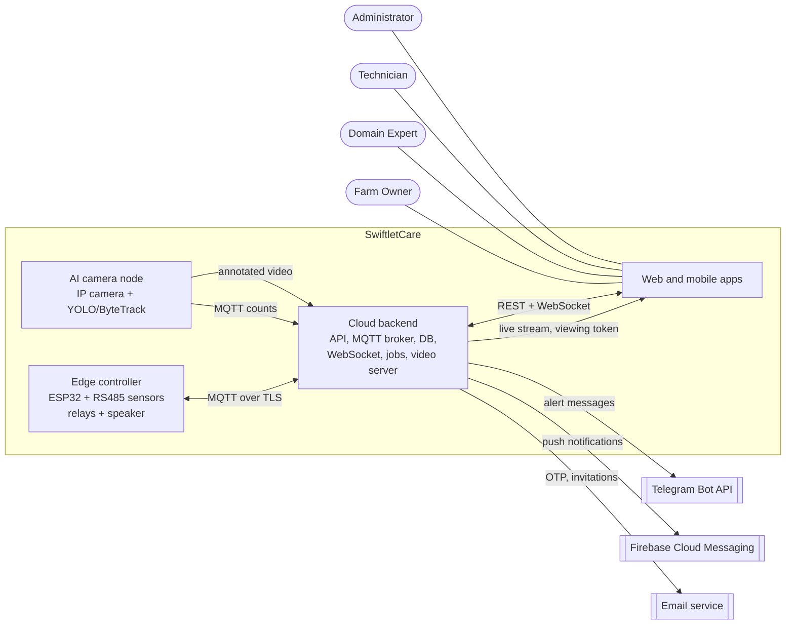

# Report 3 – Software Requirements Specification (SRS)

**SwiftletCare: An Automated Environmental Control and Multi-Modal Health Monitoring System for Swiftlet Farming**

| Field | Value |
| --- | --- |
| Project code | `[TEAM: approved project code]` |
| Course | SWP490 – Capstone Project, FA26 |
| Team | Nguyễn Chí Bảo (Leader), Trần Minh Kiệt, Nguyễn Vũ Len, Nguyễn Thị Yến Nhi, Thái Minh Tuấn |
| Supervisor | `[TEAM: supervisor name]` |
| Document version | 3.0.0 (Review 2) |
| Date | `[TEAM: dd/mm/2026]` |
| Scope baseline | Registration form – proposed final version `[TEAM: vN]` with Record of Changes (BM03) |
| Repository | `https://github.com/NBao261/SwiftletCare_KLTN/tree/review-2` |

---

## Contents

1. Introduction
2. Overall Description
3. Functional Requirements
4. Business Rules and Configurable Parameters
5. Non-Functional Requirements
6. Main Entity Lifecycles
7. Traceability
8. Out of Scope
9. Revision History

---

## 1. Introduction

### 1.1 Purpose

This document specifies **what** SwiftletCare must do: its actors, functional requirements with testable acceptance criteria, non-functional requirements with metric, threshold and measurement method, and the lifecycles of its main entities. It is the requirement baseline for Review 2, Defense 1.1 and the Viva.

**How** the system is built (architecture, Logical ERD, database script, state machine and activity diagrams, API and MQTT contracts, technology declaration, environments) is specified in **Report 4 – SDD**. Test cases are managed in **Report 5**. Progress per requirement is tracked in **Project Tracking**, not here.

### 1.2 Scope

SwiftletCare is an **automated control and monitoring system** for swiftlet houses. The house regulates and protects itself; people supervise, validate and intervene only as an exception. The product consists of:

- an **edge controller** (ESP32 with five RS485 Modbus sensors, a relay module and an attractant speaker) in each zone (floor) of a house;
- an **AI camera node** at the bird entrance (IP camera with infrared night vision and a PC or cloud server running the detection and tracking pipeline);
- a **cloud backend** (REST API, MQTT broker, database, WebSocket, background services);
- a **web application** and a **mobile application** for the Farm Owner and the Domain Expert, and a web console for the supporting roles.

The three research components are:

1. **Autonomous micro-climate control.** Fuzzy-logic control of misting and ventilation from humidity and temperature, scheduled attractant sound, and offline operation.
2. **Swiftlet entry/exit counting by computer vision.** YOLO detection and ByteTrack tracking at the entrance of each house, counting by a closed ring drawn around the entrance hole, a daily return rate per house, and an annotated live stream.
3. **Multi-modal health monitoring with an expert in the loop.** Self-diagnosis of sensors and actuators, abnormal-noise and return-rate indications, early warning by forecast, and a Domain Expert who confirms or rejects inferred alerts and tunes the system parameters.

Items explicitly excluded are listed in Section 8.

### 1.3 Definitions and Abbreviations

| Term | Meaning |
| --- | --- |
| Farm / House / Zone | A farm owns one or more houses; a house has one or more zones (floors). Control, thresholds and alerts are per zone. |
| Controller, SensorNode | The ESP32 edge controller installed in a zone. A zone may have more than one. |
| AI node, CameraNode | The camera at a bird entrance of a house (a house has one or two entrances) and the computer running the counting pipeline. Bird counts, the return rate and their alerts belong to the **house**, not to a zone. |
| Counting ring | A closed polygon (3–12 vertices, as frame ratios) drawn around the entrance hole; a bird crossing it counts as EXIT or ENTRY according to the ring's direction setting. |
| Primary Owner | The Farm Owner who created the farm. Co-owners are Farm Owners invited by the Primary Owner. |
| Inferred alert | An alert produced by inference rather than a direct measurement against a threshold: `NOISE_ANOMALY`, `SENSOR_ANOMALY`, `FORECAST_BREACH`, `LOW_RETURN_RATE`. These are validated by the Domain Expert; a rejected one becomes `DISMISSED` (no longer in force). |
| Episode | A continuous period during which one incident persists (for example one period of abnormal noise, or one misting demand period). |
| Session | Morning exit session (`MORNING_EXIT`) or evening return session (`EVENING_ENTRY`) of bird counting. |
| Return rate | Daily ratio of birds returning in the evening to birds leaving in the morning, computed on net counts (BR-12). |
| Override | A manual ON/OFF command on one relay for a limited duration. |
| Time-proportioning | Applying a power level (0–100 %) by switching a relay ON for that fraction of a fixed time window. |
| FR / NFR / BR | Functional requirement / Non-functional requirement / Business rule. |
| AC | Acceptance criterion. |
| MF / SF | Main flow / Supporting flow (Section 2.2). |

### 1.4 References

| ID | Document |
| --- | --- |
| REF-1 | Capstone Project Register – SwiftletCare, proposed final version, with Record of Changes (BM03) |
| REF-2 | Report 4 – Software Design Description (SDD) |
| REF-3 | Report 5 – Test Plan and Test Cases |
| REF-4 | `docs/api/api-spec.yaml` – OpenAPI 3.0 contract of the REST API |
| REF-5 | `docs/evidence-register.md` – sources of thresholds, device specifications and practitioner validation |
| REF-6 | `docs/bird-counting-plan.md` – design of the counting pipeline |
| REF-7 | ISO/IEC/IEEE 29148:2018 – Requirements engineering |
| REF-8 | Decree 13/2023/ND-CP on personal data protection (Vietnam) |

### 1.5 Conventions

- **Requirement IDs** have the form `MODULE-FR-nnn` and are kept stable across versions so that code, tests and commits that reference them stay valid. Gaps in the numbering are requirements removed from scope (Section 9).
- **Priority.** `M` = Mandatory: part of a main flow; candidates for the mandatory features of Defense 1.1. `S` = Supporting: serves the supporting roles, kept working and regression-tested but not extended and not proposed as a mandatory feature. `O` = Optional, not committed.
- **Acceptance criteria** are written so that each one can be turned into a test with a clear pass or fail result. Values in `code font` are configurable parameters defined in Section 4; the criterion holds for the default value and for any value set within the allowed range.
- **Actor.** "System" names the component that performs the requirement: *Controller* (ESP32 firmware), *Backend* (API and background jobs) or *AI node*.

---

## 2. Overall Description

### 2.1 Product Perspective

The component-level architecture, data flows and deployment are in the SDD (REF-2, "System Overview").

### 2.2 Main Flows

The main flows are those of the registration form (section D), numbered the same way. Each is described by one activity diagram in the SDD.

| ID | Flow (registration form) | Actors | Trigger | Business outcome | FRs |
| --- | --- | --- | --- | --- | --- |
| MF-01 | Automatic micro-climate regulation | Controller, Farm Owner | Every 10 s control cycle | Misting and ventilation power follow humidity and temperature; state shown on the dashboard | ENV-FR-001, 002, 004, 005, 010, 011, 013b, 015, 021, 022 |
| MF-02 | Air-quality monitoring | Controller, Backend, Farm Owner, Domain Expert | NH3 or CO2 reading above the zone alert limit | Alert raised for assessment; no automatic ventilation | ENV-FR-006, 007, ALERT-FR-012, EXPERT-FR-004 |
| MF-03 | Offline operation and recovery | Controller, Backend, Farm Owner | Internet lost, controller hang or power loss | Control continues; buffered data uploaded; restart reported | ENV-FR-014, 024, 025, FARM-FR-005, THREAT-FR-009, 012 |
| MF-04 | Equipment fault handling | Controller, Backend, Farm Owner | Pump dry, sensor or bus fault, implausible readings, speaker failure | Affected loop in a safe state; alert raised | THREAT-FR-006, 011, 013, ALERT-FR-010 |
| MF-05 | Early warning by forecast | Backend, Farm Owner, Domain Expert | Every 10 min | Early-warning alert with the expected crossing time | ANALYTICS-FR-009, ALERT-FR-011 |
| MF-06 | Bird counting session | AI node, Backend, Farm Owner | Morning exit and evening return sessions | Counts and return rate of the house recorded; alert on abnormal drop; annotated live stream | VISION-FR-001…014, 016, 017, 019, THREAT-FR-010 |
| MF-07 | Abnormal noise | Controller, Backend, Domain Expert | Noise sustained above the hourly baseline | Indication shown with bird counts of the same period and validated by the expert | THREAT-FR-005, 007, VISION-FR-017, EXPERT-FR-003 |
| MF-08 | Expert validation and tuning | Backend, Domain Expert, Farm Owner | Weekly health summary; pending inferred alerts; coefficient suggestion | Alerts confirmed or rejected; parameters and counting ring approved; the Farm Owner informed of every decision; conclusion delivered | EXPERT-FR-001…009, VISION-FR-018, ANALYTICS-FR-008, 010, 011 |
| MF-09 | Manual override and bypass | Farm Owner, Controller | Owner switches a relay by hand | Relay in manual mode for a limited time, then back to automatic; logged | ENV-FR-016…019, 023 |
| SF-01 | Installation and activation (supporting) | Technician, Administrator, Controller | New house, zone or device | Device registered, assigned to its zone and online | FARM-FR-003…008, 007b, TICKET-FR-010 |
| SF-02 | Maintenance requests (supporting) | Farm Owner, Technician, Administrator, Backend | Fault ticket or installation request | Ticket handled within SLA and closed | TICKET-FR-001…018 |
| SF-03 | Account and access management (supporting) | All users, Administrator | Registration, invitation, account request | Users hold the right role and farm access | AUTH-FR-001…012, SYSTEM-FR-001…003 |

### 2.3 User Classes and System Actors

| Actor | Type | Description |
| --- | --- | --- |
| Farm Owner | Human, main flow | Owner of a swiftlet farm. Manages farms, houses and zones; monitors; sets zone thresholds; receives and acknowledges alerts; overrides actuators for a limited time; records harvests; invites a Domain Expert; is informed of every decision the expert makes and reads the expert's conclusions (EXPERT-FR-009). While the farm has no Domain Expert, the Farm Owner also takes the expert's decisions (BR-22). The Primary Owner additionally deletes the farm, changes its region and invites or removes members. |
| Domain Expert | Human, main flow | Swiftlet-farming specialist invited by the Primary Owner, with access to the whole farm. Read-only on operations; confirms or rejects inferred alerts; approves or adjusts thresholds, fuzzy coefficients, detection parameters and the counting ring; writes conclusions for the Farm Owner. Does not control relays, create tickets, record harvests or acknowledge alerts. A Domain Expert is optional: the system runs without one (BR-22). |
| Technician | Human, supporting | Staff of the system operator. Installs and activates devices, provisions Wi-Fi, handles maintenance tickets, sends remote commands and firmware updates. |
| Administrator | Human, supporting | Manages user accounts, Technician regions, system-wide default thresholds and SLA settings; reviews the audit log. |
| Controller (ESP32) | System | Reads sensors, filters signals, runs fuzzy control, plays the attractant speaker, self-diagnoses and publishes over MQTT. |
| AI node | System | Detects, tracks and counts swiftlets at the entrance, publishes counts and streams annotated video. |
| Backend | System | Stores telemetry, runs the alert engine, forecasting, anomaly detection, health reports and the ticket router; sends notifications. |
| Telegram Bot API | External service | Delivers alert messages to the Farm Owner's Telegram account. |
| Firebase Cloud Messaging | External service | Delivers push notifications to the mobile application. |

### 2.4 Permissions

| Function | Farm Owner | Domain Expert | Technician | Admin |
| --- | :---: | :---: | :---: | :---: |
| View real-time dashboard, analytics, bird counts, live stream | ✓ | ✓ (read-only) | – | – |
| View zone health reports | ✓ | ✓ | – | – |
| Acknowledge alerts | ✓ | – | ✓ (incident) | – |
| Receive out-of-app notifications | ✓ | – | – | – |
| Confirm or reject inferred alerts | read ¹ | ✓ | – | – |
| Write conclusions and recommendations | read | ✓ | – | – |
| Be notified of and view the expert's decisions | ✓ | ✓ | – | – |
| Edit zone thresholds | ✓ | ✓ | – | – |
| Reset zone thresholds to the system defaults | ✓ | ✓ | – | – |
| Edit system default thresholds | – | – | – | ✓ |
| Edit fuzzy coefficients | ✓ | ✓ | – | – |
| Edit detection parameters | read ¹ | ✓ | – | – |
| Draw the counting ring of a camera | read ¹ | ✓ | – | – |
| Set the counting schedule of a house (seasons, temporary windows) | read ¹ | ✓ | – | – |
| Manual relay override | ✓ | – | ✓ (incident) | ✓ (incident) |
| Record and edit harvests | ✓ | read | – | – |
| Create farms | ✓ | – | – | ✓ |
| Create houses and zones | ✓ | – | ✓ (own regions) | ✓ |
| Delete farm, change region, invite or remove members | Primary Owner | – | – | ✓ (delete, region) |
| Register, assign, move, replace devices; remote commands, OTA | – | – | ✓ (own regions) | – |
| Create fault and installation tickets | ✓ | – | – | – |
| Handle tickets | – | – | ✓ | ✓ (any ticket) |
| Manage accounts, Technician regions, default thresholds, SLA, audit log | – | – | – | ✓ |

Technicians and Administrators see the structure and device status of a farm, never its environmental dashboard or analytics (FARM-FR-009).

¹ The Farm Owner takes this decision while the farm has no Domain Expert (BR-22). Zone thresholds and fuzzy coefficients belong to the farm: a Technician or Administrator neither edits nor resets them; the Administrator only maintains the system default thresholds (ENV-FR-007).

### 2.5 Operating Environment

- Controller: ESP32 on 2.4 GHz Wi-Fi, five RS485 Modbus RTU sensors on one bus, 4-channel relay module, DFPlayer Mini audio module, hardware watchdog.
- AI node: PC at the house or a cloud server; IP camera with RTSP (H.264, 1080p, 25 fps) and infrared night vision.
- Backend: Linux server with Docker; MongoDB, EMQX MQTT broker, MinIO object storage.
- Clients: current Chrome, Edge and Safari for the web application; Android 9+ and iOS 16.4+ for the mobile application.

The exact versions and the dev, staging and production environments are declared in the SDD.

### 2.6 Constraints

- C-1. The control loop runs entirely on the controller and must not depend on the cloud.
- C-2. NH3 and CO2 have no established limits for swiftlet houses in the literature reviewed; they are monitored and alerted only and never drive the actuators.
- C-3. The noise sensor returns a sound level in dB, not a waveform; the system therefore does not classify bird calls.
- C-4. Low-cost commodity hardware and open-source software only.
- C-5. Personal data is processed according to Decree 13/2023/ND-CP (REF-8).

### 2.7 Assumptions and Dependencies

- A-1. The house has a working Wi-Fi network at installation time; loss of Internet afterwards is handled by MF-03.
- A-2. Out-of-app notifications reach a Farm Owner who has installed the mobile application (push) or linked a Telegram account; either channel alone is sufficient.
- A-3. Default temperature, humidity and light thresholds are taken from the swiftlet-farming literature and reviewed by a practitioner; sources are recorded in REF-5.
- A-4. The engineering constants in Section 4.4 were chosen so that the system can run and have no domain source yet; they are confirmed or replaced by measurement.

---

## 3. Functional Requirements

### 3.1 Sensing and Telemetry (ENV)

| ID | Actor | Requirement | Acceptance criteria | Pri. |
| --- | --- | --- | --- | :---: |
| ENV-FR-001 | Controller | Read the five RS485 sensors (temperature-humidity, light, NH3, CO2, noise) by Modbus function 0x03 and publish telemetry over MQTT. | One telemetry message per cycle contains temperature (°C), humidity (%), light (lux), NH3 (ppm), CO2 (ppm) and noise (dB) and the `deviceId`; a disconnected sensor is reported as stale (THREAT-FR-013) instead of a value. | M |
| ENV-FR-002 | Controller | Read sensors every second and make a control decision every 10 seconds. | Over 10 minutes of operation, consecutive telemetry messages are 1 s ± 0.2 s apart and consecutive control outputs 10 s ± 1 s apart. | M |
| ENV-FR-004 | Backend | Validate incoming telemetry and store it in a time-series collection. | A message with a value outside the sensor's measurement range is stored with an anomaly flag; a message from an unknown or decommissioned `deviceId` is not stored; at most one sample per 10 s per device is stored; a buffered sample up to 7 days old keeps its original timestamp. | M |
| ENV-FR-005 | Backend | Push live sensor values, actuator state and control mode to the dashboard over WebSocket. | A telemetry message appears on an open dashboard of that zone within 2 s (NFR-01); users without access to the farm receive no event. | M |
| ENV-FR-022 | Controller | Filter temperature and humidity with a 5-sample median filter followed by a scalar Kalman filter before control; raw values are still published. | After 20 samples at 80 %, one sample at 95 % leaves the filtered value within 0.01 of 80 % while the published raw value shows 95 %; after a real step to 85 %, the filtered value is within 0.5 of 85 % after 40 samples; with `fuzzy_input_filter` off, control uses the raw value. | M |

### 3.2 Thresholds and Control Configuration (ENV)

| ID | Actor | Requirement | Acceptance criteria | Pri. |
| --- | --- | --- | --- | :---: |
| ENV-FR-006 | Farm Owner, Domain Expert of the farm | Configure per-zone thresholds: `temp_min`, `temp_max`, `humidity_min`, `humidity_max`, `light_max`, `nh3_max`, `co2_max`. | A valid change is stored, recorded in the threshold history with author, role and time, and sent to every controller of the zone; a value with min ≥ max or outside the measurement range is rejected with 400 and nothing is stored; a Technician or Administrator request, or a user who is not a member of the farm, is rejected with 403. | M |
| ENV-FR-007 | Administrator | Maintain system-wide default thresholds (BR-01), taken from the sources in REF-5. Defaults are a reference, not live values: they are copied into a zone only when the zone is created or reset (ENV-FR-020). | Defaults are editable only by an Administrator and validated like zone thresholds; a change without a source reference (an entry of REF-5) is rejected with 400; the audit log keeps old values, new values and the source; after a change, the thresholds of every existing zone are unchanged and no configuration is sent to any controller; a zone created afterwards starts with the new defaults. | M |
| ENV-FR-009 | Backend | Keep the history of threshold and coefficient changes. | Each change record holds old value, new value, user, role, time and source (`MANUAL` or `RESET_TO_DEFAULT`). | M |
| ENV-FR-020 | Farm Owner, Domain Expert of the farm | Reset the thresholds of a zone to the current system defaults, for example when a setting proved wrong. | After reset the zone thresholds equal the defaults at that moment, a history record with source `RESET_TO_DEFAULT` exists and the controllers of the zone receive the new values; a later change of the defaults does not change this zone again; a Technician or Administrator request, or a user who is not a member of the farm, is rejected with 403. | M |
| ENV-FR-021 | Farm Owner, Domain Expert of the farm | Edit the fuzzy-control coefficients of a zone without reflashing firmware (BR-05). | A value inside its range is stored with history (author, role, time) and applied by every controller of the zone on the next control cycle; a value outside its range is rejected with 400; a Technician or Administrator request, or a user who is not a member of the farm, is rejected with 403; the controller also clamps any received value to the range. | M |
| ENV-FR-026 | Backend, Domain Expert (Farm Owner, BR-22) | After the system defaults change, tell the Domain Expert of each farm, or its Farm Owners when it has no expert, which zones now differ from the new defaults; nothing is applied automatically. | After a change of `humidity_min`, the Domain Expert of each farm with a zone whose `humidity_min` differs from the new default (its Farm Owners if it has no expert) has one in-app notification listing those zones; zone thresholds stay unchanged until a Farm Owner or Domain Expert resets or edits them. | O |

### 3.3 Closed-Loop Control (ENV)

| ID | Actor | Requirement | Acceptance criteria | Pri. |
| --- | --- | --- | --- | :---: |
| ENV-FR-010 | Controller | Control the misting pump with zero-order Sugeno fuzzy logic on humidity and temperature, applied by time-proportioning over `fuzzy_window_sec`. | For the shared fuzzy test cases (firmware and backend), the misting output equals the expected value: humidity LOW → 100 %, MEDIUM and HOT → 50 %, MEDIUM and not HOT → 0 %, HIGH → 0 %, with smooth transitions inside `fuzzy_humidity_band`; the relay is ON for output × window at the start of each window. | M |
| ENV-FR-011 | Controller | Control the ventilation fan with fuzzy logic on temperature and humidity only. | HOT and not DRY → 100 %; HOT and DRY → `fuzzy_fan_dry_level`; not HOT → 0 %; the fan window is offset by half a window from the misting window; changing NH3 or CO2 alone never changes the fan output. | M |
| ENV-FR-013b | Controller | Play the attractant sound on the configured schedule through the speaker relay and the audio module. | Inside a scheduled period (default BR-07) the speaker relay is ON and the selected track plays; outside it the relay is OFF; a schedule change sent from the application takes effect without restart. | M |
| ENV-FR-014 | Controller | Keep closed-loop control running with the stored configuration while the Internet or the broker is unreachable. | With the uplink disconnected for 30 minutes, the controller keeps producing a control decision every 10 s with the last received thresholds and coefficients (NFR-06). | M |
| ENV-FR-024 | Controller | Buffer telemetry in flash while the broker is unreachable (one sample per 10 s, up to 256 KB) and upload it when the connection returns. | After a 30-minute outage every buffered sample is stored by the backend with its original timestamp (ENV-FR-004) and the buffer is emptied; when the buffer is full, new samples are dropped and older ones are kept. | M |
| ENV-FR-025 | Controller | Restart itself through the hardware watchdog when the firmware hangs, then resume control with the stored configuration. | With the main loop blocked on purpose, the controller restarts, resumes control decisions and reports `POWER_OUTAGE` (THREAT-FR-012) within the time of NFR-07. | M |
| ENV-FR-015 | Controller, Backend | Publish relay state and control mode on every change and synchronise it to the cloud. | Every relay change is visible in the application within 2 s with its mode (`AUTO` or `MANUAL`). | M |

### 3.4 Manual Override and Bypass (ENV)

| ID | Actor | Requirement | Acceptance criteria | Pri. |
| --- | --- | --- | --- | :---: |
| ENV-FR-016 | Farm Owner (Technician, Administrator when handling an incident) | Switch one relay (misting, fan, speaker) ON or OFF by hand for a limited duration. | The command is applied by the target controller and the relay reports `MANUAL`; a duration outside BR-08 is rejected with 400; a Domain Expert request is rejected with 403. | M |
| ENV-FR-017 | Controller, Backend | Suspend automatic control of an overridden relay and show it clearly; the precedence of BR-19 applies. | While in `MANUAL`, neither the fuzzy output, the pump-dry latch nor the sensor safe state changes that relay, and the dashboard shows a manual-mode banner for it. | M |
| ENV-FR-018 | Backend, Controller | End an override automatically when its duration expires, or early on request, and return to automatic control (BR-20). | At expiry (default 30 min) every overridden relay of the controller returns to `AUTO` within one control cycle; an early cancel does the same immediately. | M |
| ENV-FR-019 | Backend | Log every override and show the history. | Each record holds user, role, relay, state, start, end and end reason (`EXPIRED` or `CANCELLED`) and is listed in the zone history. | M |
| ENV-FR-023 | Hardware | Provide a three-position bypass switch (Auto / Hand / Off) at the cabinet for the pump and the fan. | In Hand the load runs with the controller powered off; in Off the load is de-energised regardless of the relay; in Auto the relay drives the load. | M |

### 3.5 Self-Protection and Self-Diagnosis (THREAT, ALERT)

| ID | Actor | Requirement | Acceptance criteria | Pri. |
| --- | --- | --- | --- | :---: |
| THREAT-FR-005 | Controller | Measure the noise level in dB continuously for speaker and abnormal-noise detection; no call classification. | Noise is present in every telemetry message; no requirement depends on frequency analysis. | M |
| THREAT-FR-006 | Controller | Raise `SPEAKER_FAILURE` when the speaker is on and playing but the sound level drops more than `speaker_drop_pct` below its baseline. | With the speaker ON and playing and a measured level 75 % below baseline (default 70 %), one `SPEAKER_FAILURE` alert is raised; at a 50 % drop no alert is raised. | M |
| THREAT-FR-007 | Controller, Backend | Learn a noise baseline for each hour of the day (90th percentile while the speaker is off) and raise `NOISE_ANOMALY` (MEDIUM) when noise stays above the baseline of that hour by `noise_margin_db` for `noise_min_sec` within 15 s. The indication is never a conclusion on its own: it is shown with the bird counts of the same period and waits for the Domain Expert's verdict. | Noise 20 dB above a learned baseline for 12 s of 15 s raises one alert (defaults 15 dB, 10 s); 20 dB for 8 s raises none; no evaluation while the speaker plays, for an hour with less than about one hour of learned data, or before the clock is synchronised; the alert creates no ticket and shows the 5-minute bird counts around it. | M |
| THREAT-FR-009 | Backend | Mark a controller offline when no heartbeat arrives and raise `NODE_OFFLINE`. | With heartbeats stopped, the device is `OFFLINE` and one `NODE_OFFLINE` alert exists within 40 s (BR-10); the alert resolves automatically when the device reconnects. | M |
| THREAT-FR-010 | Backend | Raise `EDGE_AI_DEGRADED` for the house when its AI node stops sending heartbeats, or reports fewer than 10 frames per second. | With heartbeats stopped, the camera node is `OFFLINE` and one `EDGE_AI_DEGRADED` alert exists for the house within 100 s (BR-10); it resolves at the next heartbeat; an `EDGE_AI_DEGRADED` message from the node reporting 8 fps also raises it. | M |
| THREAT-FR-011 | Controller | Detect a pump running dry and stop misting for the rest of the episode. | With humidity below `humidity_min` and the pump ON for an accumulated `pump_dry_on_sec` (default 300 s) in one episode without humidity rising by `pump_dry_min_rise_pct` (default 2 %), misting output becomes 0, one `PUMP_DRY` alert is raised and misting is retried after BR-11; a manual ON override keeps the pump running and the alert says so. | M |
| THREAT-FR-012 | Controller | Report an unexpected restart (watchdog or power loss) after reboot. | After a forced watchdog reset or a power cut, the first connection publishes one `POWER_OUTAGE` alert. | M |
| THREAT-FR-013 | Controller | Detect sensor and bus failures and hold a safe state. | A single sensor timeout or CRC error marks that reading stale and raises `SENSOR_FAULT` (MEDIUM); ≥ 3 of 5 sensors timing out in 3 consecutive cycles raises one `RS485_BUS_FAILURE` (CRITICAL) instead; if no valid temperature or humidity is available for more than 2 control cycles, misting and fan outputs are 0 until a valid reading returns. | M |
| ALERT-FR-010 | Backend | Detect implausible sensor behaviour every 10 minutes on the last 2 hours of raw telemetry: stuck values, physically impossible jumps, and drift between devices of the same zone (BR-14). | Each of the three injected patterns produces one `SENSOR_ANOMALY` (MEDIUM); the alert resolves when the data is normal again; a normal 2-hour series produces none. | M |

### 3.6 Alerts and Notifications (ALERT)

| ID | Actor | Requirement | Acceptance criteria | Pri. |
| --- | --- | --- | --- | :---: |
| ALERT-FR-001 | Backend | Classify every alert as CRITICAL, HIGH, MEDIUM or LOW by its type. | Every alert type has exactly one default severity (BR-15), and every stored alert has a severity. | M |
| ALERT-FR-005 | Farm Owner | Choose per event type which channels deliver notifications (in-app, push, Telegram). | A channel disabled for an event type receives nothing for it, while the alert is still listed in the notification centre. | M |
| ALERT-FR-006 | Farm Owner | Set quiet hours during which only CRITICAL alerts are sent out of the app. | During quiet hours a HIGH alert is not sent by push or Telegram but is listed in the app; a CRITICAL alert is sent on both. | M |
| ALERT-FR-007 | Farm Owner, Domain Expert | View the notification centre with all alerts and the number of unread (`ACTIVE`) alerts. | The list shows only alerts of farms the user can access and filters by farm, zone, status, severity, type and expert verdict; an invalid filter value is rejected with 400. | M |
| ALERT-FR-008 | Backend | Keep one open alert per incident (same type and same zone and device, or same house for house-level alerts) and close alerts automatically when conditions recover (BR-16). | A repeated occurrence increments `occurrence_count` of the open alert (`ACTIVE`, `ACKNOWLEDGED` or `DISMISSED`) instead of creating a new alert, and a `DISMISSED` alert sends no notification; a threshold breach resolves after 5 min back in range; an episodic alert resolves after 60 min without a new occurrence; `LOW_RETURN_RATE` resolves on the first later day back within the limit. | M |
| ALERT-FR-009 | Farm Owner (Technician when handling an incident) | Acknowledge an alert with a note. | An `ACTIVE` alert becomes `ACKNOWLEDGED` with user, time and note; acknowledging an alert that is not `ACTIVE` is rejected with 409; a Domain Expert or Administrator request is rejected with 403. | M |
| ALERT-FR-011 | Backend | Raise `FORECAST_BREACH` when humidity or temperature is in range now but is forecast to cross a threshold within 60 minutes. | With a series forecast to cross `humidity_min` in 40 min, one LOW alert is raised containing the expected minutes and the forecast error; it resolves when the forecast no longer crosses or when the reading actually crosses (then `THRESHOLD_BREACH` applies). | M |
| ALERT-FR-012 | Backend | Raise `THRESHOLD_BREACH` (MEDIUM) when NH3 or CO2 exceeds the zone alert limit, without driving the fan. | The alert text states that the limit is the zone's alert limit; the fan output is unchanged; both the Farm Owner and the Domain Expert see the alert. | M |
| ALERT-FR-013 | Backend | Deliver alerts to the Farm Owner's phone through a Telegram bot after a one-time account link. | After linking with the one-time code, a CRITICAL alert produces a Telegram message within 5 s (NFR-02); after unlinking, no message is sent; the bot token is read from the environment and never stored in the repository. | M |
| ALERT-FR-002 | Backend, Farm Owner | Deliver alerts as push notifications to the mobile application through Firebase Cloud Messaging; the app registers its device token after sign-in and removes it at sign-out. | A signed-in device receives a push for a CRITICAL alert within 5 s (NFR-02); after sign-out it receives none; an invalid token reported by FCM is removed. | M |

### 3.7 Forecasting, Control Performance and Tuning Suggestion (ANALYTICS)

| ID | Actor | Requirement | Acceptance criteria | Pri. |
| --- | --- | --- | --- | :---: |
| ANALYTICS-FR-001 | Farm Owner, Domain Expert | Show historical telemetry charts for 1 h, 6 h, 24 h, 7 d and 30 d. | Each range returns the samples of that range for the selected zone, aggregated so that a chart has at most the documented number of points. | M |
| ANALYTICS-FR-002 | Farm Owner, Domain Expert | Show bird-count trends: entry/exit per day and return rate per week. | For seeded count records, the chart values equal the stored daily totals and the weekly mean return rate. | M |
| ANALYTICS-FR-003 | Farm Owner, Domain Expert | Show the correlation between environmental conditions and return rate. | For seeded data with a known correlation, the report returns the expected coefficient within ± 0.01. | M |
| ANALYTICS-FR-005 | Farm Owner, Domain Expert | Compare several zones on one screen. | Selecting two or more zones shows their series on the same time axis. | M |
| ANALYTICS-FR-008 | Farm Owner, Domain Expert | Show control performance: humidity against misting and fan output, % time in range, relay switching per hour, and markers at coefficient changes. | For seeded telemetry with known in-range time and switch count, the reported values equal the expected ones. | M |
| ANALYTICS-FR-009 | Backend | Forecast humidity and temperature for the next 60 minutes (damped-trend Holt smoothing on 5-minute means of the last 6 hours) with the MAE at 30 and 60 minutes. | With at least 2 hours of data no older than 15 min, a forecast with MAE is returned; with less data the request returns a clear "insufficient data" result. | M |
| ANALYTICS-FR-010 | Backend, Domain Expert | Suggest fuzzy coefficients from recorded data (BR-06); the suggestion is never applied automatically. | With ≥ 3 days of data and R² ≥ 0.3, a suggestion with the predicted in-range time is returned; otherwise the response gives the reason; zone coefficients do not change until a user saves them. | M |
| ANALYTICS-FR-011 | Backend | Report the share of time each zone ran in automatic mode. | For seeded override logs covering 6 h of 24 h, the autonomy ratio is 75 %. | M |
| ANALYTICS-FR-004 | Farm Owner | Show the nest-count trend from harvest records. | For seeded harvests the trend values equal the recorded nest counts per batch. | O |

### 3.8 Bird Counting and Live View (VISION)

| ID | Actor | Requirement | Acceptance criteria | Pri. |
| --- | --- | --- | --- | :---: |
| VISION-FR-001 | AI node | Receive the RTSP stream of the entrance camera, or read a video file for development and evaluation. | The pipeline processes both a live RTSP source and a recorded file with the same configuration. | M |
| VISION-FR-002 | AI node | Run a lightweight YOLO detection model (ONNX Runtime) fast enough for real time; the model version is declared in the SDD. | Measured throughput on the AI node is ≥ 25 fps on the evaluation video (NFR-04). | M |
| VISION-FR-003 | AI node | Detect one class: `swiftlet`. | The model output has exactly one class. | M |
| VISION-FR-004 | AI node | Track detections across frames with ByteTrack so that a bird is not counted twice. | On a clip in which one bird crosses the line once, exactly one count is produced. | M |
| VISION-FR-005 | AI node | Count a tracked bird crossing the counting ring as EXIT or ENTRY; with `into_ring_is_exit`, moving into the ring is EXIT. | On a labelled clip, each crossing is counted in the direction given by the label; a bird that flies past the hole crosses in and out and adds one count in each direction, so the net count is unchanged. | M |
| VISION-FR-006 | AI node, Backend | Publish cumulative session counts every 30 seconds over MQTT on the house topic; the backend upserts one record per camera, session and day (Vietnam time). | Each message holds `entry_count`, `exit_count`, `timestamp` and `confidence`; resending the same cumulative counts does not double them. | M |
| VISION-FR-007 | AI node | Count in daylight and in low light using the camera's infrared mode. | Accuracy is reported separately for daylight and low-light clips (VISION-FR-016). | M |
| VISION-FR-008 | Backend | Aggregate counts per house and session (morning exit, evening return), summing the raw counts of all cameras of the house; a session is the sum of the 5-minute counts (VISION-FR-017) inside the session window in force that day (VISION-FR-019). | For a house with two cameras, the session totals equal the sum of both cameras' 5-minute counts inside that day's windows; each day's record stores the windows it was computed with. | M |
| VISION-FR-009 | Backend | Compute the daily return rate of a house on net counts (BR-12). | For morning exit 1 000 / entry 50 and evening entry 920 / exit 20, the return rate is 94.7 %; if the morning or the evening session of the day is missing, the return rate is empty (null), not 0. | M |
| VISION-FR-010 | Backend | Keep count history by day, week and month and show trend charts. | Daily, weekly and monthly aggregates equal the sums of the stored session records. | M |
| VISION-FR-011 | Backend | Each evening after the session (BR-21), raise `LOW_RETURN_RATE` for a house when its return rate drops more than `return_rate_drop_pct` (default 20 %) below the mean of up to 7 previous days that have a return rate. | With a mean of 95 % over 3–7 previous days, a day at 70 % raises one alert and a day at 85 % none; with fewer than 3 previous days, or an empty return rate today, nothing is evaluated; re-running the check on the same day adds no second alert. | M |
| VISION-FR-012 | Farm Owner, Domain Expert | Show the live count of the house during peak hours (BR-13). | Opening the page shows today's counts of the house; during a session the count updates within 2 s of each published message; users without access to the farm receive no update. | M |
| VISION-FR-013 | Farm Owner, Domain Expert | Watch the annotated live stream of a camera in the web and mobile applications, using a short-lived viewing token. | A Farm Owner or Domain Expert of the farm obtains a token valid for 60 s for that camera only and can open the stream; any other user is refused (403); a token cannot open the unannotated source stream. | M |
| VISION-FR-014 | AI node | Draw a box on every tracked bird and the counting ring on the stream before it is published. | Every frame of the published stream shows the ring and a box with a track ID for each tracked bird. | M |
| VISION-FR-016 | Team (evaluation) | Evaluate counting accuracy against manual counts on recorded video (NFR-09). | The evaluation report gives Precision, Recall and count error per direction, separately for daylight and low light, with the clips and manual counts stored for re-running. | M |
| VISION-FR-017 | AI node, Backend | Record entry/exit counts of the house per 5-minute bucket all day, kept for 90 days. | Bucket totals of one day equal the session totals for the session windows; buckets older than 90 days are removed; one read covers at most 7 days. | M |
| VISION-FR-018 | Domain Expert (Farm Owner, BR-22) | Draw the counting ring of a camera on a frame of the live video and choose its direction; the AI node applies it without restart. | A ring with 3–12 vertices inside [0, 1] is stored with history, role and audit and sent to the AI node, which applies it while keeping the session's counts; a ring with 2 or 13 vertices or a vertex outside [0, 1] is rejected with 400; a Farm Owner is rejected with 403 while the farm has a Domain Expert and accepted while it has none; if the AI node is offline the ring is stored and sent when it reconnects. | M |
| VISION-FR-019 | Domain Expert (Farm Owner, BR-22) | Set the counting schedule of a house: seasonal profiles, each a yearly date range (day and month) with a morning and an evening window, plus temporary windows for given dates (for example a spell of bad weather) that take precedence over the profile. A day covered by no profile uses the default windows (BR-13). | A valid schedule is stored with history and applies from the next day; overlapping profiles, a window whose start is not before its end, or a morning window that does not end before the evening window starts are rejected with 400; on a date with a temporary window the session uses it instead of the profile; days already computed keep their windows; a Farm Owner is rejected with 403 while the house's farm has a Domain Expert and accepted while it has none. | M |

### 3.9 Health Monitoring and Expert in the Loop (EXPERT)

| ID | Actor | Requirement | Acceptance criteria | Pri. |
| --- | --- | --- | --- | :---: |
| EXPERT-FR-001 | Farm Owner (Primary) | Invite a Domain Expert to the farm. | The invitation has role `DOMAIN_EXPERT` and covers the whole farm; a co-owner cannot invite (403); one expert can belong to several farms. | M |
| EXPERT-FR-002 | Domain Expert | View, read-only, the dashboard, analytics, bird counts, live stream, alerts, change histories and harvests of invited farms. | Every read endpoint of these features returns data to the expert; every write endpoint outside EXPERT-FR-003…008 returns 403. | M |
| EXPERT-FR-003 | Domain Expert (Farm Owner, BR-22) | Confirm or reject an inferred alert with a note, seeing sensor readings and 5-minute bird counts ±30 minutes around it; the system reports the confirmation rate per alert type. | The verdict is stored with author, role and time and can be changed; a verdict on a non-inferred alert type is rejected with 400; a Farm Owner verdict is rejected with 403 while the farm has a Domain Expert and accepted while it has none; a `REJECTED` verdict moves the alert to `DISMISSED` (Section 6.1): it leaves the active list, further occurrences of the same incident are absorbed without a new alert or notification, and it becomes `RESOLVED` when the condition recovers (BR-16); changing the verdict to `CONFIRMED` returns a `DISMISSED` alert to `ACTIVE`; a `CONFIRMED` verdict does not change the status; the statistics count confirmed, rejected and pending alerts per type and per role of the author. | M |
| EXPERT-FR-004 | Domain Expert | Approve or adjust zone thresholds and fuzzy coefficients, including system suggestions. | Changes follow ENV-FR-006/021 and are stored with role `DOMAIN_EXPERT`; the control-performance chart shows a marker at each change. | M |
| EXPERT-FR-005 | Backend | Produce a weekly health report per zone, also on demand for any period. | The report contains % time in range, % time automatic, relay switching, alerts by type, device faults, return-rate trend and NH3/CO2 mean and maximum, and its figures equal those computed from the seeded data. | M |
| EXPERT-FR-006 | Domain Expert, Farm Owner | The expert writes a conclusion and recommendations on a report; the Farm Owner is notified and reads it. Without an expert the report is still produced and read by the Farm Owner, with no conclusion. | After saving, every Farm Owner of the farm has a new in-app notification (and a Telegram message if linked) and sees the conclusion; only its author can edit it (403 for another expert), and the edit time is stored; a Farm Owner cannot write a conclusion (403). | M |
| EXPERT-FR-007 | Backend, Domain Expert, Farm Owner | Keep an in-app notification inbox per user; notify the expert in the app of new health reports and of inferred alerts awaiting validation (the Farm Owners when the farm has no expert); never send operational alerts to the expert out of the app. | A new `NOISE_ANOMALY` creates an in-app notification for the expert, pushed live over WebSocket, and no push or Telegram message to the expert; on a farm without an expert the same notification goes to its Farm Owners; a user sees only their own notifications, can mark one or all as read, and notifications older than 90 days are removed. | M |
| EXPERT-FR-008 | Domain Expert (Farm Owner, BR-22) | Tune the detection parameters within technical limits (BR-09): five per zone (noise, pump-dry, speaker) and the return-rate drop per house; with history and reset to defaults. | A value inside its range is stored with author, role and time and, for the zone parameters, sent to the controllers of the zone; a value outside its range is rejected with 400; a Farm Owner is rejected with 403 while the farm has a Domain Expert and accepted while it has none. | M |
| EXPERT-FR-009 | Backend, Farm Owner | Keep the Farm Owner informed of every decision the Domain Expert makes on the farm: zone thresholds (edit, reset), fuzzy coefficients, detection parameters, return-rate drop, counting ring, counting schedule, alert verdicts and conclusions. Each one notifies the Farm Owners in the app and is listed in one expert activity history of the farm. | For each of these eight decision types made by an expert, every Farm Owner of the farm has one in-app notification naming the expert, the time, the zone or house and the old and new values (or the verdict); the activity history of the farm lists the same entries, filterable by period, type and zone or house, and is readable by its Farm Owners and Domain Experts only (403 for Technician and Administrator); a decision made by a Farm Owner on a farm without an expert (BR-22) is listed with role `FARM_OWNER` and creates no notification for its author. | M |

### 3.10 House, Zone and Device Management (FARM)

| ID | Actor | Requirement | Acceptance criteria | Pri. |
| --- | --- | --- | --- | :---: |
| FARM-FR-001 | Farm Owner | Create, update and soft-delete a farm (name, address, GPS, description, region). | Only the Primary Owner or an Administrator changes the region or deletes; deleting resolves the farm's open alerts and cancels its open tickets; a deleted farm produces no new alerts. | M |
| FARM-FR-002 | Farm Owner (Technician, Administrator at installation) | Manage houses and zones (floors) of a farm. | A zone always belongs to exactly one house of one farm; a Domain Expert cannot create them (403). | M |
| FARM-FR-005 | Farm Owner, Domain Expert | See each device online or offline in real time. | A device switches to offline within 40 s of its last heartbeat and back to online at its next heartbeat (BR-10). | M |
| FARM-FR-006 | Technician, Farm Owner | See device details for remote diagnosis: firmware version, uptime, Wi-Fi RSSI, free memory, last reset reason and IP address. | The values shown equal those of the last heartbeat; a reset caused by a watchdog, a crash or a brown-out is shown as such. | M |
| FARM-FR-009 | Technician, Administrator | Manage farm structure without seeing operational data. | A Technician sees only farms in their assigned regions; Technician and Administrator requests to the dashboard and analytics are rejected with 403. | S |

### 3.11 Harvest Logging (MARKET)

| ID | Actor | Requirement | Acceptance criteria | Pri. |
| --- | --- | --- | --- | :---: |
| MARKET-FR-001 | Farm Owner | Record a harvest batch: date, zone, nest count, weight (g), nest type, photo. | A batch without a valid date, nest count or weight is rejected with 400; a zone of a farm the user cannot access is rejected with 403; a Domain Expert request is rejected with 403. | M |
| MARKET-FR-002 | Backend | Attach the 7-day environmental means before the harvest date. | The snapshot equals the means of the seeded telemetry for the 7 days before the date. | M |
| MARKET-FR-003 | Backend | Attach flock information: 30-day mean return rate and estimated bird count of the zone. | The values equal those computed from the seeded count records. | M |
| MARKET-FR-004 | Backend | Give every batch a unique trace code (UUID). | Two batches never share a trace code. | M |
| MARKET-FR-005 | Farm Owner | Edit or soft-delete a batch; the Domain Expert can only view. | A soft-deleted batch is hidden from lists but kept in the database; an expert edit is rejected with 403. | M |

### 3.12 Supporting Flows

These requirements serve the supporting roles of the registration form ("Technician" and "Administrator"). They are kept working and regression-tested but are not extended, and they are not proposed as mandatory features (priority `S`).

#### 3.12.1 Installation and Activation (SF-01)

| ID | Actor | Requirement | Acceptance criteria | Pri. |
| --- | --- | --- | --- | :---: |
| FARM-FR-003 | Technician | Register a controller with its device ID and device key from the provisioned-device stock. | A wrong key or an ID not in stock is rejected; a registered device starts in `PENDING`. | S |
| FARM-FR-003b | Technician | Provision the farm Wi-Fi on site through the controller's access-point mode, without reflashing. | After submitting SSID and password in AP mode, the controller joins the network and its first heartbeat sets it `ONLINE`. | S |
| FARM-FR-003c | Farm Owner, Technician | AP mode has a public part (Wi-Fi only) and an advanced part (farm, house, zone, MQTT credentials) unlocked only by the device key. | Without the key the advanced fields are refused by the device; with the key they are accepted. | S |
| FARM-FR-004 | Technician | Register the AI camera node of an entrance of a house. | A registered camera node is linked to exactly one house; the camera list never returns its RTSP address. | S |
| FARM-FR-007 | Technician | Assign a device to a zone at registration; a zone may have several controllers and cameras. | A Farm Owner or Domain Expert cannot change the assignment (403). | S |
| FARM-FR-007b | Technician | Move an installed device to another zone or farm, remotely when online, on site with the device key when offline. | After a remote move, the device reconnects on the new zone topic and its history stays attached to the device; every move is audited. | S |
| FARM-FR-008 | Technician | Remove or replace a device without losing its history. | A decommissioned device no longer appears as active but its telemetry remains queryable. | S |

#### 3.12.2 Maintenance Requests (SF-02)

| ID | Actor | Requirement | Acceptance criteria | Pri. |
| --- | --- | --- | --- | :---: |
| TICKET-FR-001 | Farm Owner (Administrator on behalf) | Create a fault ticket or an installation request (with a preferred visit time between 07:00 and 18:00, Vietnam time). | A visit time in the past or outside 07:00–18:00 is rejected with 400; a Domain Expert request is rejected with 403. | S |
| TICKET-FR-002 | Backend | Create a ticket linked to a CRITICAL or HIGH alert not acknowledged within 15 min; for `NODE_OFFLINE`, after 1 h offline. | An unacknowledged CRITICAL alert has exactly one linked ticket after 15 min; an acknowledged one gets none (except `NODE_OFFLINE` after 1 h). | S |
| TICKET-FR-003 | Backend, Administrator | Assign priority P1/P2/P3 by type; the Administrator may change it with a reason. | A `RS485_BUS_FAILURE` ticket starts as P1 and an `INSTALLATION` ticket as P3; a change without a reason is rejected with 400. | S |
| TICKET-FR-004 | Backend | Route every ticket to the Technician of the farm's region. | A ticket of a farm in region R is assigned to the Technician who holds R. | S |
| TICKET-FR-004b | Technician | Confirm the requested visit time or reschedule with a reason. | A reschedule without a reason or outside 07:00–18:00 is rejected with 400; the Farm Owner is notified of any change. | S |
| TICKET-FR-005 | Backend | Route to a backup Technician or the shared queue when no Technician fits or the assigned one is overloaded. | With the regional Technician above the overload limit, the ticket goes to the backup or the shared queue. | S |
| TICKET-FR-005b | Administrator | Intervene on any ticket: edit, reassign, change priority or visit time, close or cancel. | Each intervention is audited. | S |
| TICKET-FR-006 | Administrator | Configure response and resolution SLA per priority (BR-17). | A configuration with P1 > P2 or P2 > P3 is rejected with 400. | S |
| TICKET-FR-007 | Technician | Move a ticket through its lifecycle (Section 6.5) with a note. | A transition not allowed by Section 6.5 is rejected with 409. | S |
| TICKET-FR-008 | Technician | Send remote commands to a controller: restart, push configuration, OTA firmware update. The controller verifies the downloaded image and keeps the new firmware only after it reconnects to the broker. | A command to a device that is not `ONLINE` or `DEGRADED` is rejected with 409; RESTART or OTA to firmware older than 1.4.0 is rejected with 501; an image with a wrong SHA-256 or an interrupted download is discarded and the old firmware keeps running; a new firmware that does not reach the broker within 10 min rolls back; an OTA not confirmed within 30 min is reported as failed. | S |
| TICKET-FR-009 | Backend | Escalate a ticket that exceeds its resolution SLA. | Within 5 min after the deadline the ticket is flagged as breached and the Administrator and backup Technician are notified. | S |
| TICKET-FR-010 | Technician | Complete the site acceptance checklist before closing a ticket that had a site visit. | Closing such a ticket without a passed checklist is rejected with 409. | S |
| TICKET-FR-012 | Administrator | View ticket KPIs: open and closed per Technician, mean resolution time, SLA compliance. | For seeded tickets the KPIs equal the expected values; cancelled tickets are excluded from resolution time. | S |
| TICKET-FR-014…017 | Farm Owner, Technician, Administrator | Real-time chat per ticket; read-only once closed; a system message on reassignment. | A message sent on an open ticket reaches the other party; sending on a closed ticket returns 409; after reassignment the previous Technician can no longer send. | S |
| TICKET-FR-018 | Backend | Create a maintenance ticket when pump or fan run time or relay switch count exceeds its limit. | When accumulated pump ON time passes the limit, one `MAINTENANCE` ticket is created and the counter restarts. | S |
| TICKET-FR-011 | Farm Owner | Rate a closed ticket from 1 to 5 stars. | A rating outside 1–5, or on a cancelled ticket, is rejected. | O |
| TICKET-FR-013 | Administrator, Technician | Schedule periodic maintenance that creates `MAINTENANCE` tickets. | A ticket is created before each due date. | O |
| ENV-FR-013c | Technician, Farm Owner | Manage attractant tracks: the Technician registers a track copied to the SD card; the Farm Owner selects the default track or plays one for testing. | A track not marked as copied to the SD card cannot be selected or played (400). | O |

#### 3.12.3 Account and Access Management (SF-03)

| ID | Actor | Requirement | Acceptance criteria | Pri. |
| --- | --- | --- | --- | :---: |
| AUTH-FR-001 | Farm Owner | Register with email and verify with a one-time code. | An account is usable only after the code is verified; a wrong or expired code is rejected. | S |
| AUTH-FR-002 | All users | Sign in with email and password. | Wrong credentials return 401; repeated failures are limited by NFR-10. | S |
| AUTH-FR-003 | Backend | Manage sessions with a 15-minute access token and a 30-day refresh token. | An expired access token returns 401 and a valid refresh token issues a new one. | S |
| AUTH-FR-004 | Backend | Enforce the four roles of Section 2.4 on every route and farm membership in every service. | Every role/route pair not allowed in Section 2.4 returns 403. | S |
| AUTH-FR-005 | Farm Owner (Primary) | Invite co-owners and Domain Experts; remove members. | An account that already holds another role cannot accept the invitation (409). | S |
| AUTH-FR-005c | Administrator | Create Technician accounts and assign regions. | A new Technician can access only farms of the assigned regions. | S |
| AUTH-FR-007 | Backend | Record sign-ins and configuration changes in the audit log. | Every change listed in Sections 3.2, 3.4 and 3.9 produces an audit entry with actor and time. | S |
| AUTH-FR-009 | All users | Reset a forgotten password with a single-use code valid for 15 minutes. | A code used twice or after 15 min is rejected; after a reset all previous refresh tokens are revoked. | S |
| AUTH-FR-010 | Invitee | Accept or decline an invitation valid for 7 days (Section 6.4). | After 7 days the invitation is `EXPIRED` and cannot be accepted. | S |
| AUTH-FR-011 | Administrator | Lock or unlock an account with a mandatory reason. | A locked user's still-valid token is rejected with 401. | S |
| AUTH-FR-012 | All users, Administrator | Request deletion of one's account and personal data; the Administrator completes or rejects it within 30 days. | On completion, ownership passes to the earliest co-owner, or the farm is soft-deleted if none; personal data is anonymised; a reminder is sent to the Administrator once 7 days before the deadline. | S |
| SYSTEM-FR-001 | Administrator | Browse and filter the audit log. | Filtering by actor, action, target and period returns only matching entries. | S |
| SYSTEM-FR-002 | Administrator | Edit the system default thresholds. | See ENV-FR-007. | S |
| SYSTEM-FR-003 | Administrator | View a system health overview: farms, zones, devices by status, open tickets by priority, accounts by role and state. | For seeded data each count equals the expected value; soft-deleted farms are excluded. | S |

---

## 4. Business Rules and Configurable Parameters

### 4.1 Environmental Thresholds

| ID | Rule | Value | Source |
| --- | --- | --- | --- |
| BR-01 | Default zone thresholds | Temperature 26–31 °C; humidity 75–95 %; light < 0.2 lux | Swiftlet-farming literature and practitioner review (REF-5) |
| BR-02 | NH3 and CO2 alert limits | Provisional defaults NH3 < 25 ppm, CO2 < 1 500 ppm, used only for alerting until the Domain Expert sets them | No established source for swiftlet houses (C-2) |
| BR-03 | Below `temp_min` | Alert only; the system has no heating | Out of scope (Section 8) |
| BR-04 | Above `light_max` | Alert only; the system has no light actuator | Out of scope (Section 8) |

### 4.2 Control Parameters

| ID | Parameter | Range | Default |
| --- | --- | --- | --- |
| BR-05 | `fuzzy_humidity_band` (%RH) / `fuzzy_temp_band` (°C) / `fuzzy_fan_dry_level` (%) / `fuzzy_window_sec` (s) / `fuzzy_input_filter` | 2–20 / 1–10 / 0–100 / 60–600 / on-off | 8 / 4 / 40 / 120 / on |
| BR-06 | Coefficient suggestion | Linear model `Δh(10 min) = a·misting + b·fan + c·(T − T̄) + d` on ≤ 14 days; 120 candidate sets simulated on the last 24 h; refused if < 3 days, R² < 0.3, or misting does not raise humidity | — |
| BR-07 | Speaker schedule | Up to the configured periods per day | 05:00–07:00 and 17:00–19:00 |
| BR-08 | Override duration | 1 min – 24 h | 30 min |

### 4.3 Detection Parameters (EXPERT-FR-008)

| ID | Parameter | Range | Default | Used by |
| --- | --- | --- | --- | --- |
| BR-09a | `noise_margin_db` | 5–30 dB | 15 | THREAT-FR-007 |
| BR-09b | `noise_min_sec` (within a 15 s window) | 5–15 s | 10 | THREAT-FR-007 |
| BR-09c | `pump_dry_on_sec` | 120–900 s | 300 | THREAT-FR-011 |
| BR-09d | `pump_dry_min_rise_pct` | 0.5–10 % | 2 | THREAT-FR-011 |
| BR-09e | `speaker_drop_pct` | 30–90 % | 70 | THREAT-FR-006 |
| BR-09f | `return_rate_drop_pct` (per house) | 5–50 % | 20 | VISION-FR-011 |

The ranges are technical limits that prevent input errors, not domain recommendations.

The defaults of the fuzzy coefficients (BR-05) and of the detection parameters (BR-09) are engineering constants fixed in the software; they are not edited by the Administrator, and "reset to defaults" of these parameters returns to these constants. Only the environmental thresholds (BR-01, BR-02) have Administrator-maintained defaults, because only they are taken from documented sources.

### 4.4 Timing and Calculation Rules

| ID | Rule | Value |
| --- | --- | --- |
| BR-10 | Device offline | Controller: no heartbeat for 30 s, checked every 10 s, so detected within 40 s. AI node: no heartbeat for 90 s (three 30-second heartbeats), detected within 100 s |
| BR-11 | Misting retry after a pump-dry latch | 30 min (engineering constant, A-4) |
| BR-12 | Return rate | `(evening entry − evening exit) / (morning exit − morning entry) × 100 %`; raw counts of both directions are also stored |
| BR-13 | Default session windows (used when no seasonal profile or temporary window covers the day) | Morning 05:30–07:00, evening 17:30–19:00 (engineering default, A-4); live count (VISION-FR-012) follows the windows in force that day |
| BR-14 | Sensor anomaly | Stuck: temperature or humidity unchanged ≥ 2 h. Jump: ≥ 3 changes between consecutive samples above 2 °C / 10 % RH / 20 ppm NH3 / 500 ppm CO2. Drift: two devices of a zone differ by > 2 °C or > 8 % RH on 1-hour means |
| BR-15 | Default severity | CRITICAL: `RS485_BUS_FAILURE`. HIGH: `POWER_OUTAGE`, `SPEAKER_FAILURE`, `NODE_OFFLINE`. MEDIUM: `THRESHOLD_BREACH`, `NOISE_ANOMALY`, `SENSOR_FAULT`, `SENSOR_ANOMALY`, `PUMP_DRY`, `EDGE_AI_DEGRADED`. LOW: `LOW_RETURN_RATE`, `FORECAST_BREACH` |
| BR-16 | Automatic resolution | Threshold breach: 5 min back in range. `NODE_OFFLINE`: device reconnects. Episodic alerts (`NOISE_ANOMALY`, `PUMP_DRY`): 60 min without a new occurrence, while the controller repeats the alert every 15 min during an ongoing episode (engineering constants, A-4) |
| BR-17 | Default SLA (response / resolution) | P1 30 min / 4 h; P2 4 h / 24 h; P3 24 h / 72 h |
| BR-18 | Safe state of the control loop | Last valid temperature and humidity are used for up to 2 control cycles (20 s); beyond that misting and fan are OFF (engineering constant, A-4) |
| BR-19 | Control precedence for the pump and the fan (highest first) | 1. Bypass switch at the cabinet (Hand or Off, ENV-FR-023). 2. Manual override (ENV-FR-016). 3. Pump-dry latch (THREAT-FR-011, misting only) and sensor safe state (BR-18). 4. Fuzzy output (ENV-FR-010, 011) |
| BR-20 | Override expiry | One expiry per controller: a new override on any relay restarts the expiry of all overridden relays of that controller, and an early cancel returns all of them to `AUTO` |
| BR-21 | Return-rate check | Runs daily 15 min after the end of that day's evening window (19:15 with the default windows); needs at least 3 previous days with a return rate, of up to 7 (engineering constants, A-4) |
| BR-22 | Farm without a Domain Expert | While no Domain Expert is a member of the farm, its Farm Owners take the expert's decisions: verdicts on inferred alerts (EXPERT-FR-003), detection parameters (EXPERT-FR-008), counting ring (VISION-FR-018) and the expert notifications (EXPERT-FR-007, ENV-FR-026). Each decision is stored with the author's role. From the moment an expert joins, these decisions are the expert's alone; earlier decisions stay valid and the expert may change them. No conclusions are written without an expert (EXPERT-FR-006) |

---

## 5. Non-Functional Requirements

Every NFR has one metric, one threshold and one measurement method; each is verified by at least one test case in Report 5.

| ID | Quality attribute | Metric | Threshold | Measurement method |
| --- | --- | --- | --- | --- |
| NFR-01 | Performance – telemetry latency | Time from the controller's publish to the `TELEMETRY_UPDATE` event received by a dashboard client | P95 ≤ 2 s | Script publishes 200 telemetry messages over MQTT on staging with the send time embedded; a Socket.io client records the receive time; P95 computed from the differences |
| NFR-02 | Performance – alert delivery | Time from the alert message on MQTT to (a) the in-app alert event, (b) the push notification, (c) the Telegram message | P95 ≤ 5 s for each channel | 30 injected alerts on staging; in-app time from the Socket.io client, push time from the receive timestamp logged by the mobile app, Telegram time from the message `date` returned by the Bot API |
| NFR-03 | Performance – API response | Response time of the REST API | P95 ≤ 500 ms | k6 load test on staging with 100 concurrent WebSocket clients connected, 5 minutes on the dashboard, alerts and analytics endpoints |
| NFR-04 | Performance – counting throughput | Frames processed per second by the AI node on the evaluation video | ≥ 25 fps | Pipeline timing log over the full evaluation set on the declared AI-node hardware |
| NFR-05 | Reliability – control cycle | Interval between consecutive control decisions on the controller | 10 s ± 1 s for 100 % of cycles over 1 h | Timestamps of `control_output` in telemetry over a 1-hour run on the prototype |
| NFR-06 | Reliability – offline operation | (a) Control decisions made during an Internet outage; (b) telemetry samples lost after reconnection | (a) 100 % of expected cycles; (b) 0 samples lost for an outage of 30 min | Disconnect the router uplink for 30 min on the prototype; compare the decision log and the stored samples with the expected 10-second grid |
| NFR-07 | Reliability – recovery | Time from power restored (or watchdog reset) to the first heartbeat on the backend; `POWER_OUTAGE` reported | ≤ 30 s in 10 of 10 trials; alert in 10 of 10 | 10 power cuts and 10 forced hangs on the prototype, timed from the backend heartbeat log |
| NFR-08 | Autonomy | Share of time all relays of a zone are in `AUTO` (ANALYTICS-FR-011) and share of time temperature and humidity are in range (ANALYTICS-FR-008) | `[TEAM: autonomy ≥ X %; in range ≥ Y %]` | Continuous run of ≥ 7 days in the test house; values read from the analytics endpoints and checked against the raw logs |
| NFR-09 | Accuracy – bird counting | Precision and Recall of detection; absolute count error per direction | `[TEAM: Precision ≥ X, Recall ≥ Y, count error ≤ Z %]`, reported separately for daylight and low light | Comparison with manual counts on `[TEAM: N]` recorded clips (VISION-FR-016) |
| NFR-10 | Security | (a) Share of non-public endpoints that reject requests without a valid token; (b) password storage; (c) sign-in throttling | (a) 100 %; (b) bcrypt cost ≥ 12; (c) the 11th wrong sign-in attempt within 15 min from one IP returns 429 | Automated test enumerating every path of `api-spec.yaml` without a token; unit test on the stored hash; integration test on the sign-in limiter |
| NFR-11 | Accuracy – forecast | Mean absolute error of the 30- and 60-minute humidity and temperature forecasts | `[TEAM: MAE60 humidity ≤ X %RH, temperature ≤ Y °C]` | Back-test on ≥ 7 days of recorded telemetry, value returned by ANALYTICS-FR-009 |
| NFR-12 | Cost | Hardware cost of one zone prototype (controller, sensors, relays, speaker) plus one entrance camera | `[TEAM: ≤ total of the current BOM]` VND | Sum of the BOM in the SDD with purchase invoices |

The Design Brief (BM01, section 7) proposes at most six of these NFRs for commitment at Review 2.

---

## 6. Main Entity Lifecycles

Each lifecycle below has a state machine diagram in the SDD. Every transition names the FR that triggers it; each transition, including a rejected one, is covered by one test case in Report 5. Sections 6.1–6.3 and 6.6–6.9 belong to the automated system and the expert loop; 6.4 and 6.5 belong to the supporting flows.

### 6.1 Alert — status

| From | To | Trigger | FR |
| --- | --- | --- | --- |
| (new) | `ACTIVE` | An incident is detected and no open alert exists for the same type, zone and device | ALERT-FR-001, 008 |
| `ACTIVE` | `ACTIVE` | The same incident occurs again (occurrence count incremented) | ALERT-FR-008 |
| `ACTIVE` | `ACKNOWLEDGED` | Farm Owner acknowledges with a note | ALERT-FR-009 |
| `ACTIVE`, `ACKNOWLEDGED` | `DISMISSED` | Domain Expert (or the Farm Owner, BR-22) rejects an inferred alert | EXPERT-FR-003 |
| `DISMISSED` | `DISMISSED` | The same incident occurs again: counted, no notification | ALERT-FR-008 |
| `DISMISSED` | `ACTIVE` | The verdict is changed to `CONFIRMED` | EXPERT-FR-003 |
| `ACTIVE`, `ACKNOWLEDGED`, `DISMISSED` | `RESOLVED` | Condition recovers (BR-16), device reconnects, or the farm is deleted | ALERT-FR-008, THREAT-FR-009, FARM-FR-001 |
| `DISMISSED`, `RESOLVED` | — | Acknowledge request rejected (409) | ALERT-FR-009 |
| `RESOLVED` | — | A later occurrence creates a new alert | ALERT-FR-008 |

### 6.2 Alert — expert verdict (inferred alert types only)

| From | To | Trigger | FR |
| --- | --- | --- | --- |
| (pending) | `CONFIRMED` / `REJECTED` | Domain Expert records a verdict (the Farm Owner while the farm has no expert, BR-22) | EXPERT-FR-003 |
| `CONFIRMED` / `REJECTED` | `REJECTED` / `CONFIRMED` | Domain Expert changes the verdict after reviewing more data; the alert status follows Section 6.1 | EXPERT-FR-003 |
| any | — | Verdict on a non-inferred type rejected (400) | EXPERT-FR-003 |

### 6.3 Relay — control mode

| From | To | Trigger | FR |
| --- | --- | --- | --- |
| `AUTO` | `MANUAL` | Owner or Technician override applied by the controller | ENV-FR-016, 017 |
| `MANUAL` | `AUTO` | Override expires or is cancelled | ENV-FR-018, 019 |
| `AUTO` | `AUTO` | Domain Expert override request rejected (403); duration outside BR-08 rejected (400) | ENV-FR-016 |

### 6.4 Invitation

| From | To | Trigger | FR |
| --- | --- | --- | --- |
| (new) | `PENDING` | Primary Owner invites a co-owner or a Domain Expert | AUTH-FR-005, EXPERT-FR-001 |
| `PENDING` | `ACCEPTED` | Invitee accepts (or registers with the invited email) | AUTH-FR-010 |
| `PENDING` | `DECLINED` | Invitee declines | AUTH-FR-010 |
| `PENDING` | `EXPIRED` | 7 days pass, the farm is deleted, or the inviter's account is deleted | AUTH-FR-010, FARM-FR-001, AUTH-FR-012 |
| `ACCEPTED`, `DECLINED`, `EXPIRED` | — | Accept request rejected (409) | AUTH-FR-010 |

### 6.5 Ticket

| From | To | Trigger | FR |
| --- | --- | --- | --- |
| (new) | `NEW` | Farm Owner creates it, or an unacknowledged alert escalates | TICKET-FR-001, 002, 018 |
| `NEW` | `IN_PROGRESS` | Assigned Technician accepts | TICKET-FR-007 |
| `NEW` | `CLOSED` | Cancelled by the creator or an Administrator | TICKET-FR-005b |
| `IN_PROGRESS` | `AWAITING_FIELD_CONFIRMATION` | Site work done, checklist pending | TICKET-FR-007, 010 |
| `IN_PROGRESS` | `CLOSED` | Resolved remotely (no site visit), or cancelled | TICKET-FR-007, 008 |
| `AWAITING_FIELD_CONFIRMATION` | `CLOSED` | Site acceptance checklist passed | TICKET-FR-010 |
| `AWAITING_FIELD_CONFIRMATION` | `IN_PROGRESS` | Checklist failed, rework needed | TICKET-FR-007 |
| `CLOSED` | — | Any transition rejected (409); chat becomes read-only | TICKET-FR-007, 016 |

### 6.6 Device (controller and AI node) — connection status

| From | To | Trigger | FR |
| --- | --- | --- | --- |
| (new) | `PENDING` | Technician registers the device | FARM-FR-003 |
| `PENDING` | `ONLINE` | First heartbeat after Wi-Fi provisioning | FARM-FR-003b |
| `ONLINE` | `OFFLINE` | No heartbeat for 30 s (controller) or 90 s (AI node) (BR-10) | FARM-FR-005, THREAT-FR-009, 010 |
| `OFFLINE` | `ONLINE` | Heartbeat received | FARM-FR-005 |
| any | decommissioned | Technician removes or replaces the device; history kept | FARM-FR-008 |

### 6.7 Misting protection (controller, per controller)

| From | To | Trigger | FR |
| --- | --- | --- | --- |
| `IDLE` | `MONITORING` | Misting demand > 0 in automatic mode, or a manual ON override of the pump | THREAT-FR-011 |
| `MONITORING` | `LATCHED` | Humidity below `humidity_min` and no rise of `pump_dry_min_rise_pct` after `pump_dry_on_sec` of accumulated pump ON time; `PUMP_DRY` raised once | THREAT-FR-011 |
| `MONITORING` | `IDLE` | Misting demand returns to 0 (end of the episode) | THREAT-FR-011 |
| `LATCHED` | `IDLE` | Misting demand returns to 0, or the pump switches between automatic and manual mode | THREAT-FR-011, ENV-FR-016 |
| `LATCHED` | `MONITORING` | Retry period elapsed (BR-11) | THREAT-FR-011 |
| `MONITORING`, `LATCHED` | unchanged | Humidity reading invalid: state kept, no time accumulated | THREAT-FR-011, 013 |

While `LATCHED`, automatic misting output is 0; a manual ON override still runs the pump (BR-19).

### 6.8 Noise baseline (controller, per hour of the day)

| From | To | Trigger | FR |
| --- | --- | --- | --- |
| `LEARNING` | `READY` | About one hour of samples learned for that hour while the speaker is off | THREAT-FR-007 |
| `READY` | `READY` | Baseline keeps updating while the speaker is off | THREAT-FR-007 |
| any | not evaluated | Speaker playing, or the clock is not synchronised | THREAT-FR-007 |

`NOISE_ANOMALY` is evaluated only for an hour in `READY`.

### 6.9 Zone health report

| From | To | Trigger | FR |
| --- | --- | --- | --- |
| (new) | `GENERATED` | Weekly job, or a request for a custom period | EXPERT-FR-005 |
| `GENERATED` | `CONCLUDED` | Domain Expert writes a conclusion; Farm Owners notified | EXPERT-FR-006 |
| `CONCLUDED` | `CONCLUDED` | The author edits the conclusion (edit time stored); another expert is rejected with 403 | EXPERT-FR-006 |

---

## 7. Traceability

### 7.1 Registration Form → Requirements

| Registration item (section C) | Requirements |
| --- | --- |
| C.1 Sensing & Telemetry | ENV-FR-001, 002, 004, 005, 014, 022, 024 |
| C.1 Closed-Loop Control | ENV-FR-010, 011, 013b, 015, 021 |
| C.1 Self-Protection & Self-Diagnosis | THREAT-FR-005, 006, 007, 009, 010, 011, 012, 013, ENV-FR-025, ALERT-FR-010 |
| C.1 Forecasting & Tuning Suggestion | ANALYTICS-FR-008, 009, 010, ALERT-FR-011 |
| C.1 Bird Counting | VISION-FR-001…011, 014, 016, 017, THREAT-FR-010 |
| C.1 Health Assessment & Alerts | ALERT-FR-001, 008, EXPERT-FR-005 |
| C.2 House & Zone Management | FARM-FR-001, 002, 005, 006 |
| C.2 Real-Time Monitoring | ENV-FR-005, 015, ANALYTICS-FR-001, 005 |
| C.2 Flock Monitoring & Live View | ANALYTICS-FR-002, 003, VISION-FR-010, 012, 013, 014 |
| C.2 Alerts | ALERT-FR-002, 005, 006, 007, 009, 012, 013 |
| C.2 Manual Override | ENV-FR-016…019, ANALYTICS-FR-011 |
| C.2 Harvest Logging | MARKET-FR-001…005 |
| C.2 Expert Collaboration | EXPERT-FR-001, 006, 009 |
| C.3 Review | EXPERT-FR-002, 005 |
| C.3 Validation | EXPERT-FR-003, 007, THREAT-FR-007 |
| C.3 Tuning | EXPERT-FR-004, 008, VISION-FR-018, 019, ENV-FR-006, 009, 020, 021, 026 |
| C.3 Conclusions | EXPERT-FR-006 |
| C.4 Technician | FARM-FR-003…008, 007b, 009, TICKET-FR-001…018, ENV-FR-013c |
| C.4 Administrator | AUTH-FR-001…012, ENV-FR-007, SYSTEM-FR-001…003 |
| D. Flow 9 (bypass) and section 4 (bypass switches) | ENV-FR-023 |
| Section 4 (infrared night vision) | VISION-FR-007, 016 |
| E. Non-functional requirements | NFR-01…12 |

### 7.2 Requirement → Main Flow

The FR column of the table in Section 2.2 gives the flow of each requirement. Every Mandatory FR belongs to at least one main or supporting flow.

### 7.3 Requirement → Test

The mapping from each FR, transition and NFR to its test cases is kept in Report 5.

---

## 8. Out of Scope

| Item | Reason |
| --- | --- |
| Predator detection by camera (rats, snakes, owls) | Removed after Review 1; vision is limited to one class (`swiftlet`) |
| Bird-call classification and audio recording | The noise sensor gives a level in dB only (C-3) |
| Heating and light actuators | No heating or light-control equipment in the prototype; low temperature and excess light raise alerts only (BR-03, BR-04) |
| Automatic ventilation driven by NH3 or CO2 | No established limits for swiftlet houses (C-2) |
| Zalo and SMS notifications | Replaced by mobile push and a Telegram bot (ALERT-FR-002, 013) |
| Online trading of nests, marketplace, buyer role, public trace page | Removed after Review 1; only harvest logging remains |
| Sign-in with Google, two-factor authentication | Not in the registration form |
| Report export to PDF/CSV, heatmaps | Not in the registration form |
| Automatic session windows from weather data | No weather data source is integrated; bad-weather days are handled by temporary windows set by the Domain Expert (VISION-FR-019) |
| Camera image settings (brightness, infrared, WDR) in the application, PTZ, two-way audio, cloud video storage | The model is trained on one fixed image setup, so camera settings stay locked in the vendor's app; recording of past events is deferred (the camera's own memory card records continuously) |
| Publication to the App Store or Google Play | The mobile app is distributed as an internal build |
| Commercial production operation (99.9 % uptime, 24/7 on-call) | NFR targets are for the prototype and staging environment |

---

## 9. Revision History

| Version | Date | Change |
| --- | --- | --- |
| 2.1.5 | 10/2026 | Internal working SRS (Vietnamese) after Review 1, aligned with registration form v2 |
| 3.0.0 | `[TEAM]` | The Farm Owner is notified of every expert decision and sees them in one activity history (EXPERT-FR-009). A rejected inferred alert becomes `DISMISSED`; session windows follow per-house seasonal profiles and temporary windows (VISION-FR-019). Zone thresholds and fuzzy coefficients are edited and reset only by the Farm Owner or Domain Expert of the farm; without an expert the Farm Owner takes the expert's decisions (BR-22). Default thresholds are a reference copied only at zone creation or reset, require a source, and only the Farm Owner or Domain Expert of the farm resets a zone; ENV-FR-026 (optional) tells experts which zones differ from new defaults. New requirements ENV-FR-024 (offline buffer) and ENV-FR-025 (watchdog restart), previously stated only as NFRs; VISION-FR-018 (counting ring drawn by the Domain Expert); bird counts, return rate and their alerts per house; in-app notification inbox; live-stream viewing token; remote restart and OTA with rollback; rules BR-19 (control precedence) and BR-20 (override expiry); push notifications (ALERT-FR-002) committed together with Telegram. Rewritten in English for Review 2: requirements only, with actor and acceptance criteria per FR, NFRs with metric/threshold/method, entity lifecycles and traceability to the registration form. Design content moved to Report 4, test plan to Report 5, progress to Project Tracking. Requirements removed from scope after Review 1 (predator detection, marketplace, heating, Zalo/SMS, sales) are no longer listed; their IDs are not reused. |
