# Report 4 – Software Design Description (SDD)

**SwiftletCare: An Automated Environmental Control and Multi-Modal Health Monitoring System for Swiftlet Farming**

| Field | Value |
| --- | --- |
| Project code | `[TEAM: approved project code]` |
| Course | SWP490 – Capstone Project, FA26 |
| Team | Nguyễn Chí Bảo (Leader), Trần Minh Kiệt, Nguyễn Vũ Len, Nguyễn Thị Yến Nhi, Thái Minh Tuấn |
| Supervisor | `[TEAM: supervisor name]` |
| Document version | 1.1.0 (Review 2) |
| Date | `[TEAM: dd/mm/2026]` |
| Requirements baseline | Report 3 – SRS 3.1.0 (`docs/reports/report3-srs.md`) |
| Repository | `https://github.com/NBao261/SwiftletCare_KLTN/tree/review-2` |

All diagrams in this document are written in Mermaid and kept in the repository with the text. The API contract is `docs/api/api-spec.yaml` (OpenAPI 3.0, served at `/api-docs`); the database script is `docs/database/init.mongo.js`.

---

## Contents

1. Introduction
2. System Overview
3. Technology Declaration
4. Key Design Decisions
5. Component Design
6. Data Design
7. Interface Design
8. State Machine Diagrams
9. Activity Diagrams
10. Security Design
11. Deployment and Operations
12. Revision History

---

## 1. Introduction

### 1.1 Purpose

This document describes how SwiftletCare realises the requirements of Report 3: the components and the data flows between them, the technologies and environments, the database design and script, the lifecycles of the main entities and the business flows of every main workflow. Requirement IDs (`ENV-FR-010`, `BR-19`, `MF-01`…) refer to Report 3.

It describes the design that the system is built to, not the progress of the code. Where the code of the tagged repository still differs from this design, the difference is listed once, in Project Tracking (Section 6, "Gaps"), with its owner and plan.

### 1.2 Scope

The design covers the five modules of the repository:

| Module | Folder | Role |
| --- | --- | --- |
| Firmware | `firmware/` | ESP32 edge controller of one zone: sensing, filtering, fuzzy control, self-diagnosis, offline buffer, MQTT |
| AI pipeline | `ai-pipeline/` | Bird counting at the entrance of a house: detection, tracking, ring counting, annotated stream |
| Backend | `backend/` | REST API, MQTT ingestion, alert engine, background jobs, WebSocket, notifications |
| Web | `frontend/` | Dashboard and web console for all roles (PWA) |
| Mobile | `mobile/` | Mobile application for the Farm Owner and the Domain Expert |

---

## 2. System Overview

### 2.1 Architecture

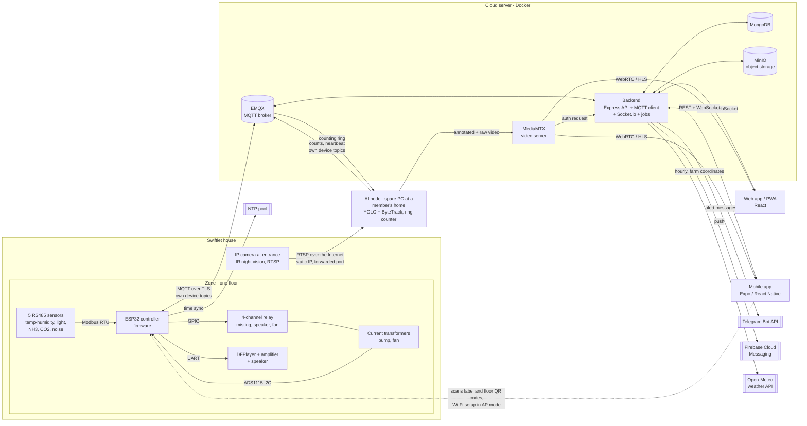

Redis is started by `docker-compose.yml` but no module uses it yet (reserved); it is therefore not part of the architecture.

### 2.2 Main Data Flows

| # | Flow | Path | Notes |
| --- | --- | --- | --- |
| DF-1 | Telemetry | Sensors → ESP32 (1 Hz, filtered) → MQTT `swiftletcare/dev/{deviceId}/telemetry` (QoS 0) → backend → MongoDB (1 sample / 10 s) and Socket.io `TELEMETRY_UPDATE` | While the broker is unreachable the ESP32 buffers 1 sample / 10 s in flash and uploads it on `…/telemetry/buffered` (QoS 1); a sample leaves the flash only after its PUBACK (ENV-FR-024) |
| DF-2 | Control | ESP32 decides every 10 s locally (fuzzy) → relays → `…/relay/status` → backend → `RELAY_UPDATE` | The cloud never closes the control loop (C-1) |
| DF-3 | Configuration | User changes thresholds / coefficients / detection parameters → backend validates, stores with history and raises the zone's configuration version → full configuration published retained on `…/{deviceId}/config` of every controller of the zone → ESP32 clamps, stores in NVS, reports the applied version in its heartbeat | A controller that reconnects receives the retained configuration at once (ENV-FR-027) |
| DF-4 | Device alerts | ESP32 detects misting without humidity rise, speaker failure, sensor/bus fault, noise anomaly, unexpected restart → MQTT `…/alert` (QoS 1, event ID) → `createAlert()` → `ALERT_NEW`, Telegram, push, in-app inbox | An alert raised offline waits in NVS until its PUBACK; the backend counts an event ID once (ALERT-FR-008) |
| DF-5 | Backend-raised alerts | Telemetry ingestion with dwell time (`THRESHOLD_BREACH`, BR-34); jobs: offline (10 s), sensor anomaly and forecast (10 min), return rate (daily) → `createAlert()` | Inferred types stay MEDIUM/LOW and go to the expert's queue |
| DF-6 | Bird counts | Camera RTSP → AI node → MQTT `swiftletcare/dev/{deviceId}/vision/bird-count` (session every 30 s, 5-minute buckets, QoS 1) → backend resolves the camera's house → `BIRD_COUNT_UPDATE` | Counts belong to the house (Report 3 §2.8) |
| DF-7 | Live video | AI node publishes annotated stream to MediaMTX → viewer gets a 60-second token from the API → MediaMTX asks `POST /internal/stream-auth` → WebRTC (web) or HLS (mobile) | Video never passes through the backend |
| DF-8 | Expert loop | Daily, weekly and monthly house health reports and inferred alerts → expert verdict, tuning, conclusion → notifications to the Farm Owner | EXPERT-FR-003…011 |
| DF-9 | Device setup | Administrator adds the device to the stock (label and broker credential issued) → device flashed with its ID and credential → Farm Owner scans the label and the floor code in the mobile app → `POST /devices/sensor-nodes/register` (device `PENDING`) → Wi-Fi entered in AP mode → first heartbeat on the device's own topics → backend sets `ONLINE` and publishes the zone's configuration retained → heartbeat reports the configuration version → app shows "configuration applied" | Nothing about the farm is typed on or stored in the device (FARM-FR-003c); a move only changes the zone in the database and republishes the configuration, online or offline |
| DF-10 | Daily health assessment (MF-11) | After the evening return-rate check: per house, environment in range (telemetry of each zone), air-quality hours and noise episodes (alerts, dismissed ones excluded), return-rate drop (counts), completeness per source and the day's rain → levels of the house (BR-28) → status with reasons (BR-29, 30) → `househealthdays` (current status) → daily report → in-app notification → each assessor rates the day before seeing the status; the status shown is stored with the rating (BR-31) | Late data and later verdicts recompute the current status only; weekly and monthly reports aggregate the stored days; the field evaluation reads the snapshots (ANALYTICS-FR-014) |
| DF-11 | Weather | Hourly job → Open-Meteo by farm coordinates → `weatherobservations` → charts and DF-10 | Only coordinates leave the system; used only by BR-30 and for display (C-6) |

---

## 3. Technology Declaration

### 3.1 Third-Party Services

| Service | Purpose | Data sent |
| --- | --- | --- |
| Telegram Bot API | Out-of-app alert channel (ALERT-FR-013) | Chat ID of the linked user, alert title, message, farm and zone names |
| Firebase Cloud Messaging | Mobile push notifications (ALERT-FR-002) | Device token, alert title and message |
| Open-Meteo | Weather context: hourly outdoor temperature, humidity, rainfall (ANALYTICS-FR-013) | Latitude and longitude of the farm only. `[TEAM: confirm the terms of use for this project]` |
| NTP (`pool.ntp.org`) | Clock of the ESP32 for the speaker schedule, the hourly noise baseline and command freshness (BR-35) | Time request only, no user data |
| SMTP e-mail provider | Invitation links, temporary passwords and password-reset codes | E-mail address, link or one-time code |
| Roboflow | Annotation of the training images: draft labels from motion tracks are uploaded and corrected by hand | Frames extracted from the team's own entrance clips (masked, no people, no personal data) |
| Google Colab | Training the detection model (Ultralytics) and exporting it to ONNX | The labelled dataset |

Self-hosted components (no data leaves the installation's servers): EMQX, MongoDB, MinIO, MediaMTX.

### 3.2 Development Technologies

| Layer | Technology | Version (from the repository) |
| --- | --- | --- |
| Firmware | ESP32 (ESP32-WROOM-32D), Arduino framework on FreeRTOS, PlatformIO `espressif32` | Arduino-ESP32 core 2.0.17; firmware 1.4.0 |
| Firmware libraries | ESP-IDF MQTT client `esp-mqtt` (`mqtt_client.h`, shipped with the Arduino-ESP32 core: QoS 1 publish, TLS with a CA certificate, persistent session), ArduinoJson, ModbusMaster, DFRobotDFPlayerMini, ElegantOTA, Adafruit ADS1X15 for the current transformers | core 2.0.17, ^7.0, ^2.0.1, ^1.0.6, ^3.1; ADS1X15 pinned when it is added |
| Controller board | Team-designed PCB: ESP32, RS485 transceiver, relay drivers, ADS1115 16-bit ADC with two clamp-on current transformers (SCT-013 or ZMCT103C class, isolated from mains) | `[TEAM: board revision]` |
| AI pipeline | Python, OpenCV, NumPy, ONNX Runtime, supervision (ByteTrack), paho-mqtt, PyYAML, loguru; detection model YOLO26n exported to ONNX (one class, trained on Colab; `torch`/`ultralytics` are not runtime dependencies) | Python 3.11–3.12; opencv-python ≥ 4.14 < 5; numpy ≥ 1.26 < 3; onnxruntime 1.30; supervision 0.30; paho-mqtt 2.x |
| Backend | Node.js, TypeScript, Express, Mongoose, mqtt.js, Socket.io, node-cron, jsonwebtoken, bcryptjs, firebase-admin (FCM) | Node 22, TypeScript ^5.4, Express ^4.19, Mongoose ^8.3, mqtt ^5.6, Socket.io ^4.7, node-cron ^3.0 |
| Web | React, Vite, TailwindCSS, TanStack Query, Zustand, axios, socket.io-client, React Router; `qrcode` (device labels, floor codes), `html5-qrcode` (scanning in the browser), `jspdf` + `jspdf-autotable` (health report PDF) | React ^18.3, Vite ^5.3, Tailwind ^3.4, TanStack Query ^5.40, Zustand ^4.5, React Router ^6.23, qrcode ^1.5.4, html5-qrcode ^2.3.8, jspdf ^2.5.1, jspdf-autotable ^3.8.2 |
| Mobile | Expo (Router), React Native; `expo-camera` (device labels, floor codes), `expo-notifications` (FCM device token), `expo-video` (HLS live stream), `react-native-mmkv`, `victory-native` | Expo ~53, React Native 0.79.6, React 19.0 |
| Database and infrastructure | MongoDB, EMQX (HTTP authentication against the backend, file-based authorisation), MinIO, MediaMTX (Docker images) | mongo 7.0, emqx 5.7.0, minio latest, mediamtx 1.21.1 |
| Testing | Jest + mongodb-memory-server (backend, mobile), Vitest (web), Unity on host `pio test -e native` (firmware), pytest (AI pipeline) | Jest ^29.7, Vitest ^1.6 |

### 3.3 Source Code and DevOps

| Item | Choice |
| --- | --- |
| Repository hosting | GitHub, repository `NBao261/SwiftletCare_KLTN` |
| Branches | `develop` is the integration branch (default); `main` receives releases for production. Work branches `feat/…`, `fix/…`, `docs/…`, `chore/…`, `hotfix/…` (`docs/github-setup.md`) |
| Branch rules | `develop`: pull request with 1 approval, stale reviews dismissed, no force push, no deletion. `main`: pull request with code-owner approval, required status checks, linear history, push restricted to the owner |
| Commits | Conventional Commits with a project `type`/`scope` list, checked by commitlint in CI (`.commitlintrc.json`) |
| CI (`.github/workflows/ci.yml`) | On every pull request: commitlint, gitleaks secret scan, then only for the modules the PR touches: backend `lint`, `build:check`, `npm test` (unit + integration on mongodb-memory-server, 80 % line coverage); web `lint`, `tsc`, `vitest`, `build`; firmware `pio test -e native`; mobile `lint`, `typecheck`, `jest`; AI pipeline `pytest` |
| Code review | Every PR is reviewed against the module's own rules (`*/CLAUDE.md`), with an automated review routine (`.claude/commands/review-pr.md`) plus one human approval |
| CD | No automated deployment: staging and production are deployed by hand from a tag (Section 11) |

### 3.4 Deployment Environments

| Environment | Where | How it is deployed | Rollback |
| --- | --- | --- | --- |
| Development | Each member's machine | `docker compose up -d` (MongoDB, EMQX, MinIO, MediaMTX), `npm run dev` for backend and web, Expo for mobile, ESP32 flashed over USB or LAN OTA | — |
| Staging | One rented VPS (2 vCPU, 4 GB RAM, ≥ 60 GB SSD, Ubuntu 24.04 LTS) in Singapore or Vietnam, `[TEAM: provider]`, with a domain `[TEAM: domain]` and four names: `app.`, `api.`, `stream.`, `mqtt.`. The AI node is the team's spare PC at a member's home, reading the camera over the Internet (Section 11) | From the tag being demonstrated: `docker compose -f docker-compose.staging.yml up -d --build` (backend and web built into images, Caddy reverse proxy with Let's Encrypt TLS, a TLS proxy for MQTT and the video publish, EMQX, MongoDB, MinIO, MediaMTX); pending `npm run migrate:*` scripts run once; demo data loaded by the seed script. Procedure: `docs/deploy/staging.md` | Re-deploy the previous tag with the same command; restore the `mongodump` taken just before the deployment |
| Production | Not operated commercially (Report 3, Section 8) | Same procedure as staging from `main` | Same as staging. Controller firmware rolls back by itself when a new image does not reach the broker within 10 min (FARM-FR-013) |

Defense 1.1 demonstrations run on staging with seeded data (guideline §9.2).

### 3.5 AI Tools

| Tool | Model | Used in |
| --- | --- | --- |
| Claude Code | `[TEAM: model]` | Specification (SRS restructuring), design (this SDD, diagrams), code (backend, firmware, pipeline), tests, pull-request review |
| `[TEAM: other tools]` | `[TEAM]` | `[TEAM]` |

Every AI output merged into `develop` passes code review and CI first (guideline §10).

---

## 4. Key Design Decisions

| ID | Decision | Options considered | Chosen and rationale | Related |
| --- | --- | --- | --- | --- |
| D1 | Where the control loop runs | Cloud decides and sends commands; ESP32 decides locally | **ESP32 decides locally** every 10 s; the cloud only configures. Control keeps working without the Internet, which the registration commits to | ENV-FR-010, 011, 014, C-1 |
| D2 | Control method | On/off thresholds; PID; fuzzy logic | **Zero-order Sugeno fuzzy logic with time-proportioning** on relays: smooth power levels with plain relays, parameters a domain expert can read and tune; mirrored in the backend for simulation and suggestions | ENV-FR-010, 011, 021, ANALYTICS-FR-010 |
| D3 | Device–cloud protocol and device identity | HTTP polling; WebSocket; MQTT with topics per farm/house/zone and a shared credential; **MQTT with topics per device and a credential per device** | **MQTT (EMQX) over TLS, one topic tree per device `swiftletcare/dev/{deviceId}/…`, one broker credential per device.** The device knows only its ID and credential; its farm, house and zone live in the backend, so a move needs no message to the device and no topic correction. The broker authorises with one static rule (a device reaches only `swiftletcare/dev/${username}/#`), so a leaked credential exposes one device, and revoking the stock entry cuts it off. Delivery: live telemetry and heartbeat QoS 0 (the next sample replaces a lost one); buffered telemetry, device alerts, relay status, counts and every command QoS 1, with an event ID or command ID so a redelivery is applied once (BR-35); configuration retained per device and applied by version. The ESP32 uses ESP-IDF `esp-mqtt` because PubSubClient cannot publish with QoS 1 | Section 7.2, FARM-FR-003c, BR-27, BR-35, NFR-10 |
| D4 | Database | Relational (PostgreSQL); time-series DB; MongoDB | **MongoDB** with Mongoose: telemetry as documents with TTL (90 days), flexible embedded histories (thresholds, tuning), one store for the whole system; schema enforced by `$jsonSchema` validators generated from the models | Section 6 |
| D5 | Where bird counting runs | Raspberry Pi at the house; cloud GPU server fed by the camera stream; desktop PC at the house; **the team's spare PC at a member's home** | **Spare PC at a member's home, reading the camera over the Internet**: no new hardware and more compute than a Raspberry Pi, no paid GPU server, and the machine stays dry and is maintained where the team lives instead of in a humid house nobody visits. The house's VNPT line has a static public IP, so the camera's RTSP feed (1080p, about 2 Mbps) is pulled over TCP through one forwarded port. Costs: the house's uplink carries the feed during the sessions; an outage of either line leaves the session incomplete (VISION-FR-020); the forwarded port answers only the AI node's static public IP (source-IP rule on the house modem, NFR-10 e) and the camera has a strong password. Checked by a 24-hour pull test and by counting the same clip read locally and over the Internet; throughput is measured on this PC (NFR-04). One camera per entrance, counts per house | VISION-FR-002, 020, THREAT-FR-010, NFR-04 |
| D6 | Counting geometry | Straight virtual line; ring around the hole with tracking only near it; ring with whole-frame tracking | **Whole-frame tracking and a closed ring around the hole, with extrapolation of fast tracks**: birds leave the hole in every direction, so a line misses some; at the hole a bird is a 1–2-frame blur moving 150–200 px/frame (clip of 22/10/2026), so tracking near the hole alone never gives it an identity — tracked over the whole room it already has one, and a fast track lost just outside the ring is counted by its last velocity. Fly-pasts cancel in the net count | VISION-FR-004, 005, 009, 018, BR-25 |
| D7 | Expert in the loop | Expert approval blocks every change; changes apply at once with no review | **Owner changes apply at once and open a review item; only the expert applies system suggestions; without an expert the owner decides** — safety on site is never blocked and every parameter is still validated | EXPERT-FR-010, 011, BR-22 |
| D8 | Live video path | Through the backend; dedicated video server | **MediaMTX** with short-lived viewing tokens checked by the backend: the API never carries video, raw feed only for the pipeline | VISION-FR-013 |
| D9 | Device identity and setup | Technician types device ID and key on a web console; QR code shown on the controller's AP-mode page; small display on the board; Bluetooth (BLE) provisioning; **printed label QR code plus a code on each floor** | **Printed label with device ID and activation key, and a floor code**: the ESP32 has no display or code of its own, and a label needs no hardware or firmware change because the key is checked only by the backend and never stored on the controller. Floors share one Wi-Fi network, so the floor cannot be told by radio; scanning its code replaces choosing from a list. Farm, house and zone are kept only by the backend (D3), so they are never entered on the device and a move, online or offline, needs no visit. A display or BLE would add hardware or much more firmware for the same two steps. Optional later: derive the device ID from the factory MAC address so every board runs one firmware image | FARM-FR-003, 003c, 007, 007b, 010, 011, 012, BR-26, 27 |
| D10 | How the sources are combined into a house's health | Weighted health score; classifier trained on labelled days; **transparent rules with agreement between sources** | **Rules with agreement**: no source gives weights, and there are no labelled days to train on yet; each source is compared with the house's own past or with sourced ranges, a status needs two sources to reach `ACTION`, every status lists the indicators behind it, and the levels are set by the expert. The rules are judged by agreement with practitioners' independent ratings (NFR-14); a learned model can be tried later on the rated days | ANALYTICS-FR-012, 014, BR-28…31 |
| D11 | Actuator current sensing | None (infer from humidity); Hall-effect IC in the mains path (ACS712); **clamp-on current transformer with an external ADC** | **Current transformer + ADS1115**: isolated from mains, so no mains track crosses the logic board; non-invasive on existing wiring; the ESP32's own ADC is not linear enough. Normal current is learned per load, so no threshold is invented for an unknown pump or fan | THREAT-FR-014, BR-32 |
| D12 | Outdoor conditions | Outdoor sensor node; **weather API**; none | **Weather API (Open-Meteo)** by farm coordinates: no hardware, includes rainfall, which a node does not measure easily and which explains low return rates; it is a regional estimate, so it is context only. An outdoor node stays optional | ANALYTICS-FR-013, BR-30, C-6 |
| D13 | Report files | Server-side PDF; **PDF in the web client, CSV from the API** | **`jspdf` in the web client** (already a dependency) renders the report the API returns, so the file shows the same figures as the screen; the CSV of daily indicators is produced by the API so every client gets the same columns | EXPERT-FR-013 |
| D14 | Scope of the supporting roles | Maintenance tickets with routing by region, SLA and KPIs; Technician invited into each farm by its owner; **Technician sees every farm's devices, without relay control** | **Technician on every farm, devices only**: tickets, SLA, regions and KPIs serve a service company with many customers, not the house (Review 1: "more a platform than a system"); an invitation per farm adds a step for every repair. The risk of a role that is not a farm member is limited by what it can do: no relays, thresholds, coefficients or alert acknowledgement, no environmental data, and every device action is audited and notified to the Farm Owners. Faults reach the owner as repeated alerts instead of tickets | FARM-FR-009, 013, ALERT-FR-015, 016, Report 3 §2.4 |
| D15 | Manual override against the controller's checks | Manual override above everything; protections above manual; **manual above the software checks, with limits** | **Manual override passes the fuzzy output, the misting latch and the sensor safe state, within limits:** these checks infer a fault from humidity or from a missing reading, so they must not lock out the owner who sees the house; the electrical protection stays in the house's panel (C-7). A remote pump ON lasts at most 30 min and needs a confirmation while a sensor or misting alert is open, so a forgotten command cannot run the pump for hours on a faulty sensor; each relay has its own expiry | ENV-FR-016…018, BR-08, BR-19, BR-20, C-7 |
| D16 | Daily status when data arrives late | Freeze the day at the first rating; recompute and overwrite; **keep both** | **A current status that follows the data and an evaluation snapshot per rating that never changes:** operations see the best status, while the agreement measure (NFR-14) compares each rating with exactly what the assessor saw | ANALYTICS-FR-012, 014, EXPERT-FR-012, BR-31 |

The Design Brief (BM01, section 3) proposes five of these.

---

## 5. Component Design

### 5.1 Firmware (ESP32 controller)

FreeRTOS tasks pinned to core 1:

| Task | Priority | Does |
| --- | --- | --- |
| `SensorTask` | 2 | Every 1 s: read the five Modbus sensors (`sensors/SensorManager`), mark stale readings, filter temperature and humidity (`sensors/SignalFilter`: median 5 + scalar Kalman), read the pump and fan currents from the ADS1115, update the hourly noise baseline and detect abnormal noise (`sensors/NoiseAnomalyDetector`); while the broker is unreachable, append the sample to the offline buffer (`storage/StorageManager`, SPIFFS, 1 sample / 10 s, 256 KB) |
| `PIDTask` | 3 | Every 10 s: speaker schedule (`audio/AudioManager`), the expiry of each overridden relay (BR-20), fuzzy misting and fan demand (`pid/FuzzyControl`) with time-proportioning, misting check (`pid/PumpDryMonitor`, raises `MISTING_INEFFECTIVE`), safe state on missing inputs, actuator current check against the learned normal current (BR-32); applies relays in the precedence of BR-19 and queues device alerts with an event ID |
| `MQTTTask` | 1 | Wi-Fi and the `esp-mqtt` session over TLS (CA certificate of the broker's issuer, device ID as user name, device credential as password, persistent session); publishes telemetry and heartbeat (QoS 0, heartbeat with diagnostics and the applied configuration version), relay status, device alerts and the offline buffer (QoS 1), deleting an alert or a buffered sample from NVS or flash only on its PUBACK; after an unexpected restart queues one `UNEXPECTED_RESTART` with the reset reason; receives the retained configuration (`…/config`) and commands (`…/cmd`), skipping a command ID already applied and relay, audio or restart commands older than BR-35 (the last RESTART and OTA command IDs are kept in NVS so a redelivery after the restart is ignored); remote RESTART / OTA with SHA-256 check and rollback (`ota/RemoteCommand`, `ota/RemoteOta`, OTA over HTTPS with the CA certificate) |
| `loop()` | — | Feeds the task watchdog (30 s); serves the Wi-Fi captive portal (`wifi/WiFiProvisioner`) while it is open, and reopens it when the broker stays unreachable so a new broker address can be entered |

Configuration (`config/Config`) is stored in NVS with its version, and every received value is clamped to the same ranges as the backend validator. Pure C++ parts (fuzzy, filter, noise detector, misting check, current check, command de-duplication, remote command) are unit-tested on the host.

### 5.2 AI Pipeline (AI node)

`stream.py` (RTSP or clip loop) runs `pipeline.py` (`FramePipeline`) on every frame: `frame_prep.py` masks the camera's date overlay and cuts the frame into 2 overlapping tiles → `inference.py` runs YOLO (ONNX) on each tile and merges the duplicates of the overlap → `sv.ByteTrack` tracks every bird over the whole frame (boxes enlarged before matching, because a small fast bird's boxes in consecutive frames do not overlap) → `counting.py` (`RingCounter`) counts ring crossings, extrapolates fast tracks at the hole and keeps ambiguous tracks apart → the frame is drawn with green boxes and the yellow ring. `remote_config.py` reads the node's retained `swiftletcare/dev/{deviceId}/config` and swaps in a new ring without restart. The same `FramePipeline` is used by `tools/track_clip.py`, so a recorded clip is processed exactly like the live stream. Dataset tools: `tools/pick_roi.py` (ring calibration), `tools/extract_frames.py` (masked tile images and draft labels from motion tracks for Roboflow), `tools/split_by_day.py` (train/val/test split by recording day).

`stream.py` reads the latest frame in its own thread and reconnects with back-off, publishes 5-minute buckets (`BucketClock`) and cumulative session counts (its session windows are defaults; the backend computes the sessions from the buckets, VISION-FR-008, 019) and a heartbeat every 30 s with the processed frames per second and the model version, all on the node's own device topics with its broker credential; serves an MJPEG preview on localhost and pushes the annotated stream to MediaMTX with ffmpeg (`stream_pusher.py`).

### 5.3 Backend

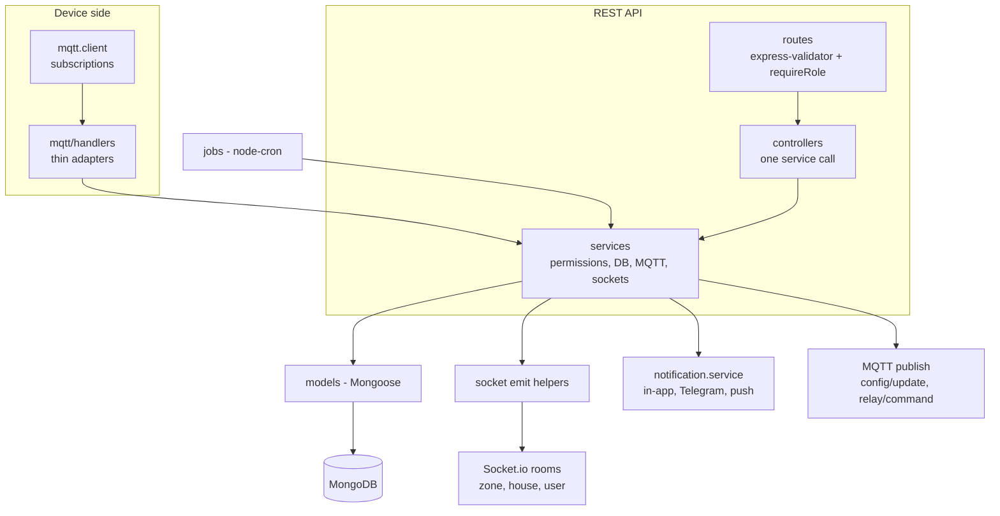

Layer rules: only services query the database, check permissions, publish MQTT and emit socket events; controllers hold no logic; every route validates input and declares its roles (`backend/CLAUDE.md`).

| Service group | Services | Requirements |
| --- | --- | --- |
| Identity and access | `auth`, `admin`, `farmAccess.util`, `mqttAuth` (broker authentication of devices) | AUTH-FR-002…012, NFR-10, Section 2.4 of Report 3 |
| Structure and devices | `farm`, `device`, `provisionedDevice`, `configSync`, `audioTrack`, `stream` | FARM-FR-001…013, ENV-FR-016…021, 027, VISION-FR-013, 018 |
| Telemetry and control | `telemetry` (with the breach dwell of BR-34), `fuzzyModel.util` | ENV-FR-001…005, ALERT-FR-012, ANALYTICS-FR-008, 010 |
| Alerts and notifications | `alert`, `sensorAnomaly`, `forecast`, `notification`, `telegram`, `push` (FCM), `relayUsage` | ALERT-FR-001…016, THREAT-FR-009, 010 |
| Flock | `birdCount` | VISION-FR-006…012, 017 |
| Analytics and expert | `analytics`, `healthAssessment`, `healthReport`, `weather`, `expertActivity`, `parameterReview`, `coefficientProposal` | ANALYTICS-FR-001…014, EXPERT-FR-001…013 |
| Supporting | `system`, `harvest` | SYSTEM-FR-001…003, HARVEST-FR-001…005 |

Background jobs:

| Job | Schedule | Does |
| --- | --- | --- |
| `deviceOffline` | every 10 s | Controller silent > 30 s → `OFFLINE` + `NODE_OFFLINE`; AI node silent > 90 s → `OFFLINE` + `EDGE_AI_DEGRADED` |
| `overrideExpiry` | every 1 min | Expired overrides back to `AUTO` |
| `alertEscalation` | every 2 min | Unacknowledged CRITICAL/HIGH after 15 min, `NODE_OFFLINE` after 1 h → sent once more to the Farm Owners (ALERT-FR-015); automatic resolution of breaches and episodic alerts (BR-16) |
| `configSync` | every 1 min | Controllers still reporting an old configuration version: republish; 3 heartbeats behind while online → `CONFIG_MISMATCH` (BR-24) |
| `sensorAnomaly` | every 10 min | Stuck, jumping and drifting sensors → `SENSOR_ANOMALY` |
| `forecast` | every 10 min | 60-minute forecast → `FORECAST_BREACH` |
| `returnRate` | daily, 15 min after the evening window of each house (BR-21) | Sessions from the 5-minute buckets of that day's windows, completeness (VISION-FR-020), return rate vs previous days → `LOW_RETURN_RATE` |
| `healthAssessment` | daily, after `returnRate`; again when late data or a verdict touches a day of the last 7 | Current daily status of every house (ANALYTICS-FR-012, BR-28…30) |
| `healthReport` | BR-33 | Daily, weekly and monthly reports per house with a section per zone; notifications |
| `weather` | hourly | Weather of every farm with coordinates (ANALYTICS-FR-013) |
| `activationOverdue` | every 1 min | Devices not activated in 15 min; OTA unconfirmed after 30 min |
| `relayUsage` | hourly | Pump and fan ON time and switch count since the last service → `MAINTENANCE_DUE` (ALERT-FR-016) |
| `invitationExpiry` | hourly | Invitations older than 7 days → `EXPIRED` |

### 5.4 Web and Mobile

Both clients follow the same pattern: TanStack Query for server state, Zustand for session state, axios for REST, socket.io-client for real-time events, one route group per role, data from the API only (no mock data). The web application is a PWA with the Farm Owner, Domain Expert, Technician and Administrator screens; the mobile application uses Expo Router and serves the Farm Owner and the Domain Expert with the scope of the registration form (3.2 b): monitoring, count analytics and the live stream, alerts with push, manual override, device setup by QR code, daily health status, reports and ratings, harvest logging, and expert validation and tuning.

Live stream (VISION-FR-013): the web plays WebRTC (WHEP) and the mobile app plays HLS with `expo-video`, both from MediaMTX with the same 60-second token. The counting-ring editor draws the ring over a frame of the stream (web, VISION-FR-018).

Push (ALERT-FR-002): after sign-in the mobile app gets the FCM device token with `expo-notifications` and registers it with the API; sign-out removes it; the backend deletes a token that FCM reports invalid.

Health (MF-11): web and mobile show each house's daily status with its reasons and the rating screen, which asks for the assessor's own status before revealing the system's (BR-31). The blinding is enforced by the API, not only by the screens: for a Farm Owner or Domain Expert who has neither rated nor skipped a day inside the rating window, the day, report, CSV and notification endpoints return the day without its status, reasons or the other ratings; `POST …/rating` stores the rating and its snapshot in one atomic update and returns the status in its response; `POST …/skip` reveals it without a rating; the web exports a report as PDF with `jspdf` and downloads the daily indicators as CSV from the API.

Manual override (MF-09): before a pump ON, the client reads the zone's open alerts; when a `SENSOR_FAULT`, `RS485_BUS_FAILURE` or `MISTING_INEFFECTIVE` is open it shows them and sends the command with the confirmation (ENV-FR-016).

Farm location (FARM-FR-001): the farm form takes the coordinates from the device's current position (browser or phone geolocation, used while standing at the house) or as typed latitude and longitude; no map library is added. The farm list marks a farm still without coordinates, because it gets no weather (A-5).

Device setup (MF-10): the mobile app scans the device label and the floor code with `expo-camera`, fills in the registration, guides Wi-Fi provisioning in AP mode and shows the setup progress (FARM-FR-012) from the device status and the configuration sync state (SM-12). The Administrator's stock screen prints the label right after a device is added, because the API returns the activation key (and, for flashing, the broker credential) only then; the zone screen prints floor codes. Both QR codes are generated in the client with `qrcode` from values the API already returns, so there is no QR endpoint. Formats: `swiftletcare://claim?d=<device ID>&k=<activation key>` and `swiftletcare://zone?z=<zone ID>`; a scan in the web console (`html5-qrcode`) reads the same formats.

### 5.5 Engineering Constants in the Code

Each constant of Report 3, Section 4.5 has one home in the code. A change of value is made there and in Report 3 in the same pull request.

| Constant (Report 3 §4.5) | Where |
| --- | --- |
| Misting retry after a misting latch | firmware `PUMP_DRY_RETRY_MIN` |
| Highest humidity still valid | firmware `HUMIDITY_SATURATION_MAX`, backend `fuzzyModel.util.ts` |
| Last valid temperature/humidity reused | firmware `CONTROL_INPUT_MAX_AGE_CYCLES` |
| Repeat of an ongoing episodic alert | firmware `EPISODE_ALERT_RESEND_MS` |
| Automatic resolution of an episodic alert | backend `EPISODE_CLEAR_MS` |
| AUTO status ignored after a manual command | backend `DEVICE_CONFIRM_GRACE_MS` |
| Override duration limits | backend `MIN_OVERRIDE_MS`, `MAX_OVERRIDE_MS`, `MAX_PUMP_ON_OVERRIDE_MS` |
| Command freshness | firmware and backend `COMMAND_MAX_AGE_MS` |
| Threshold-breach dwell time | backend `BREACH_DWELL_MS` |
| AI node silent before it is offline | backend `CAMERA_OFFLINE_THRESHOLD_MS` |
| AI node frame rate that raises `EDGE_AI_DEGRADED` | AI node `config.yaml`, backend `CAMERA_MIN_FPS` |
| Default session windows | AI node `config.yaml`, backend `DEFAULT_SESSION_WINDOWS` |
| Return-rate check | backend `jobs/returnRate.job.ts`, `MIN_BASELINE_DAYS` |
| One read of 5-minute counts | backend `MAX_BUCKET_RANGE_MS`, `DEFAULT_BUCKET_RANGE_MS` |
| Live-stream viewing token | backend `STREAM_TOKEN_TTL_SEC` |
| Counting ring vertices | backend `devices.route.ts`, AI node `remote_config.MAX_POINTS` |
| Ring margin, tile overlap, extrapolation | AI node `config.yaml` (`tracking.ring`, tile overlap, `extrapolate_min_speed_px`, `extrapolate_frames`) |
| OTA timeouts | firmware `OTA_VERIFY_TIMEOUT_MS`, `OTA_READ_TIMEOUT_MS`; backend `OTA_CONFIRM_TIMEOUT_MS` |
| Configuration mismatch | backend `CONFIG_MISMATCH_HEARTBEATS` |
| Device not connected after registration | backend `ACTIVATION_TIMEOUT_MS` |
| Rate limits | backend `RATE_LIMIT_MAX`, `AUTH_RATE_LIMIT_MAX`, `AUTH_RATE_LIMIT_WINDOW_MS`, `REFRESH_RATE_LIMIT_MAX` |
| Account deletion reminder | backend `DELETION_REMIND_DAYS_BEFORE` |
| Repeat of an unacknowledged alert | backend `jobs/alertEscalation.job.ts` |
| Service limits of the pump and the fan | backend `RELAY_SERVICE_LIMITS` |
| Temporary password | backend account-creation service of AUTH-FR-005c |
| Live-data label, zone balance bands | web `LIVE_MAX_AGE_MS`, `STALE_TIMEOUT_MS`, `ZoneBalanceCard` |
| Health-indicator level defaults, rain confounder, rating window | backend `healthAssessment` service |
| Actuator current check | firmware actuator-current monitor |
| Weather fetch | backend `jobs/weather.job.ts` |
| Size of one installation | staging sizing (Section 3.4) and the NFR-03 load script |
| Retention (BR-36) | TTL indexes of Section 6.3 |

---

## 6. Data Design

### 6.1 Logical ERD

```mermaid
erDiagram
  USER {
    ObjectId _id PK
    string email UK
    string role "ADMIN | FARM_OWNER | DOMAIN_EXPERT | TECHNICIAN"
    string full_name
    string status "ACTIVE | LOCKED | DELETION_REQUESTED | DELETED"
    string locked_reason
    date locked_at
    date deletion_requested_at
    date deleted_at
    bool must_change_password
    string telegram_chat_id
  }
  PUSH_TOKEN {
    ObjectId _id PK
    ObjectId user_id FK
    string token UK
    string platform "android | ios"
    date last_seen_at
  }
  FARM {
    ObjectId _id PK
    ObjectId owner_id FK
    string name
    string address
    object coordinates "lat, lng"
    array members "embedded: user_id, role, is_primary"
    bool is_deleted
  }
  INVITATION {
    ObjectId _id PK
    ObjectId farm_id FK
    ObjectId invited_by FK
    string invited_email
    string invited_role
    string status "PENDING | ACCEPTED | DECLINED | EXPIRED"
    date expires_at
  }
  HOUSE {
    ObjectId _id PK
    ObjectId farm_id FK
    string name
    object bird_count_tuning "return_rate_drop_pct"
    object counting_schedule "seasonal profiles, temporary windows"
    object health_levels "BR-28 level boundaries"
    array tuning_history
  }
  ZONE {
    ObjectId _id PK
    ObjectId house_id FK
    ObjectId farm_id FK
    string name
    object thresholds
    object fuzzy_tuning
    object detection_tuning
    number config_version
    array threshold_history
    array fuzzy_tuning_history
    array detection_tuning_history
  }
  SENSOR_NODE {
    ObjectId _id PK
    string device_id UK
    ObjectId zone_id FK
    string status "PENDING | ONLINE | OFFLINE"
    date decommissioned_at
    object relays "per relay: state, mode AUTO|MANUAL, override_expiry, override_by"
    string firmware_version
    date last_heartbeat
    string last_reset_reason
    number applied_config_version
    object actuator_baseline "learned normal current per load"
    object ota_pending "version, requested_at"
    object ota_failed "version, failed_at"
  }
  CAMERA_NODE {
    ObjectId _id PK
    string device_id UK
    ObjectId house_id FK
    string status "PENDING | ONLINE | OFFLINE"
    date decommissioned_at
    date last_heartbeat
    number fps
    string model_version
    object counting_ring
    array counting_ring_history
  }
  PROVISIONED_DEVICE {
    ObjectId _id PK
    string device_id UK
    string kind "SENSOR | CAMERA"
    string activation_key_hash
    string broker_secret_hash
    date claimed_at
    date key_reissued_at
    date revoked_at
  }
  TELEMETRY {
    ObjectId node_id FK
    ObjectId zone_id FK
    date timestamp
    number temperature
    number humidity
    number nh3_ppm
    number co2_ppm
    number light_lux
    number sound_db
    array stale_fields "sensors reported stale"
    bool is_anomaly
    array anomaly_fields
    number misting_pct
    number ventilation_pct
    number pump_current_a
    number fan_current_a
    bool buffered
  }
  RELAY_OVERRIDE_LOG {
    ObjectId _id PK
    ObjectId node_id FK
    ObjectId zone_id FK
    ObjectId started_by FK
    string relay
    bool state
    bool alert_confirmed
    date started_at
    date expires_at
    date ended_at
    string end_reason "EXPIRED | CANCELLED"
  }
  AUDIO_TRACK {
    ObjectId _id PK
    ObjectId node_id FK
    number track_number
    bool synced_to_sd
  }
  ALERT {
    ObjectId _id PK
    ObjectId farm_id FK
    ObjectId zone_id FK "zone alerts"
    ObjectId house_id FK "house alerts"
    ObjectId node_id FK
    string event_id "device event, unique per node"
    string type
    string severity
    string status "ACTIVE | ACKNOWLEDGED | DISMISSED | RESOLVED"
    string previous_status "status before DISMISSED"
    object details "metric, observed, threshold, direction, started_at, reset_reason"
    object expert_verdict "result, note, by, role, at"
    number occurrence_count
    date renotified_at
    date resolved_at
  }
  BIRD_COUNT_RECORD {
    ObjectId _id PK
    ObjectId camera_node_id FK
    ObjectId house_id FK
    string session_date
    string session_type "MORNING_EXIT | EVENING_ENTRY"
    string window_start
    string window_end
    number entry_count
    number exit_count
    bool complete
  }
  BIRD_COUNT_BUCKET {
    ObjectId camera_node_id FK
    ObjectId house_id FK
    date bucket_start
    number entry_count
    number exit_count
  }
  HOUSE_HEALTH_DAY {
    ObjectId _id PK
    ObjectId house_id FK
    ObjectId farm_id FK
    string date "Vietnam day"
    object indicators "environment, air, flock, noise: value and level"
    object completeness "per source"
    string current_status "GOOD | WATCH | ACTION | INSUFFICIENT_DATA"
    array current_reasons
    date computed_at
    array ratings "by, role, outcome RATED | SKIPPED, rating, note, at, snapshot status and reasons"
  }
  HOUSE_HEALTH_REPORT {
    ObjectId _id PK
    ObjectId house_id FK
    ObjectId farm_id FK
    string kind "DAILY | WEEKLY | MONTHLY | CUSTOM"
    date period_start
    date period_end
    object house_metrics
    array zone_sections
    object expert_conclusion "text, by, at, edited_at"
  }
  WEATHER_OBSERVATION {
    ObjectId _id PK
    ObjectId farm_id FK
    date hour
    number temperature
    number humidity
    number precipitation_mm
  }
  NOTIFICATION {
    ObjectId _id PK
    ObjectId user_id FK
    string title
    object ref "type: ALERT | HEALTH_REPORT | HEALTH_DAY | EXPERT_DECISION | PARAMETER_REVIEW | COEFFICIENT_PROPOSAL | TECHNICIAN_ACTION | INVITATION; id"
    date read_at
    date created_at
  }
  HARVEST_BATCH {
    ObjectId _id PK
    ObjectId farm_id FK
    ObjectId zone_id FK
    ObjectId created_by FK
    string trace_code UK
    date harvest_date
    number nest_count
    number weight_grams
    string nest_type
    string photo_object_key
    object env_snapshot
    object flock_snapshot "of the zone's house"
    bool is_deleted
  }
  AUDIT_LOG {
    ObjectId _id PK
    ObjectId actor_id FK
    string actor_role
    ObjectId farm_id FK
    string action
    string target_type
    string target_id
    object before
    object after
    string source_ip
    string client
    string correlation_id
    date created_at
  }
  PARAMETER_REVIEW {
    ObjectId _id PK
    ObjectId zone_id FK
    ObjectId changed_by FK
    string group "thresholds | fuzzy"
    object old_values
    object new_values
    string status "PENDING_REVIEW | ACCEPTED | REVERTED | ADJUSTED"
    ObjectId reviewed_by FK
  }
  COEFFICIENT_PROPOSAL {
    ObjectId _id PK
    ObjectId zone_id FK
    ObjectId submitted_by FK
    object suggested_values
    object current_values
    string status "PROPOSED | APPROVED | REJECTED | SUPERSEDED"
    string note
  }
  SYSTEM_SETTING {
    bool _singleton UK
    object default_thresholds
    array default_threshold_history "values, source, by, at"
  }

  USER ||--o{ FARM : "owns"
  FARM }o--o{ USER : "members"
  USER ||--o{ PUSH_TOKEN : "registers"
  FARM ||--o{ INVITATION : "invites"
  FARM ||--o{ HOUSE : "has"
  HOUSE ||--o{ ZONE : "has floors"
  ZONE ||--o{ SENSOR_NODE : "controlled by"
  HOUSE ||--o{ CAMERA_NODE : "entrances"
  PROVISIONED_DEVICE ||--o| SENSOR_NODE : "registered as"
  PROVISIONED_DEVICE ||--o| CAMERA_NODE : "registered as"
  SENSOR_NODE ||--o{ TELEMETRY : "publishes"
  SENSOR_NODE ||--o{ RELAY_OVERRIDE_LOG : "overridden"
  SENSOR_NODE ||--o{ AUDIO_TRACK : "plays"
  ZONE ||--o{ ALERT : "zone alerts"
  HOUSE ||--o{ ALERT : "house alerts"
  CAMERA_NODE ||--o{ BIRD_COUNT_RECORD : "sessions"
  CAMERA_NODE ||--o{ BIRD_COUNT_BUCKET : "5-minute counts"
  HOUSE ||--o{ HOUSE_HEALTH_DAY : "assessed daily"
  HOUSE ||--o{ HOUSE_HEALTH_REPORT : "reported"
  FARM ||--o{ WEATHER_OBSERVATION : "weather"
  USER ||--o{ NOTIFICATION : "receives"
  ZONE ||--o{ HARVEST_BATCH : "harvested"
  USER ||--o{ AUDIT_LOG : "acts"
  ZONE ||--o{ PARAMETER_REVIEW : "owner changes"
  ZONE ||--o{ COEFFICIENT_PROPOSAL : "suggestions"
```

The expert activity history of a farm (EXPERT-FR-009) is read from `AUDIT_LOG` by `farm_id` and actor role; it is not a separate entity. The device label state (SM-16) is derived from `PROVISIONED_DEVICE` and the node registered with its device ID.

### 6.2 Collections

| Collection | Entity | Key indexes | Notes |
| --- | --- | --- | --- |
| `users` | User | `email` unique; `status` | Password hash and reset-code hashes never returned by the API |
| `pushtokens` | Push token | `token` unique; `user_id` | Removed at sign-out and when FCM reports it invalid |
| `farms` | Farm | `owner_id`, `members.user_id` | Members embedded with role |
| `invitations` | Invitation | `token` unique; `farm_id + invited_email + status` | 7-day expiry by job |
| `houses` | House | `farm_id` | Counting schedule, health levels, return-rate drop |
| `zones` | Zone | `house_id`, `farm_id` | `farm_id` immutable; histories embedded; `config_version` raised by every change |
| `sensornodes` | Controller | `device_id` unique; `zone_id`; `status + last_heartbeat` | Relays embedded, one expiry per relay |
| `cameranodes` | AI node / camera | `device_id` unique; `house_id` | Counting ring and its history |
| `provisioneddevices` | Device stock | `device_id` unique | Hashes of the activation key and the broker secret |
| `telemetries` | Telemetry | `node_id + timestamp` unique; `zone_id + timestamp`; TTL on `timestamp` | One stored sample per 10 s per device; the unique index drops a re-sent buffered sample |
| `relayoverridelogs` | Override | `node_id + started_at`; `zone_id + started_at` | Source of the autonomy ratio |
| `audiotracks` | Attractant track | `node_id + track_number` unique | |
| `alerts` | Alert | `farm_id + zone_id + node_id + type + status`; partial `house_id + type + status`; partial unique `node_id + event_id`; TTL on `resolved_at` | Expert verdict embedded |
| `birdcountrecords` | Session count | `camera_node_id + session_type + session_date` unique; `house_id + session_date` | Computed from the buckets of the day's windows |
| `birdcountbuckets` | 5-minute count | `camera_node_id + bucket_start` unique; TTL | |
| `househealthdays` | Daily health status | `house_id + date` unique; `farm_id + date` | Ratings with their snapshots embedded |
| `househealthreports` | Health report | `house_id + kind + period_start + period_end` unique | Zone sections and conclusion embedded |
| `weatherobservations` | Weather hour | `farm_id + hour` unique; TTL | |
| `notifications` | In-app notification | `user_id + created_at`; TTL | |
| `harvestbatches` | Harvest | `trace_code` unique; `farm_id + harvest_date` | Soft delete; photo in MinIO |
| `auditlogs` | Audit entry | `actor_id + created_at`, `farm_id + created_at`, `target_type + target_id`, `action + created_at` | Source of the expert activity history |
| `parameterreviews` | Review item | `zone_id + group + status` | One open item per zone and group |
| `coefficientproposals` | Proposal | `zone_id + status` | |
| `systemsettings` | Singleton settings | `_singleton` unique | Default thresholds and their sourced history |

The exact field list, types and indexes of every collection are those of the database script (6.5).

### 6.3 Data Retention

Report 3, BR-36 sets the retention periods; this table is how they are enforced.

| Data | Period (BR-36) | Mechanism |
| --- | --- | --- |
| Telemetry | 90 days | TTL index on `telemetries.timestamp` |
| 5-minute bird counts | 90 days | TTL index on `birdcountbuckets.bucket_start` |
| Hourly weather | 90 days | TTL index on `weatherobservations.hour` |
| In-app notifications | 90 days | TTL index on `notifications.created_at` |
| Resolved alerts | 180 days after resolution | TTL index on `alerts.resolved_at` |
| Session counts, daily statuses and ratings, reports, harvests, override logs, histories, audit log | Life of the installation | No TTL; soft delete where a requirement asks for it |

### 6.4 Schema Migrations

The Iteration 1 database is carried into this design by idempotent scripts (`npm run migrate:*`), run once at deployment (Section 11).

| Migration | Collections | Requirement |
| --- | --- | --- |
| Alert types renamed (`PUMP_DRY` → `MISTING_INEFFECTIVE`, `POWER_OUTAGE` → `UNEXPECTED_RESTART`), `PREDATOR_DETECTED` alerts removed, `DISMISSED` and `previous_status` added | `alerts` | THREAT-FR-011, 012, EXPERT-FR-003 |
| `is_active` replaced by `status` with the lock and deletion dates | `users` | Report 3 §6.14 |
| Zalo and SMS notification preferences removed | `users` | Report 3 §8 |
| One `control_mode` and one `override_expiry` per controller replaced by the embedded `relays` object; `heating` relay field removed; unused device states `ERROR`, `DEGRADED` mapped to `ONLINE` | `sensornodes`, `cameranodes` | BR-20, Report 3 §6.6 |
| Broker secret issued for every device in the stock (to be flashed), `claimed_at`, `revoked_at` | `provisioneddevices` | FARM-FR-010, BR-27 |
| `config_version` on zones, `applied_config_version` on controllers | `zones`, `sensornodes` | ENV-FR-027 |
| Weekly zone reports moved into house reports with `kind` and zone sections | `zonehealthreports` → `househealthreports` | EXPERT-FR-005 |
| Unused harvest state `ARCHIVED` removed; `nest_type`, `photo_object_key` | `harvestbatches` | HARVEST-FR-001 |
| `sla_hours` removed from the settings | `systemsettings` | Report 3 §8 |
| New collections created empty | `pushtokens`, `househealthdays`, `weatherobservations`, `parameterreviews`, `coefficientproposals` | ALERT-FR-002, ANALYTICS-FR-012, 013, EXPERT-FR-010, 011 |

### 6.5 Database Script

`docs/database/init.mongo.js` creates every collection with a `$jsonSchema` validator (types, required fields, enumerations, nested objects and arrays) and all indexes, including unique, partial and TTL indexes. It is **generated from the Mongoose models** by `npm run db:script` (`backend/src/utils/dbScript.util.ts`), so the script and the models always describe the same data, and every model change that brings the code closer to the ERD above regenerates it:

- `tests/unit/utils/dbScript.util.test.ts` fails if the committed script differs from what the models produce, so a model change cannot be merged without regenerating it;
- `tests/integration/databaseScript.test.ts` enforces the validators (`validationLevel: strict`, `validationAction: error`) on a MongoDB instance and writes real documents through the models, and checks that a document missing a required field is rejected.

Run: `mongosh "<MONGODB_URI>" docs/database/init.mongo.js` (safe to run twice). Seed data for demonstrations: `npm run seed`.

---

## 7. Interface Design

### 7.1 REST API

The full contract (paths, parameters, bodies, responses, roles) is `docs/api/api-spec.yaml`. Every response uses `{ success, data?, meta?, error? }`; lists paginate (default 20, max 100); routes are unprefixed.

| Router | Main resources |
| --- | --- |
| `/auth` | Login, refresh, logout, first-sign-in password change, password reset, account creation from an invitation link, notification preferences, Telegram link, deletion request (no public sign-up) |
| `/farms` | Farms, members, houses, zones, thresholds and reset, fuzzy tuning, detection tuning, bird-count tuning |
| `/invitations` | Accept, decline |
| `/devices` | Sensor nodes (register and move, also by the Farm Owner for MF-10; relay override, speaker schedule, audio tracks, remote commands, history), camera nodes (register, counting ring, stream token) |
| `/telemetry` | Latest and history |
| `/alerts` | List, detail, acknowledge, verdict, verdict statistics, evidence of an inferred alert |
| `/analytics` | Charts, comparison, control performance, forecast, coefficient suggestion, autonomy, bird counts (current, daily, trends, buckets, correlation) |
| `/health-reports` | Daily, weekly and monthly reports per house and conclusions; daily health statuses of a house; rating and skipping of a day; CSV of daily indicators (days not yet rated or skipped by the caller are returned without status, BR-31) |
| `/expert-activity` | Expert activity history of a farm (EXPERT-FR-009), review items and coefficient proposals (EXPERT-FR-010, 011) |
| `/notifications` | Inbox, mark read; push-token registration and removal (ALERT-FR-002) |
| `/harvests` | Harvest batches |
| `/admin`, `/system` | Provisioned-device stock (add and return the activation key and the broker secret once, revoke, re-issue key), Farm Owner and Technician accounts, lock, deletion requests, default thresholds, audit log, technical overview |
| `/internal/stream-auth`, `/internal/mqtt-auth` | MediaMTX authorisation and EMQX device authentication (no user token, reachable only inside the Docker network) |

### 7.2 MQTT

Every device has its own topic tree `swiftletcare/dev/{deviceId}/…` and its own broker credential (D3). EMQX authenticates a device through `POST /internal/mqtt-auth` (device ID and secret checked against the stock, refused once revoked) and authorises it with one static rule: a device publishes and subscribes only under `swiftletcare/dev/${username}/#`; the backend's service account subscribes to `swiftletcare/dev/+/…` with a persistent session and QoS 1. The backend resolves the farm, house and zone from the device record; a payload whose `deviceId` differs from the topic is dropped.

| Topic (under `swiftletcare/dev/{deviceId}/`) | Direction | Payload (main fields) | QoS |
| --- | --- | --- | --- |
| `telemetry` | controller → cloud | `deviceId`, six readings, stale sensors, `control_output`, `pump_current_a`, `fan_current_a`, timestamp | 0 |
| `telemetry/buffered` | controller → cloud | Samples from the offline buffer, each with its own timestamp; deleted from flash on PUBACK | 1 |
| `heartbeat` | controller → cloud | `deviceId`, firmware version, RSSI, free heap, uptime, reset reason, IP, `applied_config_version` | 0 |
| `heartbeat` | AI node → cloud | `deviceId`, model version, processed frames per second, camera connected | 0 |
| `relay/status` | controller → cloud | `deviceId`, per relay: state, mode, expiry; `commandId` of the command that caused the change, if any | 1 |
| `alert` | controller → cloud | `deviceId`, `eventId`, type, severity, details (reset reason for `UNEXPECTED_RESTART`); kept in NVS until PUBACK | 1 |
| `vision/bird-count` | AI node → cloud | Session counts every 30 s, or `kind: BUCKET` 5-minute counts | 1 |
| `vision/alert` | AI node → cloud | `EDGE_AI_DEGRADED` with the frame rate | 1 |
| `config` | cloud → device | Retained. Controller: thresholds, fuzzy and detection parameters, speaker settings, `config_version`. AI node: counting ring, `config_version` | 1 |
| `cmd` | cloud → device | Envelope `commandId`, `type` (`RELAY`, `CLEAR_OVERRIDE`, `AUDIO`, `RESTART`, `OTA`), `issuedAt`, payload. Applied once per `commandId`; `RELAY`, `AUDIO` and `RESTART` older than BR-35 are not applied | 1 |

Retained messages are never ingested by the backend. A move to another zone only updates the database and republishes `config`; nothing is sent about farm, house or zone.

### 7.3 WebSocket (Socket.io)

Clients authenticate with the access token. Rooms: `zone:<id>` (`JOIN_ZONE`), `house:<id>` (`JOIN_HOUSE`) and the personal room `user:<id>`. Server events: `TELEMETRY_UPDATE`, `RELAY_UPDATE`, `DEVICE_STATUS_CHANGE`, `ALERT_NEW`, `BIRD_COUNT_UPDATE`, `NOTIFICATION_NEW`.

---

## 8. State Machine Diagrams

One diagram per lifecycle of Report 3, Section 6. Transition labels name the triggering requirement; the diagrams add no rule of their own.

### 8.1 Alert — status (SM-01)

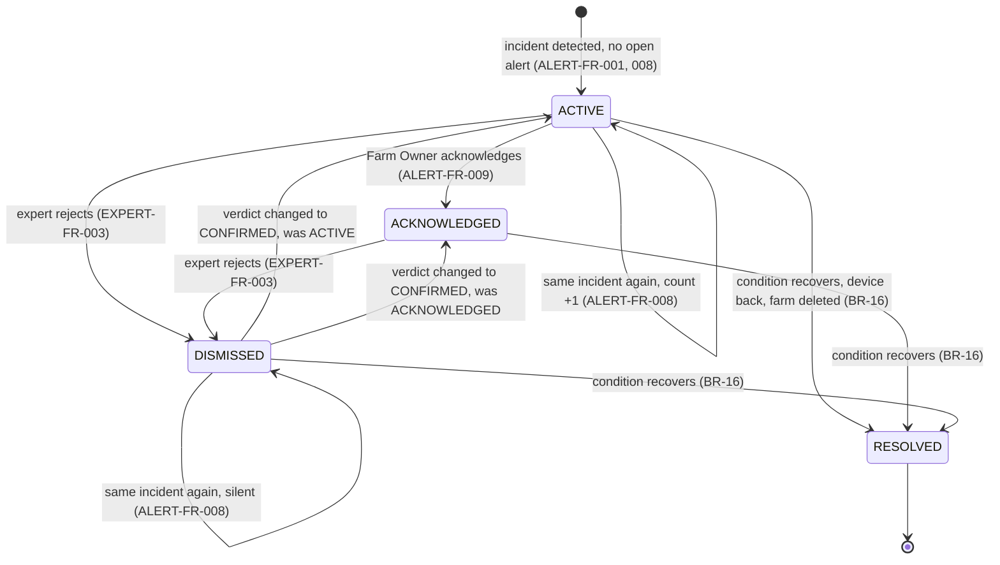

### 8.2 Alert — expert verdict (SM-02)

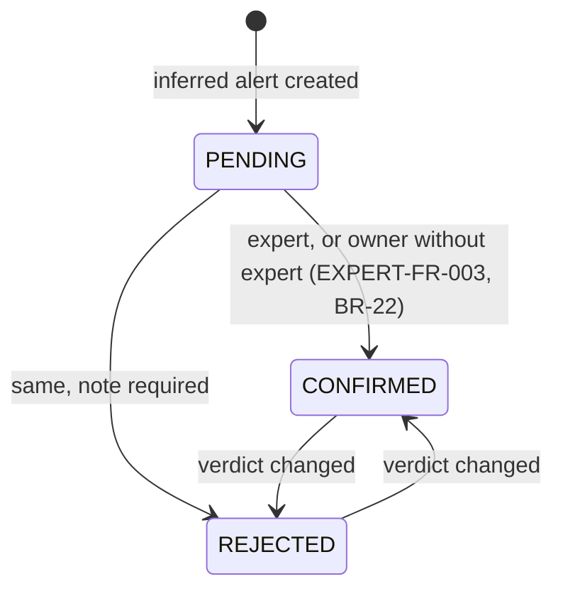

### 8.3 Relay — control mode (SM-03)

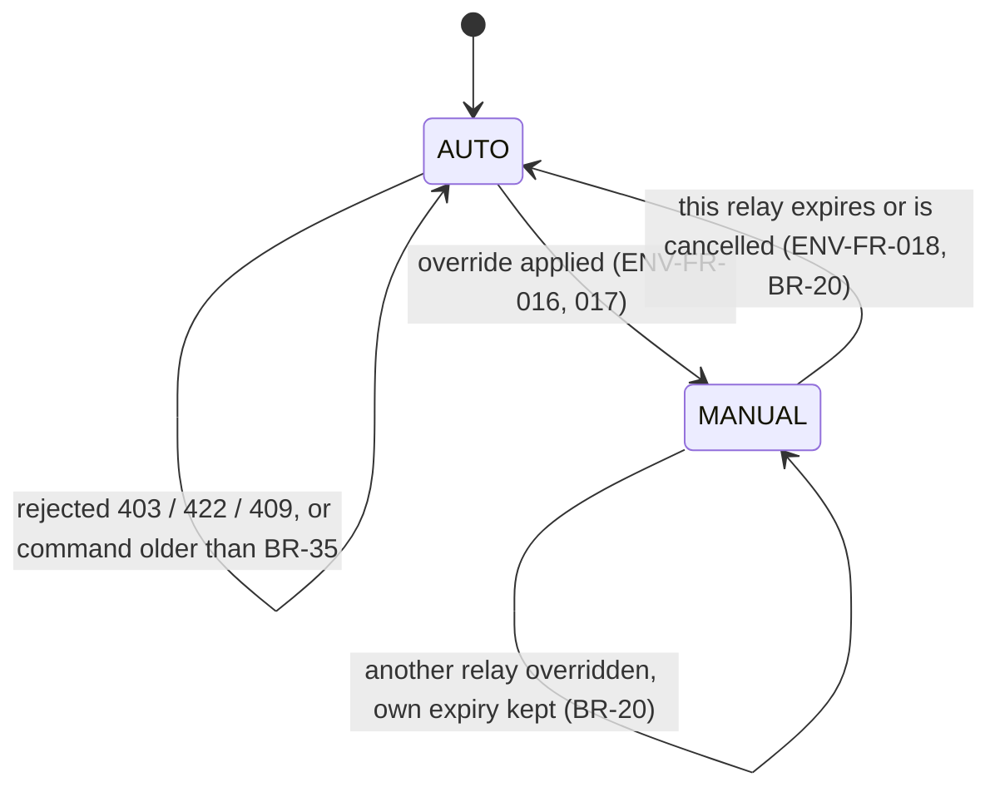

### 8.4 Invitation (SM-04)

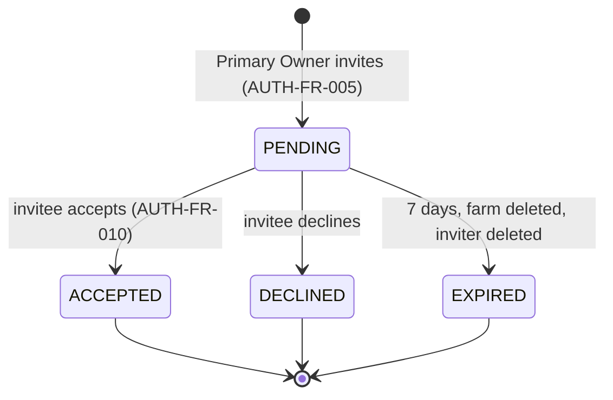

### 8.5 (SM-05, number not used)

The number is kept so that SM-06…SM-17 match Report 3, Sections 6.6–6.17.

### 8.6 Device — connection status (SM-06)

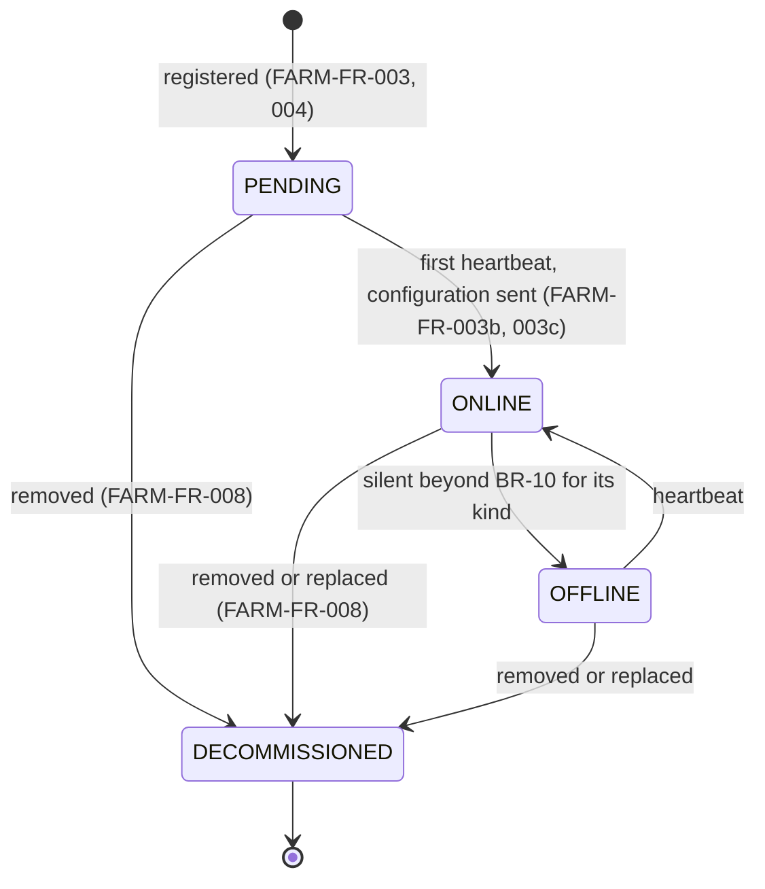

Registration is done by the Farm Owner or a Technician (MF-10). A device still `PENDING` 15 min after registration stays `PENDING` and its registrant is notified (FARM-FR-012).

### 8.7 Misting protection (SM-07, controller)

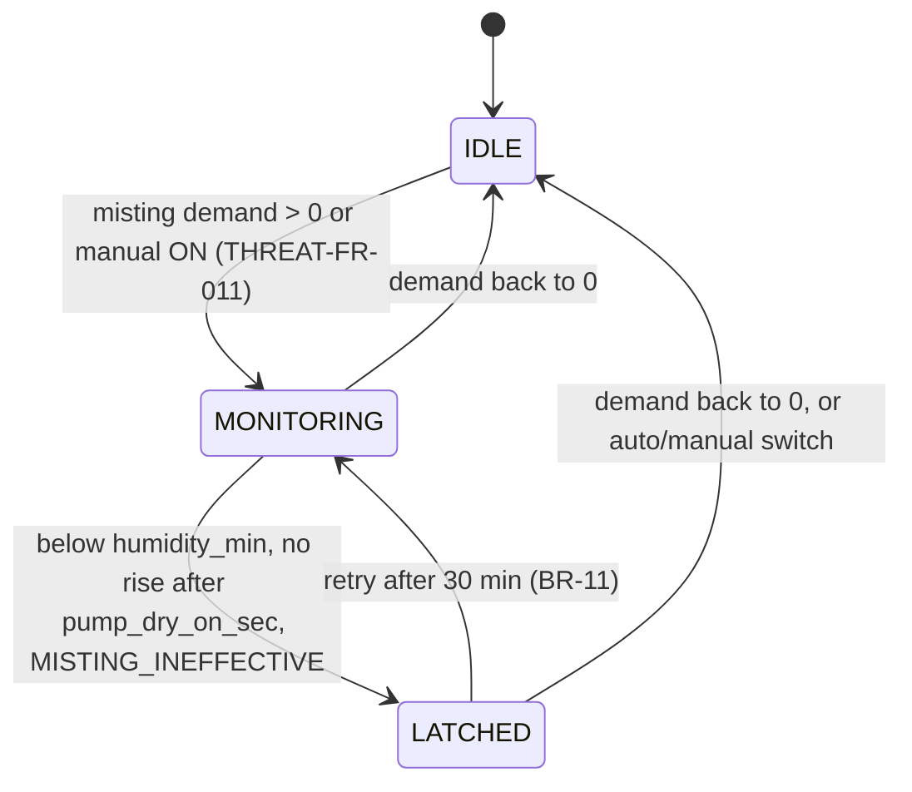

### 8.8 Noise baseline per hour (SM-08, controller)

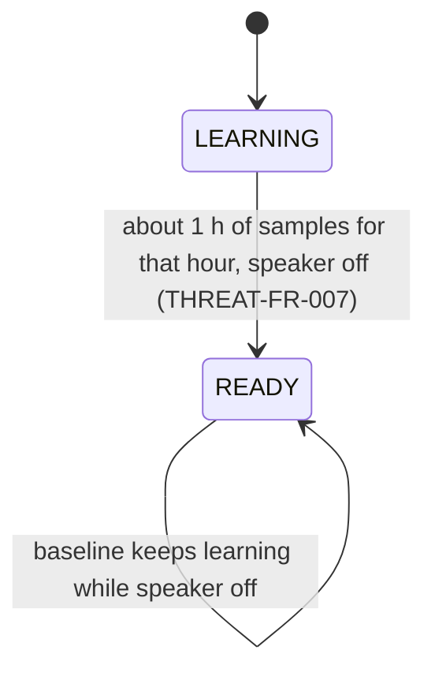

### 8.9 Health report (SM-09)

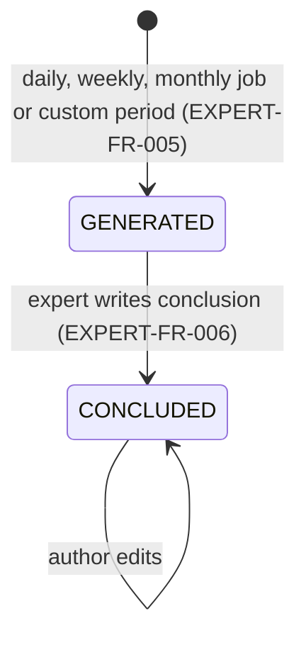

### 8.10 Review of a Farm Owner's change (SM-10)

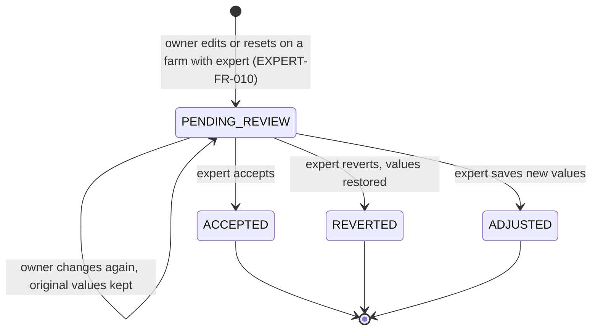

### 8.11 Coefficient suggestion proposal (SM-11)

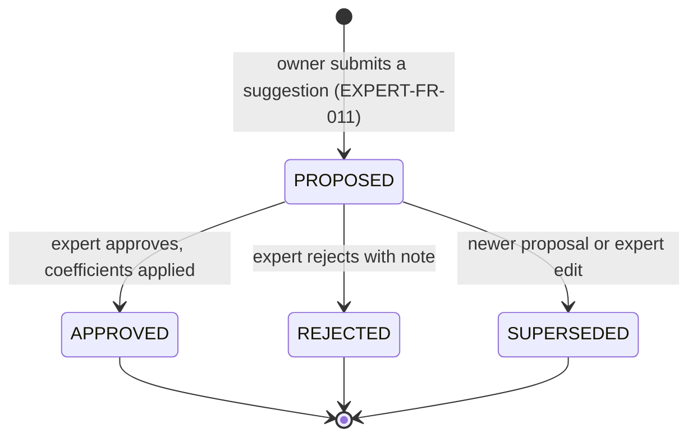

### 8.12 Configuration sync per controller (SM-12)

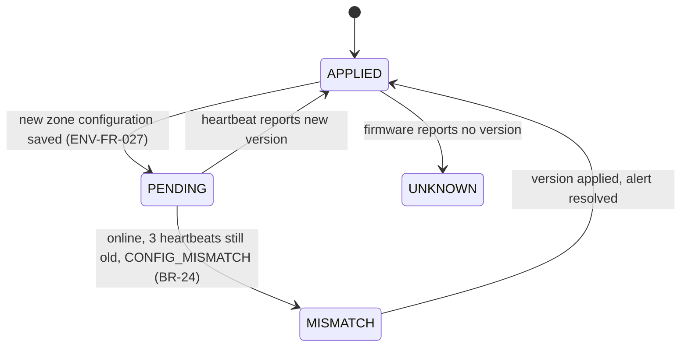

---

### 8.13 Harvest batch (SM-13)

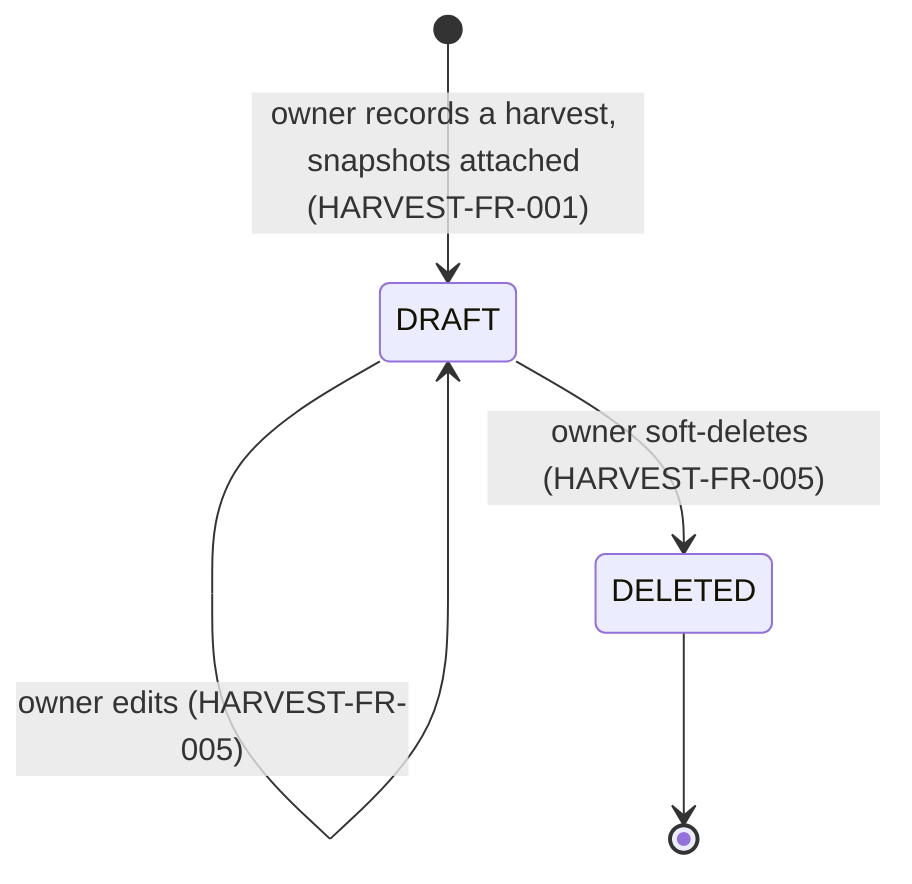

### 8.14 User account (SM-14)


### 8.15 Firmware update per controller (SM-15)

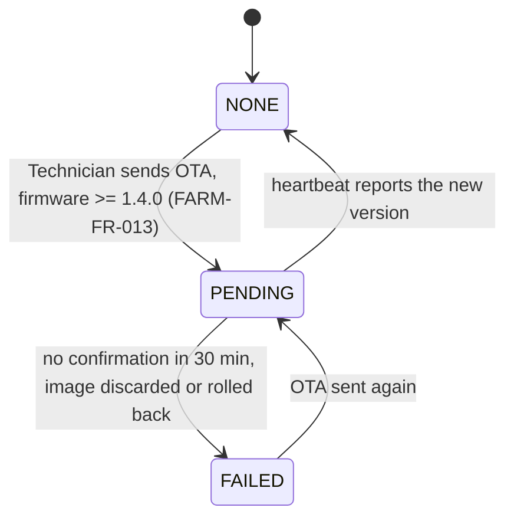

### 8.16 Device label — stock entry (SM-16)

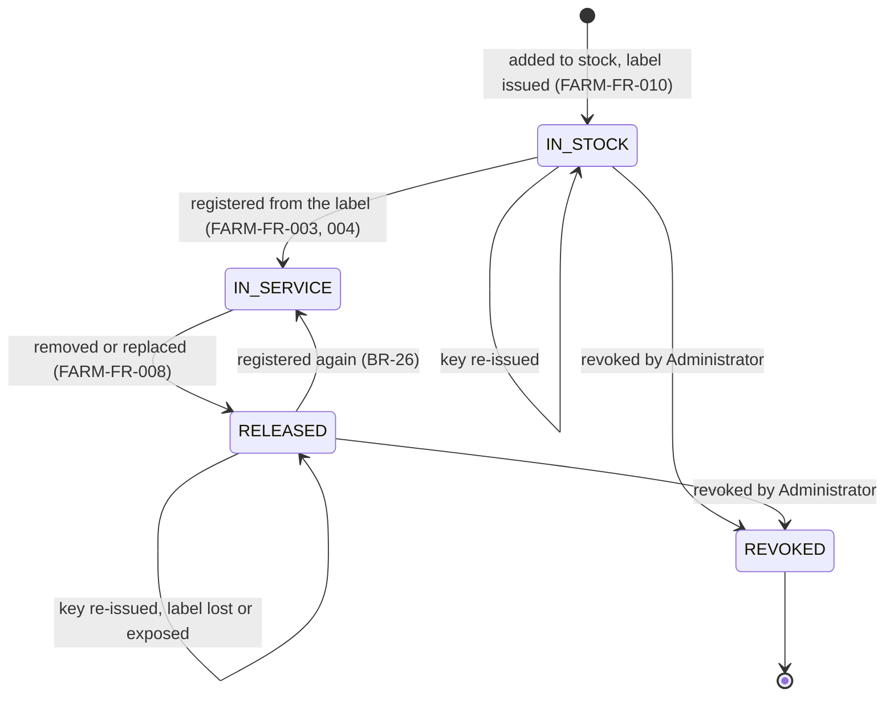

The state is derived from `provisioneddevices` (`claimed_at`, `revoked_at`) and whether a sensor or camera node with that device ID is in service; it is not a stored field.

### 8.17 Daily health status of a house and assessor rating (SM-17)

```mermaid
stateDiagram-v2
  [*] --> COMPUTED : daily assessment (ANALYTICS-FR-012)
  COMPUTED --> COMPUTED : late data or verdict, current status recomputed; snapshots kept
```

```mermaid
stateDiagram-v2
  [*] --> PENDING : day computed, one per Farm Owner and Domain Expert; status hidden (BR-31)
  PENDING --> RATED : rating + snapshot stored together, status shown (EXPERT-FR-012)
  PENDING --> SKIPPED : status shown, not in NFR-14
  PENDING --> EXPIRED : 7 days without rating
  RATED --> RATED : note added
  RATED --> [*]
  SKIPPED --> [*]
  EXPIRED --> [*]
```

The rating state is derived per assessor from `househealthdays.ratings` and the day's date (Report 3, Section 6.18); a request to rate again after `RATED`, `SKIPPED` or `EXPIRED` is rejected with 409.

## 9. Activity Diagrams

One diagram per main and supporting flow of Report 3, Section 2.2. Lanes are the actors (people and external services) and the SwiftletCare components that act for them (controller, backend, AI node); the components are parts of the system, not actors (Report 3, Section 2.3). The diagram shows who takes part and the business decisions, not the internal processing.

### 9.1 MF-01 Automatic micro-climate regulation (AD-01)

```mermaid
flowchart TB
  subgraph C[Controller]
    A1[Read 5 sensors every 1 s<br/>filter temp and humidity] --> A2{Valid temp and<br/>humidity within 2 cycles?}
    A2 -- no --> A3[Safe state: misting and fan OFF<br/>SENSOR_FAULT]
    A2 -- yes --> A4[Every 10 s: fuzzy misting and fan power]
    A4 --> A5{Relay overridden<br/>or pump latched?}
    A5 -- override --> A6[Keep manual state]
    A5 -- latched --> A7[Misting 0 %]
    A5 -- no --> A8[Apply time-proportioning]
    A6 & A7 & A8 --> A9[Publish telemetry and relay state]
  end
  subgraph B[Backend]
    B1[Store 1 sample / 10 s<br/>push to dashboard]
  end
  subgraph O[Farm Owner]
    O1[Watch live values,<br/>power levels and mode]
  end
  A9 --> B1 --> O1
```

### 9.2 MF-02 Air-quality monitoring (AD-02)

```mermaid
flowchart TB
  subgraph C[Controller]
    A1[Measure NH3 and CO2] --> A2[Publish telemetry]
  end
  subgraph B[Backend]
    B1{Above zone alert limit<br/>for the dwell time of BR-34?} -- no --> B2[Store, show trend]
    B1 -- yes --> B3[THRESHOLD_BREACH MEDIUM<br/>no fan action]
    B3 --> B4[Notify Farm Owner]
  end
  subgraph O[Farm Owner]
    O1[Acknowledge with note]
  end
  subgraph E[Domain Expert]
    E1[Assess, set or adjust<br/>NH3 / CO2 alert limits]
  end
  A2 --> B1
  B4 --> O1
  B3 --> E1
  E1 --> B5[Store limits with history,<br/>send to controllers]
```

### 9.3 MF-03 Offline operation and recovery (AD-03)

```mermaid
flowchart TB
  subgraph C[Controller]
    A1{Broker reachable?} -- yes --> A2[Publish normally]
    A1 -- no --> A3[Keep controlling with stored config<br/>buffer 1 sample / 10 s in flash]
    A3 --> A1
    A4[Firmware hang or power loss] --> A5[Watchdog / power-on restart]
    A5 --> A6[Resume control, queue<br/>UNEXPECTED_RESTART with reset reason]
    A2 --> A7[Upload buffered samples<br/>and queued alerts, QoS 1]
  end
  subgraph B[Backend]
    B1{Heartbeat for 30 s?} -- no --> B2[OFFLINE + NODE_OFFLINE]
    B3[Heartbeat back] --> B4[ONLINE, resolve alert;<br/>retained configuration delivered]
  end
  subgraph O[Farm Owner]
    O1[Receive offline / restart alerts]
  end
  B2 --> O1
  A6 --> O1
  A7 --> B3
```

### 9.4 MF-04 Equipment fault handling (AD-04)

```mermaid
flowchart TB
  subgraph C[Controller]
    A1{Which fault?}
    A1 -- pump on, humidity not rising --> A2[Stop automatic misting for the episode<br/>MISTING_INEFFECTIVE, retry after 30 min]
    A1 -- sensor timeout / CRC --> A3[Mark stale, safe state<br/>SENSOR_FAULT or RS485_BUS_FAILURE]
    A1 -- speaker on, level low --> A4[SPEAKER_FAILURE]
  end
  subgraph B[Backend]
    B0[Every 10 min: stuck, jump, drift] --> B1[SENSOR_ANOMALY]
    B5[Pump or fan past its service limit] --> B6[MAINTENANCE_DUE]
    B2[One open alert per incident<br/>notify the Farm Owners]
    B3{Still ACTIVE after 15 min<br/>CRITICAL/HIGH, 1 h NODE_OFFLINE?} -- yes --> B4[Send once more]
  end
  subgraph O[Farm Owner]
    O1[Acknowledge, act on site]
  end
  subgraph T[Technician]
    T1[Sees device alerts of every farm:<br/>diagnose, restart, OTA - SF-02]
  end
  A2 & A3 & A4 --> B2
  B1 --> B2
  B6 --> B2
  B2 --> O1
  B2 --> B3
  B4 --> O1
  B2 -.-> T1
```

### 9.5 MF-05 Early warning by forecast (AD-05)

```mermaid
flowchart TB
  subgraph B[Backend]
    B1[Every 10 min: forecast next 60 min] --> B2{Enough data?}
    B2 -- no --> B3[Skip zone]
    B2 -- yes --> B4{In range now,<br/>forecast crosses?}
    B4 -- no --> B5[Resolve open FORECAST_BREACH]
    B4 -- yes --> B6[FORECAST_BREACH LOW<br/>expected minutes, MAE]
  end
  subgraph O[Farm Owner]
    O1[Prepare: check pump, water, fan]
  end
  subgraph E[Domain Expert]
    E1[Confirm or reject the warning]
  end
  B6 --> O1
  B6 --> E1
```

### 9.6 MF-06 Bird counting session (AD-06)

```mermaid
flowchart TB
  subgraph AI[AI node]
    A1[Read RTSP stream] --> A2[Detect on 2 tiles,<br/>track over the whole frame]
    A2 --> A3[Count ring crossings,<br/>extrapolate fast tracks<br/>EXIT / ENTRY]
    A3 --> A4[Publish session counts every 30 s<br/>and 5-minute buckets]
    A2 --> A5[Draw boxes and ring,<br/>publish annotated stream]
  end
  subgraph B[Backend]
    B1[Store per house and session] --> B2[After evening window:<br/>compute return rate]
    B2 --> B3{Session complete and<br/>≥ 3 baseline days?}
    B3 -- no --> B4[No evaluation]
    B3 -- yes --> B5{Drop above limit?}
    B5 -- yes --> B6[LOW_RETURN_RATE for the house]
    B5 -- no --> B7[Resolve earlier alert]
  end
  subgraph O[Farm Owner]
    O1[Watch live count and stream,<br/>trends]
  end
  subgraph E[Domain Expert]
    E1[Draw counting ring,<br/>set seasonal windows]
    E2[Confirm or reject alert]
  end
  A4 --> B1
  A5 --> O1
  B1 --> O1
  B6 --> E2
  E1 --> A1
```

### 9.7 MF-07 Abnormal noise (AD-07)

```mermaid
flowchart TB
  subgraph C[Controller]
    A1[Learn hourly noise baseline<br/>while speaker off] --> A2{Speaker off, hour READY,<br/>clock synced?}
    A2 -- no --> A3[Do not evaluate]
    A2 -- yes --> A4{Above baseline by margin<br/>for min seconds?}
    A4 -- yes --> A5[NOISE_ANOMALY MEDIUM]
  end
  subgraph B[Backend]
    B1[Attach evidence: environment,<br/>noise, 5-minute bird counts ±30 min] --> B2[Queue for expert,<br/>notify in app]
  end
  subgraph E[Domain Expert]
    E1{Real event?} -- yes --> E2[CONFIRMED]
    E1 -- no --> E3[REJECTED with note:<br/>alert DISMISSED]
    E3 --> E4[Tune noise parameters if needed]
  end
  subgraph O[Farm Owner]
    O1[Informed of verdict]
  end
  A5 --> B1
  B2 --> E1
  E2 & E3 --> O1
```

### 9.8 MF-08 Expert validation and tuning (AD-08)

```mermaid
flowchart TB
  subgraph B[Backend]
    B1[Daily, weekly, monthly<br/>house health reports] --> B2[Notify owner and expert]
    B3[Coefficient suggestion from data]
  end
  subgraph O[Farm Owner]
    O1[Edit thresholds / coefficients<br/>applied at once] --> O2[Review item for expert]
    O3[Submit suggestion to expert]
    O4[Read conclusion and decisions]
  end
  subgraph E[Domain Expert]
    E1[Review report, write conclusion]
    E2{Owner change OK?} -- yes --> E3[Accept]
    E2 -- no --> E4[Revert or adjust]
    E5{Approve suggestion?} -- yes --> E6[Apply coefficients]
    E5 -- no --> E7[Reject with note]
  end
  subgraph C[Controller]
    C1[Receive new configuration,<br/>report applied version]
  end
  B2 --> E1 --> O4
  O2 --> E2
  B3 --> O3 --> E5
  E4 & E6 & O1 --> C1
  E3 & E4 & E6 & E7 --> O4
```

### 9.9 MF-09 Manual override (AD-09)

```mermaid
flowchart TB
  subgraph O[Farm Owner]
    O1[Switch a relay for a duration<br/>harvest, cleaning, maintenance]
  end
  subgraph B[Backend]
    B1{Role allowed, duration within BR-08,<br/>pump ON confirmed if an alert is open?} -- no --> B2[Reject 403 / 422 / 409]
    B1 -- yes --> B3[Log override, send command<br/>with commandId]
    B4[Expiry job] --> B5[Clear override, log end]
  end
  subgraph C[Controller]
    C1[Apply relay if fresh, report MANUAL] --> C2[On this relay's expiry: back to AUTO]
  end
  subgraph H[House - outside the system]
    H1[Controller failed:<br/>relays release, loads stop] --> H2[Farmer runs loads with<br/>the house's own switches]
  end
  O1 --> B1
  B3 --> C1
  B5 --> C2
  C1 -. controller fails .-> H1
```

### 9.10 MF-10 Device setup by the Farm Owner (AD-10)

```mermaid
flowchart TB
  subgraph A[Administrator - before delivery]
    A1[Add device to stock] --> A2[Print label:<br/>QR with device ID + key]
  end
  subgraph O[Farm Owner - mobile app]
    O1[Scan device label] --> O2[Scan floor code<br/>or pick zone]
    O3[Join the device's setup Wi-Fi,<br/>enter farm Wi-Fi]
    O4[See online,<br/>configuration applied]
  end
  subgraph B[Backend]
    B1{Key valid, device not<br/>in service, zone accessible?} -- no --> B2[Reject 400 / 409 / 403]
    B1 -- yes --> B3[Register PENDING, audit]
    B9[Still PENDING after 15 min:<br/>notify registrant]
    B4[First heartbeat on the<br/>device's own topics] --> B6[ONLINE, publish zone<br/>configuration retained]
    B7{Reported version =<br/>zone version?} -- yes --> B8[Configuration applied]
    B7 -- no, 3 heartbeats --> B10[CONFIG_MISMATCH]
  end
  subgraph C[Controller]
    C1[Power on, no Wi-Fi:<br/>AP mode] --> C2[Join farm Wi-Fi,<br/>first heartbeat]
    C4[Apply configuration,<br/>report version]
  end
  A2 --> O1
  O2 --> B1
  B3 --> O3
  B3 -.-> B9
  C1 --> O3 --> C2 --> B4
  B6 --> C4 --> B7
  B8 --> O4
```

Moving a controller to another floor: scan the new floor's code; the backend changes the zone in the database and republishes the new zone's configuration, which an online controller applies at once and an offline one at its next connection. A Technician may follow the same steps on any farm; the Farm Owners are notified of each registration or move (FARM-FR-009).

### 9.11 SF-02 Remote device maintenance (AD-11)

```mermaid
flowchart TB
  subgraph T[Technician - console]
    T0[Device alert, or new firmware] --> T1[Open device: firmware, uptime,<br/>RSSI, memory, reset reason]
    T1 --> T2{Remote fix?}
    T2 -- yes --> T3[Restart, push configuration or OTA]
    T2 -- no --> T4[Replace or set up again on site<br/>steps of MF-10]
  end
  subgraph B[Backend]
    B1{Role Technician,<br/>device online?} -- no --> B2[Reject 403 / 409]
    B1 -- yes --> B3[Send command with deviceId, audit]
    B3 --> B4[Notify the Farm Owners in the app]
    B5{OTA confirmed by heartbeat<br/>within 30 min?} -- no --> B6[FAILED]
  end
  subgraph C[Controller]
    C1[Restart, apply configuration,<br/>or verify and install image]
    C1 --> C2{New firmware reaches<br/>broker in 10 min?} -- no --> C3[Roll back]
  end
  subgraph O[Farm Owner]
    O1[Sees what the Technician did]
  end
  T3 --> B1
  B3 --> C1
  C2 -- yes --> B5
  B4 --> O1
```

### 9.12 SF-03 Account and access management (AD-12)

```mermaid
flowchart TB
  subgraph A0[Administrator]
    A0a[Create the Farm Owner's account<br/>temporary password]
  end
  subgraph U[Farm Owner]
    U1[First sign-in, change password] --> U2[Create farm]
    U2 --> U3[Invite co-owner or Domain Expert]
  end
  subgraph B[Backend]
    B1[Invitation PENDING, 7 days] --> B2{Accepted in time?}
    B2 -- yes --> B3[Add member with role]
    B2 -- no --> B4[EXPIRED]
  end
  subgraph E[Invitee]
    E1[Accept or decline;<br/>no account: create it from the link]
  end
  subgraph A[Administrator]
    A1[Create Technicians, lock accounts,<br/>handle deletion requests]
  end
  A0a --> U1
  U3 --> B1 --> E1 --> B2
```

---

### 9.13 SF-04 Harvest logging (AD-13)

```mermaid
flowchart TB
  subgraph O[Farm Owner]
    O1[Record harvest: date, zone,<br/>nest count, weight, type, photo] --> O2[View harvests against<br/>environment and flock]
  end
  subgraph B[Backend]
    B1{Valid and zone of<br/>own farm?} -- no --> B2[Reject]
    B1 -- yes --> B3[Attach 7-day environment means<br/>and 30-day flock figures of the house]
    B3 --> B4[Store batch DRAFT<br/>with trace code]
  end
  subgraph E[Domain Expert]
    E1[Read harvests in health review]
  end
  O1 --> B1
  B4 --> O2
  B4 --> E1
```

### 9.14 MF-11 Daily health assessment and periodic reports (AD-14)

```mermaid
flowchart TB
  subgraph W[Weather service]
    W1[Hourly temperature,<br/>humidity, rainfall]
  end
  subgraph B[Backend]
    B1[Evening return-rate check done] --> B2{Environment and flock<br/>complete? BR-28}
    B2 -- no --> B3[INSUFFICIENT_DATA]
    B2 -- yes --> B4[Indicators vs house levels;<br/>optional source incomplete: not assessed;<br/>dismissed noise not counted]
    B4 --> B5{Flock CLEAR and environment,<br/>air or noise deviates? BR-29}
    B5 -- yes --> B6{Deciding sources exactly flock + noise,<br/>rain over a session and a noise episode? BR-30}
    B6 -- no --> B7[ACTION]
    B6 -- yes --> B8[WATCH]
    B5 -- no --> B9{Any CLEAR or two SLIGHT?}
    B9 -- yes --> B8
    B9 -- no --> B10[GOOD]
    B11[Store current status with reasons,<br/>daily report, notify]
    B12[Weekly / monthly reports]
    B13[Late data or verdict:<br/>recompute current status only]
  end
  subgraph A[Farm Owner / Domain Expert]
    A1[Open the day: give own status first] --> A2[See status and reasons;<br/>snapshot stored with the rating]
    A3[Read reports, download PDF / CSV,<br/>expert writes conclusion]
  end
  W1 --> B6
  B3 --> B11
  B7 --> B11
  B8 --> B11
  B10 --> B11
  B11 --> A1
  B11 --> B12 --> A3
  B13 --> B11
```

## 10. Security Design

| Concern | Design |
| --- | --- |
| Authentication | JWT access token (15 min) in the response body; refresh token (30 days) in an httpOnly, `sameSite=strict` cookie and stored hashed per user so each one can be revoked; password reset revokes all |
| Authorisation | No public sign-up: accounts are created by the Administrator or from an invitation link; `requireRole` on every route following Report 3, Section 2.4; farm membership checked in services (`farmAccess.util`); a Technician reaches every farm's devices and their device alerts (FARM-FR-009) but never its environmental data, relays, thresholds, or its environmental and inferred alerts, and every device action is audited and notified to the Farm Owners |
| Passwords and codes | bcrypt; one-time codes hashed and never returned by the API |
| Rate limiting | 300 requests/min per account; 10 failed sign-ins / 15 min per IP; 30 refreshes/min per IP |
| Devices | Activation key from the provisioned stock, printed on the device label and checked only by the backend (stored hashed, compared in constant time, one message for an unknown ID and a wrong key); never stored on the controller; a device in service is never registered again (BR-26); labels and floor codes carry no Wi-Fi or broker credential. Each device has its own broker secret, flashed with its device ID and stored hashed in the stock; EMQX checks it through `/internal/mqtt-auth` and refuses it once the entry is revoked |
| Broker | MQTT over TLS only (8883), the controller and the AI node verifying the server with the CA certificate of its issuer; a device reaches only `swiftletcare/dev/${username}/#` (NFR-10 d); commands carry a command ID and issue time and are applied once and only while fresh (BR-35); device alerts carry an event ID; OTA only over HTTPS with the CA certificate, SHA-256 verification and rollback |
| Health and reports | Ratings and downloads limited to the Farm Owners and Domain Expert of the farm; the status of a day is hidden server-side from an assessor who has not rated or skipped it (BR-31); exported files carry names and figures, never internal identifiers; the weather service receives only the farm's coordinates |
| Camera | The RTSP port of the camera is forwarded on the house modem (VNPT static-IP plan) with a source-IP rule: only the AI node's static public IP reaches it, every other source is dropped by the modem (NFR-10 e); strong camera password, kept only in the AI node's `.env`; the rule is re-checked from a 4G connection after any change of the modem or of the AI node's line. RTSP is not encrypted between the two lines; this residual risk is accepted for the prototype, and RTSPS (if the camera supports it) or a VPN between the two modems replaces it when available (Report 3, Section 8.1) |
| Video | Viewing tokens valid 60 s for one camera path, signed with a separate secret, for WebRTC and HLS alike; the raw feed is readable only by the pipeline |
| Secrets | Environment variables only (`.env.example` documents them); gitleaks scan in CI |
| Personal data | Account deletion with anonymisation (AUTH-FR-012, Decree 13/2023/ND-CP); audit log of sensitive changes with source IP, client and correlation ID; push tokens and Telegram chat IDs never written to logs |

---

## 11. Deployment and Operations

```mermaid
flowchart LR
  subgraph VPS[Staging VPS - Docker]
    RP[Caddy reverse proxy<br/>Let's Encrypt TLS, 443] --> API[backend container]
    RP --> WEBS[web static build]
    RP --> MTX[MediaMTX<br/>WebRTC signalling]
    API --> MONGO[(MongoDB<br/>internal only)]
    API -- MQTT 1883<br/>Docker network --> EMQX[(EMQX)]
    TLSP[TLS proxy<br/>8883 MQTT, 8322 RTSPS] --> EMQX
    TLSP --> MTX
    API --> MINIO[(MinIO<br/>internal only)]
    MTX -- stream auth --> API
  end
  subgraph HOUSE[Test house - VNPT line, static public IP]
    ESP[ESP32 controllers]
    CAM[IP camera<br/>RTSP, port 18554 forwarded,<br/>AI node's IP only]
  end
  subgraph HOME[Member's home]
    PC[AI node:<br/>spare desktop PC]
  end
  CAM -- RTSP over TCP<br/>across the Internet --> PC
  ESP -- MQTT over TLS 8883 --> TLSP
  PC -- counts, heartbeat<br/>MQTT TLS 8883 --> TLSP
  PC -- annotated video<br/>RTSPS 8322 --> TLSP
  USERS[Web and mobile users] -- HTTPS / WSS 443 --> RP
  USERS -- WebRTC media UDP 8189 --> MTX
  API -- outbound HTTPS --> EXT[[Telegram, FCM,<br/>Open-Meteo]]
```

Why this split: users, the panel's network and the controllers need one stable public address with TLS that does not go down with the house's power or line (the house's VNPT line has a static public IP, but on a consumer modem in a borrowed house), so the backend runs on a VPS. The AI node runs on a spare PC at a member's home and pulls the camera's RTSP feed over the Internet through the one port forwarded on the house modem (D5); it sends counts and the annotated stream on to the VPS. Only ports 80/443 (Caddy), 8883 (MQTT over TLS) and 8322 (RTSPS publish, AI node only) — both wrapped by a TLS proxy that reuses Caddy's certificate — and 8189 (WebRTC media, encrypted by WebRTC itself) are open on the VPS; MongoDB, MinIO, the EMQX dashboard and `/internal/*` are reachable only inside the Docker network or over SSH.

| Operation | Procedure |
| --- | --- |
| Deploy | On the VPS: check out the tag, `docker compose -f docker-compose.staging.yml up -d --build`, run pending `npm run migrate:*` scripts (all idempotent), load demo data with the seed script on a fresh database; smoke check `GET /health`, sign-in, one telemetry message |
| Rollback | Re-deploy the previous tag; restore the MongoDB dump taken before the deployment |
| Backup | `mongodump` before each deployment and once a day by cron, 7 dumps kept, copied off the VPS `[TEAM: where]` |
| AI node | `stream.py` runs as a service on the spare PC at a member's home that starts at boot and restarts on failure, reconnecting to the camera with back-off; the PC's BIOS is set to power on after a power cut; the camera URL and password live only in the node's `.env`; the counting ring and model file are versioned with the tag |
| Firmware | OTA from the Technician console; the new image is kept only after it reaches the broker within 10 minutes, otherwise the bootloader returns to the previous one |
| Monitoring | Technical overview (SYSTEM-FR-003), device and AI-node status and alerts (`NODE_OFFLINE`, `EDGE_AI_DEGRADED`), audit log, `docker compose logs` |

The staging files are `deploy/docker-compose.staging.yml`, the Dockerfiles of the backend and the web, the Caddyfile, the TLS proxy configuration, the EMQX authentication and authorisation files, `.env.staging.example` and the demo seed of every scenario of the Design Brief, Appendix A2 (procedure: `docs/deploy/staging.md`).

---

## 12. Revision History

| Version | Date | Change |
| --- | --- | --- |
| 1.1.0 | 26/10/2026 | SM-17 splits the day status from the rating state of each assessor (`ratingWindow` job and the day's `state` field removed). Harvest requirements referred to as `HARVEST-FR` (Report 3 3.1.0). Camera port restricted to the AI node's static IP by a modem rule (D5, Sections 10, 11). Final design for Review 2 against Report 3 3.1.0: device topics and one broker credential per device with a static authorisation rule, QoS 1 with event and command IDs, retained configuration, `esp-mqtt` on the ESP32, `config/reassign` removed (D3, D9, Sections 2.2, 5.1, 7.2, 10, AD-10); decisions D15 (manual override within limits) and D16 (current status and evaluation snapshot); Logical ERD as the final design: user status, push tokens, per-relay override, telemetry validity, alert event ID and details, house health reports with a unique key per kind and period, notification references, harvest type and photo, audit source, stock credentials, `sla_hours` removed; Section 6.3 data retention (BR-36), Section 6.4 schema migrations, Section 5.5 code location of the engineering constants; mobile scope, HLS stream and FCM token in Section 5.4; state machines and activity diagrams aligned (SM-03, 06, 14, 17; AD-02, 03, 04, 08, 09, 10, 11, 12, 14); 'planned' marks and the former Section 12 removed: implementation gaps are tracked only in Project Tracking |
| 1.0.10 | `[TEAM]` | Tickets, SLA, Technician regions and the Administrator's farm management removed from the code (pull requests #100–#106): permission and supporting-role gaps closed in Section 12, done ticket, region, coordinate and `MAINTENANCE_DUE` rows dropped from Section 6.4 |
| 1.0.9 | `[TEAM]` | A farm is one place with required coordinates (Report 3 FARM-FR-001, A-5): `address` and `coordinates` in the ERD, planned validator in Section 6.4, location field in the farm form (Section 5.4) |
| 1.0.8 | `[TEAM]` | Maintenance tickets, SLA and Technician regions removed (Report 3 §8, BM03 row 9): decision D14, ERD and collections, jobs, REST and WebSocket, SM-05 removed, AD-04 with repeated alerts and `MAINTENANCE_DUE`, AD-11 rewritten as remote device maintenance, security and gaps |
| 1.0.7 | `[TEAM]` | AI node moved to the team's spare PC at a member's home, reading the camera over the Internet through the house's static IP (D5, Sections 2.1, 3.4, 10, 11, 12) |
| 1.0.6 | `[TEAM]` | Staging declared: one VPS with Caddy TLS for backend, web, broker and video server, the team's spare PC at the house as AI node (D5, Sections 3.4 and 11); hardware cost no longer tracked (NFR-12 removed in Report 3); Domain Expert web screens (PR #91), the Farm Owner rework with the WHEP live stream (PR #93) and the live pipeline with MQTT publishing, video push and its pytest CI job (PR #95) noted in Sections 3.3, 5.2, 5.4 and 12; activity-diagram lanes named as actors or system components (Section 9) |
| 1.0.5 | `[TEAM]` | Bypass switch removed (borrowed test house cannot be rewired): architecture, controller board and AD-09 updated; the house's own switches are shown outside the system |
| 1.0.4 | `[TEAM]` | Daily health assessment and periodic reports (MF-11): data flows DF-10, DF-11, decisions D10 (agreement rules), D11 (current transformers), D12 (weather API), D13 (report files), planned entities `HOUSE_HEALTH_DAY` and `WEATHER_OBSERVATION`, SM-17, AD-14; Open-Meteo and the team's controller board declared |
| 1.0.3 | `[TEAM]` | Device setup by the Farm Owner (MF-10): data flow DF-9, decision D9 (label and floor QR codes), QR libraries declared, state machine SM-16 for the device label, activity diagram AD-10 rewritten for MF-10, security of the activation key, setup gaps |
| 1.0.2 | `[TEAM]` | Checked against the Review 2 guideline and the self-review prompt: firmware task responsibilities corrected from `main.cpp`; NTP added and Redis explained in the architecture; CD declared; planned entities and attributes in the ERD (6.4); state machines for harvest, user account and firmware update (SM-13…15); activity diagram for harvest logging (AD-13) |
| 1.0.1 | `[TEAM]` | AI pipeline after PR #88: whole-frame tracking on two tiles, extrapolation at the hole, `FramePipeline` shared with the clip tool, Roboflow and Colab declared, library versions updated |
| 1.0.0 | `[TEAM]` | First SDD for Review 2: architecture, technology declaration, design decisions, component design, Logical ERD with a generated database script, interfaces, 12 state machine diagrams and 12 activity diagrams |
